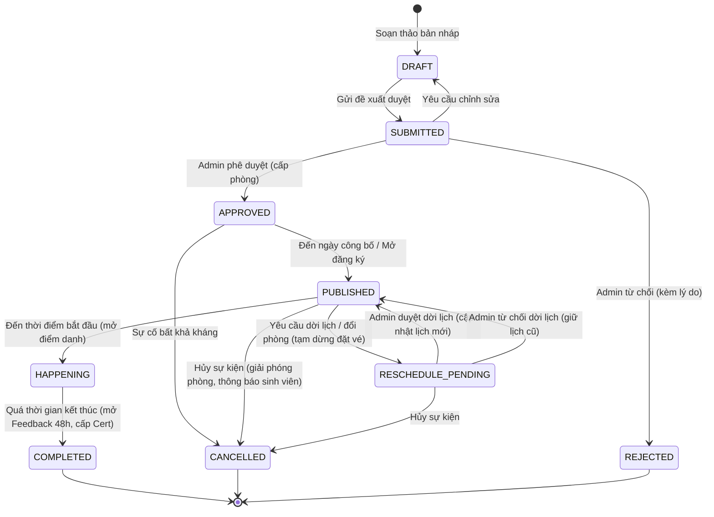

# TÀI LIỆU ĐẶC TẢ YÊU CẦU HỆ THỐNG (SYSTEM REQUIREMENTS SPECIFICATION - SRS)
## Dự án: Hệ Thống Quản Lý Sự Kiện Nội Bộ Trường Đại Học (Campus Event Hub)
**Đồ án Môn học:** Phát triển Ứng dụng Web (IS207.R11) – Khoa Hệ thống Thông tin, Trường ĐH Công nghệ Thông tin (UIT)  
**Mã tài liệu:** `SRS-IS207-CEH-v2.3` | **Phiên bản:** `2.3.0` | **Ngày lập:** `01/10/2026`  
**Chủ trì phân tích (Lead BA):** Bùi Phan Thành Trí (Project Manager) | **Giảng viên hướng dẫn:** ThS. Tạ Việt Phương

---

## THÔNG TIN TÀI LIỆU (DOCUMENT CONTROL)

| Mục | Nội dung |
|---|---|
| **Tên tài liệu** | Bản Đặc tả Yêu cầu Hệ thống (System Requirements Specification - SRS) |
| **Tên dự án chuẩn** | Campus Event Hub - Nền tảng Đăng ký, Quản lý Sự kiện Sinh viên & Điểm danh Thông minh |
| **Mã tài liệu** | `SRS-IS207-CEH-v2.3` |
| **Phiên bản** | `2.3.0` (Bản Hiệu chỉnh Hoàn thiện Kiến trúc, Tối ưu Concurrency & State Machine) |
| **Trạng thái** | Dự thảo Kiểm duyệt Kỹ thuật (Technical Review Draft) |
| **Ngày lập** | 01/10/2026 |
| **Đơn vị thực hiện** | Nhóm DAS (Lớp IS207.R11) |
| **Chủ trì phân tích (Lead BA)** | Bùi Phan Thành Trí (Project Manager) |
| **Giảng viên hướng dẫn** | ThS. Tạ Việt Phương |

## LỊCH SỬ THAY ĐỔI TÀI LIỆU (DOCUMENT REVISION HISTORY)

| Phiên bản | Ngày | Người thực hiện | Nội dung thay đổi chính |
|---|---|---|---|
| **1.0.0** | 10/09/2026 | Nhóm DAS | Khởi tạo tài liệu đặc tả ban đầu cho giai đoạn Mini Project (MVP). |
| **2.0.0** | 12/09/2026 | Bùi Phan Thành Trí | Mở rộng quy mô lên Main Project: thêm vai trò Admin, quy trình duyệt, phòng ốc, Waitlist, điểm danh 2 chiều và AI Agents. |
| **2.1.0** | 18/09/2026 | Bùi Phan Thành Trí | Cập nhật cấu trúc Use Case chi tiết và bổ sung các kịch bản ngoại lệ. |
| **2.2.0** | 18/09/2026 | Bùi Phan Thành Trí | Chuẩn hóa 34 Use Cases, bỏ GPS, claim window 60p cố định, phân bậc 60% ĐRL. |
| **2.3.0** | 01/10/2026 | Bùi Phan Thành Trí | Khắc phục toàn diện theo phản biện độc lập vòng 3: 1. Chuẩn hóa thứ tự khóa dòng duy nhất: `su_kien` ➔ `dang_ky` ➔ `hang_doi_waitlist` triệt tiêu nguy cơ Deadlock. 2. Khép kín quy tắc "Dưới 2 giờ": Thêm tác vụ nền đóng Waitlist tại T-2h chuyển trạng thái `CLOSED_WAITLIST`, tránh treo sinh viên. 3. Bổ sung trạng thái `RESCHEDULE_PENDING` vào State Machine; quy định rõ tạm dừng đặt vé và giữ nguyên vé cũ khi dời lịch/đổi phòng. 4. Sửa thuật toán kiểm tra xung đột phòng UC-ROOM-02: Bổ sung điều kiện `ma_su_kien != :current_event_id` loại trừ va chạm chính mình khi Admin duyệt. 5. Chuẩn hóa logic ĐRL: Định nghĩa rõ `thoi_luong_su_kien` (phút); UC-FEED-01 chỉ bật `du_dieu_kien_drl = 1` khi `ti_le_drl > 0.0`. 6. Sửa câu SQL UC-DISC-01: Tách lọc phòng `ma_phong`, lọc chuyên đề, hỗ trợ từ khóa ngắn như "AI". 7. Đồng bộ mã NFR trong RTM, thống nhất tên cột CSDL (`thoi_gian_bat_dau`, `thoi_gian_ket_thuc`, `ma_phong`, `ngay_cong_bo`, `nguoi_thuc_hien`). |

## BẢNG CHÚ GIẢI THUẬT NGỮ (GLOSSARY)

| Thuật ngữ / Viết tắt | Tên đầy đủ tiếng Anh | Định nghĩa nghiệp vụ trong hệ thống |
|---|---|---|
| **RBAC** | Role-Based Access Control | Cơ chế kiểm soát truy cập dựa trên vai trò người dùng được xác thực ở tầng máy chủ (Server-side). |
| **Event-scoped Role** | Event-scoped Authorization | Quyền hạn chỉ có hiệu lực trong phạm vi một sự kiện cụ thể (ví dụ: Sinh viên được gán làm Staff soát vé cho sự kiện X). |
| **HMAC** | Hash-based Message Authentication Code | Cơ chế xác thực thông điệp dựa trên hàm băm mật mã (SHA-256) kết hợp với Khóa bí mật độc lập (Secret Key) để chống làm giả vé cá nhân. |
| **TOTP** | Time-based One-Time Password | Thuật toán sinh mã dùng một lần theo thời gian (RFC 6238), tự động xoay vòng mã Dynamic QR trên màn chiếu mỗi 30 giây. |
| **FIFO** | First In, First Out | Nguyên tắc xếp hàng "Vào trước - Ra trước" áp dụng cho Hàng đợi Danh sách Chờ (Waitlist). |
| **Claim Window** | Time-bounded Reservation Window | Khung thời gian giữ chỗ có thời hạn (cố định 60 phút) cấp cho sinh viên trong Waitlist để xác nhận nhận vé trước khi slot bị chuyển tiếp. |
| **ĐRL** | Điểm Rèn Luyện | Điểm đánh giá kết quả rèn luyện của sinh viên theo Quy chế của Bộ GD&ĐT và Trường ĐH Công nghệ Thông tin (UIT). |
| **CTSV** | Phòng Công tác Sinh viên | Đơn vị chức năng tại trường đại học quản lý chế độ chính sách, phong trào và công nhận Điểm Rèn Luyện. |
| **Wake Lock API** | Screen Wake Lock API | Giao diện lập trình web cho phép ứng dụng giữ màn hình thiết bị luôn sáng khi sinh viên đang xếp hàng soát vé. |
| **Sanctum** | Laravel Sanctum | Hệ thống xác thực phiên làm việc an toàn cho ứng dụng Single Page Application (SPA) dựa trên Cookie/Session và CSRF Token. |

## MỤC LỤC TÀI LIỆU

- [PHẦN 1: TỔNG QUAN HỆ THỐNG (SYSTEM OVERVIEW)](#phần-1-tổng-quan-hệ-thống-system-overview)
  - [1.1. Mục đích tài liệu](#11-mục-đích-tài-liệu)
  - [1.2. Phạm vi hệ thống (System Scope)](#12-phạm-vi-hệ-thống-system-scope)
  - [1.3. Các tác nhân hệ thống (Actors)](#13-các-tác-nhân-hệ-thống-actors)
  - [1.4. Ma trận Phân quyền Truy cập theo Vai trò (RBAC Matrix)](#14-ma-trận-phân-quyền-truy-cập-theo-vai-trò-rbac-matrix)
  - [1.5. Mô hình Trạng thái Vòng đời Sự kiện (Event Lifecycle State Machine)](#15-mô-hình-trạng-thái-vòng-đời-sự-kiện-event-lifecycle-state-machine)
- [PHẦN 2: CÁC YÊU CẦU PHI CHỨC NĂNG (NON-FUNCTIONAL REQUIREMENTS)](#phần-2-các-yêu-cầu-phi-chức-năng-non-functional-requirements)
- [PHẦN 3: ĐẶC TẢ CHI TIẾT 34 USE CASES HỆ THỐNG](#phần-3-đặc-tả-chi-tiết-34-use-cases-hệ-thống)
  - [PHÂN HỆ 1: Quản trị Tài khoản, Xác thực & Định danh (AUTH) (UC-AUTH-01 → 05)](#phân-hệ-1-quản-trị-tài-khoản-xác-thực--định-danh-auth)
  - [PHÂN HỆ 2: Quản trị Hệ thống, Tài nguyên & Phòng ốc (ADM & ROOM) (UC-ADM-01, UC-ROOM-01 → 02)](#phân-hệ-2-quản-trị-hệ-thống-tài-nguyên--phòng-ốc-adm--room)
  - [PHÂN HỆ 3: Vòng đời & Kiểm duyệt Sự kiện (EVT) (UC-EVT-01 → 04)](#phân-hệ-3-vòng-đời--kiểm-duyệt-sự-kiện-evt)
  - [PHÂN HỆ 4: Khám phá & Tra cứu Sự kiện Công khai (DISC) (UC-DISC-01 → 02)](#phân-hệ-4-khám-phá--tra-cứu-sự-kiện-công-khai-disc)
  - [PHÂN HỆ 5: Đặt vé, Concurrency & Hàng đợi chờ (BOOK) (UC-BOOK-01 → 03)](#phân-hệ-5-đặt-vé-concurrency--hàng-đợi-chờ-book)
  - [PHÂN HỆ 6: Quản lý Vé Cá nhân & Hủy vé Hoàn slot (TCK) (UC-TCK-01 → 02)](#phân-hệ-6-quản-lý-vé-cá-nhân--hủy-vé-hoàn-slot-tck)
  - [PHÂN HỆ 7: Vận hành Sự kiện & Điểm danh Thông minh (OPS) (UC-OPS-01 → 05)](#phân-hệ-7-vận-hành-sự-kiện--điểm-danh-thông-minh-ops)
  - [PHÂN HỆ 8: Đánh giá Hậu sự kiện & Cấp Chứng nhận Điện tử (POST & CERT) (UC-FEED-01, UC-CERT-01)](#phân-hệ-8-đánh-giá-hậu-sự-kiện--cấp-chứng-nhận-điện-tử-post--cert)
  - [PHÂN HỆ 9: Thống kê, Báo cáo & Điểm Rèn Luyện (REP & DRL) (UC-REP-01 → 02, UC-DRL-01)](#phân-hệ-9-thống-kê-báo-cáo--điểm-rèn-luyện-rep--drl)
  - [PHÂN HỆ 10: Thông báo Tự động & Tác vụ Nền Hệ thống (NOTIF & SYS) (UC-NOTIF-01, UC-SYS-01)](#phân-hệ-10-thông-báo-tự-động--tác-vụ-nền-hệ-thống-notif--sys)
  - [PHÂN HỆ 11: Hệ sinh thái Trí tuệ Nhân tạo Hỗ trợ (AI AGENTS) (UC-AI-01 → 03)](#phân-hệ-11-hệ-sinh-thái-trí-tuệ-nhân-tạo-hỗ-trợ-ai-agents)
- [PHẦN 4: MA TRẬN TRUY XUẤT YÊU CẦU ĐẾN KIỂM THỬ (REQUIREMENTS TRACEABILITY MATRIX)](#phần-4-ma-trận-truy-xuất-yêu-cầu-đến-kiểm-thử-requirements-traceability-matrix)
- [PHẦN 5: KẾT LUẬN & CHUẨN BỊ CHO PHASE THIẾT KẾ DỮ LIỆU](#phần-5-kết-luận--chuẩn-bị-cho-phase-thiết-kế-dữ-liệu)

---

# PHẦN 1: TỔNG QUAN HỆ THỐNG (SYSTEM OVERVIEW)

## 1.1. Mục đích tài liệu
Tài liệu Đặc tả Yêu cầu Hệ thống (SRS) này xác lập đầy đủ, nhất quán và chi tiết toàn bộ các yêu cầu nghiệp vụ, yêu cầu chức năng, yêu cầu phi chức năng và mô hình tương tác cho hệ thống Campus Event Hub. Tài liệu là căn cứ kỹ thuật chính thức để nhóm phát triển (Developers) triển khai kiến trúc Laravel MVC, nhóm kiểm thử (QA/QC) xây dựng kịch bản kiểm chứng và Giảng viên hướng dẫn đánh giá các mốc tiến độ (Checkpoints) của môn học IS207.

## 1.2. Phạm vi hệ thống (System Scope)
Hệ thống giải quyết trọn vẹn vòng đời quản lý sự kiện trong trường đại học, bao gồm:
- **Quản trị định danh, phân quyền RBAC 4 cấp độ** và thẩm định hồ sơ Đơn vị tổ chức (CLB/Khoa).
- **Quản lý hội trường, lịch mượn phòng học** với thuật toán kiểm tra xung đột thời gian (có thời gian đệm 15 phút, loại trừ va chạm chính mình khi duyệt).
- **Vòng đời phê duyệt sự kiện đa bước** giữa Ban tổ chức và Quản trị viên (P.CTSV) có lưu vết kiểm toán (Audit Trail) và quy trình dời lịch/đổi phòng an toàn (`RESCHEDULE_PENDING`).
- **Cổng thông tin khám phá sự kiện**, bộ máy đặt vé xử lý tương tranh cao (Concurrency Locking) và Hàng đợi Danh sách Chờ (Waitlist) tự động tái phân phối slot.
- **Vận hành điểm danh 2 chiều (Check-in và Check-out)** hỗ trợ song song hai mô hình: Staff soát vé cá nhân bằng HMAC và Sinh viên tự quét mã Dynamic TOTP QR xoay vòng mỗi 30 giây trên màn chiếu hội trường.
- **Khảo sát đánh giá sau sự kiện** (Feedback trong 48 giờ), cấp Giấy chứng nhận điện tử (e-Certificate) có mã băm SHA-256 bảo vệ dữ liệu cá nhân theo Nghị định 13/2023/NĐ-CP và kết xuất danh sách Điểm Rèn Luyện chuẩn mẫu P.CTSV.
- **Bộ ba Trợ lý ảo AI Agents** chuyên trách cho Sinh viên, Ban tổ chức và Quản trị viên.

## 1.3. Các tác nhân hệ thống (Actors)
Hệ thống phân định rõ ràng giữa 4 vai trò người dùng có tài khoản đăng nhập, 2 tác nhân tương tác công khai không cần tài khoản, và 1 tác nhân hệ thống tự động:
1. **Quản trị viên (Admin - P.CTSV / Ban Giám hiệu):** Vai trò quản trị cao nhất; duyệt sự kiện, duyệt dời lịch, quản lý danh mục phòng ốc, cấp quyền Ban tổ chức cho các CLB, mở khóa điều chỉnh kiểm toán.
2. **Ban tổ chức (Organizer - Đại diện CLB / Đoàn - Hội / Khoa):** Soạn thảo đề xuất sự kiện, yêu cầu cấp phòng hoặc dời phòng, quản lý số lượng vé, mở màn hình Kiosk TOTP, phân công Staff và chốt danh sách ĐRL.
3. **Nhân viên soát vé (Staff - Event-scoped Role):** Tài khoản sinh viên được Ban tổ chức ủy quyền soát vé cho một sự kiện cụ thể; sử dụng giao diện máy quét di động `/scanner` để đối soát vé vào/ra.
4. **Sinh viên (Student):** Người dùng nội bộ trường; tìm kiếm sự kiện, đặt vé, tham gia hàng đợi Waitlist, tự quét Dynamic TOTP QR điểm danh 2 chiều, làm khảo sát và nhận chứng nhận số.
5. **Khách vãng lai (Public Guest):** Người dùng chưa đăng nhập; xem thông tin sự kiện công khai và chia sẻ liên kết qua mạng xã hội.
6. **Người xác thực công khai (Public Certificate Verifier):** Nhà tuyển dụng hoặc đơn vị thứ ba quét mã QR tra cứu tính chính thực của Giấy chứng nhận số.
7. **Hệ thống (System / Background Worker):** Tác nhân tự động thực hiện các tác vụ nền: tự động chuyển trạng thái vòng đời sự kiện (UC-SYS-01), đóng Waitlist trước 2 giờ, quét giải phóng slot quá hạn 60 phút và gửi email nhắc hẹn trước 24 giờ.

## 1.4. Ma trận Phân quyền Truy cập theo Vai trò (RBAC Matrix)

| Nhóm Chức năng / Phân hệ | Khách (Guest) | Sinh viên (Student) | Staff sự kiện (Event Staff) | Ban tổ chức (Organizer) | Quản trị viên (Admin) |
|---|---|---|---|---|---|
| **Xác thực, Đăng ký (Email OTP), Đăng nhập** | CRUD (Đăng ký) | Đọc, Cập nhật | Đọc, Cập nhật | Đọc, Cập nhật | Toàn quyền |
| **Quản trị Tài khoản, Cấp quyền CLB & Khóa user** | ❌ | ❌ | ❌ | ❌ | Toàn quyền (CRUD) |
| **Quản lý Danh mục Phòng ốc & Lịch thiết bị** | ❌ | ❌ | ❌ | Chỉ xem lịch trống | Toàn quyền (CRUD) |
| **Soạn thảo & Đề xuất Sự kiện (Draft/Submit)** | ❌ | ❌ | ❌ | Toàn quyền (Sự kiện mình) | Toàn quyền kiểm soát |
| **Thẩm định & Phê duyệt Sự kiện / Dời lịch** | ❌ | ❌ | ❌ | ❌ | Toàn quyền duyệt |
| **Khám phá, Xem chi tiết sự kiện công khai** | Chỉ đọc | Chỉ đọc | Chỉ đọc | Chỉ đọc | Chỉ đọc |
| **Đặt vé Concurrency & Tham gia Waitlist** | ❌ | Thực thi (Tạo vé) | ❌ | ❌ | ❌ |
| **Quản lý Vé của tôi & Hủy vé hoàn slot** | ❌ | Thực thi (Vé của mình) | ❌ | ❌ | Tra cứu hỗ trợ |
| **Mở cổng điểm danh Kiosk & Dynamic TOTP QR** | ❌ | ❌ | ❌ | Thực thi (Sự kiện mình) | Thực thi giám sát |
| **Soát vé Staff (Quét HMAC / Nhập thủ công)** | ❌ | ❌ | Thực thi (Được gán) | Thực thi (Sự kiện mình) | Thực thi kiểm tra |
| **Điểm danh tự phục vụ 2 chiều (Dynamic QR)** | ❌ | Thực thi (Quét mã) | ❌ | ❌ | ❌ |
| **Điều chỉnh điểm danh thủ công (Manual Override)** | ❌ | ❌ | ❌ | Cập nhật (Có Audit) | Toàn quyền mở khóa |
| **Khảo sát Feedback (Hạn 48h) & Nhận Certificate** | ❌ | Thực thi (Khi đủ đ/k) | ❌ | Xem thống kê ẩn danh | Tra cứu giám sát |
| **Tra cứu Chứng nhận công khai (Public Verification)** | Chỉ đọc (Đã che) | Chỉ đọc | Chỉ đọc | Chỉ đọc | Toàn quyền |
| **Dashboard Báo cáo & Chốt Bảng Điểm Rèn Luyện** | ❌ | ❌ | ❌ | Xem & Chốt (Của mình) | Toàn quyền Toàn trường |
| **Trợ lý Thông minh (AI Agents)** | ❌ | Student Agent | ❌ | Organizer Copilot | Admin BI Agent |

## 1.5. Mô hình Trạng thái Vòng đời Sự kiện (Event Lifecycle State Machine)
Hệ thống thiết lập chuẩn hóa 9 trạng thái (8 trạng thái vòng đời chính và trạng thái hủy `CANCELLED`) được quản lý chặt chẽ ở tầng Backend:

---

# PHẦN 2: CÁC YÊU CẦU PHI CHỨC NĂNG (NON-FUNCTIONAL REQUIREMENTS)

| Mã NFR | Tên yêu cầu phi chức năng | Tiêu chuẩn kỹ thuật định lượng & Giải pháp hiện thực hóa |
|---|---|---|
| **NFR-PERF-01** | Thời gian phản hồi Soát vé (SLA) | Thời gian xử lý từ khi camera nhận diện chuỗi QR đến khi hiển thị kết quả kiểm tra vé trên giao diện Staff phải $\le 2.0$ giây trong điều kiện mạng bình thường (trạng thái máy chủ đã khởi động / warm state). *Ghi chú: Chấp nhận độ trễ Cold Start 30–50 giây trong lần gọi đầu tiên do đặc thù hạ tầng lưu trữ đám mây miễn phí.* |
| **NFR-PERF-02** | Xử lý Tải tương tranh (Concurrency Invariant) | Khi có 50 yêu cầu đặt vé đồng thời tại thời điểm chỉ còn 1 slot duy nhất: Hệ thống sử dụng giao dịch CSDL với cơ chế khóa dòng bi quan (`SELECT ... FOR UPDATE`), bảo đảm chỉ cấp đúng 1 vé thành công, 49 yêu cầu còn lại nhận thông báo hết vé/mời vào Waitlist. Tuyệt đối duy trì bất biến: `so_ve_con_lai >= 0`. |
| **NFR-PERF-03** | Hiệu năng Truy vấn & Tải trang | Kiểm tra xung đột phòng (UC-ROOM-02) $< 50$ms nhờ Composite Index; truy vấn tìm kiếm sự kiện (UC-DISC-01) $< 150$ms; trang chi tiết sự kiện (UC-DISC-02) tải hoàn tất $\le 1.5$ giây; báo cáo vĩ mô (UC-REP-02) $< 1.0$ giây nhờ Summary Table. |
| **NFR-SEC-01** | Xác thực & Bảo vệ Phiên làm việc | Sử dụng Laravel Sanctum quản lý phiên làm việc dựa trên HTTP-Only Cookie kết hợp CSRF Protection Token. Mật khẩu được băm bằng thuật toán Bcrypt (cost factor = 12). Áp dụng Rate Limiting tối đa 5 lần đăng nhập sai liên tiếp trong vòng 1 phút trên mỗi tài khoản (nếu vượt quá sẽ khóa tạm thời tài khoản đó trong 5 phút). |
| **NFR-SEC-02** | Mật mã học & Toàn vẹn Vé (HMAC) | Chuỗi định danh vé cá nhân được ký bằng thuật toán HMAC-SHA256 sử dụng Application Secret Key độc lập: `Signature = HMAC_SHA256(TicketUUID + UserID + EventID, SecretKey)`. Khi xác thực tại cổng, hệ thống tính toán lại và so sánh an toàn bằng hàm `hash_equals()`. |
| **NFR-SEC-03** | Điểm danh Màn chiếu Chống gian lận (Dynamic TOTP) | Mã QR hiển thị trên màn chiếu sử dụng thuật toán TOTP (chu kỳ cố định 30 giây/lần xoay mã, chấp nhận trễ 1 chu kỳ liền kề = 60s để bù trễ mạng) kết hợp định danh tài khoản đăng nhập để triệt tiêu việc chụp ảnh mã QR gửi từ xa. |
| **NFR-SEC-04** | Bảo vệ Dữ liệu Cá nhân (Nghị định 13/2023/NĐ-CP) | Trang tra cứu xác thực Giấy chứng nhận công khai (`/verify-certificate/{hash}`) bắt buộc che mờ các trường dữ liệu định danh: Họ tên dạng `Nguyễn V** A`, MSSV dạng `2252****`, không hiển thị số điện thoại hay email cá nhân. |
| **NFR-SEC-05** | An toàn Trợ lý AI (Text-to-SQL Guardrails) | Phân hệ Admin BI Agent truy vấn CSDL thông qua một tài khoản kết nối MySQL chuyên biệt chỉ có quyền `SELECT` duy nhất trên tập các View tổng hợp sẵn (`v_event_analytics`), giới hạn `LIMIT 50`, timeout 3.0 giây; toàn bộ thông tin nhạy cảm của sinh viên bị loại bỏ trước khi truyền dữ liệu vào prompt của LLM. |
| **NFR-USAB-01** | Tương thích Giao diện & Giữ sáng màn hình | Giao diện thích ứng từ màn hình di động (tối thiểu 375px) đến máy tính bảng và desktop (1920px). Trang xuất trình vé tích hợp Screen Wake Lock API giúp giữ màn hình điện thoại luôn sáng khi sinh viên xếp hàng vào hội trường. |
| **NFR-RELI-01** | Tính Bền vững & Lưu vết Kiểm toán (Audit Trail) | Mọi thao tác phê duyệt, từ chối, yêu cầu chỉnh sửa, hủy vé, và điều chỉnh điểm danh thủ công bắt buộc phải lưu vết vào bảng `nhat_ky_kiem_duyet` hoặc `nhat_ky_diem_danh` kèm định danh người thực hiện (`nguoi_thuc_hien`), thời gian, trạng thái trước và sau thay đổi cùng lý do bắt buộc. |

---

# PHẦN 3: ĐẶC TẢ CHI TIẾT 34 USE CASES HỆ THỐNG

> **Quy ước Thứ tự Khóa Dòng Bắt buộc (Deadlock-Free Lock Ordering Invariant):**  
> Để triệt tiêu hoàn toàn rủi ro Deadlock giữa các tiến trình tương tranh cao, toàn bộ các Database Transactions liên quan đến Đặt vé, Hủy vé và Danh sách chờ bắt buộc phải tuân thủ nghiêm ngặt một thứ tự khóa duy nhất:  
> **`su_kien` → `dang_ky` → `hang_doi_waitlist`**

PHẦN 3: ĐẶC TẢ CHI TIẾT 34 USE CASES HỆ THỐNG  
Quy ước Thứ tự Khóa Dòng Bắt buộc (Deadlock-Free Lock Ordering Invariant): 
Để triệt tiêu hoàn toàn rủi ro Deadlock giữa các tiến trình tương tranh cao, toàn bộ các 
Database Transactions liên quan đến Đặt vé, Hủy vé và Danh sách chờ bắt buộc phải 
tuân thủ nghiêm ngặt một thứ tự khóa duy nhất: 
su_kien → dang_ky → hang_doi_waitlist 

---
## PHÂN HỆ 1: QUẢN TRỊ TÀI KHOẢN, XÁC THỰC & ĐỊNH DANH (AUTH)

### UC-AUTH-01: Đăng ký tài khoản Sinh viên (Email OTP & Mật khẩu Băm)

- **Mã UC:** UC-AUTH-01
- **Tên UC:** Đăng ký tài khoản Sinh viên
- **Actor:** Sinh viên (Student), Hệ thống Email (System)
- **Mô tả:** Cho phép sinh viên tạo tài khoản trên hệ thống bằng MSSV và email trường
(@gm.uit.edu.vn); hệ thống băm mật khẩu bằng Bcrypt và băm mã OTP bằng SHA -256 
ngay trước khi lưu vào bảng đệm, gửi mã OTP để kích hoạt tài khoản chính chủ. 
- **Tiền điều kiện:** Sinh viên có email trường hợp lệ và chưa từng đăng ký tài khoản trên
hệ thống. 
- **Hậu điều kiện:** Bản ghi người dùng được tạo với trạng thái hoat_dong = 1, vai trò
SinhVien, mật khẩu được băm an toàn và có thể đăng nhập ngay. 

#### Dòng sự kiện chính (Normal Course)

1. Sinh viên truy cập trang Đăng ký tài khoản. 
2. Hệ thống hiển thị biểu mẫu: Họ và tên, MSSV (8 chữ số), Email trường, Lớp sinh 
hoạt, Khoa/Bộ môn, Số điện thoại, Mật khẩu và Xác nhận mật khẩu. 
3. Sinh viên điền đầy đủ thông tin hợp lệ và nhấn nút "Tiếp tục xác thực Email". 
4. Hệ thống kiểm tra định dạng dữ liệu và kiểm tra tính duy nhất của MSSV và Email 
trong CSDL. 
5. Hệ thống thực hiện băm mật khẩu bằng Bcrypt (cost = 12), sinh mã OTP ngẫu nhiên 6 
chữ số có hiệu lực 10 phút, băm mã OTP bằng SHA-256 và lưu bản ghi đăng ký tạm 
vào bảng đệm dang_ky_tam_thoi. 

6. Hệ thống gửi email chứa mã kích hoạt OTP (bản rõ) đến hòm thư trường của sinh 
viên. 
7. Hệ thống chuyển sang màn hình nhập mã OTP xác thực. 
8. Sinh viên kiểm tra email, nhập mã OTP 6 số và nhấn "Xác nhận tạo tài khoản". 
9. Hệ thống kiểm tra: mã OTP nhập vào (sau khi băm SHA-256) trùng khớp với mã lưu 
trong bảng đệm, chưa quá hạn 10 phút và số lần nhập sai < 5 lần. 
10. Hệ thống chuyển dữ liệu từ bảng đệm sang bảng tai_khoan chính thức với vai trò 
SinhVien và kích hoạt hoat_dong = 1. 
11. Hệ thống xóa dữ liệu trong bảng đệm, hiển thị thông báo "Đăng ký thành công" và 
chuyển hướng về trang Đăng nhập. 

#### Các dòng sự kiện khác (Alternative & Exception Courses)

- **UC-AUTH-01.EX.1 (Thông tin không hợp lệ hoặc trùng lặp): Tại bước 4, nếu định**
dạng email sai hoặc MSSV/Email đã tồn tại trong CSDL, Hệ thống thông báo lỗi chi 
tiết tương ứng và dừng quy trình. 

- **UC-AUTH-01.EX.2 (Nhập sai OTP quá 5 lần hoặc hết hạn): Tại bước 9, nếu sinh viên**
nhập sai OTP quá 5 lần liên tiếp hoặc nhập sau 10 phút, Hệ thống vô hiệu hóa mã 
OTP, hủy bỏ phiên đăng ký tạm và yêu cầu thực hiện lại từ đầu. 
- **Các yêu cầu đặc biệt:** Áp dụng Rate Limiting tối đa 3 lần yêu cầu gửi lại OTP trong
vòng 10 phút cho một địa chỉ email. 
- **Trạng thái hệ thống trước khi bắt đầu:** Chưa có bản ghi tài khoản chính thức trong
bảng tai_khoan. 
- **Trạng thái hệ thống sau khi thực hiện:** Xuất hiện bản ghi người dùng mới với trạng
thái kích hoạt, sẵn sàng đăng nhập. 
- **Điểm mở rộng:** Không có.

### UC-AUTH-02: Đăng nhập hệ thống & Phân quyền phiên làm việc (Sanctum SPA)

- **Mã UC:** UC-AUTH-02
- **Tên UC:** Đăng nhập hệ thống & Phân quyền phiên làm việc
- **Actor:** Toàn bộ người dùng (Admin, Organizer, Event Staff, Student)

- **Mô tả:** Xác thực thông tin đăng nhập của người dùng qua Email hoặc MSSV kết hợp
Mật khẩu; thiết lập phiên làm việc an toàn qua Cookie/Session (Laravel Sanctum) và 
phân quyền điều hướng đến trang chủ của vai trò tương ứng. 
- **Tiền điều kiện:** Người dùng đã có tài khoản hoạt động trong CSDL.
- **Hậu điều kiện:** Phiên làm việc được thiết lập, quyền hạn được nạp vào context ứng
dụng máy khách. 

#### Dòng sự kiện chính (Normal Course)

1. Người dùng mở trang Đăng nhập của hệ thống. 
2. Hệ thống hiển thị biểu mẫu: Tên đăng nhập (Email hoặc MSSV) và Mật khẩu. 
3. Người dùng nhập thông tin và nhấn "Đăng nhập". 
4. Hệ thống kiểm tra Rate Limit của tài khoản (tối đa 5 lần thử sai liên tiếp trong 1 phút). 
5. Hệ thống truy vấn người dùng và đối soát mật khẩu bằng password_verify(). 
6. Hệ thống kiểm tra trạng thái hoạt động của tài khoản (hoat_dong == 1). 
7. Hệ thống thiết lập phiên làm việc HTTP-Only Cookie kèm CSRF Token bảo vệ. 
8. Hệ thống truy vấn thông tin vai trò cốt lõi và các quyền hạn sự kiện (nếu là sinh viên 
được gán làm Staff tại sự kiện đang diễn ra). 
9. Hệ thống điều hướng người dùng: 
– Vai trò Admin: Điều hướng đến /admin/dashboard. 
– Vai trò ToChuc: Điều hướng đến /organizer/dashboard. 
– Vai trò SinhVien: Điều hướng đến Cổng sự kiện /. (Nếu đang được phân công làm 
Staff soát vé cho một sự kiện đang mở, menu tài khoản sẽ hiển thị thêm lối tắt đến 
màn hình /scanner). 

#### Các dòng sự kiện khác (Alternative & Exception Courses)

- **UC-AUTH-02.EX.1 (Thông tin đăng nhập không hợp lệ): Tại bước 5, nếu tài khoản**
không tồn tại hoặc mật khẩu sai, Hệ thống trả về thông báo lỗi chung: "Thông tin đăng 
nhập không hợp lệ" (không tiết lộ việc tài khoản có tồn tại hay không). 

- **UC-AUTH-02.EX.2 (Tài khoản bị khóa): Tại bước 6, nếu mật khẩu đúng nhưng**
hoat_dong == 0, Hệ thống từ chối đăng nhập và thông báo: "Tài khoản của bạn hiện 
đang bị tạm khóa. Vui lòng liên hệ Quản trị viên hệ thống". 

- **UC-AUTH-02.EX.3 (Khóa tài khoản tạm thời do Brute-force): Tại bước 4, nếu số lần**
đăng nhập thất bại của tài khoản vượt quá 5 lần trong 1 phút, Hệ thống khóa đăng 
nhập của tài khoản đó trong 5 phút và trả về lỗi 429 Too Many Requests. 
- **Các yêu cầu đặc biệt:** Cookie phiên làm việc phải có cờ HttpOnly, Secure và
SameSite=Lax. 
- **Trạng thái hệ thống trước khi bắt đầu:** Người dùng ở trạng thái Khách vãng lai
(Guest). 
- **Trạng thái hệ thống sau khi thực hiện:** Phiên làm việc được thiết lập với đầy đủ
quyền hạn. 
- **Điểm mở rộng:** Không có.

### UC-AUTH-03: Quản lý thông tin hồ sơ & Đổi mật khẩu

- **Mã UC:** UC-AUTH-03
- **Tên UC:** Quản lý thông tin hồ sơ & Đổi mật khẩu
- **Actor:** Toàn bộ người dùng đã đăng nhập
- **Mô tả:** Cho phép người dùng xem thông tin cá nhân, cập nhật số điện thoại, ảnh đại
diện, lớp sinh hoạt và chủ động đổi mật khẩu đăng nhập định kỳ. 
- **Tiền điều kiện:** Người dùng đã đăng nhập thành công.
- **Hậu điều kiện:** Thông tin hồ sơ hoặc mật khẩu mới được cập nhật vào bảng tai_khoan.

#### Dòng sự kiện chính (Normal Course)

1. Người dùng chọn mục "Hồ sơ cá nhân" từ thanh điều hướng. 
2. Hệ thống hiển thị thông tin tài khoản: Họ tên, MSSV, Email, Lớp sinh hoạt, Khoa, Vai 
trò và Số điện thoại. 
3. Người dùng cập nhật các trường được phép thay đổi (Số điện thoại, Lớp sinh hoạt, 
Ảnh đại diện) và nhấn "Lưu thay đổi". 
4. Hệ thống kiểm tra dữ liệu và cập nhật vào CSDL. 
5. Hệ thống hiển thị thông báo "Cập nhật hồ sơ thành công". 

#### Các dòng sự kiện khác (Alternative & Exception Courses)

- **UC-AUTH-03.AC.1 (Đổi mật khẩu): Người dùng chuyển sang tab "Đổi mật khẩu" ➔**
Nhập mật khẩu hiện tại, mật khẩu mới và xác nhận mật khẩu mới ➔ Hệ thống kiểm 

tra mật khẩu hiện tại chính xác và mật khẩu mới ≥ 8 ký tự ➔ Hệ thống băm mật khẩu 
mới và lưu vào CSDL ➔ Buộc đăng xuất các phiên làm việc khác. 

- **UC-AUTH-03.EX.1 (Mật khẩu cũ không chính xác): Hệ thống thông báo: "Mật khẩu**
hiện tại không chính xác" và không thực hiện cập nhật. 
- **Các yêu cầu đặc biệt:** Không cho phép người dùng tự chỉnh sửa MSSV, Email và Vai
trò hệ thống. 
- **Trạng thái hệ thống trước khi bắt đầu:** Dữ liệu hồ sơ hiện tại trong CSDL.
- **Trạng thái hệ thống sau khi thực hiện:** Dữ liệu mới được cập nhật vào bảng
tai_khoan. 
- **Điểm mở rộng:** Không có.

### UC-AUTH-04: Khôi phục mật khẩu qua Email OTP

- **Mã UC:** UC-AUTH-04
- **Tên UC:** Khôi phục mật khẩu qua Email OTP
- **Actor:** Toàn bộ người dùng quên mật khẩu, Hệ thống Email (System)
- **Mô tả:** Cho phép người dùng thiết lập lại mật khẩu tài khoản khi bị quên thông qua mã
xác thực một lần (OTP) gửi về hòm thư điện tử đã đăng ký; mã OTP được băm SHA-
256 trong CSDL. 
- **Tiền điều kiện:** Người dùng đã có tài khoản trên hệ thống.
- **Hậu điều kiện:** Mật khẩu mới được thiết lập, các phiên đăng nhập cũ bị hủy bỏ.

#### Dòng sự kiện chính (Normal Course)

1. Người dùng nhấn nút "Quên mật khẩu?" tại trang Đăng nhập. 
2. Hệ thống hiển thị biểu mẫu yêu cầu nhập Email trường liên kết với tài khoản. 
3. Người dùng nhập Email và nhấn "Gửi mã xác nhận". 
4. Hệ thống kiểm tra sự tồn tại của Email trong bảng tai_khoan. (Nếu tồn tại: sinh mã 
OTP 6 số, băm SHA-256 và lưu vào bảng otp_quen_mat_khau với hạn 10 phút, gửi 
email chứa mã OTP bản rõ đến người dùng). 
5. Hệ thống chuyển sang màn hình nhập OTP và Mật khẩu mới (Luôn hiển thị thông báo 
chung: "Nếu email tồn tại, hệ thống đã gửi mã xác nhận" để tránh lộ thông tin). 
6. Người dùng nhập mã OTP cùng mật khẩu mới và nhấn "Xác nhận". 

7. Hệ thống kiểm tra: mã OTP (sau khi băm SHA-256) trùng khớp, chưa quá 10 phút, 
chưa từng sử dụng và số lần thử < 5 lần. 
8. Hệ thống băm mật khẩu mới bằng Bcrypt, cập nhật vào bảng tai_khoan và đánh dấu 
OTP đã sử dụng. 
9. Hệ thống hiển thị thông báo thành công và chuyển hướng về trang Đăng nhập. 

#### Các dòng sự kiện khác (Alternative & Exception Courses)

- **UC-AUTH-04.EX.1 (OTP sai hoặc hết hạn): Tại bước 7, nếu mã OTP không khớp**
hoặc quá hạn, Hệ thống báo lỗi: "Mã xác nhận không đúng hoặc đã hết hạn" và yêu 
cầu thao tác lại. 
- **Các yêu cầu đặc biệt:** Giới hạn nhập sai OTP tối đa 5 lần; tự động hủy bỏ mã OTP cũ
nếu có yêu cầu sinh mã mới. 
- **Trạng thái hệ thống trước khi bắt đầu:** Người dùng không thể đăng nhập do quên mật
khẩu. 
- **Trạng thái hệ thống sau khi thực hiện:** Mật khẩu mới có hiệu lực, mã OTP bị vô hiệu
hóa. 
- **Điểm mở rộng:** Không có.

### UC-AUTH-05: Đăng xuất an toàn (Session Revocation)

- **Mã UC:** UC-AUTH-05
- **Tên UC:** Đăng xuất an toàn
- **Actor:** Toàn bộ người dùng đã đăng nhập
- **Mô tả:** Hủy bỏ phiên làm việc hiện tại, vô hiệu hóa Token xác thực và Cookie ở phía
máy chủ để đảm bảo tính an toàn cho tài khoản người dùng trên các thiết bị dùng chung. 
- **Tiền điều kiện:** Người dùng đang trong phiên đăng nhập hợp lệ.
- **Hậu điều kiện:** Phiên làm việc bị hủy hoàn toàn ở máy chủ và máy khách, chuyển
hướng về trang đăng nhập. 

#### Dòng sự kiện chính (Normal Course)

1. Người dùng nhấn nút "Đăng xuất" tại menu tài khoản. 
2. Hệ thống gửi yêu cầu POST /api/auth/logout kèm CSRF Token về Backend. 
3. Backend Laravel thu hồi phiên làm việc, xóa Cookie xác thực và vô hiệu hóa Session 
ID trong CSDL. 

4. Hệ thống xóa toàn bộ context người dùng tại máy khách. 
5. Hệ thống chuyển hướng người dùng về trang Đăng nhập kèm thông báo "Đã đăng 
xuất an toàn". 

#### Các dòng sự kiện khác (Alternative & Exception Courses)

- **Các yêu cầu đặc biệt:** Thao tác đăng xuất phải hoàn tất trong < 300ms.
- **Trạng thái hệ thống trước khi bắt đầu:** Người dùng đang đăng nhập.
- **Trạng thái hệ thống sau khi thực hiện:** Phiên làm việc bị hủy, người dùng trở thành
Khách vãng lai (Guest). 
- **Điểm mở rộng:** Không có.

---
## PHÂN HỆ 2: QUẢN TRỊ HỆ THỐNG, TÀI NGUYÊN & PHÒNG ỐC (ADM &

ROOM) 

### UC-ADM-01: Quản trị Tài khoản, Cấp quyền CLB & Khóa tài khoản

- **Mã UC:** UC-ADM-01
- **Tên UC:** Quản trị Tài khoản, Cấp quyền CLB & Khóa tài khoản
- **Actor:** Quản trị viên (Admin)
- **Mô tả:** Cho phép Quản trị viên xem danh sách người dùng toàn hệ thống, tạo hoặc phê
duyệt tài khoản đại diện Ban tổ chức (CLB/Khoa), gán đơn vị tổ chức (don_vi_to_chuc) 
và thực hiện khóa/mở khóa tài khoản khi có vi phạm. 
- **Tiền điều kiện:** Quản trị viên đã đăng nhập với vai trò Admin.
- **Hậu điều kiện:** Quyền hạn tài khoản được nâng cấp, thực thể đơn vị tổ chức được liên
kết hoặc cờ hoat_dong được cập nhật. 

#### Dòng sự kiện chính (Normal Course)

1. Quản trị viên truy cập mục "Quản trị Tài khoản & Phân quyền". 
2. Hệ thống hiển thị danh sách người dùng kèm bộ lọc vai trò (Admin, ToChuc, 
SinhVien) và trạng thái hoạt động. 
3. Quản trị viên tìm kiếm tài khoản sinh viên đại diện của CLB và chọn "Cấp quyền Ban 
tổ chức". 
4. Hệ thống hiển thị hộp thoại yêu cầu chọn Đơn vị tổ chức trực thuộc (từ bảng 
don_vi_to_chuc, ví dụ: CLB WebDev, Đoàn Khoa HTTT, CLB Truyền thông Cplus). 

5. Quản trị viên chọn đơn vị tổ chức tương ứng và nhấn "Xác nhận cấp quyền". 
6. Hệ thống cập nhật vai trò tài khoản thành ToChuc và gán ma_don_vi_to_chuc. 
7. Hệ thống ghi nhật ký kiểm toán vào bảng nhat_ky_kiem_duyet (nguoi_thuc_hien = 
AdminID) và hiển thị thông báo thành công. 

#### Các dòng sự kiện khác (Alternative & Exception Courses)

- **UC-ADM-01.AC.1 (Khóa hoặc Mở khóa tài khoản): Tại bước 2, Quản trị viên chọn**
một tài khoản vi phạm quy chế và bấm "Khóa tài khoản" kèm lý do vi phạm ➔ Hệ 
thống cập nhật hoat_dong = 0, hủy bỏ toàn bộ phiên đăng nhập hiện hữu của tài khoản 
đó và ghi nhận Audit Log. 
- **Các yêu cầu đặc biệt:** Không cho phép Quản trị viên tự khóa tài khoản của chính mình.
- **Trạng thái hệ thống trước khi bắt đầu:** Dữ liệu tài khoản hiện hữu trong CSDL.
- **Trạng thái hệ thống sau khi thực hiện:** Vai trò, đơn vị tổ chức hoặc trạng thái hoạt
động của tài khoản được cập nhật. 
- **Điểm mở rộng:** Không có.

### UC-ROOM-01: Quản lý Danh mục Hội trường, Phòng ốc & Cấu hình thiết bị

- **Mã UC:** UC-ROOM-01
- **Tên UC:** Quản lý Danh mục Hội trường, Phòng ốc & Cấu hình thiết bị
- **Actor:** Quản trị viên (Admin)
- **Mô tả:** Quản trị viên khởi tạo, cập nhật thông tin các hội trường, phòng học, sức chứa
tối đa, trang thiết bị âm thanh/máy chiếu và trạng thái bảo trì có khoảng thời gian xác 
định phục vụ cho việc cấp phòng sự kiện (không yêu cầu tọa độ GPS). 
- **Tiền điều kiện:** Quản trị viên đã đăng nhập với quyền Admin.
- **Hậu điều kiện:** Dữ liệu trong bảng phong_hoi_truong được tạo mới, cập nhật hoặc
đánh dấu bảo trì/xóa mềm. 

#### Dòng sự kiện chính (Normal Course)

1. Quản trị viên chọn mục "Quản lý Hội trường / Phòng ốc". 
2. Hệ thống hiển thị danh sách phòng hiện hữu: Tên phòng, Cơ sở (Cơ sở 1 / Cơ sở 2), 
Sức chứa tối đa, Trang thiết bị và Trạng thái khả dụng. 
3. Quản trị viên nhấn "Thêm phòng mới". 

4. Hệ thống hiển thị form nhập: Tên phòng, Cơ sở, Sức chứa (≥ 10), Thiết bị có sẵn 
(Micro, Máy chiếu, Loa, Bàn ghế). 
5. Quản trị viên điền dữ liệu và nhấn "Lưu phòng". 
6. Hệ thống kiểm tra tên phòng không được trùng lặp trong cùng cơ sở. 
7. Hệ thống lưu bản ghi mới vào bảng phong_hoi_truong và thông báo thành công. 

#### Các dòng sự kiện khác (Alternative & Exception Courses)

- **UC-ROOM-01.AC.1 (Cấu hình Bảo trì phòng có khoảng thời gian): Quản trị viên**
chọn một phòng ➔ Chọn "Bảo trì" ➔ Nhập khoảng thời gian bảo trì (Tu_ngay đến 
Den_ngay) ➔ Hệ thống kiểm tra: Nếu có sự kiện nào đã được xác nhận phòng 
(CONFIRMED) rơi vào khoảng thời gian này, Hệ thống cảnh báo danh sách các sự 
kiện bị ảnh hưởng để Quản trị viên điều phối đổi phòng trước khi áp dụng. 
- **Các yêu cầu đặc biệt:** Sử dụng cờ xóa mềm (da_xoa = 1) thay vì xóa vật lý để bảo toàn
lịch sử tổ chức sự kiện. 
- **Trạng thái hệ thống trước khi bắt đầu:** Danh mục phòng hiện hành trong CSDL.
- **Trạng thái hệ thống sau khi thực hiện:** Phòng mới được lưu trữ hoặc cập nhật cấu
hình bảo trì. 
- **Điểm mở rộng:** Không có.

### UC-ROOM-02: Tra cứu Lịch phòng & Kiểm tra Xung đột Thời gian

- **Mã UC:** UC-ROOM-02
- **Tên UC:** Tra cứu Lịch phòng & Kiểm tra Xung đột Thời gian
- **Actor:** Ban tổ chức (Organizer), Quản trị viên (Admin)
- **Mô tả:** Cho phép người dùng trực quan hóa lịch sử dụng phòng dạng Timeline/Calendar
và thực thi thuật toán kiểm tra xung đột thời gian (có thời gian đệm an toàn 15 phút giữa 
2 sự kiện liền kề, loại trừ va chạm chính mình) để đảm bảo không bao giờ xảy ra tình 
trạng đặt trùng phòng. 
- **Tiền điều kiện:** Người dùng có quyền ToChuc hoặc Admin đã đăng nhập.
- **Hậu điều kiện:** Kết quả kiểm tra tính khả dụng của phòng được xác nhận chính xác.

#### Dòng sự kiện chính (Normal Course)

1. Ban tổ chức mở chức năng "Lịch phòng / Hội trường". 

2. Hệ thống hiển thị giao diện Lịch trực quan thể hiện các khoảng thời gian đã có sự kiện 
được xác nhận (CONFIRMED) hoặc đang chờ duyệt (PENDING) của từng phòng. 
3. Ban tổ chức chọn phòng dự kiến và khoảng thời gian: thoi_gian_bat_dau (Sreq) và 
thoi_gian_ket_thuc (Ereq). 
4. Hệ thống thực hiện kiểm tra xung đột thời gian bằng truy vấn có đệm an toàn 15 phút, 
loại trừ booking của chính sự kiện đang kiểm tra: 
Xung đột ⇔ ∃ B ∈ dat_phong : (B.ma_su_kien ≠ :current_event_id) ∧ (Sreq < 
B.thoi_gian_ket_thuc + 15') ∧ (Ereq + 15' > B.thoi_gian_bat_dau) ∧ (B.trang_thai ∈ 
['PENDING', 'CONFIRMED']) 
5. Hệ thống xác nhận không có xung đột và hiển thị thông báo: "Phòng khả dụng trong 
khung giờ đã chọn". 

#### Các dòng sự kiện khác (Alternative & Exception Courses)

- **UC-ROOM-02.EX.1 (Phát hiện trùng lịch phòng): Tại bước 4, nếu phát hiện có sự**
kiện khác đang chiếm chỗ, Hệ thống cảnh báo: "Phòng đã có sự kiện ['Tên sự kiện'] 
đặt lịch từ [Start] đến [End]. Vui lòng chọn khung giờ khác hoặc phòng khác". 
- **Các yêu cầu đặc biệt:** Composite Index trên (ma_phong, thoi_gian_bat_dau,
thoi_gian_ket_thuc) bảo đảm thời gian kiểm tra < 50ms. 
- **Trạng thái hệ thống trước khi bắt đầu:** Dữ liệu đặt phòng hiện hữu trong CSDL.
- **Trạng thái hệ thống sau khi thực hiện:** Khung giờ phòng được xác nhận khả dụng cho
sự kiện. 
- **Điểm mở rộng:** Được bao hàm (<<include>>) trong UC-EVT-02, UC-EVT-03 và UC-
EVT-04. 

---
## PHÂN HỆ 3: VÒNG ĐỜI & KIỂM DUYỆT SỰ KIỆN (EVT)

### UC-EVT-01: Soạn thảo sự kiện & Cấu hình Sức chứa, Điểm Rèn Luyện

- **Mã UC:** UC-EVT-01
- **Tên UC:** Soạn thảo sự kiện & Cấu hình Sức chứa, Điểm Rèn Luyện
- **Actor:** Ban tổ chức (Organizer)

- **Mô tả:** Ban tổ chức khởi tạo nội dung sự kiện, thiết lập sức chứa vé, chọn phòng hội
trường (ma_phong), cấu hình quyền lợi Điểm Rèn Luyện (Điều 3/Điều 4, số điểm cộng 
dự kiến) và lưu dưới dạng bản nháp (DRAFT). 
- **Tiền điều kiện:** Ban tổ chức đã đăng nhập với tài khoản có vai trò ToChuc.
- **Hậu điều kiện:** Bản ghi sự kiện được lưu vào bảng su_kien với trạng thái DRAFT.

#### Dòng sự kiện chính (Normal Course)

1. Ban tổ chức nhấn nút "Tạo sự kiện mới". 
2. Hệ thống hiển thị form tạo sự kiện gồm: Tên sự kiện, Đơn vị tổ chức trực thuộc 
(ma_don_vi_to_chuc), Chuyên đề (ma_chuyen_de), Ảnh bìa, Diễn giả, Mô tả chi tiết, 
Lộ trình (Agenda), Ngày công bố (ngay_cong_bo), Thời gian bắt đầu 
(thoi_gian_bat_dau), Thời gian kết thúc (thoi_gian_ket_thuc), Phòng hội trường 
(ma_phong), Sức chứa tối đa (Capacity), Điều khoản ĐRL (Điều 3 / Điều 4), Điểm 
ĐRL dự kiến (+3 đến +5 điểm), Số giờ tình nguyện và Đối tượng tham gia. 
3. Ban tổ chức nhập đầy đủ thông tin hợp lệ với Sức_chứa_tối_đa ≤ Sức chứa tối đa của 
phòng đã chọn. 
4. Ban tổ chức nhấn "Lưu bản nháp". 
5. Hệ thống kiểm tra các ràng buộc: Tên sự kiện không để trống, thời gian kết thúc sau 
thời gian bắt đầu, sức chứa > 0. 
6. Hệ thống lưu bản ghi sự kiện mới với trang_thai = 'DRAFT', khởi tạo so_ve_con_lai = 
so_luong_toi_da. 
7. Hệ thống hiển thị thông báo "Lưu bản nháp thành công". 

#### Các dòng sự kiện khác (Alternative & Exception Courses)

- **UC-EVT-01.EX.1 (Sức chứa vượt quá phòng): Nếu sức chứa nhập vào lớn hơn sức**
chứa tối đa của phòng, Hệ thống chặn lưu và yêu cầu điều chỉnh lại số lượng vé. 

- **UC-EVT-01.EX.2 (Thời gian không hợp lệ): Nếu thời gian bắt đầu trong quá khứ, Hệ**
thống báo lỗi tương ứng. 
- **Các yêu cầu đặc biệt:** Tích hợp tính năng lưu tự động (Auto-save) mỗi 2 phút một lần
vào LocalStorage để chống mất dữ liệu khi gián đoạn mạng. 
- **Trạng thái hệ thống trước khi bắt đầu:** Chưa có bản ghi sự kiện trong CSDL.
- **Trạng thái hệ thống sau khi thực hiện:** Xuất hiện bản ghi sự kiện ở trạng thái
DRAFT. 

- **Điểm mở rộng:** Không có.

### UC-EVT-02: Gửi Đề xuất Sự kiện & Khóa Giữ chỗ Phòng (Pessimistic Lock)

- **Mã UC:** UC-EVT-02
- **Tên UC:** Gửi Đề xuất Sự kiện & Khóa Giữ chỗ Phòng
- **Actor:** Ban tổ chức (Organizer)
- **Mô tả:** Ban tổ chức gửi sự kiện nháp lên Quản trị viên để xin phê duyệt; hệ thống sử
dụng khóa bi quan khóa dòng phòng trong CSDL để giữ chỗ phòng tạm thời, ngăn chặn 
việc 2 sự kiện cùng gửi đề xuất cho một phòng trong cùng khung giờ. 
- **Tiền điều kiện:** Sự kiện ở trạng thái DRAFT và đã điền đầy đủ các thông tin bắt buộc.
- **Hậu điều kiện:** Trạng thái sự kiện chuyển sang SUBMITTED, phòng được giữ chỗ ở
trạng thái PENDING, ghi nhận Audit Log. 

#### Dòng sự kiện chính (Normal Course)

1. Ban tổ chức mở danh sách sự kiện sở hữu, chọn sự kiện DRAFT và nhấn "Gửi đề xuất 
phê duyệt". 
2. Hệ thống hiển thị màn hình rà soát tổng thể thông tin sự kiện. 
3. Ban tổ chức bấm "Xác nhận gửi duyệt". 
4. Hệ thống mở một Database Transaction: 
a. Khóa dòng phòng trong CSDL: SELECT * FROM phong_hoi_truong WHERE id 
= :ma_phong FOR UPDATE. 
b. Gọi thủ tục kiểm tra xung đột thời gian (UC-ROOM-02): Nếu phát hiện xung đột 
➔ Rollback và báo lỗi. 
c. Cập nhật trạng thái sự kiện: su_kien.trang_thai = 'SUBMITTED'. 
d. Tạo bản ghi đặt phòng trong bảng dat_phong với trang_thai = 'PENDING'. 
e. Ghi nhận một dòng lịch sử vào bảng nhat_ky_kiem_duyet (nguoi_thuc_hien = 
UserID, hanh_dong = 'SUBMIT'). 
f. Hoàn tất Commit Transaction. 
5. Hệ thống gửi thông báo In-app và Email cho Quản trị viên hệ thống. 
6. Hệ thống hiển thị thông báo "Đề xuất sự kiện đã được gửi duyệt thành công". 

#### Các dòng sự kiện khác (Alternative & Exception Courses)

- **UC-EVT-02.EX.1 (Phòng bị xung đột ngay lúc gửi duyệt): Tại bước 4.b, nếu một sự**
kiện khác vừa kịp giữ chỗ phòng trong cùng khung giờ, Hệ thống hủy lệnh gửi và 
thông báo: "Phòng đã bị sự kiện khác đặt lịch trong khung giờ này. Vui lòng chọn 
phòng hoặc thời gian khác". 
- **Các yêu cầu đặc biệt:** Sau khi chuyển sang SUBMITTED, toàn bộ các trường thông tin
của sự kiện bị khóa (Read-only) để chờ Admin xử lý. 
- **Trạng thái hệ thống trước khi bắt đầu:** Sự kiện ở trạng thái DRAFT.
- **Trạng thái hệ thống sau khi thực hiện:** Sự kiện ở trạng thái SUBMITTED, phòng ở
trạng thái PENDING. 
- **Điểm mở rộng:** Bao hàm UC-ROOM-02 (<<include>>).

### UC-EVT-03: Thẩm định, Phê duyệt Sự kiện (Kèm Audit Log)

- **Mã UC:** UC-EVT-03
- **Tên UC:** Thẩm định, Phê duyệt Sự kiện
- **Actor:** Quản trị viên (Admin)
- **Mô tả:** Quản trị viên thẩm định nội dung sự kiện, kế hoạch sử dụng phòng và đưa ra
quyết định: Phê duyệt (chuyển sang APPROVED), Yêu cầu chỉnh sửa (trả về DRAFT) 
hoặc Từ chối (REJECTED) kèm lý do; toàn bộ hành động bắt buộc lưu vết Audit Log 
(chỉ hiển thị nội bộ cho BTC và Admin). 
- **Tiền điều kiện:** Quản trị viên đã đăng nhập, sự kiện ở trạng thái SUBMITTED.
- **Hậu điều kiện:** Trạng thái sự kiện chuyển sang APPROVED, REJECTED hoặc trả về
DRAFT; lịch phòng được xác nhận chính thức (CONFIRMED) hoặc giải phóng 
(CANCELLED). 

#### Dòng sự kiện chính (Normal Course)

1. Quản trị viên mở phân hệ "Kiểm duyệt sự kiện". 
2. Hệ thống hiển thị danh sách các đề xuất đang ở trạng thái SUBMITTED. 
3. Quản trị viên chọn xem chi tiết sự kiện: Nội dung, diễn giả, phòng, sức chứa và điều 
khoản ĐRL. 
4. Quản trị viên đánh giá đạt yêu cầu và nhấn nút "Phê duyệt sự kiện". 
5. Hệ thống hiển thị hộp thoại xác nhận phê duyệt. 
6. Quản trị viên bấm xác nhận. 

7. Hệ thống mở Database Transaction: 
a. Khóa dòng phòng và kiểm tra lại xung đột phòng (UC-ROOM-02 với 
current_event_id được loại trừ). 
b. Cập nhật trạng thái sự kiện: su_kien.trang_thai = 'APPROVED'. 
c. Cập nhật trạng thái đặt phòng: dat_phong.trang_thai = 'CONFIRMED'. 
d. Ghi lịch sử kiểm toán vào bảng nhat_ky_kiem_duyet (nguoi_thuc_hien = 
AdminID, thoi_gian = NOW(), hanh_dong = 'APPROVE', ghi_chu = 'Đủ điều kiện 
tổ chức'). 
e. Hoàn tất Commit Transaction. 
8. Hệ thống gửi email thông báo phê duyệt thành công cho Ban tổ chức. (Sự kiện sẽ 
được tác vụ nền UC-SYS-01 tự động xuất bản sang PUBLISHED khi đến 
ngay_cong_bo). 

#### Các dòng sự kiện khác (Alternative & Exception Courses)

- **UC-EVT-03.AC.1 (Từ chối sự kiện): Quản trị viên nhấn "Từ chối" ➔ Nhập lý do từ**
chối (bắt buộc ≥ 10 ký tự) ➔ Hệ thống cập nhật su_kien.trang_thai = 'REJECTED', 
giải phóng lịch phòng (dat_phong.trang_thai = 'CANCELLED'), ghi Audit Log kèm lý 
do và gửi email cho BTC. 

- **UC-EVT-03.AC.2 (Yêu cầu chỉnh sửa bổ sung): Quản trị viên nhấn "Yêu cầu chỉnh**
sửa" ➔ Nhập nội dung góp ý ➔ Hệ thống chuyển trạng thái sự kiện về DRAFT, giải 
phóng tạm thời lịch phòng, ghi Audit Log và gửi thông báo cho BTC chỉnh sửa để gửi 
lại. 
- **Các yêu cầu đặc biệt:** Toàn bộ lịch sử duyệt chỉ được hiển thị trong tab "Nhật ký kiểm
duyệt" nội bộ dành cho Ban tổ chức và Quản trị viên, không hiển thị công khai cho sinh 
viên. 
- **Trạng thái hệ thống trước khi bắt đầu:** Sự kiện ở trạng thái SUBMITTED.
- **Trạng thái hệ thống sau khi thực hiện:** Sự kiện ở trạng thái APPROVED,
REJECTED hoặc DRAFT. 
- **Điểm mở rộng:** Bao hàm UC-ROOM-02 (<<include>>).

### UC-EVT-04: Điều chỉnh hoặc Hủy bỏ Sự kiện đã Công bố

- **Mã UC:** UC-EVT-04

- **Tên UC:** Điều chỉnh hoặc Hủy bỏ Sự kiện đã Công bố
- **Actor:** Ban tổ chức (Organizer), Quản trị viên (Admin), Hệ thống Email (System)
- **Mô tả:** Cho phép Ban tổ chức (hoặc Quản trị viên) thực hiện điều chỉnh thông tin (dời
thời gian, đổi phòng hội trường) hoặc hủy bỏ hoàn toàn sự kiện đã công bố 
(PUBLISHED) do sự cố bất khả kháng; hệ thống tự động xử lý kiểm tra phòng, cập nhật 
trạng thái sang RESCHEDULE_PENDING và gửi email thông báo đồng loạt cho sinh 
viên. 
- **Tiền điều kiện:** Luồng dời lịch/đổi phòng: sự kiện đang ở trạng thái PUBLISHED và
thời điểm hiện tại trước thoi_gian_bat_dau hiện hành. Luồng hủy sự kiện (UC-EVT-
04.AC.1): sự kiện đang ở trạng thái APPROVED, PUBLISHED hoặc 
RESCHEDULE_PENDING. 
- **Hậu điều kiện:** Thông tin sự kiện được chuyển sang RESCHEDULE_PENDING (chờ
duyệt lại) hoặc CANCELLED; email thông báo được phát đi cho sinh viên. 

#### Dòng sự kiện chính (Normal Course)

1. Ban tổ chức chọn sự kiện đã công bố và nhấn nút "Yêu cầu điều chỉnh dời lịch / đổi 
phòng". 
2. Hệ thống hiển thị form cho phép nhập: Thời gian mới hoặc Phòng mới kèm lý do bắt 
buộc. 
3. Ban tổ chức chọn thời gian/phòng mới và nhấn "Gửi yêu cầu điều chỉnh". 
4. Hệ thống mở Database Transaction: 
a. Khóa dòng sự kiện: SELECT * FROM su_kien WHERE id = :id FOR UPDATE; 
xác nhận sự kiện vẫn đang ở trạng thái PUBLISHED. 
b. Khóa dòng phòng mới và kiểm tra xung đột thời gian (UC-ROOM-02, loại trừ bản 
ghi đặt phòng hiện hành của chính sự kiện). Nếu xung đột ➔ Rollback và báo lỗi. 
c. Giữ nguyên bản ghi đặt phòng cũ ở trạng thái CONFIRMED (để khôi phục lịch cũ 
nếu đề xuất bị từ chối) và tạo bản ghi đặt phòng mới ở trạng thái PENDING chứa 
phòng/thời gian đề xuất. 
d. Chuyển trạng thái sự kiện sang RESCHEDULE_PENDING (hệ thống tạm dừng 
việc đặt vé mới trên web, các vé sinh viên đã đặt trước đó vẫn được bảo lưu). 
e. Ghi nhận nhật ký kiểm toán vào bảng nhat_ky_kiem_duyet (nguoi_thuc_hien = 
UserID, hanh_dong = 'REQUEST_RESCHEDULE'). 

f. Hoàn tất Commit Transaction. 
5. Quản trị viên mở đề xuất điều chỉnh trong phân hệ "Kiểm duyệt sự kiện", đối chiếu 
lịch/phòng cũ và mới rồi nhấn "Phê duyệt điều chỉnh". Hệ thống mở Database 
Transaction (khóa su_kien trước, sau đó khóa dòng phòng và kiểm tra lại xung đột qua 
UC-ROOM-02): chuyển bản ghi đặt phòng mới sang CONFIRMED, bản ghi cũ sang 
CANCELLED, cập nhật ma_phong, thoi_gian_bat_dau, thoi_gian_ket_thuc của sự 
kiện theo bản ghi mới, đưa sự kiện trở lại trạng thái PUBLISHED và ghi Audit Log 
(hanh_dong = 'APPROVE_RESCHEDULE'). 
6. Hệ thống tự động kích hoạt Queue gửi email thông báo cập nhật lịch/phòng mới đến 
toàn bộ sinh viên đang giữ vé DaDangKy và sinh viên đang trong Waitlist 
(WAITING/OFFERED). 

#### Các dòng sự kiện khác (Alternative & Exception Courses)

- **UC-EVT-04.AC.1 (Hủy bỏ sự kiện hoàn toàn):**
1. Tại bước 1, Ban tổ chức chọn "Hủy sự kiện hoàn toàn" và nhập lý do hủy chi tiết. 
2. Hệ thống mở Database Transaction tuân thủ thứ tự khóa chuẩn: 
a. Khóa dòng sự kiện: SELECT * FROM su_kien WHERE id = :id FOR UPDATE. 
b. Cập nhật su_kien.trang_thai = 'CANCELLED'. 
c. Cập nhật toàn bộ bản ghi dat_phong đang PENDING/CONFIRMED của sự kiện 
sang CANCELLED. 
d. Khóa và cập nhật toàn bộ vé trong bảng dang_ky sang DaHuy (ly_do_huy = 'Sự 
kiện bị hủy bởi BTC'). 
e. Cập nhật toàn bộ sinh viên trong hang_doi_waitlist sang CANCELLED. 
f. Ghi nhận Audit Log (nguoi_thuc_hien = UserID, hanh_dong = 
'CANCEL_EVENT'). 
g. Hoàn tất Commit Transaction. 
3. Hệ thống kích hoạt Queue gửi email thông báo hủy sự kiện khẩn cấp đến toàn bộ 
sinh viên có liên quan. 

- **UC-EVT-04.AC.2 (Quản trị viên từ chối điều chỉnh): Tại bước 5, Quản trị viên nhấn**
"Từ chối điều chỉnh" ➔ Nhập lý do (bắt buộc ≥ 10 ký tự) ➔ Hệ thống mở Database 
Transaction (khóa su_kien trước): chuyển bản ghi đặt phòng mới sang CANCELLED, 

giữ nguyên bản ghi đặt phòng cũ CONFIRMED, đưa sự kiện trở lại PUBLISHED với 
lịch/phòng cũ, ghi Audit Log (hanh_dong = 'REJECT_RESCHEDULE') và gửi email 
cho Ban tổ chức; việc đặt vé mới được mở lại. 
- **Các yêu cầu đặc biệt:** Tác vụ gửi email đồng loạt phải được đẩy vào hàng đợi bất đồng
bộ (Laravel Queue Worker) để tránh làm nghẽn máy chủ. 
- **Trạng thái hệ thống trước khi bắt đầu:** Sự kiện ở trạng thái PUBLISHED (dời
lịch/đổi phòng) hoặc APPROVED/PUBLISHED/RESCHEDULE_PENDING (hủy sự 
kiện). 
- **Trạng thái hệ thống sau khi thực hiện:** Sự kiện ở trạng thái
RESCHEDULE_PENDING, CANCELLED, hoặc quay lại PUBLISHED sau khi Quản 
trị viên xử lý đề xuất điều chỉnh. 
- **Điểm mở rộng:** Bao hàm UC-ROOM-02 (<<include>>).

---
## PHÂN HỆ 4: KHÁM PHÁ & TRA CỨU SỰ KIỆN CÔNG KHAI (DISC)

### UC-DISC-01: Tìm kiếm Nâng cao & Lọc sự kiện Đa tiêu chí

- **Mã UC:** UC-DISC-01
- **Tên UC:** Tìm kiếm Nâng cao & Lọc sự kiện Đa tiêu chí
- **Actor:** Sinh viên (Student), Khách vãng lai (Guest)
- **Mô tả:** Cho phép người dùng tìm kiếm sự kiện theo từ khóa (kết hợp Prefix search và
MySQL Full-Text Search hỗ trợ từ khóa ngắn như "AI"), lọc theo chuyên đề, lọc theo 
phòng hội trường cụ thể (ma_phong), tình trạng vé ("Còn vé"), sắp xếp và phân trang 
máy chủ. 
- **Tiền điều kiện:** Các sự kiện đang ở trạng thái PUBLISHED.
- **Hậu điều kiện:** Danh sách sự kiện thỏa mãn điều kiện lọc được hiển thị trực quan.

#### Dòng sự kiện chính (Normal Course)

1. Người dùng mở Cổng khám phá sự kiện. 
2. Hệ thống mặc định tải danh sách các sự kiện PUBLISHED sắp diễn ra gần nhất kèm 
phân trang (9 sự kiện/trang). 
3. Người dùng nhập từ khóa tìm kiếm (Ví dụ: "Workshop AI"). 

4. Người dùng chọn bộ lọc Chuyên đề, chọn Phòng hội trường (Dropdown ma_phong) 
và tick chọn "Chỉ hiện sự kiện còn vé" (so_ve_con_lai > 0). 
5. Hệ thống áp dụng Debounce 300ms, làm sạch các ký tự toán tử đặc biệt của chuỗi tìm 
kiếm và gửi truy vấn về API. 
6. Backend thực hiện truy vấn tối ưu: 
SELECT * FROM su_kien 
WHERE trang_thai = 'PUBLISHED' 
  AND (:category_id IS NULL OR ma_chuyen_de = :category_id) 
  AND (:room_id IS NULL OR ma_phong = :room_id) 
  AND (:only_available = 0 OR so_ve_con_lai > 0) 
  AND ( 
      :keyword IS NULL OR :keyword = '' 
      OR ten_su_kien LIKE CONCAT('%', :keyword, '%') 
      OR dien_gia LIKE CONCAT('%', :keyword, '%') 
      OR (CHAR_LENGTH(:keyword) >= 3 AND MATCH(ten_su_kien, mo_ta, 
dien_gia) AGAINST(:keyword IN BOOLEAN MODE)) 
  ) 
ORDER BY thoi_gian_bat_dau ASC LIMIT 9 OFFSET :offset; 
 
7. Hệ thống cập nhật danh sách hiển thị trên giao diện tức thời mà không tải lại trang. 

#### Các dòng sự kiện khác (Alternative & Exception Courses)

- **UC-DISC-01.EX.1 (Không có kết quả): Nếu không có sự kiện nào khớp, Hệ thống**
hiển thị Empty State: "Không tìm thấy sự kiện phù hợp với từ khóa của bạn". 
- **Các yêu cầu đặc biệt:** Tốc độ phản hồi truy vấn tìm kiếm < 150ms.
- **Trạng thái hệ thống trước khi bắt đầu:** Danh sách sự kiện PUBLISHED trong CSDL.
- **Trạng thái hệ thống sau khi thực hiện:** Kết quả tìm kiếm và lọc được hiển thị.
- **Điểm mở rộng:** Không có.

### UC-DISC-02: Xem chi tiết sự kiện & Phục vụ Thẻ Meta OpenGraph

- **Mã UC:** UC-DISC-02
- **Tên UC:** Xem chi tiết sự kiện & Phục vụ Thẻ Meta OpenGraph

- **Actor:** Sinh viên (Student), Khách vãng lai (Guest)
- **Mô tả:** Hiển thị thông tin chi tiết sự kiện (Banner, mục tiêu, lộ trình, diễn giả, quyền lợi
ĐRL, số vé còn lại); cung cấp endpoint kết xuất thẻ Meta OpenGraph (SSR) phục vụ 
preview bài viết khi chia sẻ link lên Facebook/Zalo; điều khiển nút bấm thông minh theo 
trạng thái tài khoản. 
- **Tiền điều kiện:** Sự kiện tồn tại trong CSDL và đang ở trạng thái PUBLISHED (hoặc
RESCHEDULE_PENDING/HAPPENING/COMPLETED). 
- **Hậu điều kiện:** Toàn bộ thông tin chi tiết sự kiện được render đầy đủ; crawler mạng xã
hội trích xuất được thẻ OpenGraph chính xác. 

#### Dòng sự kiện chính (Normal Course)

1. Người dùng nhấn vào Thẻ sự kiện từ trang chủ hoặc truy cập qua URL trực tiếp 
/events/{id}. 
2. Hệ thống tải toàn bộ dữ liệu chi tiết sự kiện kèm đơn vị tổ chức trực thuộc. 
3. Hệ thống hiển thị số lượng vé còn lại: Đọc trực tiếp từ trường su_kien.so_ve_con_lai. 
4. Hệ thống kiểm tra ngữ cảnh tài khoản người dùng đã đăng nhập: 
– Nếu chưa đăng nhập: Nút bấm hiển thị "Đăng nhập để đặt vé". 
– Nếu sự kiện đang ở trạng thái RESCHEDULE_PENDING: Nút bấm hiển thị "Tạm 
dừng đặt vé (đang chờ duyệt dời lịch)" (Disabled); sinh viên đã có vé vẫn xem 
được thông tin sự kiện. 
– Nếu đã có vé: Nút bấm chuyển thành "Bạn đã đăng ký vé" (Disabled) kèm liên kết 
đến Vé của tôi. 
– Nếu đang trong Waitlist (WAITING): Nút bấm hiển thị "Bạn đang ở vị trí số [X] 
trong danh sách chờ" (Disabled). 
– Nếu đang được nhận slot (OFFERED): Nút bấm hiển thị "Bạn có 1 slot đang chờ 
xác nhận - Còn [MM:SS]" kèm liên kết đến Vé của tôi để nhận vé. 
– Nếu hết vé (so_ve_con_lai == 0): 
– Nếu cách giờ sự kiện ≥ 2 giờ: Nút bấm chuyển thành "Tham gia danh sách chờ" 
(UC-BOOK-02). 
– Nếu cách giờ sự kiện < 2 giờ: Nút bấm chuyển thành "Hết vé (Đã đóng danh sách 
chờ)" (Disabled). 

– Nếu còn vé: Nút bấm hiển thị "Đăng ký tham gia ngay" (UC-BOOK-01). 

#### Các dòng sự kiện khác (Alternative & Exception Courses)

- **UC-DISC-02.AC.1 (Crawler mạng xã hội truy cập): Khi bot crawler của**
Facebook/Zalo truy vấn URL chia sẻ /events/{id}/share, Backend Laravel trả về trang 
HTML tĩnh có đầy đủ các thẻ: <meta property="og:title">, <meta 
property="og:image">, <meta property="og:description"> để hiển thị preview bài viết 
đẹp mắt. 
- **Các yêu cầu đặc biệt:** Trang chi tiết tải hoàn tất nội dung trong vòng ≤ 1.5 giây.
- **Trạng thái hệ thống trước khi bắt đầu:** Dữ liệu sự kiện trong CSDL.
- **Trạng thái hệ thống sau khi thực hiện:** Giao diện chi tiết được hiển thị.
- **Điểm mở rộng:** Mở rộng sang UC-BOOK-01 (<<extend>> khi còn vé) hoặc UC-
BOOK-02 (<<extend>> khi hết vé và ≥ 2h). 

---
## PHÂN HỆ 5: ĐẶT VÉ, CONCURRENCY & HÀNG ĐỢI CHỜ (BOOK)

### UC-BOOK-01: Đăng ký vé & Khóa giao dịch Concurrency (Pessimistic Lock)

- **Mã UC:** UC-BOOK-01
- **Tên UC:** Đăng ký vé & Khóa giao dịch Concurrency
- **Actor:** Sinh viên (Student)
- **Mô tả:** Xử lý luồng đặt vé trực tuyến của sinh viên, áp dụng khóa dòng bi quan
(SELECT ... FOR UPDATE) theo đúng thứ tự khóa chuẩn (su_kien ➔ dang_ky) để triệt 
tiêu lỗi Race Condition; sinh vé điện tử có mã QR bảo mật ký bằng HMAC-SHA256 
độc lập. 
- **Tiền điều kiện:** Sinh viên đã đăng nhập, sự kiện ở trạng thái PUBLISHED, trong khung
thời gian mở đăng ký, so_ve_con_lai > 0 và sinh viên hiện không sở hữu vé hợp lệ của 
sự kiện này. 
- **Hậu điều kiện:** so_ve_con_lai giảm đi 1, một bản ghi vé mới được tạo trong bảng
dang_ky với trạng thái DaDangKy, mã QR HMAC-SHA256 được sinh và email xác 
nhận được gửi đi. 

#### Dòng sự kiện chính (Normal Course)

1. Sinh viên nhấn nút "Đăng ký tham gia" tại trang chi tiết sự kiện. 

2. Hệ thống hiển thị Modal xác nhận thông tin: Họ tên, MSSV, Email, Lớp sinh hoạt và 
Điều khoản tham dự. 
3. Sinh viên bấm "Xác nhận đặt vé". 
4. Hệ thống mở một Database Transaction tuân thủ thứ tự khóa chuẩn: 
a. Khóa dòng sự kiện trước: SELECT * FROM su_kien WHERE id = :id FOR 
UPDATE. 
b. Kiểm tra quy tắc 1 vé/sinh viên: Khóa và kiểm tra bảng dang_ky xem sinh viên đã 
có vé ở trạng thái DaDangKy hoặc DaCheckIn chưa. (Lưu ý: Nếu sinh viên đã từng 
hủy vé trước đó, hệ thống vẫn cho phép đăng ký lại nếu còn vé). 
c. Kiểm tra so_ve_con_lai > 0: Nếu = 0 ➔ Rollback và báo hết vé. 
d. Giảm số lượng vé: UPDATE su_kien SET so_ve_con_lai = so_ve_con_lai - 1 
WHERE id = :id. 
e. Nếu so_ve_con_lai sau khi giảm bằng 0: Cập nhật trường thoi_diem_het_ve = 
NOW(). 
f. Sinh mã định danh vé (UUID v4) và tính toán chữ ký số HMAC-SHA256: 
Signature = HMAC_SHA256(TicketUUID + UserID + EventID, 
APP_SECRET_KEY) 
g. Tạo bản ghi mới trong bảng dang_ky với trạng thái DaDangKy lưu trữ Signature. 
h. Hoàn tất Commit Transaction. 
5. Hệ thống kích hoạt Queue gửi Email xác nhận đặt vé thành công kèm mã QR vé. 
6. Hệ thống chuyển hướng sinh viên đến màn hình xem vé trong "Vé của tôi". 

#### Các dòng sự kiện khác (Alternative & Exception Courses)

- **UC-BOOK-01.EX.1 (Hết vé ngay thời điểm bấm xác nhận): Tại bước 4.c, nếu người**
khác đã chiếm slot cuối cùng dẫn đến so_ve_con_lai == 0, Hệ thống Rollback giao 
dịch, thông báo: "Rất tiếc! Sự kiện vừa hết vé chính thức". Nếu thời điểm hiện tại còn 
≥ 2 giờ trước sự kiện, hệ thống tự động hiển thị nút "Tham gia danh sách chờ" (UC-
BOOK-02); nếu < 2 giờ, thông báo danh sách chờ đã đóng. 

- **UC-BOOK-01.EX.2 (Đang giữ vé hợp lệ): Tại bước 4.b, nếu phát hiện sinh viên đang**
có vé hợp lệ, Hệ thống Rollback và thông báo: "Bạn đã sở hữu vé cho sự kiện này". 

- **Các yêu cầu đặc biệt:** Transaction phải được thực thi trong thời gian < 500ms để tránh
gây nghẽn Connection Pool. 
- **Trạng thái hệ thống trước khi bắt đầu:** su_kien.so_ve_con_lai = N > 0.
- **Trạng thái hệ thống sau khi thực hiện:** su_kien.so_ve_con_lai = N - 1, bản ghi vé mới
xuất hiện trong bảng dang_ky. 
- **Điểm mở rộng:** Mở rộng sang UC-BOOK-02 (<<extend>> khi hết vé và ≥ 2h).

### UC-BOOK-02: Tham gia Hàng đợi Danh sách Chờ (Waitlist FIFO Queue)

- **Mã UC:** UC-BOOK-02
- **Tên UC:** Tham gia Hàng đợi Danh sách Chờ
- **Actor:** Sinh viên (Student)
- **Mô tả:** Cho phép sinh viên đăng ký vào hàng đợi chờ khi sự kiện đã hết vé chính thức;
giao dịch bắt buộc khóa dòng sự kiện trước (su_kien FOR UPDATE) để kiểm tra lại 
so_ve_con_lai == 0 nhằm triệt tiêu hoàn toàn race condition bỏ lỡ slot nhả ra. 
- **Tiền điều kiện:** Sinh viên đã đăng nhập, sự kiện PUBLISHED, đã hết vé
(so_ve_con_lai == 0), thời điểm hiện tại trước giờ bắt đầu sự kiện tối thiểu 2 giờ, và 
sinh viên chưa có vé/chưa nằm trong Waitlist. 
- **Hậu điều kiện:** Sinh viên được thêm vào bảng hang_doi_waitlist với trạng thái
WAITING và số thứ tự tăng dần. 

#### Dòng sự kiện chính (Normal Course)

1. Sinh viên thấy nút "Tham gia danh sách chờ" tại trang chi tiết sự kiện và nhấn vào nút 
này. 
2. Hệ thống hiển thị hộp thoại quy chế: "Khi có người hủy vé, hệ thống sẽ ưu tiên gửi 
email giữ chỗ cho bạn theo thứ tự. Bạn sẽ có cố định 60 phút để xác nhận nhận vé". 
3. Sinh viên bấm "Đồng ý tham gia hàng chờ". 
4. Hệ thống mở Database Transaction tuân thủ thứ tự khóa chuẩn: 
a. Khóa dòng sự kiện trước: SELECT * FROM su_kien WHERE id = :event_id 
FOR UPDATE. 
b. Kiểm tra tương tranh: Nếu so_ve_con_lai > 0 (do có người vừa hủy vé nhả slot): 
Hệ thống Rollback, hủy thao tác vào hàng chờ và thông báo: "Sự kiện vừa có vé 
trống khả dụng! Vui lòng đặt vé ngay", tự động chuyển hướng sang UC-BOOK-01. 

c. Nếu so_ve_con_lai == 0: Khóa (FOR UPDATE) và kiểm tra các bản ghi dang_ky 
của sinh viên cho sự kiện này (đúng thứ tự khóa chuẩn). Nếu sinh viên đã có vé 
DaDangKy hoặc DaCheckIn ➔ Rollback và thông báo: "Bạn đã sở hữu vé cho sự 
kiện này". 
d. Khóa bảng waitlist để tính thứ tự: SELECT MAX(so_thu_tu) FROM 
hang_doi_waitlist WHERE ma_su_kien = :event_id FOR UPDATE. 
e. Kiểm tra sinh viên chưa nằm trong Waitlist ở trạng thái WAITING hoặc 
OFFERED. 
f. Xác định số thứ tự tiếp theo: Thứ_tự = MAX + 1. 
g. Tạo bản ghi trong bảng hang_doi_waitlist với trang_thai = 'WAITING'. 
h. Hoàn tất Commit Transaction. 
5. Hệ thống hiển thị thông báo: "Bạn đã tham gia danh sách chờ thành công ở vị trí số 
[X]". Thẻ thông tin hàng chờ xuất hiện trong tab "Danh sách chờ" tại trang Vé của tôi. 

#### Các dòng sự kiện khác (Alternative & Exception Courses)

- **UC-BOOK-02.EX.1 (Đã nằm trong Waitlist): Hệ thống thông báo: "Bạn đã nằm trong**
danh sách chờ của sự kiện này ở vị trí số [X]". 

- **UC-BOOK-02.EX.2 (Quá hạn đăng ký Waitlist): Nếu thời gian hiện tại cách giờ sự**
kiện bắt đầu < 2 giờ, Hệ thống khóa chức năng Waitlist và thông báo: "Đã đóng danh 
sách chờ do sự kiện sắp diễn ra". 
- **Các yêu cầu đặc biệt:** Chỉ mục trên (ma_su_kien, trang_thai, so_thu_tu) tối ưu hóa
việc truy vấn người đứng đầu hàng đợi. 
- **Trạng thái hệ thống trước khi bắt đầu:** Sinh viên chưa nằm trong hàng đợi.
- **Trạng thái hệ thống sau khi thực hiện:** Bản ghi mới xuất hiện trong
hang_doi_waitlist. 
- **Điểm mở rộng:** Không có.

### UC-BOOK-03: Tiếp nhận, Xác nhận Giữ chỗ có thời hạn (60 Phút) & Tự động Hoàn

trả Slot 
- **Mã UC:** UC-BOOK-03
- **Tên UC:** Tiếp nhận, Xác nhận Giữ chỗ có thời hạn & Tự động Hoàn trả Slot
- **Actor:** Sinh viên trong Waitlist (Student), Hệ thống Tự động (System)

- **Mô tả:** Khi có vé bị hủy, hệ thống tự động cấp quyền giữ chỗ cố định 60 phút (Claim
Window) cho người đứng đầu hàng đợi; xử lý xác nhận nhận vé hoặc tự động hoàn trả 
slot về so_ve_con_lai nếu hết người chờ nhằm triệt tiêu hoàn toàn nguy cơ mất slot. 
- **Tiền điều kiện:** Có slot trống được giải phóng từ việc hủy vé (UC-TCK-02), hàng đợi
có sinh viên ở trạng thái WAITING. 
- **Hậu điều kiện:** Sinh viên bấm nhận vé ➔ Cấp vé chính thức DaDangKy; hoặc hết
hạn/từ chối ➔ Chuyển tiếp người sau hoặc hoàn trả slot cho sự kiện (so_ve_con_lai = 
so_ve_con_lai + 1). 

#### Dòng sự kiện chính (Normal Course)

1. Khi có slot trống, Hệ thống chọn bản ghi có so_thu_tu nhỏ nhất đang ở trạng thái 
WAITING. 
2. Hệ thống cập nhật trạng thái bản ghi sang OFFERED, gán han_chot_xac_nhan = 
NOW() + INTERVAL 60 MINUTE. 
3. Hệ thống gửi email thông báo khẩn cấp và đẩy thông báo In-app cho sinh viên. 
4. Sinh viên truy cập vào tab "Danh sách chờ" trong trang "Vé của tôi", thấy thẻ sự kiện 
đang đếm ngược thời gian giữ chỗ kèm 2 nút: "Xác nhận nhận vé" và "Tôi không 
tham gia nữa". 
5. Sinh viên nhấn nút "Xác nhận nhận vé". 
6. Hệ thống mở Database Transaction tuân thủ thứ tự khóa chuẩn: 
a. Khóa dòng sự kiện: SELECT * FROM su_kien WHERE id = :event_id FOR 
UPDATE. 
b. Khóa (FOR UPDATE) các bản ghi dang_ky của sinh viên cho sự kiện này; nếu đã 
có vé hợp lệ ➔ Rollback (tránh cấp trùng vé). 
c. Khóa bản ghi waitlist: SELECT * FROM hang_doi_waitlist WHERE id = :id FOR 
UPDATE. 
d. Kiểm tra thời điểm bấm xác nhận: Nếu NOW() > han_chot_xac_nhan ➔ Rollback 
và báo hết hạn. 
e. Cập nhật trạng thái waitlist: trang_thai = 'ACCEPTED'. 

f. Tạo bản ghi vé chính thức trong bảng dang_ky với trạng thái DaDangKy, sinh mã 
UUID và chữ ký HMAC-SHA256. (Lưu ý: Không cần giảm so_ve_con_lai vì slot 
đã được bảo lưu từ lúc người trước hủy vé). 
g. Hoàn tất Commit Transaction. 
7. Hệ thống gửi email vé điện tử hoàn tất và chuyển thẻ vé sang tab "Sắp diễn ra". 

#### Các dòng sự kiện khác (Alternative & Exception Courses)

- **UC-BOOK-03.AC.1 (Quá hạn xác nhận - Auto-escalation hoặc Hoàn trả slot):**
1. Background Job của Hệ thống quét thấy bản ghi OFFERED đã quá hạn (NOW() > 
han_chot_xac_nhan). 
2. Hệ thống mở Database Transaction tuân thủ thứ tự khóa chuẩn: 
a. Khóa dòng su_kien trước: SELECT * FROM su_kien WHERE id = :event_id 
FOR UPDATE. 
b. Cập nhật bản ghi quá hạn sang EXPIRED. 
c. Kiểm tra xem còn sinh viên nào đang ở trạng thái WAITING và sự kiện cách giờ 
bắt đầu ≥ 2 giờ hay không: 
– Nếu còn: Lấy người tiếp theo chuyển sang OFFERED, gán hạn chót 60 phút 
mới và gửi email thông báo. 
– Nếu KHÔNG CÒN AI hoặc cách giờ sự kiện < 2 giờ: Hệ thống thực hiện hoàn 
trả slot vào vé công khai: UPDATE su_kien SET so_ve_con_lai = 
so_ve_con_lai + 1 WHERE id = :event_id. 
d. Hoàn tất Commit Transaction. 

- **UC-BOOK-03.AC.2 (Sinh viên chủ động bấm "Tôi không tham gia nữa"):  Tại bước 4,**
sinh viên bấm nút từ chối ➔ Hệ thống cập nhật trạng thái sang DECLINED ➔ Ngay 
lập tức kích hoạt kiểm tra người tiếp theo hoặc hoàn trả slot về so_ve_con_lai = 
so_ve_con_lai + 1 như luồng AC.1. 
- **Các yêu cầu đặc biệt:** Bất biến kế toán: Capacity = Vé hợp lệ + Slot OFFERED +
so_ve_con_lai. 
- **Trạng thái hệ thống trước khi bắt đầu:** Slot vé trống vừa được giải phóng từ người
hủy. 

- **Trạng thái hệ thống sau khi thực hiện:** Vé chính thức được tạo cho sinh viên chờ
hoặc slot được hoàn trả mở bán công khai. 
- **Điểm mở rộng:** Không có.

---
## PHÂN HỆ 6: QUẢN LÝ VÉ CÁ NHÂN & HỦY VÉ HOÀN SLOT (TCK)

### UC-TCK-01: Tra cứu Vé cá nhân, Tích hợp Wake Lock & Quản lý Danh sách chờ

- **Mã UC:** UC-TCK-01
- **Tên UC:** Tra cứu Vé cá nhân, Tích hợp Wake Lock & Quản lý Danh sách chờ
- **Actor:** Sinh viên (Student)
- **Mô tả:** Cho phép sinh viên xem toàn bộ vé điện tử cá nhân phân chia theo các tab rõ
ràng: "Sắp diễn ra", "Danh sách chờ" và "Lịch sử"; tích hợp Screen Wake Lock API 
giúp giữ sáng màn hình điện thoại khi mở mã QR xuất trình tại cổng vào. 
- **Tiền điều kiện:** Sinh viên đã đăng nhập vào hệ thống.
- **Hậu điều kiện:** Toàn bộ vé và trạng thái hàng chờ được hiển thị trực quan theo thời
gian thực. 

#### Dòng sự kiện chính (Normal Course)

1. Sinh viên nhấn vào mục "Vé của tôi" trên thanh điều hướng. 
2. Hệ thống tải dữ liệu từ bảng dang_ky và hang_doi_waitlist của sinh viên, phân loại 
thành 3 tab: 
– Tab "Sắp diễn ra": Các vé có trạng thái DaDangKy hoặc DaCheckIn (sự kiện 
đang diễn ra nhưng chưa check-out). 
– Tab "Danh sách chờ": Các bản ghi waitlist có trạng thái WAITING (hiển thị vị trí 
xếp hàng) hoặc OFFERED (hiển thị đồng hồ đếm ngược xác nhận 60 phút). 
– Tab "Lịch sử": Các vé có trạng thái DaCheckOut, DaHuy hoặc sự kiện đã 
COMPLETED; cùng các bản ghi waitlist đã kết thúc (EXPIRED, DECLINED, 
CLOSED_WAITLIST, CANCELLED). 
3. Tại tab "Sắp diễn ra", Sinh viên nhấn vào thẻ vé để mở modal xuất trình mã QR. 
4. Hệ thống render hình ảnh mã QR khổ lớn trên nền trắng tương phản cao. 

5. Ứng dụng tự động kích hoạt Screen Wake Lock API của trình duyệt: 
navigator.wakeLock.request('screen') để ngăn màn hình điện thoại bị tắt hoặc khóa tự 
động trong khi xếp hàng. 

#### Các dòng sự kiện khác (Alternative & Exception Courses)

- **UC-TCK-01.AC.1 (Đóng modal vé): Khi sinh viên đóng modal mã QR, hệ thống tự**
động giải phóng Wake Lock để tiết kiệm pin cho thiết bị. 
- **Các yêu cầu đặc biệt:** Mã QR hiển thị kèm chuỗi UUID rút gọn phía dưới để phục vụ
Staff nhập tay khi camera không đọc được. 
- **Trạng thái hệ thống trước khi bắt đầu:** Dữ liệu vé lưu trong CSDL.
- **Trạng thái hệ thống sau khi thực hiện:** Giao diện vé được hiển thị, màn hình được giữ
sáng. 
- **Điểm mở rộng:** Không có.

### UC-TCK-02: Hủy vé Trước sự kiện & Kế toán Hoàn trả Slot (Kèm Audit Log)

- **Mã UC:** UC-TCK-02
- **Tên UC:** Hủy vé Trước sự kiện & Kế toán Hoàn trả Slot
- **Actor:** Sinh viên (Student)
- **Mô tả:** Cho phép sinh viên hủy vé khi có lịch bận đột xuất trước giờ bắt đầu sự kiện; hệ
thống vô hiệu hóa vé, ghi nhận nhật ký kiểm toán và kích hoạt điều phối hoàn trả slot 
tuân thủ nghiêm ngặt thứ tự khóa chuẩn (su_kien ➔ dang_ky ➔ hang_doi_waitlist). 
- **Tiền điều kiện:** Sinh viên sở hữu vé ở trạng thái DaDangKy và thời điểm hiện tại trước
giờ bắt đầu sự kiện (NOW() < su_kien.thoi_gian_bat_dau). 
- **Hậu điều kiện:** Trạng thái vé chuyển sang DaHuy, slot được chuyển cho Waitlist hoặc
cộng lại so_ve_con_lai, ghi nhận Audit Log. 

#### Dòng sự kiện chính (Normal Course)

1. Sinh viên vào tab "Sắp diễn ra" trong trang "Vé của tôi", tìm đến vé cần hủy và bấm 
"Hủy vé". 
2. Hệ thống hiển thị hộp thoại cảnh báo: "Bạn có chắc chắn muốn hủy vé? Slot này sẽ 
lập tức được chuyển cho bạn sinh viên khác". 
3. Sinh viên nhấn "Xác nhận hủy vé". 
4. Hệ thống mở Database Transaction tuân thủ thứ tự khóa chuẩn: 

a. Khóa dòng sự kiện trước: SELECT * FROM su_kien WHERE id = :event_id 
FOR UPDATE. 
b. Khóa bản ghi vé: SELECT * FROM dang_ky WHERE id = :ticket_id FOR 
UPDATE. 
c. Cập nhật trạng thái vé: trang_thai = 'DaHuy', lưu thoi_gian_huy = NOW(). 
d. Ghi nhận Audit Log vào bảng nhat_ky_kiem_duyet (nguoi_thuc_hien = UserID, 
hanh_dong = 'CANCEL_TICKET'). 
e. Khóa bảng Waitlist kiểm tra: 
– Nếu có người WAITING và cách giờ sự kiện ≥ 2 giờ: Lấy người đầu tiên chuyển 
sang OFFERED kèm hạn chót 60 phút (UC-BOOK-03). 
– Nếu KHÔNG CÓ người WAITING hoặc cách giờ sự kiện < 2 giờ: Cộng trả 1 
slot vào vé mở bán công khai: UPDATE su_kien SET so_ve_con_lai = 
so_ve_con_lai + 1 WHERE id = :event_id. 
f. Hoàn tất Commit Transaction. 
5. Hệ thống gửi email xác nhận đã hủy vé thành công cho sinh viên. 
6. Thẻ vé chuyển sang tab "Lịch sử" với trạng thái Đã hủy. 

#### Các dòng sự kiện khác (Alternative & Exception Courses)

- **UC-TCK-02.EX.1 (Hủy vé khi sự kiện đã bắt đầu hoặc kết thúc): Nếu sự kiện đã đến**
giờ bắt đầu hoặc đã kết thúc, nút "Hủy vé" bị vô hiệu hóa; cố tình gọi API hủy vé sẽ 
nhận lỗi 400 Bad Request. 
- **Các yêu cầu đặc biệt:** Toàn bộ tiến trình hủy vé và luân chuyển slot thực thi trong một
Transaction duy nhất. 
- **Trạng thái hệ thống trước khi bắt đầu:** Vé ở trạng thái DaDangKy.
- **Trạng thái hệ thống sau khi thực hiện:** Vé ở trạng thái DaHuy, slot được chuyển
nhượng hoặc hoàn trả. 
- **Điểm mở rộng:** Không có.

---
## PHÂN HỆ 7: VẬN HÀNH SỰ KIỆN & ĐIỂM DANH THÔNG MINH (OPS)

### UC-OPS-01: Mở cổng Điểm danh Kiosk & Chiếu Dynamic TOTP QR

- **Mã UC:** UC-OPS-01

- **Tên UC:** Mở cổng Điểm danh Kiosk & Chiếu Dynamic TOTP QR
- **Actor:** Ban tổ chức (Organizer), Quản trị viên (Admin)
- **Mô tả:** Ban tổ chức (hoặc Admin) mở giao diện Kiosk/Màn chiếu hội trường tại thời
điểm khai mạc (Check-in) hoặc bế mạc (Check-out); hệ thống tự động sinh và xoay 
vòng mã Dynamic TOTP QR mỗi 30 giây để sinh viên tự quét mã điểm danh (không 
dùng GPS). 
- **Tiền điều kiện:** Người dùng có vai trò ToChuc hoặc Admin đã đăng nhập, sự kiện ở
trạng thái HAPPENING (hoặc chuẩn bị bắt đầu trước 30 phút). 
- **Hậu điều kiện:** Màn hình Kiosk hiển thị mã Dynamic QR tự động làm mới mỗi 30 giây
kèm đồng hồ đếm ngược. 

#### Dòng sự kiện chính (Normal Course)

1. Ban tổ chức chọn sự kiện và nhấn nút "Mở màn hình Điểm danh Chiếu Hội trường".  
2. Ban tổ chức chọn chế độ điểm danh: "Cổng vào (Check-in)" hoặc "Cổng ra (Check-
out)". 
3. Hệ thống mở cửa sổ toàn màn hình (Full-screen Kiosk View). 
4. Backend TOTP Engine khởi tạo chuỗi mã hóa động chứa mode hoạt động: 
Token = TOTP(EventID + Mode + TimeStep30s, EVENT_TOTP_SECRET) 
5. Hệ thống kết xuất mã QR chứa Token kèm thông tin sự kiện và hiển thị đồng hồ đếm 
ngược 30 giây. 
6. Sau mỗi chu kỳ 30 giây, Hệ thống tự động sinh Token mới và cập nhật lại hình ảnh 
mã QR mượt mà. 

#### Các dòng sự kiện khác (Alternative & Exception Courses)

- **UC-OPS-01.AC.1 (Đóng cổng điểm danh): Khi hết giờ đón tiếp hoặc bế mạc, Ban tổ**
chức bấm "Đóng cổng điểm danh" ➔ Hệ thống ngừng xoay mã và vô hiệu hóa việc 
quét mã từ sinh viên. 
- **Các yêu cầu đặc biệt:** Màn hình Kiosk phải hoạt động mượt mà liên tục trong nhiều giờ
mà không bị rò rỉ bộ nhớ. 
- **Trạng thái hệ thống trước khi bắt đầu:** Cổng điểm danh chưa mở.
- **Trạng thái hệ thống sau khi thực hiện:** Màn hình Dynamic QR hoạt động, sẵn sàng
tiếp nhận lượt quét. 

- **Điểm mở rộng:** Không có.

### UC-OPS-02: Soát vé Check-in tại Bàn đón tiếp qua Mã HMAC (< 2.0s)

- **Mã UC:** UC-OPS-02
- **Tên UC:** Soát vé Check-in tại Bàn đón tiếp qua Mã HMAC
- **Actor:** Nhân viên soát vé (Event Staff), Ban tổ chức (Organizer)
- **Mô tả:** Nhân viên soát vé (hoặc BTC) sử dụng camera điện thoại quét mã QR in trên vé
cá nhân của sinh viên; hệ thống tính toán lại chữ ký HMAC-SHA256 để xác minh tính 
chính thực và ghi nhận check-in trong thời gian dưới 2 giây. 
- **Tiền điều kiện:** Người dùng được phân công làm Staff (hoặc là chủ sự kiện); sự kiện
đang trong khung giờ mở cửa đón tiếp. 
- **Hậu điều kiện:** Trạng thái vé chuyển sang DaCheckIn, lưu vết thoi_gian_check_in,
hiển thị thông tin xác thực trên màn hình Staff. 

#### Dòng sự kiện chính (Normal Course)

1. Staff mở màn hình máy quét di động (/scanner) và chọn sự kiện phụ trách. 
2. Staff hướng camera về phía mã QR vé của sinh viên. 
3. Ứng dụng đọc chuỗi dữ liệu gồm: TicketUUID, UserID, EventID và Signature. 
4. Ứng dụng gửi request xác thực về Backend API: POST /api/check-in/verify-ticket. 
5. Backend thực hiện xác thực tính chính thực: 
a. Tính toán lại: ExpectedSig = HMAC_SHA256(TicketUUID + UserID + EventID, 
APP_SECRET_KEY). 
b. So sánh an toàn: hash_equals(ExpectedSig, Signature). Nếu sai ➔ Báo vé giả mạo. 
c. Kiểm tra vé trong CSDL: Phải thuộc đúng sự kiện đang quét và đang ở trạng thái 
DaDangKy. 
6. Hệ thống cập nhật: dang_ky.trang_thai = 'DaCheckIn', dang_ky.thoi_gian_check_in = 
NOW(), dang_ky.da_check_in = 1. 
7. Hệ thống trả về kết quả màu xanh lá kèm âm thanh thông báo và hiển thị Họ tên, 
MSSV, Khoa của sinh viên. 
8. Tổng thời gian từ bước 2 đến bước 7 hoàn tất trong ≤ 2.0 giây. 

#### Các dòng sự kiện khác (Alternative & Exception Courses)

- **UC-OPS-02.AC.1 (Nhập mã vé thủ công): Nếu camera bị lỗi, Staff chuyển sang tab**
"Nhập thủ công" ➔ Nhập chuỗi mã vé hoặc MSSV ➔ Bấm "Xác nhận" ➔ Hệ thống 
xử lý đối soát như luồng chính. 

- **UC-OPS-02.EX.1 (Vé đã quét trước đó - Quét trùng): Tại bước 5.c, nếu vé đã có**
da_check_in == 1, Hệ thống cảnh báo đỏ kèm âm thanh cảnh báo: "VÉ ĐÃ SỬ 
DỤNG! Đã check-in lúc [hh:mm:ss dd/mm/yyyy]". 

- **UC-OPS-02.EX.2 (Vé sai sự kiện hoặc vé giả mạo): Hệ thống cảnh báo đỏ: "Mã vé**
không hợp lệ hoặc không thuộc sự kiện này". 
- **Các yêu cầu đặc biệt:** Chỉ mục trên ma_qr_code trong bảng dang_ky đảm bảo thời gian
xử lý Backend < 150ms. 
- **Trạng thái hệ thống trước khi bắt đầu:** Vé ở trạng thái DaDangKy.
- **Trạng thái hệ thống sau khi thực hiện:** Vé chuyển sang trạng thái DaCheckIn.
- **Điểm mở rộng:** Không có.

### UC-OPS-03: Điểm danh Tự phục vụ 2 Chiều qua Dynamic TOTP QR (Phân bậc 60%

ĐRL) 
- **Mã UC:** UC-OPS-03
- **Tên UC:** Điểm danh Tự phục vụ 2 Chiều qua Dynamic TOTP QR
- **Actor:** Sinh viên tham dự (Student)
- **Mô tả:** Sinh viên sử dụng điện thoại cá nhân (đã đăng nhập) quét mã Dynamic TOTP
QR xoay vòng mỗi 30 giây trên màn chiếu hội trường tại Cổng vào (Check-in) và Cổng 
ra (Check-out); hệ thống tự động tính toán thời lượng tham gia và phân bậc Điểm Rèn 
Luyện (Mốc chuẩn 60% thời lượng). 
- **Tiền điều kiện:** Sinh viên đã đăng nhập, sở hữu vé hợp lệ của sự kiện, sự kiện ở trạng
thái HAPPENING và màn hình Kiosk đang mở. 
- **Hậu điều kiện:** Ghi nhận mốc thời gian check-in hoặc check-out tương ứng; phân bậc
tỷ lệ Điểm Rèn Luyện được hưởng. 

#### Dòng sự kiện chính (Normal Course)

1. Sinh viên mở ứng dụng và chọn tính năng "Quét mã điểm danh hội trường". 
2. Sinh viên hướng camera quét mã Dynamic QR đang xoay vòng trên màn chiếu. 
3. Ứng dụng đọc mã Token và gửi về Backend API: POST /api/check-in/self-scan. 

4. Backend thẩm định mã TOTP: Xác minh Token có khớp với mã hợp lệ trong chu kỳ 
30 giây hiện tại (hoặc chu kỳ liền kề trước đó 30s để bù trễ mạng, tối đa 60s hiệu lực). 
5. Hệ thống trích xuất tham số Mode từ Token: 
– Nếu Mode == 'CHECK_IN' (Cổng vào đầu giờ): 
a. Hệ thống kiểm tra vé của sinh viên đang ở trạng thái DaDangKy (chưa từng 
check-in). 
b. Hệ thống cập nhật: dang_ky.trang_thai = 'DaCheckIn', 
dang_ky.thoi_gian_check_in = NOW(), dang_ky.da_check_in = 1. 
c. Màn hình sinh viên hiển thị thông báo thành công màu xanh: "Check-in thành 
công! Chúc bạn có trải nghiệm tuyệt vời tại sự kiện". 
– Nếu Mode == 'CHECK_OUT' (Cổng ra cuối giờ): 
a. Hệ thống kiểm tra sinh viên bắt buộc đã có da_check_in == 1. 
b. Hệ thống tính toán thời lượng tham gia thực tế (tính theo phút): 
Δt = TIMESTAMPDIFF(MINUTE, dang_ky.thoi_gian_check_in, NOW()) 
c. Hệ thống tính tổng thời lượng sự kiện (tính theo phút): 
thoi_luong_su_kien = TIMESTAMPDIFF(MINUTE, su_kien.thoi_gian_bat_dau, 
su_kien.thoi_gian_ket_thuc) 
d. Hệ thống tính tỷ lệ phần trăm tham dự: Rate = Δt / thoi_luong_su_kien × 100%. 
e. Phân bậc Điểm Rèn Luyện theo quy định: 
– Trường hợp 1 (Rate ≥ 60%): Đạt chuẩn tham dự trọn vẹn. Hệ thống cập nhật 
dang_ky.trang_thai = 'DaCheckOut', thoi_gian_check_out = NOW(), 
da_check_out = 1, tham_gia_tron_ven = 1, ti_le_drl = 1.0 (Nhận 100% ĐRL). 
Hiển thị thông báo chúc mừng hoàn thành trọn vẹn. 
– Trường hợp 2 (30% ≤ Rate < 60%): Rời sự kiện sớm. Hệ thống cập nhật 
dang_ky.trang_thai = 'DaCheckOut', thoi_gian_check_out = NOW(), 
da_check_out = 1, tham_gia_mot_phan = 1, ti_le_drl = 0.5 (Nhận 50% ĐRL). 
Hiển thị thông báo: "Bạn đã rời sự kiện sớm (đạt dưới 60% thời lượng). Sau 
khi hoàn thành feedback, bạn sẽ nhận được 50% Điểm Rèn Luyện của sự 
kiện". 

#### Các dòng sự kiện khác (Alternative & Exception Courses)

- **UC-OPS-03.EX.1 (Check-out quá sớm < 30% thời lượng sự kiện): Tại bước 5.Mode**
Check-out, nếu sinh viên quét check-out khi chưa đạt 30% thời lượng sự kiện (Rate < 
30%), Hệ thống cảnh báo: "Thời gian tham dự chưa đạt mức tối thiểu (dưới 30% thời 
lượng sự kiện). Lượt tham gia này sẽ không được tính Điểm Rèn Luyện". Hệ thống 
vẫn cho phép xác nhận ra về (da_check_out = 1) nhưng gán ti_le_drl = 0.0. 

- **UC-OPS-03.EX.2 (Chưa từng Check-in đầu giờ mà quét Check-out): Hệ thống từ**
chối: "Không tìm thấy lịch sử check-in vào cổng của vé này. Bạn không đủ điều kiện 
điểm danh ra về". 

- **UC-OPS-03.EX.3 (Mã TOTP hết hạn do chụp ảnh cũ): Nếu mã QR đã quá 60 giây**
(ảnh chụp cũ), Hệ thống từ chối: "Mã QR đã hết hiệu lực. Vui lòng quét mã trực tiếp 
trên màn chiếu". 
- **Các yêu cầu đặc biệt:** Không sử dụng định vị GPS; kiểm soát gian lận thông qua tính
động 30s của TOTP và đối soát tài khoản đăng nhập. 
- **Trạng thái hệ thống trước khi bắt đầu:** Vé ở trạng thái DaDangKy (trước check-in)
hoặc DaCheckIn (trước check-out). 
- **Trạng thái hệ thống sau khi thực hiện:** Ghi nhận check-in/out thành công kèm tỷ lệ
Điểm Rèn Luyện tương ứng. 
- **Điểm mở rộng:** Mở rộng sang UC-FEED-01 (<<extend>> khi đã check-out).

### UC-OPS-04: Điều chỉnh Trạng thái Điểm danh Thủ công & Xử lý Khiếu nại (Kèm

Audit Log) 
- **Mã UC:** UC-OPS-04
- **Tên UC:** Điều chỉnh Trạng thái Điểm danh Thủ công & Xử lý Khiếu nại
- **Actor:** Ban tổ chức (Organizer), Quản trị viên (Admin)
- **Mô tả:** Cho phép Ban tổ chức can thiệp điều chỉnh trạng thái vé của sinh viên (chuyển
sang DaCheckIn hoặc DaCheckOut) trong các trường hợp ngoại lệ như: sinh viên hết 
pin điện thoại, lỗi camera hoặc khiếu nại chính đáng; toàn bộ thao tác bắt buộc nhập lý 
do và lưu vào nhật ký kiểm toán. 
- **Tiền điều kiện:** Ban tổ chức đã đăng nhập, sự kiện chưa bị Ban tổ chức chốt Điểm Rèn
Luyện (da_chot_drl == 0). 
- **Hậu điều kiện:** Trạng thái vé được cập nhật, bản ghi nhật ký kiểm toán được tạo.

#### Dòng sự kiện chính (Normal Course)

1. Ban tổ chức vào trang "Quản lý Người tham gia" của sự kiện. 
2. Ban tổ chức tìm kiếm sinh viên theo MSSV hoặc Họ tên. 
3. Hệ thống hiển thị dòng thông tin sinh viên kèm trạng thái vé hiện tại. 
4. Ban tổ chức nhấn nút "Điều chỉnh trạng thái thủ công". 
5. Hệ thống hiển thị modal yêu cầu chọn: Trạng thái mới muốn đổi (DaCheckIn / 
DaCheckOut) và ô nhập "Lý do điều chỉnh bắt buộc" (≥ 10 ký tự). 
6. Ban tổ chức chọn trạng thái, nhập lý do (Ví dụ: "Sinh viên bị hỏng camera, đã xuất 
trình thẻ sinh viên bản cứng tại bàn BTC") và nhấn "Xác nhận". 
7. Hệ thống mở Transaction: 
a. Cập nhật trạng thái vé và cờ tương ứng. 
b. Ghi nhật ký vào bảng nhat_ky_diem_danh (ma_ve, nguoi_thuc_hien = UserID, 
trang_thai_cu, trang_thai_moi, ly_do, thoi_gian). 
c. Hoàn tất Commit Transaction. 
8. Hệ thống cập nhật bảng dữ liệu và hiển thị thông báo thành công. 

#### Các dòng sự kiện khác (Alternative & Exception Courses)

- **UC-OPS-04.EX.1 (Sự kiện đã bị khóa chốt ĐRL): Nếu sự kiện đã được chốt Điểm Rèn**
Luyện (da_chot_drl == 1), Hệ thống khóa chức năng can thiệp thủ công của BTC; chỉ 
duy nhất Quản trị viên (Admin) mới có quyền mở khóa có kiểm toán. 
- **Các yêu cầu đặc biệt:** Các bản ghi điều chỉnh thủ công được đánh dấu huy hiệu riêng
(Badge: "Thủ công") trên danh sách để Admin dễ dàng hậu kiểm. 
- **Trạng thái hệ thống trước khi bắt đầu:** Trạng thái vé ban đầu của sinh viên.
- **Trạng thái hệ thống sau khi thực hiện:** Trạng thái vé được cập nhật, nhật ký kiểm
toán được lưu trữ. 
- **Điểm mở rộng:** Không có.

### UC-OPS-05: Phân công Nhân viên Soát vé theo Sự kiện (Event-scoped Staff)

- **Mã UC:** UC-OPS-05
- **Tên UC:** Phân công Nhân viên Soát vé theo Sự kiện
- **Actor:** Ban tổ chức (Organizer)

- **Mô tả:** Ban tổ chức tìm kiếm sinh viên theo MSSV để cấp quyền làm Nhân viên soát vé
(Staff) trong phạm vi sự kiện của mình; sinh viên được gán quyền sẽ thấy sự kiện xuất 
hiện trong danh sách phụ trách trên màn hình /scanner. 
- **Tiền điều kiện:** Ban tổ chức đã đăng nhập và là chủ sở hữu sự kiện.
- **Hậu điều kiện:** Bản ghi phân công được lưu vào bảng nhan_vien_check_in.

#### Dòng sự kiện chính (Normal Course)

1. Ban tổ chức mở mục "Phân công Nhân sự / Staff" trong sự kiện.  
2. Hệ thống hiển thị danh sách nhân sự hiện tại. 
3. Ban tổ chức nhấn "Thêm nhân viên soát vé" và nhập MSSV sinh viên cần gán. 
4. Hệ thống kiểm tra tài khoản sinh viên tồn tại trong CSDL. 
5. Ban tổ chức nhấn "Gán quyền soát vé". 
6. Hệ thống tạo bản ghi mới trong bảng nhan_vien_check_in liên kết giữa ma_tai_khoan 
và ma_su_kien. 
7. Hệ thống thông báo thành công và tài khoản sinh viên đó lập tức được cấp quyền truy 
cập màn hình soát vé cho sự kiện này. 

#### Các dòng sự kiện khác (Alternative & Exception Courses)

- **UC-OPS-05.AC.1 (Thu hồi quyền Staff): Ban tổ chức nhấn "Hủy quyền" bên cạnh tên**
nhân viên ➔ Hệ thống xóa bản ghi khỏi bảng nhan_vien_check_in ➔ Quyền soát vé 
của nhân viên bị chấm dứt tức thì. 
- **Các yêu cầu đặc biệt:** Một sinh viên có thể làm Staff cho sự kiện này nhưng vẫn là
người tham gia bình thường tại sự kiện khác. 
- **Trạng thái hệ thống trước khi bắt đầu:** Danh sách phân công hiện tại.
- **Trạng thái hệ thống sau khi thực hiện:** Quyền soát vé sự kiện được cấp phát hoặc thu
hồi. 
- **Điểm mở rộng:** Không có.

---
## PHÂN HỆ 8: ĐÁNH GIÁ HẬU SỰ KIỆN & CẤP CHỨNG NHẬN ĐIỆN TỬ (POST

& CERT) 

### UC-FEED-01: Khảo sát Đánh giá Chất lượng Sự kiện (Thời hạn 48 giờ)

- **Mã UC:** UC-FEED-01

- **Tên UC:** Khảo sát Đánh giá Chất lượng Sự kiện
- **Actor:** Sinh viên tham dự (Student)
- **Mô tả:** Sinh viên hoàn thành Check-out thực hiện gửi form đánh giá chất lượng sự kiện
trong thời hạn 48 giờ kể từ khi sự kiện kết thúc; là điều kiện kích hoạt cấp Giấy chứng 
nhận số và bật cờ đủ điều kiện Điểm Rèn Luyện (nếu có tỷ lệ ĐRL > 0.0). 
- **Tiền điều kiện:** Sinh viên có vé ở trạng thái DaCheckOut, thời điểm hiện tại trong vòng
48 giờ sau khi sự kiện kết thúc, và chưa từng nộp feedback cho sự kiện này. 
- **Hậu điều kiện:** Ý kiến đánh giá được lưu vào bảng danh_gia_feedback, bật cờ
da_feedback = 1, kích hoạt cờ du_dieu_kien_drl = 1 (nếu ti_le_drl > 0.0) và mở khóa 
quyền tải Giấy chứng nhận số (chỉ khi ti_le_drl > 0.0). 

#### Dòng sự kiện chính (Normal Course)

1. Sinh viên vào trang "Vé của tôi", chọn vé sự kiện đã kết thúc và nhấn nút "Làm khảo 
sát đánh giá". 
2. Hệ thống kiểm tra điều kiện thời gian (NOW() ≤ Thoi_gian_ket_thuc + 48h). 
3. Hệ thống hiển thị form khảo sát gồm các tiêu chí: Đánh giá sao nội dung (1–5 sao), 
Đánh giá diễn giả, Đánh giá khâu tổ chức và Ý kiến đóng góp bằng văn bản. 
4. Sinh viên điền đánh giá và nhấn "Gửi phản hồi". 
5. Hệ thống kiểm tra các trường đánh giá sao bắt buộc không để trống. 
6. Hệ thống lưu bản ghi đánh giá vào bảng danh_gia_feedback. 
7. Hệ thống cập nhật bản ghi vé: da_feedback = 1. 
8. Kiểm tra điều kiện Điểm Rèn Luyện: 
– Nếu dang_ky.ti_le_drl > 0.0 (tham dự ≥ 30% thời lượng): Hệ thống cập nhật 
dang_ky.du_dieu_kien_drl = 1. 
– Nếu dang_ky.ti_le_drl == 0.0 (tham dự < 30% thời lượng): Hệ thống giữ nguyên 
dang_ky.du_dieu_kien_drl = 0. 
9. Hệ thống hiển thị thông báo cảm ơn. Nếu ti_le_drl > 0.0, hệ thống tự động chuyển 
hướng đến màn hình nhận Giấy chứng nhận số (UC-CERT-01); nếu ti_le_drl == 0.0, 
hệ thống thông báo: "Cảm ơn bạn đã đánh giá. Do thời gian tham dự chưa đạt mức tối 
thiểu 30%, lượt tham gia này không được cấp Giấy chứng nhận và không tính Điểm 
Rèn Luyện". 

#### Các dòng sự kiện khác (Alternative & Exception Courses)

- **UC-FEED-01.EX.1 (Hết hạn 48 giờ khảo sát): Nếu sinh viên truy cập sau 48 giờ kể từ**
khi sự kiện kết thúc, Hệ thống thông báo: "Đã hết thời hạn gửi đánh giá cho sự kiện 
này (Hạn chót là 48 giờ sau khi sự kiện bế mạc)". 
- **Các yêu cầu đặc biệt:** Dữ liệu feedback hiển thị cho Ban tổ chức được ẩn danh hoàn
toàn (không kèm MSSV hay Họ tên) để bảo đảm tính trung thực của khảo sát. 
- **Trạng thái hệ thống trước khi bắt đầu:** dang_ky.da_feedback = 0,
dang_ky.du_dieu_kien_drl = 0. 
- **Trạng thái hệ thống sau khi thực hiện:** dang_ky.da_feedback = 1, cờ
du_dieu_kien_drl được bật nếu đủ điều kiện, quyền cấp chứng nhận được mở khóa cho 
sinh viên có ti_le_drl > 0.0. 
- **Điểm mở rộng:** Mở rộng sang UC-CERT-01 (<<extend>> sau khi nộp feedback).

### UC-CERT-01: Cấp Giấy chứng nhận số & Xác minh Ẩn danh SHA-256 (Nghị định 13)

- **Mã UC:** UC-CERT-01
- **Tên UC:** Cấp Giấy chứng nhận số & Xác minh Ẩn danh SHA-256
- **Actor:** Sinh viên (Student), Người xác thực công khai (Public Verifier)
- **Mô tả:** Hệ thống sinh mã băm SHA-256 độc bản một lần duy nhất để kết xuất Giấy
chứng nhận số dạng PDF; cung cấp trang tra cứu xác thực công khai có cơ chế che mờ 
dữ liệu cá nhân theo quy định bảo vệ dữ liệu cá nhân (Nghị định 13/2023/NĐ-CP); sử 
dụng font mã nguồn mở tương thích đa nền tảng. 
- **Tiền điều kiện:** Sinh viên thỏa mãn đồng thời 4 điều kiện: da_check_in == 1,
da_check_out == 1, da_feedback == 1, và có tỷ lệ tham dự hợp lệ (ti_le_drl > 0.0). 
- **Hậu điều kiện:** Bản ghi chứng nhận được lưu vĩnh viễn trong bảng chung_nhan kèm
mã băm SHA-256, file PDF được tạo, liên kết xác minh công khai hoạt động. 

#### Dòng sự kiện chính (Normal Course)

1. Sinh viên nhấn nút "Tải Giấy chứng nhận". 
2. Hệ thống kiểm tra bảng chung_nhan: 
– Nếu đã từng sinh chứng nhận: Lấy lại mã băm ma_hash đã lưu trong CSDL để đảm 
bảo tính bất biến (Idempotency). 
– Nếu chưa từng sinh: Hệ thống tạo mã băm SHA-256 duy nhất: 

Hash = SHA256(TicketID + UserID + EventID + APP_KEY) 
Lưu bản ghi mới vào bảng chung_nhan (ma_dang_ky, ma_hash, ngay_cap = 
NOW()). 
3. Hệ thống tạo file PDF theo mẫu phôi chuẩn của Trường (sử dụng font Liberation Serif 
tương thích Times New Roman trên máy chủ Linux) chứa: Họ tên sinh viên, MSSV, 
Tên sự kiện, Đơn vị tổ chức, Tỷ lệ tham dự (Trọn vẹn 100% / Một phần 50%), Mã 
băm rút gọn (8 ký tự đầu) và Mã QR dẫn đến URL: {APP_URL}/verify-
certificate/{hash}. 
4. Hệ thống xuất file PDF để sinh viên tải về máy. 

#### Các dòng sự kiện khác (Alternative & Exception Courses)

- **UC-CERT-01.AC.1 (Tra cứu Xác thực Công khai - Tuân thủ Nghị định 13):**
1. Người xác thực công khai (Nhà tuyển dụng) quét mã QR hoặc truy cập link /verify-
certificate/{hash}. 
2. Hệ thống truy vấn bản ghi trong bảng chung_nhan. 
3. Hệ thống hiển thị huy hiệu xanh "CHỨNG NHẬN HỢP LỆ" kèm thông tin đã che 
mờ: 
– Họ tên: Nguyễn V** A 
– MSSV: 2252**** 
– Đơn vị bảo chứng: Tên Đơn vị tổ chức (CLB / Khoa) 
– Tên sự kiện, Thời gian tổ chức và Ghi chú tham dự. 

- **UC-CERT-01.EX.1 (Mã hash không tồn tại hoặc giả mạo): Hệ thống phát cảnh báo**
đỏ: "CẢNH BÁO: Mã chứng nhận không tồn tại hoặc đã bị làm giả trong hệ thống". 

- **UC-CERT-01.EX.2 (Không đủ điều kiện cấp chứng nhận): Nếu sinh viên có ti_le_drl**
== 0.0 (tham dự dưới 30% thời lượng), Hệ thống từ chối cấp và thông báo: "Lượt 
tham gia này chưa đạt mức tối thiểu 30% thời lượng nên không đủ điều kiện cấp Giấy 
chứng nhận". 
- **Các yêu cầu đặc biệt:** File PDF được render chuẩn vector, phông chữ UTF-8 không lỗi
tiếng Việt, dung lượng file < 400KB. 
- **Trạng thái hệ thống trước khi bắt đầu:** Chưa có hoặc đã có bản ghi trong bảng
chung_nhan. 

- **Trạng thái hệ thống sau khi thực hiện:** File PDF được tải về, URL xác minh công
khai phản hồi đúng dữ liệu che mờ. 
- **Điểm mở rộng:** Không có.

---
## PHÂN HỆ 9: THỐNG KÊ, BÁO CÁO & ĐIỂM RÈN LUYỆN (REP & DRL)

### UC-REP-01: Dashboard Phân tích Sự kiện Ban tổ chức (Show-up Rate chuẩn)

- **Mã UC:** UC-REP-01
- **Tên UC:** Dashboard Phân tích Sự kiện Ban tổ chức
- **Actor:** Ban tổ chức (Organizer)
- **Mô tả:** Cung cấp bảng điều khiển trực quan hóa các chỉ số hiệu quả sự kiện với công
thức đo lường chuẩn xác: Tỷ lệ lấp đầy vé, Tỷ lệ tham dự thực tế (loại trừ vé đã hủy) và 
Điểm hài lòng trung bình từ bảng khảo sát. 
- **Tiền điều kiện:** Ban tổ chức đã đăng nhập và là chủ sở hữu sự kiện.
- **Hậu điều kiện:** Các biểu đồ và thẻ chỉ số KPI được kết xuất trực quan theo thời gian
thực. 

#### Dòng sự kiện chính (Normal Course)

1. Ban tổ chức chọn mục "Thống kê Báo cáo" của sự kiện. 
2. Hệ thống thực hiện các phép tính tổng hợp từ CSDL: 
– Tổng số chỗ phát hành: Capacity. 
– Tổng số vé đăng ký hợp lệ: TotalValid = Count(trang_thai ≠ 'DaHuy'). 
– Tổng số lượt tham dự thực tế: Attended = Count(thoi_gian_check_in IS NOT 
NULL). 
– Tỷ lệ lấp đầy: TotalValid / Capacity × 100%. 
– Tỷ lệ tham dự thực tế (Show-up Rate): Attended / TotalValid × 100%. 
– Điểm đánh giá trung bình từ bảng danh_gia_feedback. 
3. Hệ thống hiển thị các thẻ chỉ số KPI tổng quan. 
4. Hệ thống hiển thị biểu đồ phân bổ sinh viên theo Khoa/Viện và biểu đồ lưu lượng 
check-in theo từng khung giờ. 
5. Ban tổ chức có thể xem danh sách ý kiến đóng góp dạng ẩn danh. 

#### Các dòng sự kiện khác (Alternative & Exception Courses)

- **Các yêu cầu đặc biệt:** Hỗ trợ tính năng Polling định kỳ tự động làm mới số liệu mỗi khi
có lượt check-in mới tại cổng. 
- **Trạng thái hệ thống trước khi bắt đầu:** Dữ liệu sự kiện trong CSDL.
- **Trạng thái hệ thống sau khi thực hiện:** Báo cáo phân tích được hiển thị trực quan.
- **Điểm mở rộng:** UC-DRL-01 (<<extend>> Chốt danh sách ĐRL).

### UC-REP-02: Dashboard Báo cáo Chiến lược Toàn trường (Summary Table)

- **Mã UC:** UC-REP-02
- **Tên UC:** Dashboard Báo cáo Chiến lược Toàn trường
- **Actor:** Quản trị viên (Admin)
- **Mô tả:** Cung cấp góc nhìn vĩ mô toàn trường về phong trào sinh viên: tổng số sự kiện,
tỷ lệ lấp đầy phòng hội trường, bảng xếp hạng các CLB hoạt động tích cực và phân tích 
tốc độ "cháy vé" thông qua Bảng tổng hợp số liệu (Summary Table). 
- **Tiền điều kiện:** Quản trị viên đã đăng nhập với vai trò Admin.
- **Hậu điều kiện:** Báo cáo chiến lược toàn trường được kết xuất đầy đủ.

#### Dòng sự kiện chính (Normal Course)

1. Quản trị viên chọn phân hệ "Báo cáo Toàn trường". 
2. Hệ thống truy vấn từ Bảng tổng hợp định kỳ thong_ke_su_kien_ngay (do Laravel 
Scheduler tự động cập nhật hàng đêm). 
3. Hệ thống hiển thị các khối dữ liệu: 
– Tổng số sự kiện tổ chức trong học kỳ, phân theo chuyên đề. 
– Biểu đồ công suất sử dụng phòng hội trường (Số giờ sử dụng / Tổng số giờ khả 
dụng). 
– Bảng xếp hạng các Đơn vị tổ chức (CLB/Khoa) theo số lượng sự kiện và điểm hài 
lòng trung bình. 
– Thống kê tốc độ cháy vé trung bình: Đo lường khoảng thời gian từ lúc 
PUBLISHED đến thoi_diem_het_ve. 
4. Quản trị viên có thể xuất báo cáo ra file Excel hoặc PDF để trình Ban Giám hiệu. 

#### Các dòng sự kiện khác (Alternative & Exception Courses)

- **Các yêu cầu đặc biệt:** Sử dụng Summary Table đảm bảo thời gian tải trang báo cáo vĩ
mô < 1.0 giây. 
- **Trạng thái hệ thống trước khi bắt đầu:** Dữ liệu tích lũy toàn trường.
- **Trạng thái hệ thống sau khi thực hiện:** Báo cáo vĩ mô được kết xuất.
- **Điểm mở rộng:** Không có.

### UC-DRL-01: Khóa Chốt Danh sách & Kết xuất File Điểm Rèn Luyện (Chuẩn Mẫu

CTSV) 
- **Mã UC:** UC-DRL-01
- **Tên UC:** Khóa Chốt Danh sách & Kết xuất File Điểm Rèn Luyện
- **Actor:** Ban tổ chức (Organizer), Quản trị viên (Admin)
- **Mô tả:** Ban tổ chức rà soát và bấm "Khóa chốt Điểm Rèn Luyện"; hệ thống tự động lọc
ra các sinh viên đạt cờ du_dieu_kien_drl == 1, áp dụng tỷ lệ điểm cộng tương ứng với 
thời lượng tham gia (100% hoặc 50% ĐRL) và xuất file Excel chuẩn 100% biểu mẫu 
của Phòng Công tác Sinh viên (CTSV). 
- **Tiền điều kiện:** Sự kiện ở trạng thái COMPLETED, đã qua thời hạn 48 giờ nộp
feedback, Ban tổ chức đã đăng nhập. 
- **Hậu điều kiện:** Cờ da_chot_drl = 1 được kích hoạt (khóa vĩnh viễn quyền chỉnh sửa
của BTC), file Excel được tải về máy. 

#### Dòng sự kiện chính (Normal Course)

1. Ban tổ chức mở trang "Quản lý Người tham gia" của sự kiện COMPLETED. 
2. Hệ thống hiển thị danh sách sinh viên kèm các trạng thái: Đã Check-in, Đã Check-out, 
Đã Feedback, Tỷ lệ thời gian tham dự và Điểm ĐRL thực nhận (100% định mức nếu ≥ 
60%, 50% định mức nếu 30% ≤ t < 60%). 
3. Ban tổ chức rà soát lần cuối và nhấn "Khóa chốt & Xuất file ĐRL". 
4. Hệ thống hiển thị hộp thoại xác nhận: "Sau khi chốt, danh sách điểm danh sẽ bị khóa 
vĩnh viễn. Mọi can thiệp sau này bắt buộc phải có sự phê duyệt của Quản trị viên. Bạn 
có chắc chắn muốn chốt?". 
5. Ban tổ chức bấm "Xác nhận chốt". 
6. Hệ thống cập nhật: su_kien.da_chot_drl = 1. 

7. Hệ thống kết xuất file Excel (.xlsx) theo đúng định dạng mẫu của P.CTSV gồm các 
cột: 
STT | MSSV | Họ và tên | Lớp sinh hoạt | Khoa | Tên sự kiện | Điều ĐRL | Điểm 
cộng thực nhận | Thời gian vào | Thời gian ra | Ghi chú tham dự. 
8. File Excel được tải tự động về thiết bị của Ban tổ chức với định dạng UTF-8 không lỗi 
font. 

#### Các dòng sự kiện khác (Alternative & Exception Courses)

- **UC-DRL-01.EX.1 (Không có sinh viên đủ điều kiện): Nếu không có sinh viên nào**
hoàn tất đủ 3 bước, Hệ thống cảnh báo: "Hiện chưa có sinh viên nào đủ điều kiện cộng 
Điểm Rèn Luyện". 

- **UC-DRL-01.AC.1 (Mở khóa điều chỉnh sau khi chốt): Nếu có khiếu nại phát sinh sau**
khi chốt, chỉ Quản trị viên (Admin) mới có quyền bấm "Mở khóa điều chỉnh ĐRL" ➔ 
Nhập lý do mở khóa ➔ Hệ thống mở khóa tạm thời cho BTC và ghi nhận Audit Log. 
- **Các yêu cầu đặc biệt:** Định dạng trường MSSV trong Excel là dạng chuỗi văn bản
(Text) để không bị mất số 0 ở đầu; nhúng font tương thích hệ điều hành Linux máy chủ. 
- **Trạng thái hệ thống trước khi bắt đầu:** su_kien.da_chot_drl = 0.
- **Trạng thái hệ thống sau khi thực hiện:** su_kien.da_chot_drl = 1, file Excel được tải
về. 
- **Điểm mở rộng:** Không có.

---
## PHÂN HỆ 10: THÔNG BÁO TỰ ĐỘNG & TÁC VỤ NỀN HỆ THỐNG (NOTIF &

SYS) 

### UC-NOTIF-01: Dịch vụ Gửi Email Nhắc nhở Trước 24 Giờ & Thông báo In-app

- **Mã UC:** UC-NOTIF-01
- **Tên UC:** Dịch vụ Gửi Email Nhắc nhở Trước 24 Giờ & Thông báo In-app
- **Actor:** Hệ thống Tự động (System / Cron Job)
- **Mô tả:** Tác vụ nền tự động quét các sự kiện sẽ bắt đầu trong vòng 24 giờ tới và tự động
gửi email nhắc lịch kèm mã QR vé và thông báo chuông (In-app Notification) cho toàn 
bộ sinh viên đang giữ vé hợp lệ (DaDangKy). 

- **Tiền điều kiện:** Sự kiện ở trạng thái PUBLISHED, thời điểm bắt đầu sự kiện nằm trong
khoảng từ 23 đến 24 giờ tính từ thời điểm hiện tại. 
- **Hậu điều kiện:** Email nhắc lịch được gửi đi qua hàng đợi SMTP, bản ghi thông báo
được lưu vào bảng thong_bao. 

#### Dòng sự kiện chính (Normal Course)

1. Laravel Task Scheduler chạy tác vụ định kỳ mỗi giờ một lần (php artisan events:send-
reminders). 
2. Hệ thống truy vấn các sự kiện thỏa mãn điều kiện: 
WHERE trang_thai = 'PUBLISHED' AND thoi_gian_bat_dau BETWEEN NOW() 
+ INTERVAL 23 HOUR AND NOW() + INTERVAL 24 HOUR. 
3. Với mỗi sự kiện tìm được, Hệ thống lấy danh sách vé hợp lệ (trang_thai = 
'DaDangKy'). 
4. Hệ thống đẩy các job gửi email vào hàng đợi bất đồng bộ (Queue Worker). 
5. Queue Worker thực hiện gửi Email chứa: Tên sự kiện, Thời gian bắt đầu, Phòng hội 
trường, Lưu ý trang phục và Mã QR Code đính kèm để sinh viên chuẩn bị xuất trình.  
6. Đồng thời, Hệ thống tạo bản ghi thông báo trong bảng thong_bao hiển thị biểu tượng 
quả chuông trên giao diện web của sinh viên. 

#### Các dòng sự kiện khác (Alternative & Exception Courses)

- **Các yêu cầu đặc biệt:** Đảm bảo mỗi sinh viên chỉ nhận duy nhất 1 email nhắc nhở bằng
cách kiểm tra cờ da_gui_nhac_nho = 1 trên bản ghi vé. 
- **Trạng thái hệ thống trước khi bắt đầu:** Chưa gửi email nhắc hẹn.
- **Trạng thái hệ thống sau khi thực hiện:** Email và thông báo In-app được phát đi thành
công. 
- **Điểm mở rộng:** Không có.

### UC-SYS-01: Tự động Chuyển Trạng thái Vòng đời & Quản lý Hàng chờ (Lifecycle

Worker) 
- **Mã UC:** UC-SYS-01
- **Tên UC:** Tự động Chuyển Trạng thái Vòng đời & Quản lý Hàng chờ
- **Actor:** Hệ thống Tự động (System / Cron Job)

- **Mô tả:** Tác vụ nền chạy tự động định kỳ quét CSDL thực hiện: (1) Quét xử lý các slot
OFFERED quá hạn 60 phút mỗi 1 phút/lần; (2) Đóng Waitlist và chuyển sang 
CLOSED_WAITLIST tại mốc T - 2h; (3) Chuyển trạng thái sự kiện theo mốc thời gian 
thực tế (APPROVED ➔ PUBLISHED ➔ HAPPENING ➔ COMPLETED). 
- **Tiền điều kiện:** Laravel Task Scheduler đang hoạt động bình thường trên máy chủ.
- **Hậu điều kiện:** Trạng thái sự kiện và hàng đợi Waitlist được cập nhật tự động đồng bộ
theo thời gian thực. 

#### Dòng sự kiện chính (Normal Course)

1. Tác vụ Quét Slot Waitlist Quá hạn (Chạy mỗi 1 phút): 
– Quét các bản ghi trong hang_doi_waitlist có trang_thai = 'OFFERED' và NOW() > 
han_chot_xac_nhan. 
– Tự động kích hoạt quy trình giải phóng và chuyển tiếp slot theo UC-BOOK-
03.AC.1. 
2. Tác vụ Đóng Waitlist Sát Giờ G (Chạy mỗi 5 phút): 
– Quét các sự kiện PUBLISHED có thoi_gian_bat_dau - INTERVAL 2 HOUR ≤ 
NOW(). 
– Với mỗi sự kiện, mở Database Transaction tuân thủ thứ tự khóa chuẩn: khóa dòng 
su_kien trước (FOR UPDATE), sau đó chuyển toàn bộ các bản ghi WAITING còn 
lại sang CLOSED_WAITLIST rồi Commit; tiếp đó gửi email thông báo danh sách 
chờ đã đóng. Mọi slot hủy sau mốc này sẽ được hoàn trả thẳng vào so_ve_con_lai. 
3. Tác vụ Chuyển Trạng thái Sự kiện (Chạy mỗi 5 phút, xử lý theo lô trong một 
Database Transaction): 
a. Chuyển sang PUBLISHED: Quét các sự kiện có trang_thai = 'APPROVED' và 
NOW() ≥ ngay_cong_bo ➔ Cập nhật trang_thai = 'PUBLISHED'. 
b. Chuyển sang HAPPENING: Quét các sự kiện có trang_thai = 'PUBLISHED' và 
NOW() ≥ thoi_gian_bat_dau ➔ Cập nhật trang_thai = 'HAPPENING' (cho phép 
mở cổng soát vé Kiosk TOTP tại UC-OPS-01). 
c. Chuyển sang COMPLETED: Quét các sự kiện có trang_thai = 'HAPPENING' và 
NOW() > thoi_gian_ket_thuc ➔ Cập nhật trang_thai = 'COMPLETED' (tự động 
mở cổng khảo sát Feedback 48 giờ tại UC-FEED-01). 

4. Hệ thống ghi log vận hành vào tệp nhật ký hệ thống (storage/logs/scheduler.log). 

#### Các dòng sự kiện khác (Alternative & Exception Courses)

- **Các yêu cầu đặc biệt:** Tác vụ xử lý theo lô (Batch Processing) đảm bảo hiệu năng máy
chủ khi có nhiều sự kiện diễn ra đồng thời. 
- **Trạng thái hệ thống trước khi bắt đầu:** Dữ liệu sự kiện và hàng chờ ở trạng thái cũ.
- **Trạng thái hệ thống sau khi thực hiện:** Trạng thái sự kiện và hàng đợi Waitlist được
cập nhật chuẩn xác. 
- **Điểm mở rộng:** Không có.

---
## PHÂN HỆ 11: HỆ SINH THÁI TRÍ TUỆ NHÂN TẠO HỖ TRỢ (AI AGENTS)

### UC-AI-01: Tương tác Trợ lý Sinh viên (Student AI Concierge)

- **Mã UC:** UC-AI-01
- **Tên UC:** Tương tác Trợ lý Sinh viên
- **Actor:** Sinh viên (Student)
- **Mô tả:** Cung cấp khung trò chuyện thông minh bằng ngôn ngữ tự nhiên; ứng dụng kỹ
thuật RAG (Retrieval-Augmented Generation) để tìm kiếm sự kiện theo ngữ nghĩa, giải 
đáp thể lệ Điểm Rèn Luyện và đưa ra gợi ý sự kiện cá nhân hóa dựa trên khoa và lịch sử 
tham gia của sinh viên. 
- **Tiền điều kiện:** Sinh viên đã đăng nhập vào hệ thống.
- **Hậu điều kiện:** Phản hồi thông minh kèm các thẻ sự kiện liên quan được hiển thị trong
cửa sổ chat. 

#### Dòng sự kiện chính (Normal Course)

1. Sinh viên nhấn vào biểu tượng Trợ lý AI ở góc màn hình. 
2. Hệ thống mở cửa sổ chat hiển thị lời chào và các câu hỏi gợi ý. 
3. Sinh viên nhập câu hỏi tự nhiên (Ví dụ: "Mình là sinh viên năm 2 khoa HTTT, tuần 
này có workshop nào về Data hoặc AI được cộng Điểm Rèn Luyện Điều 3 không?"). 
4. Hệ thống trích xuất ý định (Intent), truy vấn các sự kiện PUBLISHED thỏa mãn từ 
CSDL và đưa vào prompt ngữ cảnh. 
5. AI Service (Google Gemini / OpenAI API) tổng hợp câu trả lời thân thiện, súc tích.  

6. Hệ thống hiển thị câu trả lời kèm thẻ sự kiện tương ứng có nút "Xem chi tiết" và "Đặt 
vé nhanh". 

#### Các dòng sự kiện khác (Alternative & Exception Courses)

- **UC-AI-01.EX.1 (Lỗi dịch vụ AI bên ngoài): Nếu API AI bị lỗi hoặc vượt hạn mức, Hệ**
thống tự động chuyển sang chế độ dự phòng: "Trợ lý AI hiện đang bận. Bạn có thể tra 
cứu nhanh bằng thanh Tìm kiếm sự kiện tại trang chủ". 
- **Các yêu cầu đặc biệt:** Tích hợp bộ lọc an toàn ngăn chặn tấn công Prompt Injection.
- **Trạng thái hệ thống trước khi bắt đầu:** Khung chat ở trạng thái chờ.
- **Trạng thái hệ thống sau khi thực hiện:** Câu trả lời và thẻ gợi ý được hiển thị.
- **Điểm mở rộng:** Không có.

### UC-AI-02: Sử dụng Trợ lý Sáng tạo Nội dung Sự kiện (Organizer Copilot)

- **Mã UC:** UC-AI-02
- **Tên UC:** Sử dụng Trợ lý Sáng tạo Nội dung Sự kiện
- **Actor:** Ban tổ chức (Organizer)
- **Mô tả:** Hỗ trợ Ban tổ chức tự động sinh tiêu đề lôi cuốn, bản mô tả chi tiết, dự thảo lộ
trình chương trình (Agenda) và bài viết truyền thông Fanpage từ các ý tưởng thô sơ; 
đồng thời hỗ trợ tóm tắt ý kiến đánh giá phản hồi sau sự kiện. 
- **Tiền điều kiện:** Ban tổ chức đang ở màn hình tạo/sửa sự kiện (UC-EVT-01) hoặc xem
báo cáo sự kiện (UC-REP-01). 
- **Hậu điều kiện:** Các trường thông tin trên form được tự động điền các đoạn văn bản do
AI gợi ý. 

#### Dòng sự kiện chính (Normal Course)

1. Tại form tạo sự kiện, Ban tổ chức nhấn nút "Trợ lý AI Gợi ý nội dung". 
2. Hệ thống hiển thị hộp thoại yêu cầu nhập từ khóa chủ đề (Ví dụ: "Tọa đàm Chuyển 
đổi số trong Doanh nghiệp, diễn giả từ FPT, thời lượng 2 tiếng tại Hội trường E" ). 
3. Ban tổ chức bấm "Tạo nội dung". 
4. Backend AI Service tạo ra: 3 gợi ý Tiêu đề, Bản mô tả chi tiết mục tiêu, Dự thảo 
khung thời gian Agenda từng phần và Mẫu bài đăng truyền thông Facebook. 
5. Ban tổ chức xem trước, chỉnh sửa trực tiếp và nhấn "Áp dụng vào form". 
6. Hệ thống tự động nạp nội dung vào các trường tương ứng của sự kiện. 

#### Các dòng sự kiện khác (Alternative & Exception Courses)

- **UC-AI-02.AC.1 (Tóm tắt Phản hồi Feedback sau sự kiện): Tại màn hình báo cáo UC-**
REP-01, Ban tổ chức nhấn "Tóm tắt ý kiến sinh viên" ➔ AI phân tích toàn bộ văn bản 
phản hồi trong bảng danh_gia_feedback và trích xuất ra 3 điểm khen ngợi nổi bật và 3 
điểm cần khắc phục. 
- **Các yêu cầu đặc biệt:** Ban tổ chức giữ quyền kiểm duyệt và chỉnh sửa 100% nội dung
trước khi bấm lưu, tuân thủ nguyên tắc con người chịu trách nhiệm cuối cùng. 
- **Trạng thái hệ thống trước khi bắt đầu:** Form sự kiện đang để trống.
- **Trạng thái hệ thống sau khi thực hiện:** Nội dung gợi ý được điền vào form tạo sự
kiện. 
- **Điểm mở rộng:** Được mở rộng từ UC-EVT-01 (<<extend>>).

### UC-AI-03: Phân tích Dữ liệu qua Trợ lý Quản trị (Admin BI Agent an toàn Read-

Only) 
- **Mã UC:** UC-AI-03
- **Tên UC:** Phân tích Dữ liệu qua Trợ lý Quản trị
- **Actor:** Quản trị viên (Admin)
- **Mô tả:** Cho phép Quản trị viên đặt câu hỏi bằng ngôn ngữ tự nhiên để truy vấn số liệu
thống kê vĩ mô (Text-to-Insight) và dự đoán xu hướng đề tài hot; hệ thống thực thi truy 
vấn an toàn tuyệt đối qua kết nối CSDL chỉ đọc (Read-only User) trên tập các View 
tổng hợp sẵn và che mờ thông tin cá nhân. 
- **Tiền điều kiện:** Quản trị viên đã đăng nhập với vai trò Admin.
- **Hậu điều kiện:** Báo cáo phân tích và biểu đồ trực quan được AI tổng hợp và trình bày.

#### Dòng sự kiện chính (Normal Course)

1. Quản trị viên mở phân hệ "Trợ lý Phân tích Dữ liệu BI". 
2. Quản trị viên nhập câu hỏi (Ví dụ: "Thống kê 3 chuyên đề sự kiện có tỷ lệ đăng ký vé 
nhanh nhất trong học kỳ này và đưa ra nhận xét về nhu cầu kỹ năng của sinh viên"). 
3. Hệ thống chuyển đổi câu hỏi thành truy vấn SELECT an toàn trên Database View 
v_event_analytics. 
4. Hệ thống thực thi truy vấn qua kết nối CSDL Read-only với LIMIT 50 và timeout 3.0 
giây. 

5. Hệ thống loại bỏ toàn bộ thông tin nhạy cảm của sinh viên trước khi gửi số liệu vào 
ngữ cảnh LLM. 
6. AI phân tích số liệu, đưa ra bảng so sánh và nhận định về xu hướng quan tâm của sinh 
viên. 
7. Hệ thống hiển thị kết quả phân tích dạng báo cáo quản trị kèm biểu đồ trực quan. 

#### Các dòng sự kiện khác (Alternative & Exception Courses)

- **UC-AI-03.EX.1 (Truy vấn chứa từ khóa nguy hiểm): Nếu câu lệnh do AI sinh ra chứa**
bất kỳ từ khóa thay đổi dữ liệu nào (INSERT, UPDATE, DELETE, DROP, ALTER), 
Hệ thống lập tức chặn đứng và từ chối thực thi. 
- **Các yêu cầu đặc biệt:** Tài khoản kết nối MySQL dành cho AI được cô lập hoàn toàn
quyền ghi dữ liệu. 
- **Trạng thái hệ thống trước khi bắt đầu:** Dữ liệu vĩ mô lưu trong CSDL.
- **Trạng thái hệ thống sau khi thực hiện:** Báo cáo phân tích insight hiển thị cho Quản trị
viên. 
- **Điểm mở rộng:** Không có.

---

# PHẦN 4: MA TRẬN TRUY XUẤT YÊU CẦU ĐẾN KIỂM THỬ (REQUIREMENTS TRACEABILITY MATRIX - RTM)

Ma trận này ánh xạ liên kết chặt chẽ giữa 7 Mục tiêu & 8 Nhóm Yêu cầu của Project Charter v2.0 với đúng 34 Use Cases hệ thống, Bảng CSDL tác động và Phương pháp kiểm thử kỹ thuật (kết hợp cả Playwright E2E UI và Pest API Backend):

| Mã Use Case | Tên Chức Năng | Tác nhân chính | Liên kết Charter v2.0 | Bảng CSDL tác động | Mức ưu tiên | Phương pháp Kiểm thử Kỹ thuật |
|---|---|---|---|---|---|---|
| **UC-AUTH-01** | Đăng ký tài khoản (Email OTP) | Student | F-01, NFR-SEC-01, Mục tiêu 1 | `tai_khoan`, `dang_ky_tam_thoi` | **P0 (Critical)** | Pest API Test & Mailpit OTP flow check |
| **UC-AUTH-02** | Đăng nhập hệ thống & Sanctum | All | F-01, NFR-SEC-01, Mục tiêu 1 | `tai_khoan`, `sessions` | **P0 (Critical)** | Playwright E2E Test & Brute-force limit |
| **UC-AUTH-03** | Quản lý hồ sơ & Đổi mật khẩu | All | F-01, Mục tiêu 1 | `tai_khoan` | **P1 (High)** | Playwright Form Test & Hash verify |
| **UC-AUTH-04** | Khôi phục mật khẩu qua Email OTP | All | F-01, NFR-SEC-01, Mục tiêu 1 | `otp_quen_mat_khau`, `tai_khoan` | **P1 (High)** | Integration Test qua Mailpit SMTP |
| **UC-AUTH-05** | Đăng xuất an toàn (Revoke Session) | All | F-01, Mục tiêu 1 | `sessions` | **P1 (High)** | Session Invalidation Assert Test |
| **UC-ADM-01** | Quản trị Tài khoản & Cấp quyền CLB | Admin | F-01, Mục tiêu 1 | `tai_khoan`, `don_vi_to_chuc` | **P0 (Critical)** | Playwright Admin Test & RBAC Policy Check |
| **UC-ROOM-01** | Quản lý Danh mục Phòng ốc | Admin | F-03, Mục tiêu 2 | `phong_hoi_truong` | **P0 (Critical)** | Pest CRUD Test & Soft-delete Assert |
| **UC-ROOM-02** | Tra cứu lịch phòng & Chống trùng | Organizer | F-03, NFR-PERF-03, Mục tiêu 2 | `dat_phong`, `phong_hoi_truong` | **P0 (Critical)** | Unit Test Thuật toán Xung đột (15m buffer) |
| **UC-EVT-01** | Soạn thảo sự kiện & Capacity, ĐRL | Organizer | F-02, Mục tiêu 2 | `su_kien`, `chuyen_de` | **P0 (Critical)** | Playwright Form Test & Validation Check |
| **UC-EVT-02** | Gửi đề xuất & Giữ chỗ phòng | Organizer | F-02, F-03, Mục tiêu 2 | `su_kien`, `dat_phong` | **P0 (Critical)** | Concurrency Lock Test (Pessimistic) |
| **UC-EVT-03** | Thẩm định, Phê duyệt Sự kiện | Admin | F-02, NFR-RELI-01, Mục tiêu 2 | `su_kien`, `nhat_ky_kiem_duyet` | **P0 (Critical)** | Playwright Approval Flow & Audit Log Test |
| **UC-EVT-04** | Điều chỉnh/Hủy sự kiện công bố | Organizer/Admin | F-02, NFR-RELI-01, Mục tiêu 2 | `su_kien`, `dang_ky`, `dat_phong` | **P1 (High)** | Reschedule Transaction & Mail Queue Test |
| **UC-DISC-01** | Tìm kiếm Nâng cao & Lọc đa tiêu chí | Student/Guest | F-04, NFR-PERF-03, Mục tiêu 3 | `su_kien`, `chuyen_de` | **P1 (High)** | Playwright Search Test & Benchmark (< 150ms) |
| **UC-DISC-02** | Chi tiết sự kiện & Thẻ OpenGraph | Student/Guest | F-04, NFR-USAB-01, NFR-PERF-03, Mục tiêu 3 | `su_kien`, `don_vi_to_chuc` | **P1 (High)** | SSR Meta Tag Assert & Route Share Test |
| **UC-BOOK-01** | Đăng ký vé & Khóa Concurrency | Student | F-04, NFR-PERF-02, Mục tiêu 3 | `dang_ky`, `su_kien` | **P0 (Critical)** | k6 Concurrency Test (50 VUs lock check) |
| **UC-BOOK-02** | Tham gia Danh sách chờ (Waitlist) | Student | F-04, Mục tiêu 3 | `su_kien`, `hang_doi_waitlist` | **P0 (Critical)** | FIFO Sequence Assert & Slot check Test |
| **UC-BOOK-03** | Nhận Claim Window 60p & Hoàn slot | Student/System | F-04, Mục tiêu 3 | `hang_doi_waitlist`, `su_kien` | **P0 (Critical)** | Pest Timer Test & Invariant Balance Test |
| **UC-TCK-01** | Tra cứu vé cá nhân & Wake Lock | Student | F-04, NFR-USAB-01, Mục tiêu 3 | `dang_ky`, `hang_doi_waitlist` | **P1 (High)** | Playwright Mobile View & Wake Lock Mock |
| **UC-TCK-02** | Hủy vé & Hoàn trả slot bảo toàn | Student | F-04, NFR-RELI-01, Mục tiêu 3 | `su_kien`, `dang_ky` | **P0 (Critical)** | Deadlock-free Lock Ordering Assert Test |
| **UC-OPS-01** | Mở cổng Kiosk & Chiếu Dynamic QR | Organizer/Admin | F-05, NFR-SEC-03, Mục tiêu 4 | `su_kien` | **P0 (Critical)** | TOTP Generator & 30s Rotation Test |
| **UC-OPS-02** | Staff Soát vé HMAC tại bàn (< 2s) | Event Staff/Organizer | F-05, NFR-PERF-01, Mục tiêu 4 | `dang_ky` | **P0 (Critical)** | Benchmark SLA (≤ 2.0s) & HMAC Check |
| **UC-OPS-03** | Tự điểm danh TOTP 2 chiều (60% ĐRL) | Student | F-05, NFR-SEC-03, Mục tiêu 4 | `dang_ky` | **P0 (Critical)** | Check-in/out Flow & 60% DRL Logic Test |
| **UC-OPS-04** | Can thiệp điểm danh thủ công | Organizer/Admin | F-05, NFR-RELI-01, Mục tiêu 4 | `dang_ky`, `nhat_ky_diem_danh` | **P1 (High)** | Manual Override Audit Log Verification |
| **UC-OPS-05** | Phân công Nhân viên Soát vé | Organizer | F-01, Mục tiêu 1, Mục tiêu 4 | `nhan_vien_check_in` | **P0 (Critical)** | Event-scoped RBAC Gatekeeper Test |
| **UC-FEED-01** | Khảo sát Feedback (Hạn 48h) | Student | F-06, Mục tiêu 5 | `danh_gia_feedback`, `dang_ky` | **P0 (Critical)** | 48-Hour Window Expiration Assert Test |
| **UC-CERT-01** | Cấp e-Certificate & Xác minh SHA | Student/Public | F-06, NFR-SEC-04, Mục tiêu 5 | `chung_nhan`, `dang_ky` | **P0 (Critical)** | PDF Vector Assert & Privacy Masking Test |
| **UC-REP-01** | Dashboard BTC & Show-up Rate | Organizer | F-07, Mục tiêu 3, Mục tiêu 5 | Summary Aggregations | **P1 (High)** | Playwright Chart Test & Math Formula Check |
| **UC-REP-02** | Báo cáo Chiến lược Toàn trường | Admin | F-07, NFR-PERF-03, Mục tiêu 3, Mục tiêu 5 | `thong_ke_su_kien_ngay` | **P1 (High)** | Summary Table Query Performance Test |
| **UC-DRL-01** | Khóa chốt & Xuất file ĐRL CTSV | Organizer/Admin | F-07, Mục tiêu 5 | `su_kien`, `dang_ky` | **P0 (Critical)** | Maatwebsite/Excel Output & Column Assert |
| **UC-NOTIF-01** | Gửi email nhắc hẹn trước 24 giờ | System | F-08, NFR-RELI-01, Mục tiêu 7 | `thong_bao`, `dang_ky` | **P1 (High)** | Laravel Scheduled Task & Mail Queue Test |
| **UC-SYS-01** | Tự động chuyển trạng thái & quản lý hàng chờ | System | F-02, Mục tiêu 2, Mục tiêu 7 | `su_kien`, `hang_doi_waitlist` | **P0 (Critical)** | Batch State Transition Cron Job Assert |
| **UC-AI-01** | Trợ lý Sinh viên (AI Concierge) | Student | F-08, Mục tiêu 6 | `su_kien`, AI Service | **P2 (Medium)** | Semantic Intent Parsing & Fallback Test |
| **UC-AI-02** | Trợ lý Nội dung (Organizer Copilot) | Organizer | F-08, Mục tiêu 6 | AI Service | **P2 (Medium)** | Prompt Response & Auto-fill Test |
| **UC-AI-03** | Trợ lý Quản trị (Admin BI Agent) | Admin | F-08, NFR-SEC-05, Mục tiêu 6 | `v_event_analytics` | **P2 (Medium)** | Read-only SQL Sandbox & Data Mask Test |

---

# PHẦN 5: KẾT LUẬN & CHUẨN BỊ CHO PHASE THIẾT KẾ DỮ LIỆU

Bản Đặc tả Yêu cầu Hệ thống (SRS) phiên bản 2.3.0 đã đạt mức độ hoàn thiện cao, giải quyết các mục tiêu kỹ thuật trọng yếu:
1. **Khép kín quy trình nghiệp vụ:** Xác lập chính xác số lượng **34 Use Cases**, quy định thứ tự khóa dòng bi quan duy nhất (`su_kien` ➔ `dang_ky` ➔ `hang_doi_waitlist`) tránh deadlock, bảo toàn số lượng vé và tự động hóa chuyển đổi trạng thái vòng đời sự kiện thông qua tác vụ nền `UC-SYS-01`.
2. **Hiện thực hóa chính sách điểm danh & Điểm Rèn Luyện thực tế:** Loại bỏ định vị GPS, sử dụng Dynamic TOTP 30 giây trên màn chiếu kết hợp đối soát mốc tham dự 60% thời lượng sự kiện để công nhận ĐRL công bằng và minh bạch.
3. **Tuân thủ đầy đủ chuẩn mực kiến trúc IS207:** Xác lập rõ nền tảng PHP Laravel 11 MVC, CSDL MySQL 8.0/MariaDB, cơ chế bảo mật Laravel Sanctum, mã hóa HMAC-SHA256 độc lập và bộ công cụ kiểm thử tự động hóa Pest / Playwright.

Tài liệu này là căn cứ vững chắc để nhóm tiến hành ngay bước tiếp theo: **Thiết kế Cơ sở Dữ liệu Chi tiết (Database Model & ERD Specification)** cho hệ thống.
