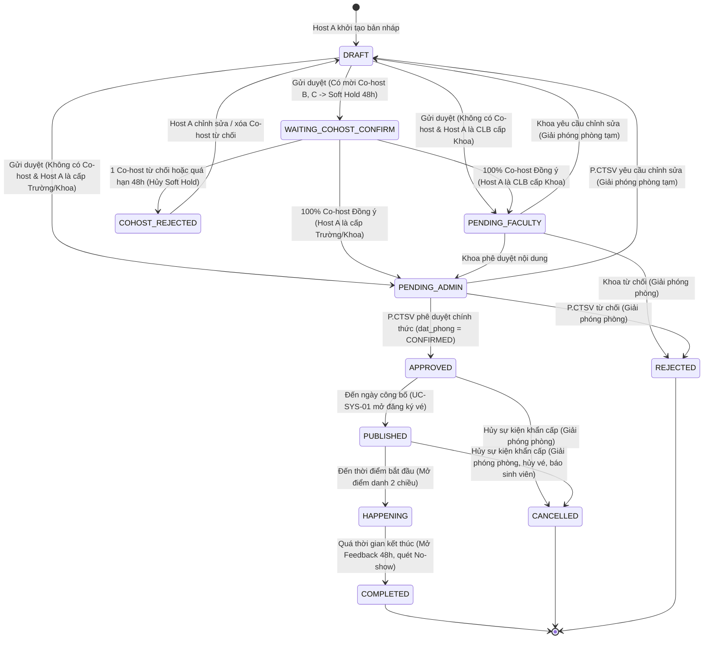

# TÀI LIỆU ĐẶC TẢ YÊU CẦU HỆ THỐNG (SYSTEM REQUIREMENTS SPECIFICATION - SRS)
## Dự án: Hệ Thống Quản Lý Sự Kiện Nội Bộ Trường Đại Học (Campus Event Hub)
**Đồ án Môn học:** Phát triển Ứng dụng Web (IS207.R11) – Khoa Hệ thống Thông tin, Trường ĐH Công nghệ Thông tin (UIT)  
**Mã tài liệu:** `SRS-IS207-CEH-v2.4` | **Phiên bản:** `2.4.0` | **Ngày cập nhật:** `21/10/2026`  
**Chủ trì phân tích (Lead BA):** Bùi Phan Thành Trí (Project Manager) | **Giảng viên hướng dẫn:** ThS. Tạ Việt Phương

## THÔNG TIN TÀI LIỆU (DOCUMENT CONTROL)

| Mục | Nội dung |
|---|---|
| **Tên tài liệu** | Bản Đặc tả Yêu cầu Hệ thống (System Requirements Specification - SRS) |
| **Tên dự án chuẩn** | Campus Event Hub - Nền tảng Đăng ký, Quản lý Sự kiện Sinh viên & Điểm danh Thông minh |
| **Mã tài liệu** | `SRS-IS207-CEH-v2.4` |
| **Phiên bản** | `2.4.0` (Bản Đồng bộ SSOT theo Feedback Giảng viên: 32 Use Cases, Duyệt Đa cấp, Co-organizers, Anti-Fraud & 2 AI Agents) |
| **Trạng thái** | Bản Chính thức đã Phê duyệt Kỹ thuật (Approved Baseline - Single Source of Truth) |
| **Ngày cập nhật** | 21/10/2026 |
| **Đơn vị thực hiện** | Nhóm DAS (Lớp IS207.R11) |
| **Chủ trì phân tích (Lead BA)** | Bùi Phan Thành Trí (Project Manager) |
| **Giảng viên hướng dẫn** | ThS. Tạ Việt Phương |

## LỊCH SỬ THAY ĐỔI TÀI LIỆU (DOCUMENT REVISION HISTORY)

| Phiên bản | Ngày | Người thực hiện | Nội dung thay đổi chính |
|---|---|---|---|
| **1.0.0** | 10/09/2026 | Nhóm DAS | Khởi tạo tài liệu đặc tả ban đầu cho giai đoạn Mini Project (MVP). |
| **2.0.0** | 12/09/2026 | Bùi Phan Thành Trí | Mở rộng quy mô lên Main Project: thêm vai trò Admin, quy trình duyệt, phòng ốc, Waitlist, điểm danh 2 chiều và AI Agents. |
| **2.1.0** | 18/09/2026 | Bùi Phan Thành Trí | Cập nhật cấu trúc Use Case chi tiết và bổ sung các kịch bản ngoại lệ. |
| **2.2.0** | 18/09/2026 | Bùi Phan Thành Trí | Chuẩn hóa danh mục Use Cases, bỏ GPS, phân bậc 60% ĐRL. |
| **2.3.0** | 01/10/2026 | Bùi Phan Thành Trí | Chuẩn hóa thứ tự khóa dòng `su_kien` $\rightarrow$ `dang_ky` $\rightarrow$ `hang_doi_waitlist`, đóng Waitlist tại $T-2\text{h}$, loại trừ va chạm chính mình trong `UC-ROOM-02`. |
| **2.4.0** | 21/10/2026 | Bùi Phan Thành Trí | **Đồng bộ hóa toàn diện 8 Quyết định Kiến trúc cốt lõi theo `feedback-history.md` (Chuẩn hóa 32 Use Cases):**<br>1. **Tinh chỉnh Hệ sinh thái AI Agent 2 cấp độ:** Chuẩn hóa `UC-AI-01` (Organizer Content & Analytics Copilot) và `UC-AI-02` (Admin BI Agent Read-only).<br>2. **Phân cấp Đơn vị Tổ chức & Đồng tổ chức (Co-organizers):** Bổ sung `ma_don_vi_cha` trên `don_vi_to_chuc` và bảng `su_kien_dong_to_chuc`; yêu cầu 100% đơn vị đồng tổ chức bấm Đồng ý (Soft Hold phòng tối đa 48h).<br>3. **Luồng Duyệt Đa cấp theo Cấp của Host (Host-driven Approval Routing):** CLB cấp Khoa đi qua `PENDING_FACULTY` $\rightarrow$ `PENDING_ADMIN` $\rightarrow$ `APPROVED`; CLB cấp Trường/Khoa đi thẳng `PENDING_ADMIN` $\rightarrow$ `APPROVED`.<br>4. **Tinh gọn Vòng đời Sự kiện & Cố định Phòng Hội trường:** Sáp nhập luồng hủy sự kiện khẩn cấp và thông báo ngoại lệ vào `UC-EVT-03`; cố định bất biến $\text{so\_luong\_toi\_da} \le \text{phong\_hoi\_truong.suc\_chua\_toi\_da}$ ngay từ khâu tạo sự kiện.<br>5. **Khóa Hủy vé tại mốc $T - 4\text{h}$ & Xử lý No-show:** Cập nhật `UC-TCK-02` tự động khóa hủy vé tại mốc $T - 4\text{h}$; bổ sung tác vụ nền `UC-SYS-01` quét vé chưa check-in để gửi cảnh báo và gắn cờ `vi_pham_no_show = 1` cho P.CTSV xét chế tài.<br>6. **Sự kiện Không Giới Hạn Slot & Chống Trùng Lịch Cá Nhân:** Thêm cờ `khong_gioi_han_slot`; chặn tuyệt đối trùng giờ giữa các sự kiện giới hạn slot và cảnh báo mềm với sự kiện không giới hạn slot trong `UC-BOOK-01`.<br>7. **Ràng buộc Mở Check-out ($T_{end}-25\text{m}$), Công thức $\Delta t$ & Chống Gian lận Điểm danh:** Nút mở Check-out chỉ bật từ $T_{end}-25\text{m}$ (mở sớm bắt buộc gõ `CONFIRM` / `XÁC NHẬN`); tính $\Delta t = \min(\text{Check-out}, \text{Kết thúc thực tế}) - \max(\text{Check-in}, \text{Bắt đầu kế hoạch})$; tích hợp Single Active Session và Device Binding chống quét hộ.<br>8. **Claim Window Linh hoạt sát mốc $T - 2\text{h}$:** Cập nhật `UC-BOOK-03` với $\text{Hạn chót giữ chỗ} = \min(\text{NOW()} + 60\text{m}, \text{Mốc } T - 2\text{h})$ triệt tiêu lỗi "slot treo ma". |

## BẢNG CHÚ GIẢI THUẬT NGỮ (GLOSSARY)

| Thuật ngữ / Viết tắt | Tên đầy đủ tiếng Anh | Định nghĩa nghiệp vụ trong hệ thống |
|---|---|---|
| **RBAC** | Role-Based Access Control | Cơ chế kiểm soát truy cập dựa trên vai trò người dùng được xác thực ở tầng máy chủ (Server-side). |
| **Host-driven Routing** | Host-driven Multi-level Approval | Cơ chế định tuyến phê duyệt tự động dựa trên phân cấp của đơn vị chủ trì chính (Host A): CLB thuộc Khoa phải qua Khoa duyệt nội dung (`PENDING_FACULTY`) trước khi lên P.CTSV (`PENDING_ADMIN`); đơn vị cấp Trường/Khoa đi thẳng lên P.CTSV. |
| **Co-organizer** | Co-organizing Unit | Đơn vị đồng tổ chức (CLB/Khoa B, C, D) được đơn vị chủ trì chính (Host A) mời phối hợp tổ chức sự kiện qua bảng `su_kien_dong_to_chuc`. |
| **Soft Hold 48h** | Temporary Venue Hold | Cơ chế giữ chỗ phòng hội trường tạm thời tối đa 48 giờ trong lúc chờ 100% các đơn vị đồng tổ chức bấm xác nhận đồng ý (`WAITING_COHOST_CONFIRM`). |
| **Event-scoped Role** | Event-scoped Authorization | Quyền hạn chỉ có hiệu lực trong phạm vi một sự kiện cụ thể (ví dụ: Sinh viên được gán làm Staff soát vé cho sự kiện X). |
| **HMAC** | Hash-based Message Authentication Code | Cơ chế xác thực thông điệp dựa trên hàm băm mật mã (SHA-256) kết hợp với Khóa bí mật độc lập (Secret Key) để chống làm giả vé cá nhân. |
| **TOTP** | Time-based One-Time Password | Thuật toán sinh mã dùng một lần theo thời gian (RFC 6238), tự động xoay vòng mã Dynamic QR trên màn chiếu mỗi 30 giây. |
| **Device Binding** | Device Identifier Anti-Fraud | Cơ chế lưu mã định danh thiết bị độc lập với phiên đăng nhập để phát hiện và chặn hành vi dùng 1 điện thoại quét điểm danh hộ cho nhiều tài khoản trong cùng một sự kiện. |
| **FIFO** | First In, First Out | Nguyên tắc xếp hàng "Vào trước - Ra trước" áp dụng cho Hàng đợi Danh sách Chờ (Waitlist). |
| **Flexible Claim Window** | Dynamic Time-bounded Reservation | Khung thời gian giữ chỗ linh hoạt cấp cho sinh viên đầu hàng đợi Waitlist: $\min(\text{NOW()} + 60\text{ phút}, \text{Mốc } T - 2\text{h})$, đảm bảo giải phóng dứt điểm slot trước khi đóng hàng chờ lúc $T - 2\text{h}$. |
| **ĐRL** | Điểm Rèn Luyện | Điểm đánh giá kết quả rèn luyện của sinh viên theo Quy chế của Bộ GD&ĐT và Trường ĐH Công nghệ Thông tin (UIT). |
| **CTSV** | Phòng Công tác Sinh viên | Đơn vị chức năng cấp Trường quản lý chế độ chính sách, phê duyệt cấp phòng/ĐRL và quyết định chế tài vi phạm No-show. |
| **Wake Lock API** | Screen Wake Lock API | Giao diện lập trình web cho phép ứng dụng giữ màn hình thiết bị luôn sáng khi sinh viên đang xếp hàng soát vé. |
| **Sanctum** | Laravel Sanctum | Hệ thống xác thực phiên làm việc an toàn cho ứng dụng Single Page Application (SPA) dựa trên Cookie/Session và CSRF Token, kết hợp cơ chế Single Active Session. |

# PHẦN 1: TỔNG QUAN HỆ THỐNG (SYSTEM OVERVIEW)

## 1.1. Mục đích tài liệu
Tài liệu Đặc tả Yêu cầu Hệ thống (SRS) này xác lập đầy đủ, nhất quán và chi tiết toàn bộ các yêu cầu nghiệp vụ, yêu cầu chức năng, yêu cầu phi chức năng và mô hình tương tác cho hệ thống **Campus Event Hub**. Tài liệu đóng vai trò là căn cứ kỹ thuật chuẩn xác để nhóm phát triển (Developers) triển khai kiến trúc Laravel 11 MVC + React 19, nhóm kiểm thử (QA/QC) xây dựng kịch bản kiểm chứng (Playwright E2E, Pest API, k6 Concurrency) và Giảng viên hướng dẫn đánh giá nghiệm thu đồ án môn học IS207.

## 1.2. Phạm vi hệ thống (System Scope)
Hệ thống giải quyết trọn vẹn vòng đời quản lý và vận hành sự kiện trong trường đại học thông qua **32 Use Cases** chia thành **11 Phân hệ**:
- **Quản trị định danh, phân quyền RBAC 4 cấp độ**, cơ chế **Phiên đăng nhập Đơn nhất (Single Active Session)** và quản lý phân cấp Đơn vị tổ chức (`ma_don_vi_cha` phân biệt đơn vị cấp Trường và CLB trực thuộc Khoa).
- **Quản lý hội trường, lịch mượn phòng học** với thuật toán kiểm tra xung đột thời gian (có thời gian đệm an toàn 15 phút, loại trừ va chạm chính mình) và giữ chỗ tạm thời **Soft Hold 48h** cho sự kiện đồng tổ chức.
- **Vòng đời phê duyệt sự kiện đa cấp (Host-driven Multi-level Approval)** có cơ chế đồng thuận 100% từ các đơn vị đồng tổ chức (`su_kien_dong_to_chuc`), định tuyến tự động qua Khoa (`PENDING_FACULTY`) và Phòng CTSV (`PENDING_ADMIN`), kèm nhật ký kiểm toán bất biến (Audit Trail).
- **Cổng thông tin khám phá sự kiện**, bộ máy đặt vé xử lý tương tranh cao (Pessimistic Concurrency Locking), hỗ trợ cả **Sự kiện Giới hạn Slot** và **Sự kiện Không Giới Hạn Slot (`khong_gioi_han_slot = 1`)**, kiểm soát chống trùng lịch cá nhân, khóa hủy vé tại mốc $T - 4\text{h}$, và Hàng đợi Danh sách Chờ (Waitlist FIFO) với Claim Window linh hoạt $\min(\text{NOW()} + 60\text{m}, T - 2\text{h})$.
- **Vận hành điểm danh 2 chiều (Check-in và Check-out)** kết hợp **Khung Chống Gian lận Điểm danh (Anti-Fraud Check-in Framework)**: Staff soát vé bằng HMAC-SHA256 và Sinh viên tự quét mã Dynamic TOTP QR xoay vòng 30 giây trên màn chiếu, kiểm soát mở cổng Check-out nghiêm ngặt từ mốc $T_{end} - 25\text{ phút}$, chống quét chéo thiết bị (Device Binding) và tính toán thời lượng tham gia thực tế theo công thức $\Delta t$ chuẩn xác.
- **Khảo sát đánh giá sau sự kiện** (Feedback trong 48 giờ), cấp Giấy chứng nhận điện tử (e-Certificate) có mã băm SHA-256 bảo vệ dữ liệu cá nhân theo Nghị định 13/2023/NĐ-CP, tự động gắn cờ vi phạm No-show và kết xuất danh sách Điểm Rèn Luyện chuẩn mẫu P.CTSV.
- **Hệ sinh thái AI Agent 2 cấp độ** chuyên biệt cho Ban tổ chức (**Organizer Content & Analytics Copilot** - `UC-AI-01`) và Quản trị viên (**Admin BI Agent** - `UC-AI-02`).

## 1.3. Các tác nhân hệ thống (Actors)
Hệ thống phân định rõ ràng giữa 4 vai trò người dùng có tài khoản đăng nhập, 2 tác nhân tương tác công khai không cần tài khoản, và 1 tác nhân hệ thống tự động:
1. **Quản trị viên (Admin - P.CTSV / Ban Giám hiệu):** Vai trò quản trị cao nhất cấp Trường; phê duyệt cấp phòng & ĐRL (`PENDING_ADMIN` $\rightarrow$ `APPROVED`), quản lý danh mục phòng ốc, quản lý cây phân cấp Đơn vị tổ chức, cấp quyền Ban tổ chức, mở khóa điều chỉnh ĐRL và sử dụng Admin BI Agent (`UC-AI-02`).
2. **Ban tổ chức (Organizer - Đại diện CLB / Đoàn - Hội / Khoa):**
   - *Đơn vị chủ trì chính (Host A):* Soạn thảo đề xuất sự kiện, mời các đơn vị đồng tổ chức, mở màn hình Kiosk TOTP, phân công Staff, chốt danh sách ĐRL và sử dụng Organizer Content & Analytics Copilot (`UC-AI-01`).
   - *Đơn vị đồng tổ chức (Co-organizer B, C, D):* Xem chi tiết lời mời đồng tổ chức và bấm Xác nhận Đồng ý (`DONG_Y`) hoặc Từ chối (`TU_CHOI`).
   - *Ban Quản lý Khoa (Faculty Reviewer - Tài khoản `ToChuc` thuộc đơn vị có `loai_don_vi = 'Khoa'` và `ma_don_vi_cha IS NULL`):* Thẩm định và phê duyệt nội dung bước 1 (`PENDING_FACULTY` $\rightarrow$ `PENDING_ADMIN`) đối với các sự kiện do CLB trực thuộc Khoa mình khởi xướng.
3. **Nhân viên soát vé (Staff - Event-scoped Role):** Tài khoản sinh viên được Ban tổ chức ủy quyền soát vé cho một sự kiện cụ thể; sử dụng giao diện máy quét di động `/scanner` để đối soát vé vào/ra và giám sát trực tiếp tại hội trường.
4. **Sinh viên (Student):** Người dùng nội bộ trường; tìm kiếm sự kiện, đặt vé (hoặc tham gia Waitlist), hủy vé trước mốc $T - 4\text{h}$, tự quét Dynamic TOTP QR điểm danh 2 chiều trên thiết bị cá nhân, làm khảo sát trong 48 giờ và nhận chứng nhận số.
5. **Khách vãng lai (Public Guest):** Người dùng chưa đăng nhập; xem thông tin sự kiện công khai và chia sẻ liên kết qua mạng xã hội.
6. **Người xác thực công khai (Public Certificate Verifier):** Nhà tuyển dụng hoặc đơn vị thứ ba quét mã QR tra cứu tính chính thực của Giấy chứng nhận số.
7. **Hệ thống (System / Background Worker):** Tác nhân tự động thực hiện các tác vụ nền (`UC-NOTIF-01`, `UC-SYS-01`): chuyển trạng thái vòng đời sự kiện, giải phóng Soft Hold 48h quá hạn, quét slot Waitlist quá hạn theo hạn chót linh hoạt $\min(\text{NOW()}+60\text{m}, T-2\text{h})$, đóng Waitlist tại mốc $T - 2\text{h}$, gửi email nhắc hẹn trước 24 giờ và quét gắn cờ cảnh báo vi phạm No-show sau khi sự kiện kết thúc.

## 1.4. Ma trận Phân quyền Truy cập theo Vai trò (RBAC Matrix)

| Nhóm Chức năng / Phân hệ | Khách (Guest) | Sinh viên (Student) | Staff sự kiện (Event Staff) | Ban tổ chức (CLB / Khoa) | Quản trị viên (Admin P.CTSV) |
|---|---|---|---|---|---|
| **Xác thực, Đăng ký (Email OTP), Đăng nhập Single Session** | CRUD (Đăng ký) | Đọc, Cập nhật | Đọc, Cập nhật | Đọc, Cập nhật | Toàn quyền |
| **Quản trị Tài khoản, Phân cấp Đơn vị (`ma_don_vi_cha`)** | ❌ | ❌ | ❌ | ❌ | Toàn quyền (CRUD) |
| **Quản lý Danh mục Phòng ốc & Lịch thiết bị** | ❌ | ❌ | ❌ | Chỉ xem lịch trống | Toàn quyền (CRUD) |
| **Soạn thảo Sự kiện & Mời Đồng tổ chức (`UC-EVT-01`)** | ❌ | ❌ | ❌ | Thực thi (Host A) | Toàn quyền kiểm soát |
| **Xác nhận Đồng tổ chức (`WAITING_COHOST_CONFIRM`)** | ❌ | ❌ | ❌ | Thực thi (Co-host B, C) | Giám sát |
| **Phê duyệt Bước 1 cấp Khoa (`PENDING_FACULTY`)** | ❌ | ❌ | ❌ | Thực thi (Đơn vị Khoa) | Toàn quyền duyệt thay |
| **Phê duyệt Cuối cấp Trường (`PENDING_ADMIN`)** | ❌ | ❌ | ❌ | ❌ | Toàn quyền duyệt |
| **Khám phá, Xem chi tiết sự kiện công khai** | Chỉ đọc | Chỉ đọc | Chỉ đọc | Chỉ đọc | Chỉ đọc |
| **Đặt vé Concurrency, Kiểm tra Trùng lịch & Waitlist** | ❌ | Thực thi (Tạo vé) | ❌ | ❌ | ❌ |
| **Quản lý Vé của tôi & Hủy vé trước mốc $T - 4\text{h}$** | ❌ | Thực thi (Vé của mình) | ❌ | ❌ | Tra cứu hỗ trợ |
| **Mở Kiosk TOTP & Mở Check-out từ $T_{end} - 25\text{m}$** | ❌ | ❌ | ❌ | Thực thi (Sự kiện mình) | Thực thi giám sát |
| **Soát vé Staff (Quét HMAC / Kiểm tra thẻ khi quét chéo)** | ❌ | ❌ | Thực thi (Được gán) | Thực thi (Sự kiện mình) | Thực thi kiểm tra |
| **Điểm danh tự phục vụ 2 chiều (Dynamic QR + Device Bind)** | ❌ | Thực thi (Quét mã) | ❌ | ❌ | ❌ |
| **Điều chỉnh điểm danh thủ công (Manual Override)** | ❌ | ❌ | ❌ | Cập nhật (Có Audit) | Toàn quyền mở khóa |
| **Khảo sát Feedback (Hạn 48h) & Nhận Certificate** | ❌ | Thực thi (Khi đủ đ/k) | ❌ | Xem thống kê ẩn danh | Tra cứu giám sát |
| **Tra cứu Chứng nhận công khai (Public Verification)** | Chỉ đọc (Đã che) | Chỉ đọc | Chỉ đọc | Chỉ đọc | Toàn quyền |
| **Dashboard Báo cáo & Chốt Bảng Điểm Rèn Luyện** | ❌ | ❌ | ❌ | Xem & Chốt (Của mình) | Toàn quyền Toàn trường |
| **Hệ sinh thái Trợ lý AI (2 AI Agents)** | ❌ | ❌ | ❌ | Organizer Copilot (`UC-AI-01`) | Admin BI Agent (`UC-AI-02`) |

## 1.5. Mô hình Trạng thái Vòng đời Sự kiện (Event Lifecycle State Machine)
Hệ thống thiết lập vòng đời sự kiện gồm **8 trạng thái tiến trình chính** (`DRAFT`, `WAITING_COHOST_CONFIRM`, `PENDING_FACULTY`, `PENDING_ADMIN`, `APPROVED`, `PUBLISHED`, `HAPPENING`, `COMPLETED`) và **3 trạng thái ngoại lệ/hủy** (`COHOST_REJECTED`, `REJECTED`, `CANCELLED`) — tổng cộng 11 giá trị trong ENUM `su_kien.trang_thai`:



# PHẦN 2: CÁC YÊU CẦU PHI CHỨC NĂNG (NON-FUNCTIONAL REQUIREMENTS)

| Mã NFR | Tên yêu cầu phi chức năng | Tiêu chuẩn kỹ thuật định lượng & Giải pháp hiện thực hóa |
|---|---|---|
| **NFR-PERF-01** | Thời gian phản hồi Soát vé (SLA) | Thời gian xử lý từ khi camera nhận diện chuỗi QR đến khi hiển thị kết quả kiểm tra vé trên giao diện Staff phải $\le 2.0$ giây trong điều kiện mạng bình thường (warm state). *Ghi chú: Chấp nhận độ trễ Cold Start 30–50 giây trong lần gọi đầu tiên do đặc thù hạ tầng lưu trữ đám mây miễn phí.* |
| **NFR-PERF-02** | Xử lý Tải tương tranh (Concurrency Invariant) | Khi có 50 yêu cầu đặt vé đồng thời tại thời điểm chỉ còn 1 slot duy nhất của sự kiện có giới hạn slot (`khong_gioi_han_slot = 0`): Hệ thống sử dụng giao dịch CSDL với cơ chế khóa dòng bi quan (`SELECT ... FOR UPDATE`), bảo đảm chỉ cấp đúng 1 vé thành công, 49 yêu cầu còn lại nhận thông báo hết vé/mời vào Waitlist. Tuyệt đối duy trì bất biến: `so_ve_con_lai >= 0`. |
| **NFR-PERF-03** | Hiệu năng Truy vấn & Tải trang | Kiểm tra xung đột phòng (`UC-ROOM-02`) $< 50\text{ms}$ nhờ Composite Index; truy vấn tìm kiếm sự kiện (`UC-DISC-01`) $< 150\text{ms}$; trang chi tiết sự kiện (`UC-DISC-02`) tải hoàn tất $\le 1.5$ giây; báo cáo vĩ mô (`UC-REP-02`) $< 1.0$ giây nhờ Summary Table. |
| **NFR-SEC-01** | Xác thực, Single Active Session & Bảo vệ Phiên | Sử dụng Laravel Sanctum quản lý phiên làm việc dựa trên HTTP-Only Cookie kết hợp CSRF Protection Token. Mật khẩu được băm bằng thuật toán Bcrypt (`cost = 12`). Áp dụng **Single Active Session** (mỗi tài khoản sinh viên chỉ duy trì 1 phiên đăng nhập hoạt động tại 1 thời điểm; đăng nhập thiết bị mới sẽ hủy phiên cũ ngay lập tức) và Rate Limiting tối đa 5 lần đăng nhập sai liên tiếp trong 1 phút. |
| **NFR-SEC-02** | Mật mã học & Toàn vẹn Vé (HMAC) | Chuỗi định danh vé cá nhân được ký bằng thuật toán HMAC-SHA256 sử dụng Application Secret Key độc lập: `Signature = HMAC_SHA256(TicketUUID + UserID + EventID, SecretKey)`. Khi xác thực tại cổng, hệ thống tính toán lại và so sánh an toàn bằng hàm `hash_equals()`. |
| **NFR-SEC-03** | Khung Chống Gian lận Điểm danh (Anti-Fraud Check-in Framework) | Kết hợp 3 lớp bảo vệ: (1) **Chống gian lận từ xa:** Mã Dynamic TOTP QR trên màn chiếu xoay vòng mỗi 30 giây (chấp nhận trễ tối đa 60s bù mạng); (2) **Chống gian lận tại chỗ (Device Binding):** Mỗi trình duyệt lưu một `Device Identifier` độc lập với phiên đăng nhập; nếu 1 thiết bị quét điểm danh cho $\ge 2$ tài khoản khác nhau trong cùng 1 sự kiện, hệ thống chặn lượt quét thứ hai và gắn cờ `nghi_van_gian_lan = 1`; (3) **Kiểm soát cổng Check-out & Công thức $\Delta t$:** Khóa mở cổng Check-out cho đến mốc $T_{end} - 25\text{ phút}$ và tính thời lượng thực tế theo công thức $\Delta t = \min(\text{Check-out}, \text{Kết thúc thực tế}) - \max(\text{Check-in}, \text{Bắt đầu kế hoạch})$. |
| **NFR-SEC-04** | Bảo vệ Dữ liệu Cá nhân (Nghị định 13/2023/NĐ-CP) | Trang tra cứu xác thực Giấy chứng nhận công khai (`/verify-certificate/{hash}`) bắt buộc che mờ các trường dữ liệu định danh: Họ tên dạng `Nguyễn V** A`, MSSV dạng `2252****`, không hiển thị số điện thoại hay email cá nhân. |
| **NFR-SEC-05** | An toàn Hệ sinh thái 2 AI Agents | (1) **Organizer Copilot (`UC-AI-01`):** Chỉ được phép truy vấn dữ liệu phản hồi ẩn danh (`v_feedback_an_danh`) và số liệu của riêng các sự kiện thuộc đơn vị tổ chức đó. (2) **Admin BI Agent (`UC-AI-02`):** Truy vấn CSDL thông qua tài khoản kết nối MySQL chuyên biệt chỉ có quyền `SELECT` duy nhất trên View `v_event_analytics`, giới hạn `LIMIT 50`, timeout 3.0 giây; toàn bộ thông tin định danh cá nhân (PII) bị loại bỏ hoàn toàn trước khi gửi tới LLM. |
| **NFR-USAB-01** | Tương thích Giao diện & Giữ sáng màn hình | Giao diện thích ứng từ màn hình di động (tối thiểu 375px) đến máy tính bảng và desktop (1920px). Trang xuất trình vé tích hợp Screen Wake Lock API giúp giữ màn hình điện thoại luôn sáng khi sinh viên xếp hàng vào hội trường. |
| **NFR-RELI-01** | Tính Bền vững & Lưu vết Kiểm toán (Audit Trail) | Mọi thao tác gửi duyệt, đồng tổ chức xác nhận/từ chối, Khoa duyệt/từ chối, P.CTSV duyệt/từ chối, mở Check-out sớm, hủy sự kiện, hủy vé và điều chỉnh điểm danh thủ công bắt buộc phải lưu vết vào bảng `nhat_ky_kiem_duyet` hoặc `nhat_ky_diem_danh` kèm định danh người thực hiện (`nguoi_thuc_hien`), thời gian, trạng thái trước/sau và lý do bắt buộc. |

# PHẦN 3: ĐẶC TẢ CHI TIẾT 32 USE CASES HỆ THỐNG

> **Quy ước Thứ tự Khóa Dòng Bắt buộc (Deadlock-Free Lock Ordering Invariant):**  
> Để triệt tiêu hoàn toàn rủi ro Deadlock giữa các tiến trình tương tranh cao, toàn bộ các Database Transactions liên quan đến Đặt vé, Hủy vé và Danh sách chờ bắt buộc phải tuân thủ nghiêm ngặt một thứ tự khóa duy nhất:  
> **`su_kien` $\longrightarrow$ `dang_ky` $\longrightarrow$ `hang_doi_waitlist`**

## PHÂN HỆ 1: QUẢN TRỊ TÀI KHOẢN, XÁC THỰC & ĐỊNH DANH (AUTH) (5 Use Cases)

### UC-AUTH-01: Đăng ký tài khoản Sinh viên (Email OTP & Mật khẩu Băm)
- **Mã UC:** `UC-AUTH-01`
- **Tên UC:** Đăng ký tài khoản Sinh viên
- **Actor:** Sinh viên (Student), Hệ thống Email (System)
- **Mô tả:** Cho phép sinh viên tạo tài khoản trên hệ thống bằng MSSV và email trường (`@gm.uit.edu.vn`); hệ thống băm mật khẩu bằng Bcrypt và băm mã OTP bằng SHA-256 ngay trước khi lưu vào bảng đệm `dang_ky_tam_thoi`, gửi mã OTP để kích hoạt tài khoản chính chủ.
- **Tiền điều kiện:** Sinh viên có email trường hợp lệ và chưa từng đăng ký tài khoản trên hệ thống.
- **Hậu điều kiện:** Bản ghi người dùng được tạo trong bảng `tai_khoan` với trạng thái `hoat_dong = 1`, vai trò `SinhVien`, mật khẩu được băm an toàn và có thể đăng nhập ngay.

#### Dòng sự kiện chính (Normal Course)
1. Sinh viên truy cập trang Đăng ký tài khoản.
2. Hệ thống hiển thị biểu mẫu: Họ và tên, MSSV (8 chữ số), Email trường, Lớp sinh hoạt, Khoa/Bộ môn, Số điện thoại, Mật khẩu và Xác nhận mật khẩu.
3. Sinh viên điền đầy đủ thông tin hợp lệ và nhấn nút "Tiếp tục xác thực Email".
4. Hệ thống kiểm tra định dạng dữ liệu và kiểm tra tính duy nhất của MSSV và Email trong CSDL.
5. Hệ thống thực hiện băm mật khẩu bằng Bcrypt (`cost = 12`), sinh mã OTP ngẫu nhiên 6 chữ số có hiệu lực 10 phút, băm mã OTP bằng SHA-256 và lưu bản ghi đăng ký tạm vào bảng đệm `dang_ky_tam_thoi`.
6. Hệ thống gửi email chứa mã kích hoạt OTP (bản rõ) đến hòm thư trường của sinh viên.
7. Hệ thống chuyển sang màn hình nhập mã OTP xác thực.
8. Sinh viên kiểm tra email, nhập mã OTP 6 số và nhấn "Xác nhận tạo tài khoản".
9. Hệ thống kiểm tra: mã OTP nhập vào (sau khi băm SHA-256) trùng khớp với mã lưu trong bảng đệm, chưa quá hạn 10 phút và `so_lan_nhap_sai < 5`.
10. Hệ thống chuyển dữ liệu từ bảng đệm sang bảng `tai_khoan` chính thức với `loai_tai_khoan = 'SinhVien'` và kích hoạt `hoat_dong = 1`.
11. Hệ thống xóa dữ liệu trong bảng đệm, hiển thị thông báo "Đăng ký thành công" và chuyển hướng về trang Đăng nhập.

#### Các dòng sự kiện khác (Alternative & Exception Courses)
- **UC-AUTH-01.EX.1 (Thông tin không hợp lệ hoặc trùng lặp):** Tại bước 4, nếu định dạng email sai hoặc MSSV/Email đã tồn tại trong CSDL, Hệ thống thông báo lỗi chi tiết tương ứng và dừng quy trình.
- **UC-AUTH-01.EX.2 (Nhập sai OTP quá 5 lần hoặc hết hạn):** Tại bước 9, nếu sinh viên nhập sai OTP quá 5 lần liên tiếp hoặc nhập sau 10 phút, Hệ thống vô hiệu hóa mã OTP, xóa bản ghi đăng ký tạm và yêu cầu thực hiện lại từ đầu.
- **Các yêu cầu đặc biệt:** Áp dụng Rate Limiting tối đa 3 lần yêu cầu gửi lại OTP trong vòng 10 phút cho một địa chỉ email.

### UC-AUTH-02: Đăng nhập hệ thống, Single Active Session & Phân quyền phiên làm việc (Sanctum SPA)
- **Mã UC:** `UC-AUTH-02`
- **Tên UC:** Đăng nhập hệ thống, Single Active Session & Phân quyền phiên làm việc
- **Actor:** Toàn bộ người dùng (Admin, Organizer, Event Staff, Student)
- **Mô tả:** Xác thực thông tin đăng nhập qua Email hoặc MSSV kết hợp Mật khẩu; thực thi cơ chế **Phiên đăng nhập Đơn nhất (Single Active Session)** bằng cách thu hồi toàn bộ phiên đăng nhập cũ của tài khoản đó trên các thiết bị khác nhằm chống gian lận điểm danh; thiết lập phiên làm việc mới qua HTTP-Only Cookie (Laravel Sanctum) và điều hướng theo vai trò.
- **Tiền điều kiện:** Người dùng đã có tài khoản hoạt động trong CSDL.
- **Hậu điều kiện:** Phiên làm việc mới được thiết lập, các phiên cũ trên thiết bị khác bị chấm dứt tức thì, quyền hạn được nạp vào context ứng dụng.

#### Dòng sự kiện chính (Normal Course)
1. Người dùng mở trang Đăng nhập của hệ thống.
2. Hệ thống hiển thị biểu mẫu: Tên đăng nhập (Email hoặc MSSV) và Mật khẩu.
3. Người dùng nhập thông tin và nhấn "Đăng nhập".
4. Hệ thống kiểm tra Rate Limit của tài khoản (tối đa 5 lần thử sai liên tiếp trong 1 phút).
5. Hệ thống truy vấn người dùng và đối soát mật khẩu bằng `password_verify()`.
6. Hệ thống kiểm tra trạng thái hoạt động của tài khoản (`hoat_dong == 1`).
7. **Thực thi Single Active Session:** Hệ thống xóa toàn bộ các bản ghi phiên đăng nhập trước đó của `user_id` trong bảng `sessions` (`DELETE FROM sessions WHERE user_id = :ma_tai_khoan`), đảm bảo một tài khoản không thể đăng nhập đồng thời ở nhà và tại hội trường.
8. Hệ thống khởi tạo phiên làm việc mới với HTTP-Only Cookie kèm CSRF Token bảo vệ, đồng thời đảm bảo trình duyệt duy trì mã định danh thiết bị độc lập (`Device Identifier` lưu trong `localStorage` / Cookie dài hạn không bị xóa khi đăng xuất) phục vụ kiểm soát chống quét chéo tại `UC-OPS-03`.
9. Hệ thống truy vấn thông tin vai trò cốt lõi, cấp đơn vị tổ chức (`ma_don_vi_to_chuc`, `ma_don_vi_cha`, `loai_don_vi`) và các quyền hạn sự kiện (Staff soát vé tại `nhan_vien_check_in`).
10. Hệ thống điều hướng người dùng:
    - Vai trò `Admin`: Điều hướng đến `/admin/dashboard`.
    - Vai trò `ToChuc`: Điều hướng đến `/organizer/dashboard` (Hiển thị thêm tab "Duyệt sự kiện cấp Khoa" nếu đơn vị có `loai_don_vi = 'Khoa'` và `ma_don_vi_cha IS NULL`).
    - Vai trò `SinhVien`: Điều hướng đến Cổng sự kiện `/` (Hiển thị thêm lối tắt `/scanner` nếu đang được phân công làm Staff soát vé).

#### Các dòng sự kiện khác (Alternative & Exception Courses)
- **UC-AUTH-02.EX.1 (Thông tin đăng nhập không hợp lệ):** Tại bước 5, nếu tài khoản không tồn tại hoặc mật khẩu sai, Hệ thống trả về thông báo lỗi chung: "Thông tin đăng nhập không hợp lệ".
- **UC-AUTH-02.EX.2 (Tài khoản bị khóa):** Tại bước 6, nếu `hoat_dong == 0`, Hệ thống từ chối đăng nhập và thông báo: "Tài khoản của bạn hiện đang bị tạm khóa. Vui lòng liên hệ Quản trị viên hệ thống".
- **UC-AUTH-02.EX.3 (Khóa tạm thời do Brute-force):** Tại bước 4, nếu số lần đăng nhập thất bại vượt quá 5 lần trong 1 phút, Hệ thống khóa đăng nhập tạm thời trong 5 phút và trả về lỗi `429 Too Many Requests`.

### UC-AUTH-03: Quản lý thông tin hồ sơ & Đổi mật khẩu
- **Mã UC:** `UC-AUTH-03`
- **Tên UC:** Quản lý thông tin hồ sơ & Đổi mật khẩu
- **Actor:** Toàn bộ người dùng đã đăng nhập
- **Mô tả:** Cho phép người dùng xem thông tin cá nhân, cập nhật số điện thoại, ảnh đại diện, lớp sinh hoạt và chủ động đổi mật khẩu đăng nhập định kỳ.
- **Tiền điều kiện:** Người dùng đã đăng nhập thành công.
- **Hậu điều kiện:** Thông tin hồ sơ hoặc mật khẩu mới được cập nhật vào bảng `tai_khoan`.

#### Dòng sự kiện chính (Normal Course)
1. Người dùng chọn mục "Hồ sơ cá nhân" từ thanh điều hướng.
2. Hệ thống hiển thị thông tin tài khoản: Họ tên, MSSV, Email, Lớp sinh hoạt, Khoa, Vai trò và Số điện thoại.
3. Người dùng cập nhật các trường được phép thay đổi (Số điện thoại, Lớp sinh hoạt, Ảnh đại diện) và nhấn "Lưu thay đổi".
4. Hệ thống kiểm tra dữ liệu hợp lệ và cập nhật vào bảng `tai_khoan`.
5. Hệ thống hiển thị thông báo "Cập nhật hồ sơ thành công".

#### Các dòng sự kiện khác (Alternative & Exception Courses)
- **UC-AUTH-03.AC.1 (Đổi mật khẩu):** Người dùng chuyển sang tab "Đổi mật khẩu" $\rightarrow$ Nhập mật khẩu hiện tại, mật khẩu mới ($\ge 8$ ký tự) và xác nhận mật khẩu mới $\rightarrow$ Hệ thống kiểm tra mật khẩu hiện tại chính xác, băm mật khẩu mới bằng Bcrypt (`cost = 12`), lưu vào CSDL và thu hồi các phiên làm việc khác.
- **UC-AUTH-03.EX.1 (Mật khẩu cũ không chính xác):** Hệ thống thông báo "Mật khẩu hiện tại không chính xác" và từ chối cập nhật.

### UC-AUTH-04: Khôi phục mật khẩu qua Email OTP
- **Mã UC:** `UC-AUTH-04`
- **Tên UC:** Khôi phục mật khẩu qua Email OTP
- **Actor:** Toàn bộ người dùng quên mật khẩu, Hệ thống Email (System)
- **Mô tả:** Cho phép người dùng thiết lập lại mật khẩu tài khoản khi bị quên thông qua mã xác thực một lần (OTP) gửi về email đã đăng ký; mã OTP được băm SHA-256 trong bảng `otp_quen_mat_khau`.
- **Tiền điều kiện:** Người dùng đã có tài khoản trên hệ thống.
- **Hậu điều kiện:** Mật khẩu mới được thiết lập, các phiên đăng nhập cũ bị hủy bỏ.

#### Dòng sự kiện chính (Normal Course)
1. Người dùng nhấn nút "Quên mật khẩu?" tại trang Đăng nhập.
2. Hệ thống hiển thị biểu mẫu yêu cầu nhập Email trường liên kết với tài khoản.
3. Người dùng nhập Email và nhấn "Gửi mã xác nhận".
4. Hệ thống kiểm tra sự tồn tại của Email trong bảng `tai_khoan`. Nếu tồn tại: hủy các OTP cũ chưa dùng, sinh mã OTP 6 số mới, băm SHA-256 và lưu vào bảng `otp_quen_mat_khau` với hạn 10 phút, gửi email chứa mã OTP bản rõ đến người dùng.
5. Hệ thống chuyển sang màn hình nhập OTP và Mật khẩu mới (hiển thị thông báo chung: "Nếu email tồn tại, hệ thống đã gửi mã xác nhận").
6. Người dùng nhập mã OTP cùng mật khẩu mới và nhấn "Xác nhận".
7. Hệ thống kiểm tra: mã OTP (sau khi băm SHA-256) trùng khớp, chưa quá 10 phút, `da_su_dung == 0` và `so_lan_thu_sai < 5`.
8. Hệ thống băm mật khẩu mới bằng Bcrypt, cập nhật vào bảng `tai_khoan`, đánh dấu `da_su_dung = 1` và xóa toàn bộ phiên cũ trong `sessions`.
9. Hệ thống hiển thị thông báo thành công và chuyển hướng về trang Đăng nhập.

#### Các dòng sự kiện khác (Alternative & Exception Courses)
- **UC-AUTH-04.EX.1 (OTP sai hoặc hết hạn):** Tại bước 7, nếu mã OTP không khớp hoặc quá hạn, Hệ thống tăng `so_lan_thu_sai` và báo lỗi: "Mã xác nhận không đúng hoặc đã hết hạn".

### UC-AUTH-05: Đăng xuất an toàn (Session Revocation)
- **Mã UC:** `UC-AUTH-05`
- **Tên UC:** Đăng xuất an toàn
- **Actor:** Toàn bộ người dùng đã đăng nhập
- **Mô tả:** Hủy bỏ phiên làm việc hiện tại, xóa Cookie xác thực và Session ID ở phía máy chủ nhưng vẫn bảo toàn `Device Identifier` trên trình duyệt để phục vụ quy tắc chống quét hộ điểm danh.
- **Tiền điều kiện:** Người dùng đang trong phiên đăng nhập hợp lệ.
- **Hậu điều kiện:** Phiên làm việc bị hủy hoàn toàn ở máy chủ và máy khách, chuyển hướng về trang đăng nhập.

#### Dòng sự kiện chính (Normal Course)
1. Người dùng nhấn nút "Đăng xuất" tại menu tài khoản.
2. Hệ thống gửi yêu cầu `POST /api/auth/logout` kèm CSRF Token về Backend.
3. Backend Laravel thu hồi phiên làm việc, xóa Cookie xác thực phiên và xóa dòng tương ứng trong bảng `sessions`.
4. Hệ thống xóa thông tin người dùng trong bộ nhớ ứng dụng (giữ nguyên mã `Device Identifier` của trình duyệt).
5. Hệ thống chuyển hướng người dùng về trang Đăng nhập kèm thông báo "Đã đăng xuất an toàn".

## PHÂN HỆ 2: QUẢN TRỊ HỆ THỐNG, TÀI NGUYÊN & PHÒNG ỐC (ADM & ROOM) (3 Use Cases)

### UC-ADM-01: Quản trị Tài khoản, Phân cấp Đơn vị Tổ chức & Cấp quyền CLB/Khoa
- **Mã UC:** `UC-ADM-01`
- **Tên UC:** Quản trị Tài khoản, Phân cấp Đơn vị Tổ chức & Cấp quyền CLB/Khoa
- **Actor:** Quản trị viên (Admin)
- **Mô tả:** Cho phép Quản trị viên quản lý danh mục Đơn vị tổ chức theo cấu trúc phân cấp cha - con (`ma_don_vi_cha`), xem danh sách người dùng toàn hệ thống, cấp quyền Ban tổ chức (`ToChuc`) cho đại diện Khoa/CLB và thực hiện khóa/mở khóa tài khoản khi có vi phạm.
- **Tiền điều kiện:** Quản trị viên đã đăng nhập với vai trò `Admin`.
- **Hậu điều kiện:** Đơn vị tổ chức được cấu hình phân cấp chính xác (`ma_don_vi_cha`), quyền hạn tài khoản được nâng cấp hoặc cờ `hoat_dong` được cập nhật kèm Audit Log.

#### Dòng sự kiện chính (Normal Course)
1. Quản trị viên truy cập mục "Quản trị Tài khoản & Đơn vị Tổ chức".
2. Tại tab "Đơn vị tổ chức", Quản trị viên tạo hoặc cập nhật thông tin trong bảng `don_vi_to_chuc`:
   - Nếu là **Đơn vị cấp Trường** (Khoa, Đoàn - Hội Trường, CLB cấp Trường, Phòng ban): Thiết lập `ma_don_vi_cha = NULL`.
   - Nếu là **CLB trực thuộc Khoa**: Thiết lập `ma_don_vi_cha = <ma_don_vi_to_chuc của Khoa quản lý>`.
3. Tại tab "Tài khoản người dùng", Quản trị viên tìm kiếm tài khoản đại diện của Khoa hoặc CLB và chọn "Cấp quyền Ban tổ chức".
4. Hệ thống hiển thị hộp thoại yêu cầu chọn Đơn vị tổ chức trực thuộc từ bảng `don_vi_to_chuc` (hiển thị rõ cấp đơn vị: Cấp Trường/Khoa hay CLB trực thuộc Khoa).
5. Quản trị viên chọn đơn vị tổ chức tương ứng và nhấn "Xác nhận cấp quyền".
6. Hệ thống cập nhật `loai_tai_khoan = 'ToChuc'` và gán `ma_don_vi_to_chuc`.
7. Hệ thống ghi nhật ký kiểm toán vào bảng `nhat_ky_kiem_duyet` (`nguoi_thuc_hien = AdminID`, `hanh_dong = 'GRANT_ORGANIZER'`) và hiển thị thông báo thành công.

#### Các dòng sự kiện khác (Alternative & Exception Courses)
- **UC-ADM-01.AC.1 (Khóa hoặc Mở khóa tài khoản):** Quản trị viên chọn một tài khoản vi phạm quy chế (ví dụ: tái phạm No-show nhiều lần hoặc gian lận điểm danh) và bấm "Khóa tài khoản" kèm lý do bắt buộc $\rightarrow$ Hệ thống cập nhật `hoat_dong = 0`, xóa toàn bộ phiên đăng nhập trong `sessions` và ghi Audit Log (`hanh_dong = 'LOCK_ACCOUNT'`).

### UC-ROOM-01: Quản lý Danh mục Hội trường, Phòng ốc & Cấu hình thiết bị
- **Mã UC:** `UC-ROOM-01`
- **Tên UC:** Quản lý Danh mục Hội trường, Phòng ốc & Cấu hình thiết bị
- **Actor:** Quản trị viên (Admin)
- **Mô tả:** Quản trị viên khởi tạo, cập nhật thông tin các hội trường, phòng học, sức chứa tối đa (`suc_chua_toi_da >= 10`), trang thiết bị âm thanh/máy chiếu và trạng thái bảo trì có khoảng thời gian xác định phục vụ cho việc cấp phòng sự kiện.
- **Tiền điều kiện:** Quản trị viên đã đăng nhập với quyền `Admin`.
- **Hậu điều kiện:** Dữ liệu trong bảng `phong_hoi_truong` được tạo mới, cập nhật hoặc đánh dấu bảo trì/xóa mềm.

#### Dòng sự kiện chính (Normal Course)
1. Quản trị viên chọn mục "Quản lý Hội trường / Phòng ốc".
2. Hệ thống hiển thị danh sách phòng hiện hữu: Tên phòng, Cơ sở (`CoSo1` / `CoSo2`), Sức chứa tối đa (`suc_chua_toi_da`), Trang thiết bị và Trạng thái khả dụng.
3. Quản trị viên nhấn "Thêm phòng mới".
4. Hệ thống hiển thị form nhập: Tên phòng, Cơ sở, Sức chứa tối đa ($\ge 10$), Thiết bị có sẵn (Micro, Máy chiếu, Loa, Bàn ghế).
5. Quản trị viên điền dữ liệu và nhấn "Lưu phòng".
6. Hệ thống kiểm tra tên phòng không được trùng lặp trong cùng cơ sở (`uq_phong_ten_coso`).
7. Hệ thống lưu bản ghi mới vào bảng `phong_hoi_truong` và thông báo thành công.

#### Các dòng sự kiện khác (Alternative & Exception Courses)
- **UC-ROOM-01.AC.1 (Cấu hình Bảo trì phòng có khoảng thời gian):** Quản trị viên chọn một phòng $\rightarrow$ Chọn trạng thái `BaoTri` $\rightarrow$ Nhập khoảng thời gian bảo trì (`bao_tri_tu_ngay` đến `bao_tri_den_ngay`) $\rightarrow$ Nếu có sự kiện đã được xác nhận phòng (`CONFIRMED`) rơi vào khoảng thời gian này, Hệ thống hiển thị cảnh báo danh sách các sự kiện bị ảnh hưởng để Quản trị viên chủ động xử lý trước khi áp dụng.

### UC-ROOM-02: Tra cứu Lịch phòng & Kiểm tra Xung đột Thời gian
- **Mã UC:** `UC-ROOM-02`
- **Tên UC:** Tra cứu Lịch phòng & Kiểm tra Xung đột Thời gian
- **Actor:** Ban tổ chức (Organizer), Quản trị viên (Admin)
- **Mô tả:** Cho phép người dùng trực quan hóa lịch sử dụng phòng dạng Timeline/Calendar và thực thi thuật toán kiểm tra xung đột thời gian (có thời gian đệm an toàn 15 phút giữa 2 sự kiện liền kề, loại trừ va chạm chính mình) để đảm bảo không bao giờ xảy ra tình trạng đặt trùng phòng.
- **Tiền điều kiện:** Người dùng có quyền `ToChuc` hoặc `Admin` đã đăng nhập.
- **Hậu điều kiện:** Kết quả kiểm tra tính khả dụng của phòng được xác nhận chính xác.

#### Dòng sự kiện chính (Normal Course)
1. Ban tổ chức hoặc Quản trị viên mở chức năng "Lịch phòng / Hội trường".
2. Hệ thống hiển thị giao diện Lịch trực quan thể hiện các khoảng thời gian đã có sự kiện được xác nhận (`CONFIRMED`) hoặc đang giữ chỗ chờ duyệt / chờ đồng tổ chức xác nhận (`PENDING`) của từng phòng.
3. Người dùng chọn phòng dự kiến (`ma_phong`) và khoảng thời gian: `thoi_gian_bat_dau` ($S_{req}$) và `thoi_gian_ket_thuc` ($E_{req}$).
4. Hệ thống thực hiện kiểm tra xung đột thời gian bằng truy vấn có đệm an toàn 15 phút, loại trừ booking của chính sự kiện đang kiểm tra:
   $$\text{Xung đột} \iff \exists B \in \text{dat\_phong} : (B.\text{ma\_su\_kien} \neq \text{:current\_event\_id}) \land (S_{req} < B.\text{thoi\_gian\_ket\_thuc} + 15\text{m}) \land (E_{req} + 15\text{m} > B.\text{thoi\_gian\_bat\_dau}) \land (B.\text{trang\_thai} \in \{\text{'PENDING'}, \text{'CONFIRMED'}\})$$
5. Đồng thời hệ thống kiểm tra phòng không nằm trong khoảng thời gian bảo trì (`phong_hoi_truong.trang_thai = 'BaoTri'`).
6. Hệ thống xác nhận không có xung đột và hiển thị thông báo: "Phòng khả dụng trong khung giờ đã chọn".

#### Các dòng sự kiện khác (Alternative & Exception Courses)
- **UC-ROOM-02.EX.1 (Phát hiện trùng lịch phòng hoặc trùng lịch bảo trì):** Tại bước 4–5, nếu phát hiện có sự kiện khác đang chiếm chỗ hoặc phòng đang bảo trì, Hệ thống cảnh báo chi tiết khung giờ bị trùng và yêu cầu chọn khung giờ khác hoặc phòng khác.
- **Điểm mở rộng:** Được bao hàm (`<<include>>`) trong `UC-EVT-02` và `UC-EVT-03`.

## PHÂN HỆ 3: VÒNG ĐỜI & KIỂM DUYỆT SỰ KIỆN ĐA CẤP (EVT) (3 Use Cases)

### UC-EVT-01: Soạn thảo Sự kiện, Mời Đơn vị Đồng tổ chức & Cấu hình Sức chứa / Không giới hạn Slot
- **Mã UC:** `UC-EVT-01`
- **Tên UC:** Soạn thảo Sự kiện, Mời Đơn vị Đồng tổ chức & Cấu hình Sức chứa / Không giới hạn Slot
- **Actor:** Ban tổ chức chủ trì chính (Host A / Primary Organizer)
- **Mô tả:** Ban tổ chức chủ trì chính (Host A) khởi tạo nội dung sự kiện, chọn phòng hội trường cố định (`ma_phong`), cấu hình chế độ giới hạn slot hoặc không giới hạn slot (`khong_gioi_han_slot`), chọn danh sách các đơn vị đồng tổ chức (`su_kien_dong_to_chuc` nếu có), cấu hình quyền lợi Điểm Rèn Luyện và lưu dưới dạng bản nháp (`DRAFT`).
- **Tiền điều kiện:** Ban tổ chức đã đăng nhập với tài khoản có vai trò `ToChuc`.
- **Hậu điều kiện:** Bản ghi sự kiện được lưu vào bảng `su_kien` với trạng thái `DRAFT`, các đơn vị đồng tổ chức (nếu có) được lưu vào bảng `su_kien_dong_to_chuc` với trạng thái `CHO_XAC_NHAN`.

#### Dòng sự kiện chính (Normal Course)
1. Ban tổ chức (Host A) nhấn nút "Tạo sự kiện mới".
2. Hệ thống hiển thị form tạo sự kiện gồm:
   - Thông tin chung: Tên sự kiện, Đơn vị chủ trì chính (`ma_don_vi_to_chuc` = đơn vị của Host A), Danh sách Đơn vị đồng tổ chức mời tham gia (Multi-select từ `don_vi_to_chuc`, tùy chọn), Chuyên đề (`ma_chuyen_de`), Ảnh bìa, Diễn giả, Mô tả chi tiết, Lộ trình (`lo_trinh` JSON), Đối tượng tham gia.
   - Thời gian & Địa điểm: Ngày công bố (`ngay_cong_bo`), Thời gian bắt đầu (`thoi_gian_bat_dau`), Thời gian kết thúc (`thoi_gian_ket_thuc`), Phòng hội trường (`ma_phong`).
   - Cấu hình Sức chứa: Tùy chọn cờ **"Sự kiện không giới hạn slot"** (`khong_gioi_han_slot`). Nếu tắt (`khong_gioi_han_slot = 0`), yêu cầu nhập Sức chứa tối đa (`so_luong_toi_da`).
   - Quyền lợi ĐRL: Điều khoản ĐRL (`KhongCo`, `Dieu3`, `Dieu4`), Điểm ĐRL dự kiến (`+3` đến `+5` điểm), Số giờ tình nguyện.
3. Host A điền thông tin và nhấn "Lưu bản nháp".
4. Hệ thống kiểm tra các ràng buộc bất biến:
   - `thoi_gian_bat_dau < thoi_gian_ket_thuc` và `ngay_cong_bo <= thoi_gian_bat_dau`.
   - **Bất biến sức chứa phòng:** Nếu `khong_gioi_han_slot == 0`, bắt buộc `0 < so_luong_toi_da <= phong_hoi_truong.suc_chua_toi_da`. Nếu `khong_gioi_han_slot == 1`, gán `so_luong_toi_da = NULL` và `so_ve_con_lai = NULL`.
   - Các đơn vị đồng tổ chức được chọn không được trùng với đơn vị chủ trì chính (`ma_don_vi_to_chuc`).
5. Hệ thống lưu bản ghi vào bảng `su_kien` với `trang_thai = 'DRAFT'` (khởi tạo `so_ve_con_lai = so_luong_toi_da` nếu giới hạn slot) và lưu danh sách đồng tổ chức vào `su_kien_dong_to_chuc` (`trang_thai_xac_nhan = 'CHO_XAC_NHAN'`).
6. Hệ thống hiển thị thông báo "Lưu bản nháp thành công".

#### Các dòng sự kiện khác (Alternative & Exception Courses)
- **UC-EVT-01.EX.1 (Sức chứa vượt quá sức chứa phòng):** Nếu `khong_gioi_han_slot == 0` và `so_luong_toi_da > phong_hoi_truong.suc_chua_toi_da`, Hệ thống chặn lưu và báo lỗi: "Số lượng vé phát hành không được vượt quá sức chứa tối đa của phòng hội trường đã chọn ([X] chỗ)".
- **UC-EVT-01.EX.2 (Thời gian không hợp lệ):** Nếu thời gian bắt đầu trong quá khứ hoặc kết thúc trước khi bắt đầu, Hệ thống báo lỗi tương ứng.
- **Điểm mở rộng:** Mở rộng sang `UC-AI-01` (`<<extend>>` khi Host A sử dụng Organizer Copilot để gợi ý nội dung, Agenda và bài đăng truyền thông).

### UC-EVT-02: Gửi Đề xuất Sự kiện, Giữ chỗ Phòng Soft Hold 48h & Xác nhận Đồng tổ chức (Co-organizer Consensus)
- **Mã UC:** `UC-EVT-02`
- **Tên UC:** Gửi Đề xuất Sự kiện, Giữ chỗ Phòng Soft Hold 48h & Xác nhận Đồng tổ chức
- **Actor:** Ban tổ chức chủ trì chính (Host A), Đơn vị đồng tổ chức (Co-organizers B, C, D)
- **Mô tả:** Host A gửi đề xuất sự kiện; hệ thống khóa bi quan dòng phòng để kiểm tra xung đột và tạo bản ghi giữ chỗ phòng (`PENDING`). Nếu sự kiện có đơn vị đồng tổ chức, sự kiện chuyển sang `WAITING_COHOST_CONFIRM` (giữ chỗ phòng Soft Hold tối đa 48h) chờ **100% đơn vị đồng tổ chức bấm Đồng ý** mới định tuyến tự động sang hàng đợi duyệt cấp Khoa (`PENDING_FACULTY`) hoặc cấp Trường (`PENDING_ADMIN`) dựa trên cấp của Host A.
- **Tiền điều kiện:** Sự kiện đang ở trạng thái `DRAFT` (hoặc `COHOST_REJECTED` đã chỉnh sửa lại) và đã điền đầy đủ thông tin bắt buộc.
- **Hậu điều kiện:** Sự kiện chuyển sang `WAITING_COHOST_CONFIRM` (nếu có Co-host), hoặc chuyển thẳng sang `PENDING_FACULTY` / `PENDING_ADMIN` (nếu không có Co-host); khi 100% Co-host đồng ý thì chuyển sang `PENDING_FACULTY` / `PENDING_ADMIN`; nếu có 1 Co-host từ chối thì chuyển sang `COHOST_REJECTED` và giải phóng giữ chỗ phòng.

#### Dòng sự kiện chính (Normal Course)
1. Host A mở sự kiện ở trạng thái `DRAFT` và nhấn "Gửi đề xuất phê duyệt".
2. Hệ thống mở một Database Transaction:
   a. Khóa dòng phòng trong CSDL: `SELECT * FROM phong_hoi_truong WHERE ma_phong = :ma_phong FOR UPDATE`.
   b. Gọi thủ tục kiểm tra xung đột thời gian (`UC-ROOM-02`): Nếu phát hiện xung đột $\rightarrow$ Rollback và báo lỗi.
   c. Kiểm tra danh sách đơn vị đồng tổ chức trong `su_kien_dong_to_chuc`:
      - **Trường hợp 1 (Có đơn vị đồng tổ chức):**
        + Cập nhật `su_kien.trang_thai = 'WAITING_COHOST_CONFIRM'`.
        + Đặt lại toàn bộ bản ghi trong `su_kien_dong_to_chuc` của sự kiện về `trang_thai_xac_nhan = 'CHO_XAC_NHAN'`, `thoi_gian_phan_hoi = NULL`.
        + Tạo bản ghi trong `dat_phong` với `trang_thai = 'PENDING'` và `han_giu_cho_tam = NOW() + INTERVAL 48 HOUR` (Soft Hold 48h).
      - **Trường hợp 2 (Không có đơn vị đồng tổ chức - Độc lập tổ chức):**
        + Kiểm tra phân cấp của Host A (`don_vi_to_chuc.ma_don_vi_cha`):
          * Nếu `ma_don_vi_cha IS NOT NULL` (Host A là CLB trực thuộc Khoa) $\rightarrow$ Cập nhật `su_kien.trang_thai = 'PENDING_FACULTY'`.
          * Nếu `ma_don_vi_cha IS NULL` (Host A là CLB cấp Trường, Đoàn-Hội Trường hoặc Khoa) $\rightarrow$ Cập nhật `su_kien.trang_thai = 'PENDING_ADMIN'`.
        + Tạo bản ghi trong `dat_phong` với `trang_thai = 'PENDING'`, `han_giu_cho_tam = NULL`.
   d. Ghi nhận nhật ký vào bảng `nhat_ky_kiem_duyet` (`nguoi_thuc_hien = UserID`, `hanh_dong = 'SUBMIT'`).
   e. Hoàn tất Commit Transaction.
3. Nếu ở trạng thái `WAITING_COHOST_CONFIRM`, hệ thống gửi thông báo In-app (`MOI_DONG_TO_CHUC`) và Email đến đại diện các đơn vị đồng tổ chức B, C, D.
4. Đại diện từng đơn vị đồng tổ chức đăng nhập, mở mục "Lời mời Đồng tổ chức", xem chi tiết sự kiện và nhấn **"Xác nhận Đồng ý"**.
5. Hệ thống mở Database Transaction:
   a. Khóa dòng sự kiện: `SELECT * FROM su_kien WHERE ma_su_kien = :id FOR UPDATE`.
   b. Cập nhật dòng tương ứng trong `su_kien_dong_to_chuc`: `trang_thai_xac_nhan = 'DONG_Y'`, `thoi_gian_phan_hoi = NOW()`.
   c. Ghi nhận Audit Log (`hanh_dong = 'COHOST_ACCEPT'`).
   d. Kiểm tra xem **100% đơn vị đồng tổ chức** của sự kiện đã có `trang_thai_xac_nhan == 'DONG_Y'` hay chưa:
      - Nếu chưa đủ 100%: Giữ nguyên `su_kien.trang_thai = 'WAITING_COHOST_CONFIRM'`.
      - Nếu **đã đạt 100% `DONG_Y`**: Xóa giới hạn tạm `dat_phong.han_giu_cho_tam = NULL` và định tuyến theo cấp của Host A:
        * Nếu Host A có `ma_don_vi_cha IS NOT NULL` (CLB cấp Khoa) $\rightarrow$ Chuyển `su_kien.trang_thai = 'PENDING_FACULTY'` và gửi thông báo cho Khoa quản lý của Host A.
        * Nếu Host A có `ma_don_vi_cha IS NULL` (CLB cấp Trường hoặc Khoa) $\rightarrow$ Chuyển `su_kien.trang_thai = 'PENDING_ADMIN'` và gửi thông báo cho P.CTSV (`Admin`).
   e. Hoàn tất Commit Transaction.

#### Các dòng sự kiện khác (Alternative & Exception Courses)
- **UC-EVT-02.AC.1 (Một đơn vị đồng tổ chức bấm Từ chối):**
  1. Tại bước 4, đại diện một đơn vị đồng tổ chức nhấn "Từ chối tham gia" và nhập lý do bắt buộc (`ghi_chu_tu_choi` $\ge 5$ ký tự).
  2. Hệ thống mở Transaction: Khóa `su_kien`, cập nhật bản ghi trong `su_kien_dong_to_chuc` sang `TU_CHOI` kèm `thoi_gian_phan_hoi = NOW()`, chuyển `su_kien.trang_thai = 'COHOST_REJECTED'`, giải phóng giữ chỗ phòng tạm thời (`dat_phong.trang_thai = 'CANCELLED'`), ghi Audit Log (`hanh_dong = 'COHOST_REJECT'`) và thông báo cho Host A.
  3. Host A có thể mở sự kiện `COHOST_REJECTED`, bấm "Chỉnh sửa lại đề xuất" để chuyển về `DRAFT`, loại bỏ hoặc thay đổi đơn vị đồng tổ chức rồi gửi duyệt lại.
- **UC-EVT-02.EX.1 (Phòng bị xung đột ngay lúc gửi duyệt):** Tại bước 2.b, nếu phòng đã bị sự kiện khác giữ chỗ trong cùng khung giờ, Hệ thống Rollback và yêu cầu Host A chọn phòng hoặc khung giờ khác.
- **Điểm mở rộng:** Bao hàm `UC-ROOM-02` (`<<include>>`).

### UC-EVT-03: Thẩm định, Phê duyệt Sự kiện Đa cấp (Khoa & P.CTSV) & Xử lý Hủy Sự kiện / Thông báo Ngoại lệ
- **Mã UC:** `UC-EVT-03`
- **Tên UC:** Thẩm định, Phê duyệt Sự kiện Đa cấp (Khoa & P.CTSV) & Xử lý Hủy Sự kiện / Thông báo Ngoại lệ
- **Actor:** Ban Quản lý Khoa (Faculty Reviewer), Quản trị viên P.CTSV (Admin), Ban tổ chức (Host A)
- **Mô tả:** Thực thi quy trình thẩm định và phê duyệt sự kiện theo 2 cấp: (1) Cấp Khoa thẩm định nội dung đối với sự kiện ở trạng thái `PENDING_FACULTY` (do CLB thuộc Khoa đề xuất) để chuyển lên `PENDING_ADMIN`; (2) Cấp Trường (P.CTSV - `Admin`) thẩm định cấp phòng hội trường và Điểm Rèn Luyện đối với sự kiện ở trạng thái `PENDING_ADMIN` để chuyển sang `APPROVED`. Đồng thời xử lý hủy sự kiện khẩn cấp (`CANCELLED`) hoặc gửi thông báo ngoại lệ cho sinh viên.
- **Tiền điều kiện:** Sự kiện ở trạng thái `PENDING_FACULTY` (với người duyệt cấp Khoa) hoặc `PENDING_ADMIN` (với Quản trị viên P.CTSV); hoặc ở trạng thái `APPROVED`/`PUBLISHED` (khi cần hủy khẩn cấp / gửi thông báo ngoại lệ).
- **Hậu điều kiện:** Sự kiện chuyển sang `PENDING_ADMIN`, `APPROVED`, `REJECTED`, `DRAFT` hoặc `CANCELLED`; lịch phòng được xác nhận chính thức (`CONFIRMED`) hoặc giải phóng (`CANCELLED`); lưu vết đầy đủ vào `nhat_ky_kiem_duyet`.

#### Dòng sự kiện chính (Normal Course - Luồng Phê duyệt Đa cấp)
1. **Bước Duyệt Cấp 1 — Ban Quản lý Khoa (Chỉ áp dụng khi sự kiện ở `PENDING_FACULTY`):**
   a. Tài khoản đại diện Khoa (`loai_tai_khoan = 'ToChuc'`, thuộc đơn vị `Khoa` là `ma_don_vi_cha` của Host A) mở danh sách sự kiện `PENDING_FACULTY` thuộc Khoa mình.
   b. Đại diện Khoa rà soát nội dung chuyên môn, diễn giả, lộ trình và nhấn **"Thông qua cấp Khoa"**.
   c. Hệ thống mở Transaction: Cập nhật `su_kien.trang_thai = 'PENDING_ADMIN'`, giữ nguyên bản ghi `dat_phong` ở trạng thái `PENDING`, ghi Audit Log (`hanh_dong = 'APPROVE_FACULTY'`) và gửi thông báo cho Quản trị viên P.CTSV.
2. **Bước Duyệt Cấp 2 (Cuối) — Quản trị viên P.CTSV (`PENDING_ADMIN` $\rightarrow$ `APPROVED`):**
   a. Quản trị viên P.CTSV (`Admin`) mở phân hệ "Kiểm duyệt sự kiện cấp Trường", chọn sự kiện đang ở trạng thái `PENDING_ADMIN`.
   b. Quản trị viên kiểm tra nội dung, danh sách đơn vị đồng tổ chức (đã đồng thuận 100%), điều khoản ĐRL, sức chứa phòng và nhấn **"Phê duyệt chính thức"**.
   c. Hệ thống mở Database Transaction:
      - Khóa dòng phòng và kiểm tra lại xung đột phòng (`UC-ROOM-02` với `current_event_id` được loại trừ).
      - Cập nhật trạng thái sự kiện: `su_kien.trang_thai = 'APPROVED'`.
      - Cập nhật trạng thái đặt phòng: `dat_phong.trang_thai = 'CONFIRMED'`.
      - Ghi lịch sử kiểm toán vào bảng `nhat_ky_kiem_duyet` (`nguoi_thuc_hien = AdminID`, `hanh_dong = 'APPROVE_ADMIN'`, `trang_thai_truoc = 'PENDING_ADMIN'`, `trang_thai_sau = 'APPROVED'`).
      - Hoàn tất Commit Transaction.
   d. Hệ thống gửi thông báo và email phê duyệt thành công cho Host A và các đơn vị đồng tổ chức. (Sự kiện sẽ được tác vụ nền `UC-SYS-01` tự động chuyển sang `PUBLISHED` khi đến `ngay_cong_bo`).

#### Các dòng sự kiện khác (Alternative & Exception Courses)
- **UC-EVT-03.AC.1 (Từ chối sự kiện tại cấp Khoa hoặc cấp P.CTSV):** Người duyệt nhấn "Từ chối" $\rightarrow$ Nhập lý do bắt buộc ($\ge 10$ ký tự) $\rightarrow$ Hệ thống cập nhật `su_kien.trang_thai = 'REJECTED'`, giải phóng lịch phòng (`dat_phong.trang_thai = 'CANCELLED'`), ghi Audit Log (`REJECT_FACULTY` hoặc `REJECT_ADMIN`) và gửi thông báo kèm lý do cho BTC.
- **UC-EVT-03.AC.2 (Yêu cầu chỉnh sửa bổ sung):** Người duyệt nhấn "Yêu cầu chỉnh sửa" $\rightarrow$ Nhập nội dung góp ý $\rightarrow$ Hệ thống chuyển `su_kien.trang_thai = 'DRAFT'`, giải phóng tạm thời lịch phòng (`dat_phong.trang_thai = 'CANCELLED'`), ghi Audit Log (`hanh_dong = 'REQUEST_EDIT'`) để Host A chỉnh sửa và gửi lại.
- **UC-EVT-03.AC.3 (Hủy bỏ sự kiện khẩn cấp & Thông báo ngoại lệ cho sinh viên):**
  1. Khi sự kiện đang ở trạng thái `APPROVED` hoặc `PUBLISHED` gặp sự cố bất khả kháng cần hủy bỏ, Host A hoặc Quản trị viên chọn **"Hủy sự kiện khẩn cấp"** và nhập lý do bắt buộc.
  2. Hệ thống mở Database Transaction tuân thủ thứ tự khóa chuẩn:
     a. Khóa dòng sự kiện: `SELECT * FROM su_kien WHERE ma_su_kien = :id FOR UPDATE`.
     b. Cập nhật `su_kien.trang_thai = 'CANCELLED'`.
     c. Cập nhật bản ghi `dat_phong` của sự kiện sang `CANCELLED` (giải phóng phòng).
     d. Khóa và cập nhật toàn bộ vé trong bảng `dang_ky` sang `DaHuy` (`ly_do_huy = 'Sự kiện bị hủy bởi BTC'`).
     e. Cập nhật toàn bộ sinh viên trong `hang_doi_waitlist` sang `CANCELLED`.
     f. Ghi nhận Audit Log (`hanh_dong = 'CANCEL_EVENT'`).
     g. Hoàn tất Commit Transaction và đẩy Job vào Queue gửi email thông báo khẩn cấp đến toàn bộ sinh viên liên quan.
  3. *Gửi thông báo ngoại lệ cho người tham gia:* Nếu có cập nhật thông tin hậu cần thực tế, BTC sử dụng chức năng "Gửi thông báo cập nhật cho người tham gia" (`CAP_NHAT_SU_KIEN`) để phát email/thông báo In-app tức thời cho sinh viên đang giữ vé mà không làm thay đổi trạng thái vòng đời sự kiện trên hệ thống.
- **Điểm mở rộng:** Bao hàm `UC-ROOM-02` (`<<include>>`).

## PHÂN HỆ 4: KHÁM PHÁ & TRA CỨU SỰ KIỆN CÔNG KHAI (DISC) (2 Use Cases)

### UC-DISC-01: Tìm kiếm Nâng cao & Lọc sự kiện Đa tiêu chí
- **Mã UC:** `UC-DISC-01`
- **Tên UC:** Tìm kiếm Nâng cao & Lọc sự kiện Đa tiêu chí
- **Actor:** Sinh viên (Student), Khách vãng lai (Guest)
- **Mô tả:** Cho phép người dùng tìm kiếm sự kiện theo từ khóa (kết hợp Prefix search và MySQL Full-Text Search hỗ trợ từ khóa ngắn như "AI"), lọc theo chuyên đề, lọc theo phòng hội trường (`ma_phong`), lọc theo tình trạng còn chỗ (bao gồm cả sự kiện không giới hạn slot `khong_gioi_han_slot = 1`), sắp xếp và phân trang máy chủ.
- **Tiền điều kiện:** Các sự kiện đang ở trạng thái `PUBLISHED`.
- **Hậu điều kiện:** Danh sách sự kiện thỏa mãn điều kiện lọc được hiển thị trực quan.

#### Dòng sự kiện chính (Normal Course)
1. Người dùng mở Cổng khám phá sự kiện.
2. Hệ thống mặc định tải danh sách các sự kiện `PUBLISHED` sắp diễn ra gần nhất kèm phân trang (9 sự kiện/trang).
3. Người dùng nhập từ khóa tìm kiếm, chọn bộ lọc Chuyên đề, chọn Phòng hội trường (`ma_phong`) và tick chọn "Chỉ hiện sự kiện còn chỗ".
4. Hệ thống áp dụng Debounce 300ms, làm sạch ký tự đặc biệt và gửi truy vấn về API.
5. Backend thực hiện truy vấn tối ưu:
   ```sql
   SELECT * FROM su_kien
   WHERE trang_thai = 'PUBLISHED'
     AND (:category_id IS NULL OR ma_chuyen_de = :category_id)
     AND (:room_id IS NULL OR ma_phong = :room_id)
     AND (:only_available = 0 OR khong_gioi_han_slot = 1 OR so_ve_con_lai > 0)
     AND (
         :keyword IS NULL OR :keyword = ''
         OR ten_su_kien LIKE CONCAT('%', :keyword, '%')
         OR dien_gia LIKE CONCAT('%', :keyword, '%')
         OR (CHAR_LENGTH(:keyword) >= 3 AND MATCH(ten_su_kien, mo_ta, dien_gia) AGAINST(:keyword IN BOOLEAN MODE))
     )
   ORDER BY thoi_gian_bat_dau ASC LIMIT 9 OFFSET :offset;
   ```
6. Hệ thống cập nhật danh sách hiển thị trên giao diện tức thời mà không tải lại trang.

#### Các dòng sự kiện khác (Alternative & Exception Courses)
- **UC-DISC-01.EX.1 (Không có kết quả):** Nếu không có sự kiện nào khớp, Hệ thống hiển thị Empty State: "Không tìm thấy sự kiện phù hợp với bộ lọc của bạn".

### UC-DISC-02: Xem chi tiết sự kiện & Phục vụ Thẻ Meta OpenGraph
- **Mã UC:** `UC-DISC-02`
- **Tên UC:** Xem chi tiết sự kiện & Phục vụ Thẻ Meta OpenGraph
- **Actor:** Sinh viên (Student), Khách vãng lai (Guest)
- **Mô tả:** Hiển thị thông tin chi tiết sự kiện (Banner, đơn vị chủ trì chính, các đơn vị đồng tổ chức đã xác nhận, mục tiêu, lộ trình, diễn giả, quyền lợi ĐRL, tình trạng chỗ ngồi); cung cấp endpoint kết xuất thẻ Meta OpenGraph (SSR) phục vụ preview khi chia sẻ link lên Facebook/Zalo; điều khiển nút bấm thông minh theo trạng thái tài khoản.
- **Tiền điều kiện:** Sự kiện tồn tại trong CSDL và đang ở trạng thái `PUBLISHED`, `HAPPENING` hoặc `COMPLETED`.
- **Hậu điều kiện:** Toàn bộ thông tin chi tiết sự kiện được render đầy đủ; crawler mạng xã hội trích xuất được thẻ OpenGraph chính xác.

#### Dòng sự kiện chính (Normal Course)
1. Người dùng nhấn vào Thẻ sự kiện từ trang chủ hoặc truy cập qua URL trực tiếp `/events/{id}`.
2. Hệ thống tải toàn bộ dữ liệu chi tiết sự kiện kèm Đơn vị chủ trì chính (`don_vi_to_chuc`) và danh sách các Đơn vị đồng tổ chức (`su_kien_dong_to_chuc` có `trang_thai_xac_nhan = 'DONG_Y'`).
3. Hệ thống hiển thị thông tin sức chứa:
   - Nếu `khong_gioi_han_slot == 1`: Hiển thị huy hiệu **"Sự kiện mở tự do (Không giới hạn slot)"**.
   - Nếu `khong_gioi_han_slot == 0`: Hiển thị số lượng vé còn lại đọc trực tiếp từ `su_kien.so_ve_con_lai / su_kien.so_luong_toi_da`.
4. Hệ thống kiểm tra ngữ cảnh tài khoản người dùng:
   - Nếu chưa đăng nhập: Nút bấm hiển thị "Đăng nhập để đặt vé".
   - Nếu đã có vé hợp lệ (`DaDangKy` / `DaCheckIn`): Nút bấm hiển thị "Bạn đã đăng ký vé" (Disabled) kèm liên kết đến "Vé của tôi".
   - Nếu đang trong Waitlist (`WAITING`): Nút bấm hiển thị "Bạn đang ở vị trí số [X] trong danh sách chờ" (Disabled).
   - Nếu đang được nhận slot (`OFFERED`): Nút bấm hiển thị "Bạn có 1 slot đang chờ xác nhận - Còn [MM:SS]" kèm liên kết đến "Vé của tôi".
   - Nếu sự kiện giới hạn slot đã hết vé (`khong_gioi_han_slot == 0` và `so_ve_con_lai == 0`):
     + Nếu cách giờ sự kiện $\ge 2$ giờ: Nút bấm hiển thị "Tham gia danh sách chờ" (`UC-BOOK-02`).
     + Nếu cách giờ sự kiện $< 2$ giờ: Nút bấm hiển thị "Hết vé (Đã đóng danh sách chờ)" (Disabled).
   - Nếu còn vé (`so_ve_con_lai > 0`) hoặc sự kiện không giới hạn slot (`khong_gioi_han_slot == 1`): Nút bấm hiển thị "Đăng ký tham gia ngay" (`UC-BOOK-01`).

#### Các dòng sự kiện khác (Alternative & Exception Courses)
- **UC-DISC-02.AC.1 (Crawler mạng xã hội truy cập):** Khi bot crawler của Facebook/Zalo truy vấn URL chia sẻ `/events/{id}/share`, Backend Laravel trả về trang HTML tĩnh có đầy đủ các thẻ `<meta property="og:title">`, `<meta property="og:image">`, `<meta property="og:description">`.

## PHÂN HỆ 5: ĐẶT VÉ, KIỂM SOÁT TRÙNG LỊCH & HÀNG ĐỢI CHỜ (BOOK) (3 Use Cases)

### UC-BOOK-01: Đăng ký vé, Kiểm soát Trùng lịch Cá nhân & Khóa giao dịch Concurrency (Pessimistic Lock)
- **Mã UC:** `UC-BOOK-01`
- **Tên UC:** Đăng ký vé, Kiểm soát Trùng lịch Cá nhân & Khóa giao dịch Concurrency
- **Actor:** Sinh viên (Student)
- **Mô tả:** Xử lý luồng đặt vé trực tuyến của sinh viên, áp dụng khóa dòng bi quan (`SELECT ... FOR UPDATE`) theo đúng thứ tự khóa chuẩn (`su_kien` $\rightarrow$ `dang_ky`); thực thi quy tắc **Chống trùng lịch cá nhân** phân biệt giữa sự kiện giới hạn slot (Hard Block) và sự kiện không giới hạn slot (Soft Warning); sinh vé điện tử có mã QR bảo mật ký bằng HMAC-SHA256.
- **Tiền điều kiện:** Sinh viên đã đăng nhập, sự kiện ở trạng thái `PUBLISHED`, trước giờ kết thúc sự kiện, còn slot (`khong_gioi_han_slot == 1` hoặc `so_ve_con_lai > 0`) và sinh viên chưa sở hữu vé hợp lệ của sự kiện này.
- **Hậu điều kiện:** Nếu `khong_gioi_han_slot == 0` thì `so_ve_con_lai` giảm đi 1; một bản ghi vé mới được tạo trong bảng `dang_ky` với trạng thái `DaDangKy`, mã QR HMAC-SHA256 được sinh và email xác nhận được gửi đi.

#### Dòng sự kiện chính (Normal Course)
1. Sinh viên nhấn nút "Đăng ký tham gia" tại trang chi tiết sự kiện.
2. Hệ thống kiểm tra sơ bộ lịch cá nhân của sinh viên đối với các sự kiện mà sinh viên đang giữ vé hợp lệ (`trang_thai IN ('DaDangKy', 'DaCheckIn')`) có khung thời gian giao nhau với sự kiện đang đặt ($\text{Start}_{new} < \text{End}_{existing} \land \text{End}_{new} > \text{Start}_{existing}$):
   - Nếu sự kiện đang đặt là **Sự kiện không giới hạn slot (`khong_gioi_han_slot == 1`)** (hoặc sự kiện bị trùng là sự kiện không giới hạn slot): Hệ thống hiển thị **Cảnh báo mềm (Soft Warning)** màu vàng ngay trên Modal xác nhận: *"Lưu ý: Sự kiện này trùng khung giờ với sự kiện ['Tên sự kiện'] mà bạn đã đăng ký. Bạn vẫn có thể đăng ký nhưng vui lòng tự cân nhắc sắp xếp thời gian tham dự"*.
3. Sinh viên kiểm tra thông tin trên Modal (Họ tên, MSSV, Email, Lớp sinh hoạt, Cam kết tham dự hoặc hủy trước mốc $T - 4\text{h}$) và bấm "Xác nhận đặt vé".
4. Hệ thống mở một Database Transaction tuân thủ thứ tự khóa chuẩn:
   a. Khóa dòng sự kiện trước: `SELECT * FROM su_kien WHERE ma_su_kien = :id FOR UPDATE`.
   b. Kiểm tra quy tắc 1 vé/sinh viên trên sự kiện này: Khóa và kiểm tra bảng `dang_ky` xem sinh viên đã có vé ở trạng thái `DaDangKy` hoặc `DaCheckIn` chưa.
   c. **Kiểm tra Chống trùng lịch cá nhân trong Transaction:** Truy vấn các vé hợp lệ (`DaDangKy`, `DaCheckIn`) của sinh viên tại các sự kiện khác có khung thời gian giao nhau ($\text{Start}_{new} < \text{End}_{existing} \land \text{End}_{new} > \text{Start}_{existing}$):
      - Nếu sự kiện đang đăng ký có **giới hạn slot (`khong_gioi_han_slot == 0`)** VÀ sự kiện bị trùng giờ cũng có **giới hạn slot (`khong_gioi_han_slot == 0`)**: **CHẶN TUYỆT ĐỐI (Hard Block)** $\rightarrow$ Rollback giao dịch và trả về lỗi `409 Conflict` yêu cầu sinh viên hủy vé sự kiện cũ (nếu còn trước mốc $T - 4\text{h}$) trước khi đăng ký sự kiện mới.
   d. Xử lý số lượng slot theo loại sự kiện:
      - Nếu `khong_gioi_han_slot == 0` (Sự kiện giới hạn slot):
        + Kiểm tra `so_ve_con_lai > 0`: Nếu `== 0` $\rightarrow$ Rollback và báo hết vé.
        + Giảm số lượng vé: `UPDATE su_kien SET so_ve_con_lai = so_ve_con_lai - 1 WHERE ma_su_kien = :id`.
        + Nếu `so_ve_con_lai` sau khi giảm bằng `0` và `thoi_diem_het_ve IS NULL`: Cập nhật `thoi_diem_het_ve = NOW()`.
      - Nếu `khong_gioi_han_slot == 1` (Sự kiện không giới hạn slot): Giữ nguyên `so_ve_con_lai = NULL`.
   e. Sinh mã định danh vé (`ma_ve_uuid` UUID v4) và tính toán chữ ký số HMAC-SHA256:
      $$\text{Signature} = \text{HMAC\_SHA256}(\text{TicketUUID} + \text{UserID} + \text{EventID}, \text{APP\_SECRET\_KEY})$$
   f. Tạo bản ghi mới trong bảng `dang_ky` với trạng thái `DaDangKy` lưu trữ `ma_ve_uuid` và `chu_ky_hmac`.
   g. Hoàn tất Commit Transaction.
5. Hệ thống kích hoạt Queue gửi Email xác nhận đặt vé thành công kèm mã QR vé.
6. Hệ thống chuyển hướng sinh viên đến màn hình xem vé trong "Vé của tôi".

#### Các dòng sự kiện khác (Alternative & Exception Courses)
- **UC-BOOK-01.EX.1 (Chặn tuyệt đối do trùng lịch giữa 2 sự kiện giới hạn slot):** Tại bước 4.c, nếu phát hiện trùng khung giờ với một sự kiện có giới hạn slot khác mà sinh viên đang giữ vé, Hệ thống Rollback và thông báo: *"Không thể đăng ký! Bạn đang giữ vé của sự kiện giới hạn slot ['Tên sự kiện'] diễn ra trùng khung giờ ([Start] – [End]). Để tránh chiếm chỗ ảo, vui lòng hủy vé sự kiện cũ (trước mốc T-4h) nếu bạn muốn chuyển sang sự kiện này"*.
- **UC-BOOK-01.EX.2 (Hết vé ngay thời điểm bấm xác nhận):** Tại bước 4.d, nếu `so_ve_con_lai == 0`, Hệ thống Rollback, thông báo hết vé và tự động hiển thị nút "Tham gia danh sách chờ" (`UC-BOOK-02`) nếu thời điểm hiện tại còn $\ge 2$ giờ trước khi sự kiện bắt đầu.
- **UC-BOOK-01.EX.3 (Đang giữ vé hợp lệ của chính sự kiện này):** Tại bước 4.b, Hệ thống Rollback và thông báo: "Bạn đã sở hữu vé cho sự kiện này".

### UC-BOOK-02: Tham gia Hàng đợi Danh sách Chờ (Waitlist FIFO Queue)
- **Mã UC:** `UC-BOOK-02`
- **Tên UC:** Tham gia Hàng đợi Danh sách Chờ
- **Actor:** Sinh viên (Student)
- **Mô tả:** Cho phép sinh viên đăng ký vào hàng đợi chờ khi sự kiện có giới hạn slot (`khong_gioi_han_slot == 0`) đã hết vé chính thức; giao dịch bắt buộc khóa dòng sự kiện trước (`su_kien FOR UPDATE`) để kiểm tra lại `so_ve_con_lai == 0` nhằm triệt tiêu race condition bỏ lỡ slot nhả ra.
- **Tiền điều kiện:** Sinh viên đã đăng nhập, sự kiện `PUBLISHED`, có giới hạn slot (`khong_gioi_han_slot == 0`), đã hết vé (`so_ve_con_lai == 0`), thời điểm hiện tại trước mốc $T - 2\text{h}$, không bị trùng giờ với sự kiện giới hạn slot khác đang giữ vé, và sinh viên chưa có vé/chưa nằm trong Waitlist.
- **Hậu điều kiện:** Sinh viên được thêm vào bảng `hang_doi_waitlist` với trạng thái `WAITING` và số thứ tự tăng dần (`so_thu_tu`).

#### Dòng sự kiện chính (Normal Course)
1. Sinh viên nhấn nút "Tham gia danh sách chờ" tại trang chi tiết sự kiện.
2. Hệ thống hiển thị hộp thoại quy chế: *"Khi có người hủy vé, hệ thống sẽ ưu tiên gửi email giữ chỗ cho bạn theo thứ tự FIFO. Thời gian giữ chỗ tối đa là 60 phút (và không vượt quá mốc T - 2h trước khi sự kiện bắt đầu)"*.
3. Sinh viên bấm "Đồng ý tham gia hàng chờ".
4. Hệ thống mở Database Transaction tuân thủ thứ tự khóa chuẩn:
   a. Khóa dòng sự kiện trước: `SELECT * FROM su_kien WHERE ma_su_kien = :event_id FOR UPDATE`.
   b. Kiểm tra tương tranh: Nếu `so_ve_con_lai > 0` (do có người vừa hủy vé nhả slot): Hệ thống Rollback, thông báo *"Sự kiện vừa có vé trống khả dụng! Vui lòng đặt vé ngay"* và chuyển sang `UC-BOOK-01`.
   c. Nếu `so_ve_con_lai == 0`: Khóa (`FOR UPDATE`) và kiểm tra bảng `dang_ky` của sinh viên (chưa có vé hợp lệ của sự kiện này và không trùng khung giờ với sự kiện giới hạn slot khác đang giữ vé).
   d. Khóa bảng waitlist để tính thứ tự: `SELECT COALESCE(MAX(so_thu_tu), 0) FROM hang_doi_waitlist WHERE ma_su_kien = :event_id FOR UPDATE`.
   e. Kiểm tra sinh viên chưa nằm trong Waitlist ở trạng thái `WAITING` hoặc `OFFERED`.
   f. Tạo bản ghi trong bảng `hang_doi_waitlist` với `so_thu_tu = MAX + 1`, `trang_thai = 'WAITING'`.
   g. Hoàn tất Commit Transaction.
5. Hệ thống hiển thị thông báo: "Bạn đã tham gia danh sách chờ thành công ở vị trí số [X]".

#### Các dòng sự kiện khác (Alternative & Exception Courses)
- **UC-BOOK-02.EX.1 (Đã nằm trong Waitlist):** Hệ thống thông báo vị trí hiện tại của sinh viên trong hàng chờ.
- **UC-BOOK-02.EX.2 (Quá hạn đăng ký Waitlist tại mốc $T - 2\text{h}$):** Nếu thời gian hiện tại cách giờ sự kiện bắt đầu $< 2$ giờ, Hệ thống khóa chức năng Waitlist và thông báo: "Đã đóng danh sách chờ do sự kiện sắp diễn ra".

### UC-BOOK-03: Tiếp nhận, Xác nhận Giữ chỗ Linh hoạt ($\min(\text{NOW()}+60\text{m}, T-2\text{h})$) & Tự động Hoàn trả Slot
- **Mã UC:** `UC-BOOK-03`
- **Tên UC:** Tiếp nhận, Xác nhận Giữ chỗ Linh hoạt & Tự động Hoàn trả Slot
- **Actor:** Sinh viên trong Waitlist (Student), Hệ thống Tự động (System)
- **Mô tả:** Khi có vé bị hủy hoặc slot chuyển tiếp trước mốc $T - 2\text{h}$, hệ thống tự động cấp quyền giữ chỗ cho người đứng đầu hàng đợi FIFO (`OFFERED`) với **hạn chót linh hoạt**: $\text{Hạn chót giữ chỗ} = \min(\text{NOW()} + 60\text{ phút}, \text{Mốc } T - 2\text{h})$. Quy tắc này đảm bảo toàn bộ slot tồn đọng đều được giải quyết dứt điểm trước khi đóng hàng chờ lúc $T - 2\text{h}$, triệt tiêu hoàn toàn lỗi "slot treo ma" cận giờ diễn ra sự kiện.
- **Tiền điều kiện:** Có slot trống được giải phóng từ việc hủy vé (`UC-TCK-02`) hoặc từ người trước hết hạn/từ chối nhận slot, thời điểm hiện tại trước mốc $T - 2\text{h}$ và hàng đợi có sinh viên ở trạng thái `WAITING`.
- **Hậu điều kiện:** Sinh viên bấm nhận vé trước hạn chót $\rightarrow$ Cấp vé chính thức `DaDangKy`; hoặc hết hạn/từ chối $\rightarrow$ Chuyển tiếp người sau (nếu còn trước $T - 2\text{h}$) hoặc hoàn trả slot về `so_ve_con_lai = so_ve_con_lai + 1`.

#### Dòng sự kiện chính (Normal Course)
1. Khi có slot trống tại thời điểm $\text{NOW()} < \text{thoi\_gian\_bat\_dau} - 2\text{ giờ}$, Hệ thống chọn bản ghi có `so_thu_tu` nhỏ nhất đang ở trạng thái `WAITING`.
2. Hệ thống cập nhật trạng thái bản ghi sang `OFFERED` và tính **Hạn chót giữ chỗ linh hoạt**:
   $$\text{han\_chot\_xac\_nhan} = \min(\text{NOW()} + 60\text{ phút}, \text{su\_kien.thoi\_gian\_bat\_dau} - 2\text{ giờ})$$
   *(SQL tương ứng: `LEAST(NOW() + INTERVAL 60 MINUTE, su_kien.thoi_gian_bat_dau - INTERVAL 2 HOUR)`).*
3. Hệ thống gửi email thông báo khẩn cấp và đẩy thông báo In-app (`CLAIM_SLOT`) ghi rõ thời điểm hết hạn `han_chot_xac_nhan`.
4. Sinh viên truy cập vào tab "Danh sách chờ" trong trang "Vé của tôi", thấy thẻ sự kiện đang đếm ngược thời gian giữ chỗ kèm 2 nút: "Xác nhận nhận vé" và "Tôi không tham gia nữa".
5. Sinh viên nhấn nút "Xác nhận nhận vé".
6. Hệ thống mở Database Transaction tuân thủ thứ tự khóa chuẩn:
   a. Khóa dòng sự kiện: `SELECT * FROM su_kien WHERE ma_su_kien = :event_id FOR UPDATE`.
   b. Khóa (`FOR UPDATE`) các bản ghi `dang_ky` của sinh viên: kiểm tra chưa có vé hợp lệ của sự kiện này và không trùng khung giờ với sự kiện giới hạn slot khác đang giữ vé.
   c. Khóa bản ghi waitlist: `SELECT * FROM hang_doi_waitlist WHERE id = :id FOR UPDATE`.
   d. Kiểm tra thời điểm bấm xác nhận: Nếu `NOW() > han_chot_xac_nhan` $\rightarrow$ Rollback và báo hết hạn giữ chỗ.
   e. Cập nhật trạng thái waitlist: `trang_thai = 'ACCEPTED'`, `thoi_gian_phan_hoi = NOW()`.
   f. Tạo bản ghi vé chính thức trong bảng `dang_ky` với trạng thái `DaDangKy`, sinh mã UUID và chữ ký HMAC-SHA256 (không giảm `so_ve_con_lai` vì slot đã được bảo lưu trong trạng thái `OFFERED`).
   g. Hoàn tất Commit Transaction.
7. Hệ thống gửi email vé điện tử hoàn tất và chuyển thẻ vé sang tab "Sắp diễn ra".

#### Các dòng sự kiện khác (Alternative & Exception Courses)
- **UC-BOOK-03.AC.1 (Quá hạn xác nhận - Auto-escalation hoặc Hoàn trả slot):**
  1. Tác vụ nền `UC-SYS-01` (chạy mỗi 1 phút) quét thấy bản ghi `OFFERED` đã quá hạn (`NOW() > han_chot_xac_nhan`).
  2. Hệ thống mở Database Transaction tuân thủ thứ tự khóa chuẩn:
     a. Khóa dòng `su_kien` trước (`FOR UPDATE`).
     b. Cập nhật bản ghi quá hạn sang `EXPIRED`.
     c. Kiểm tra xem còn sinh viên nào đang ở trạng thái `WAITING` VÀ thời điểm hiện tại còn trước mốc $T - 2\text{h}$ (`NOW() < thoi_gian_bat_dau - INTERVAL 2 HOUR`) hay không:
        - Nếu còn người `WAITING` và còn trước $T - 2\text{h}$: Lấy người tiếp theo chuyển sang `OFFERED`, gán `han_chot_xac_nhan = LEAST(NOW() + INTERVAL 60 MINUTE, thoi_gian_bat_dau - INTERVAL 2 HOUR)` và gửi thông báo.
        - Nếu **KHÔNG CÒN AI** hoặc đã chạm mốc $\ge T - 2\text{h}$: Hoàn trả slot trực tiếp vào vé công khai: `UPDATE su_kien SET so_ve_con_lai = so_ve_con_lai + 1 WHERE ma_su_kien = :event_id`.
     d. Hoàn tất Commit Transaction.
- **UC-BOOK-03.AC.2 (Sinh viên chủ động bấm "Tôi không tham gia nữa"):** Tại bước 4, sinh viên bấm nút từ chối $\rightarrow$ Hệ thống cập nhật trạng thái sang `DECLINED`, `thoi_gian_phan_hoi = NOW()` $\rightarrow$ Ngay lập tức kích hoạt kiểm tra chuyển tiếp người tiếp theo (với hạn chót $\min(\text{NOW()}+60\text{m}, T-2\text{h})$) hoặc hoàn trả slot về `so_ve_con_lai = so_ve_con_lai + 1` như luồng `AC.1`.
- **Các yêu cầu đặc biệt:** Bất biến kế toán đối với sự kiện giới hạn slot: $\text{Capacity} = \text{Vé hợp lệ} + \text{Slot OFFERED} + \text{so\_ve\_con\_lai}$.

## PHÂN HỆ 6: QUẢN LÝ VÉ CÁ NHÂN & HỦY VÉ TRƯỚC MỐC T-4H (TCK) (2 Use Cases)

### UC-TCK-01: Tra cứu Vé cá nhân, Tích hợp Wake Lock & Quản lý Danh sách chờ
- **Mã UC:** `UC-TCK-01`
- **Tên UC:** Tra cứu Vé cá nhân, Tích hợp Wake Lock & Quản lý Danh sách chờ
- **Actor:** Sinh viên (Student)
- **Mô tả:** Cho phép sinh viên xem toàn bộ vé điện tử cá nhân phân chia theo 3 tab: "Sắp diễn ra", "Danh sách chờ" và "Lịch sử"; tích hợp Screen Wake Lock API giúp giữ sáng màn hình điện thoại khi mở mã QR xuất trình tại cổng vào.
- **Tiền điều kiện:** Sinh viên đã đăng nhập vào hệ thống.
- **Hậu điều kiện:** Toàn bộ vé và trạng thái hàng chờ được hiển thị trực quan theo thời gian thực.

#### Dòng sự kiện chính (Normal Course)
1. Sinh viên nhấn vào mục "Vé của tôi" trên thanh điều hướng.
2. Hệ thống tải dữ liệu từ bảng `dang_ky` và `hang_doi_waitlist` của sinh viên, phân loại thành 3 tab:
   - Tab "Sắp diễn ra": Các vé có trạng thái `DaDangKy` hoặc `DaCheckIn` (hiển thị rõ hạn chót được phép hủy vé là $T - 4\text{h}$).
   - Tab "Danh sách chờ": Các bản ghi waitlist có trạng thái `WAITING` (hiển thị vị trí xếp hàng) hoặc `OFFERED` (hiển thị đồng hồ đếm ngược đến `han_chot_xac_nhan`).
   - Tab "Lịch sử": Các vé có trạng thái `DaCheckOut`, `DaHuy` hoặc sự kiện đã `COMPLETED` (hiển thị huy hiệu cảnh báo nếu `vi_pham_no_show == 1`); cùng các bản ghi waitlist đã kết thúc (`EXPIRED`, `DECLINED`, `CLOSED_WAITLIST`, `CANCELLED`).
3. Tại tab "Sắp diễn ra", Sinh viên nhấn vào thẻ vé để mở modal xuất trình mã QR.
4. Hệ thống render hình ảnh mã QR khổ lớn trên nền trắng tương phản cao kèm chuỗi UUID rút gọn.
5. Ứng dụng tự động kích hoạt Screen Wake Lock API (`navigator.wakeLock.request('screen')`) để ngăn màn hình điện thoại bị tắt trong khi xếp hàng.

#### Các dòng sự kiện khác (Alternative & Exception Courses)
- **UC-TCK-01.AC.1 (Đóng modal vé):** Khi sinh viên đóng modal mã QR, hệ thống tự động giải phóng Wake Lock để tiết kiệm pin.

### UC-TCK-02: Hủy vé Trước mốc $T - 4\text{h}$ & Kế toán Hoàn trả Slot (Kèm Audit Log)
- **Mã UC:** `UC-TCK-02`
- **Tên UC:** Hủy vé Trước mốc $T - 4\text{h}$ & Kế toán Hoàn trả Slot
- **Actor:** Sinh viên (Student)
- **Mô tả:** Cho phép sinh viên chủ động hủy vé khi có lịch bận đột xuất nhưng **bắt buộc phải thực hiện trước giờ bắt đầu sự kiện tối thiểu 4 tiếng ($T - 4\text{h}$)**; tại mốc $T - 4\text{h}$, nút Hủy vé tự động bị khóa hoàn toàn để tránh lãng phí slot sát giờ. Khi hủy hợp lệ trước $T - 4\text{h}$, hệ thống vô hiệu hóa vé, ghi Audit Log và kích hoạt điều phối hoàn trả slot tuân thủ thứ tự khóa chuẩn (`su_kien` $\rightarrow$ `dang_ky` $\rightarrow$ `hang_doi_waitlist`).
- **Tiền điều kiện:** Sinh viên sở hữu vé ở trạng thái `DaDangKy` và thời điểm hiện tại trước mốc $T - 4\text{h}$ ($\text{NOW()} < \text{su\_kien.thoi\_gian\_bat\_dau} - 4\text{ giờ}$).
- **Hậu điều kiện:** Trạng thái vé chuyển sang `DaHuy`, slot được chuyển cho người đầu hàng đợi Waitlist (với hạn chót linh hoạt $\min(\text{NOW()}+60\text{m}, T-2\text{h})$) hoặc cộng lại `so_ve_con_lai`, ghi nhận Audit Log.

#### Dòng sự kiện chính (Normal Course)
1. Sinh viên vào tab "Sắp diễn ra" trong trang "Vé của tôi", tìm đến vé cần hủy (khi $\text{NOW()} < T - 4\text{h}$) và bấm "Hủy vé".
2. Hệ thống hiển thị hộp thoại cảnh báo: *"Bạn có chắc chắn muốn hủy vé? Slot này sẽ lập tức được chuyển cho bạn sinh viên khác trong danh sách chờ"*.
3. Sinh viên nhập lý do hủy (tùy chọn) và nhấn "Xác nhận hủy vé".
4. Hệ thống mở Database Transaction tuân thủ thứ tự khóa chuẩn:
   a. Khóa dòng sự kiện trước: `SELECT * FROM su_kien WHERE ma_su_kien = :event_id FOR UPDATE`.
   b. Kiểm tra ràng buộc thời gian $T - 4\text{h}$: Nếu `NOW() >= su_kien.thoi_gian_bat_dau - INTERVAL 4 HOUR` $\rightarrow$ Rollback và trả lỗi `400 Bad Request` ("Đã qua hạn chót hủy vé 4 tiếng trước sự kiện").
   c. Khóa bản ghi vé: `SELECT * FROM dang_ky WHERE ma_dang_ky = :ticket_id FOR UPDATE`.
   d. Cập nhật trạng thái vé: `trang_thai = 'DaHuy'`, lưu `thoi_gian_huy = NOW()`.
   e. Ghi nhận Audit Log vào bảng `nhat_ky_kiem_duyet` (`nguoi_thuc_hien = UserID`, `ma_dang_ky = :ticket_id`, `hanh_dong = 'CANCEL_TICKET'`).
   f. Nếu sự kiện có giới hạn slot (`khong_gioi_han_slot == 0`), khóa bảng Waitlist kiểm tra:
      - Nếu có người đang ở trạng thái `WAITING`: Lấy người có `so_thu_tu` nhỏ nhất chuyển sang `OFFERED` với `han_chot_xac_nhan = LEAST(NOW() + INTERVAL 60 MINUTE, su_kien.thoi_gian_bat_dau - INTERVAL 2 HOUR)` (`UC-BOOK-03`).
      - Nếu **KHÔNG CÓ** người `WAITING`: Cộng trả 1 slot vào vé mở bán công khai: `UPDATE su_kien SET so_ve_con_lai = so_ve_con_lai + 1 WHERE ma_su_kien = :event_id`.
   g. Hoàn tất Commit Transaction.
5. Hệ thống gửi email xác nhận đã hủy vé thành công cho sinh viên.
6. Thẻ vé chuyển sang tab "Lịch sử" với trạng thái Đã hủy.

#### Các dòng sự kiện khác (Alternative & Exception Courses)
- **UC-TCK-02.EX.1 (Cố tình hủy vé sau mốc $T - 4\text{h}$):** Khi thời gian hiện tại bước vào khoảng $\text{NOW()} \ge \text{thoi\_gian\_bat\_dau} - 4\text{ giờ}$, nút "Hủy vé" trên giao diện bị khóa mờ (Disabled) kèm chú thích *"Đã khóa hủy vé (trong vòng 4 giờ trước sự kiện). Nếu bạn vắng mặt không lý do chính đáng, hệ thống sẽ ghi nhận No-show"*; mọi request gọi thẳng vào API hủy vé đều bị chặn với mã lỗi `400 Bad Request`.


## PHÂN HỆ 7: VẬN HÀNH SỰ KIỆN & ĐIỂM DANH THÔNG MINH CHỐNG GIAN LẬN (OPS) (5 Use Cases)

### UC-OPS-01: Mở cổng Điểm danh Kiosk, Ràng buộc Check-out ($T_{end} - 25\text{m}$) & Chiếu Dynamic TOTP QR
- **Mã UC:** `UC-OPS-01`
- **Tên UC:** Mở cổng Điểm danh Kiosk, Ràng buộc Check-out ($T_{end} - 25\text{m}$) & Chiếu Dynamic TOTP QR
- **Actor:** Ban tổ chức (Organizer), Quản trị viên (Admin)
- **Mô tả:** Ban tổ chức (hoặc Admin) mở giao diện Kiosk/Màn chiếu hội trường tại thời điểm đón tiếp (Check-in) hoặc bế mạc (Check-out); hệ thống sinh và xoay vòng mã Dynamic TOTP QR mỗi 30 giây. Đặc biệt, **nút mở QR Check-out bị khóa (disabled) cho đến mốc $\text{CurrentTime} \ge \text{EndTime} - 25\text{ phút}$**; nếu mở sớm trong khoảng 25 phút cuối trước giờ kết thúc kế hoạch, Organizer bắt buộc phải gõ chuỗi xác nhận `CONFIRM` hoặc `XÁC NHẬN` trong modal cảnh báo (không thể hoàn tác) và hệ thống ghi nhận `thoi_gian_ket_thuc_thuc_te`. Cổng Check-out mở tối đa đến $\text{EndTime} + 15\text{ phút}$.
- **Tiền điều kiện:** Người dùng có vai trò `ToChuc` hoặc `Admin` đã đăng nhập; sự kiện ở trạng thái `HAPPENING` (hoặc trước giờ bắt đầu 30 phút đối với cổng Check-in).
- **Hậu điều kiện:** Màn hình Kiosk hiển thị mã Dynamic QR tự động làm mới mỗi 30 giây; cờ `cong_check_in_mo` hoặc `cong_check_out_mo` được bật; `thoi_gian_ket_thuc_thuc_te` được ghi nhận chính xác phục vụ công thức $\Delta t$.

#### Dòng sự kiện chính (Normal Course)
1. Ban tổ chức chọn sự kiện đang diễn ra và nhấn nút "Mở màn hình Điểm danh Chiếu Hội trường".
2. Hệ thống hiển thị 2 chế độ điều khiển cổng điểm danh:
   - **Chế độ 1: "Cổng vào (Check-in)"** — Khả dụng từ 30 phút trước `thoi_gian_bat_dau`. Khi bật, hệ thống cập nhật `cong_check_in_mo = 1`.
   - **Chế độ 2: "Cổng ra (Check-out)"** — Hệ thống kiểm tra điều kiện thời gian nghiêm ngặt:
     + Nếu $\text{NOW()} < \text{thoi\_gian\_ket\_thuc} - 25\text{ phút}$: Nút **"Mở QR Check-out" bị vô hiệu hóa hoàn toàn (Disabled)** kèm thông báo *"Chỉ được mở cổng Check-out tối đa 25 phút trước giờ kết thúc kế hoạch"*.
     + Nếu $\text{thoi\_gian\_ket\_thuc} - 25\text{ phút} \le \text{NOW()} < \text{thoi\_gian\_ket\_thuc}$ (Mở sớm trong 25 phút cuối): Hệ thống hiển thị **Modal Cảnh báo Nghiêm ngặt**: *"CẢNH BÁO: Bạn đang mở cổng Check-out sớm hơn giờ kết thúc kế hoạch. Thời điểm mở cổng này sẽ được chốt làm Thời điểm kết thúc thực tế để tính tỷ lệ thời lượng tham gia (Δt) của toàn bộ sinh viên và KHÔNG THỂ HOÀN TÁC. Vui lòng gõ chính xác từ khóa `CONFIRM` hoặc `XÁC NHẬN` để tiếp tục"*.
     + Sau khi Organizer gõ đúng `CONFIRM` hoặc `XÁC NHẬN` (hoặc khi mở từ lúc $\text{NOW()} \ge \text{thoi\_gian\_ket\_thuc}$): Hệ thống cập nhật `cong_check_out_mo = 1`, gán `thoi_gian_ket_thuc_thuc_te = LEAST(NOW(), thoi_gian_ket_thuc)` (nếu mở sớm thì lấy thời điểm mở làm kết thúc thực tế; nếu mở đúng/sau giờ kết thúc kế hoạch thì lấy `thoi_gian_ket_thuc`) và ghi nhận Audit Log (`hanh_dong = 'EARLY_CHECKOUT_CONFIRM'` nếu mở sớm).
3. Hệ thống mở cửa sổ toàn màn hình (Full-screen Kiosk View).
4. Backend TOTP Engine khởi tạo chuỗi mã hóa động chứa mode hoạt động:
   $$\text{Token} = \text{TOTP}(\text{EventID} + \text{Mode} + \text{TimeStep30s}, \text{EVENT\_TOTP\_SECRET})$$
5. Hệ thống kết xuất mã QR chứa Token kèm thông tin sự kiện và hiển thị đồng hồ đếm ngược 30 giây.
6. Sau mỗi chu kỳ 30 giây, Hệ thống tự động sinh Token mới và cập nhật lại hình ảnh mã QR. Cổng Check-out tự động duy trì tối đa đến mốc $\text{thoi\_gian\_ket\_thuc} + 15\text{ phút}$.

#### Các dòng sự kiện khác (Alternative & Exception Courses)
- **UC-OPS-01.AC.1 (Đóng cổng điểm danh hoặc quá mốc $\text{EndTime} + 15\text{m}$):** Khi Ban tổ chức bấm "Đóng cổng điểm danh" hoặc khi thời gian hiện tại vượt quá $\text{thoi\_gian\_ket\_thuc} + 15\text{ phút}$, Hệ thống tự động đặt `cong_check_in_mo = 0`, `cong_check_out_mo = 0`, ngừng xoay mã QR và khóa tiếp nhận lượt quét mới.
- **UC-OPS-01.EX.1 (Nhập sai từ khóa xác nhận mở Check-out sớm):** Nếu Organizer không gõ đúng `CONFIRM` hoặc `XÁC NHẬN`, nút xác nhận trong Modal vẫn bị khóa và cổng Check-out không được mở.

### UC-OPS-02: Soát vé Check-in tại Bàn đón tiếp qua Mã HMAC (< 2.0s)
- **Mã UC:** `UC-OPS-02`
- **Tên UC:** Soát vé Check-in tại Bàn đón tiếp qua Mã HMAC
- **Actor:** Nhân viên soát vé (Event Staff), Ban tổ chức (Organizer)
- **Mô tả:** Nhân viên soát vé (hoặc BTC) sử dụng camera điện thoại quét mã QR trên vé cá nhân của sinh viên; hệ thống tính toán lại chữ ký HMAC-SHA256 để xác minh tính chính thực và ghi nhận check-in hoặc check-out trong thời gian dưới 2 giây. Đồng thời Staff thực hiện giám sát hiện trường tại cổng nhằm ngăn chặn hành vi cầm nhiều điện thoại quét hộ.
- **Tiền điều kiện:** Người dùng được phân công làm Staff (hoặc là chủ sự kiện); sự kiện đang mở cổng điểm danh.
- **Hậu điều kiện:** Trạng thái vé chuyển sang `DaCheckIn` (hoặc `DaCheckOut`), lưu vết thời gian và hiển thị thông tin xác thực trên màn hình Staff.

#### Dòng sự kiện chính (Normal Course)
1. Staff mở màn hình máy quét di động (`/scanner`), chọn sự kiện phụ trách và chế độ quét (`Check-in` hoặc `Check-out`).
2. Staff hướng camera về phía mã QR vé của sinh viên.
3. Ứng dụng đọc chuỗi dữ liệu gồm: `TicketUUID`, `UserID`, `EventID` và `Signature`.
4. Ứng dụng gửi request xác thực về Backend API: `POST /api/check-in/verify-ticket`.
5. Backend thực hiện xác thực tính chính thực:
   a. Tính toán lại: `ExpectedSig = HMAC_SHA256(TicketUUID + UserID + EventID, APP_SECRET_KEY)`.
   b. So sánh an toàn bằng `hash_equals(ExpectedSig, Signature)`. Nếu sai $\rightarrow$ Báo vé giả mạo.
   c. Kiểm tra vé trong CSDL: Phải thuộc đúng sự kiện đang quét và ở trạng thái hợp lệ (`DaDangKy` khi Check-in; `DaCheckIn` khi Check-out).
6. Hệ thống cập nhật trạng thái vé (`DaCheckIn` hoặc `DaCheckOut` kèm tính toán $\Delta t$ như `UC-OPS-03`).
7. Hệ thống trả về kết quả màu xanh lá kèm âm thanh thông báo và hiển thị Họ tên, MSSV, Khoa, Ảnh đại diện của sinh viên.
8. Tổng thời gian từ bước 2 đến bước 7 hoàn tất trong $\le 2.0$ giây.

#### Các dòng sự kiện khác (Alternative & Exception Courses)
- **UC-OPS-02.AC.1 (Nhập mã vé thủ công):** Nếu camera bị lỗi, Staff chuyển sang tab "Nhập thủ công" $\rightarrow$ Nhập chuỗi mã vé hoặc MSSV để đối soát.
- **UC-OPS-02.EX.1 (Vé đã quét trước đó - Quét trùng):** Hệ thống cảnh báo đỏ kèm âm thanh: "VÉ ĐÃ SỬ DỤNG! Đã quét lúc [hh:mm:ss dd/mm/yyyy]".
- **UC-OPS-02.EX.2 (Vé sai sự kiện hoặc giả mạo):** Hệ thống cảnh báo đỏ: "Mã vé không hợp lệ hoặc không thuộc sự kiện này".

### UC-OPS-03: Điểm danh Tự phục vụ 2 Chiều qua Dynamic TOTP QR, Chống Quét chéo Thiết bị & Tính Thời lượng $\Delta t$
- **Mã UC:** `UC-OPS-03`
- **Tên UC:** Điểm danh Tự phục vụ 2 Chiều qua Dynamic TOTP QR, Chống Quét chéo Thiết bị & Tính Thời lượng $\Delta t$
- **Actor:** Sinh viên tham dự (Student)
- **Mô tả:** Sinh viên sử dụng điện thoại cá nhân (đã đăng nhập) quét mã Dynamic TOTP QR xoay vòng mỗi 30 giây trên màn chiếu hội trường tại Cổng vào (Check-in) và Cổng ra (Check-out). Hệ thống thực thi **Khung Chống Gian lận Điểm danh (Device Binding)** ngăn chặn dùng 1 thiết bị quét hộ nhiều tài khoản, và áp dụng **Công thức tính thời lượng tham gia thực tế ($\Delta t$) chuẩn xác** để phân bậc Điểm Rèn Luyện (Mốc chuẩn 60% thời lượng).
- **Tiền điều kiện:** Sinh viên đã đăng nhập (Single Active Session), sở hữu vé hợp lệ của sự kiện, sự kiện ở trạng thái `HAPPENING` và cổng Kiosk tương ứng đang mở (`cong_check_in_mo == 1` hoặc `cong_check_out_mo == 1`).
- **Hậu điều kiện:** Ghi nhận mốc thời gian check-in/check-out, lưu mã định danh thiết bị (`ma_thiet_bi_check_in` / `ma_thiet_bi_check_out`), tính toán $\Delta t$ và phân bậc tỷ lệ Điểm Rèn Luyện (`ti_le_drl`).

#### Dòng sự kiện chính (Normal Course)
1. Sinh viên mở ứng dụng và chọn tính năng "Quét mã điểm danh hội trường".
2. Sinh viên hướng camera quét mã Dynamic QR đang xoay vòng trên màn chiếu.
3. Ứng dụng đọc mã `Token`, đính kèm mã định danh thiết bị độc lập của trình duyệt (`device_id`) và gửi về Backend API: `POST /api/check-in/self-scan`.
4. Backend thẩm định mã TOTP và điều kiện cổng:
   - Xác minh `Token` khớp với mã hợp lệ trong chu kỳ 30 giây hiện tại (hoặc chu kỳ liền kề trước đó 30s để bù trễ mạng, tối đa 60s hiệu lực).
   - Kiểm tra cổng tương ứng đang mở và trong khung thời gian cho phép (với Check-out: $\text{thoi\_gian\_ket\_thuc} - 25\text{m} \le \text{NOW()} \le \text{thoi\_gian\_ket\_thuc} + 15\text{m}$).
5. **Kiểm tra Chống Quét chéo Thiết bị (Device Binding Anti-Fraud):**
   - Hệ thống kiểm tra trong bảng `dang_ky` của sự kiện hiện tại xem `device_id` này đã từng được sử dụng để quét Check-in hoặc Check-out cho bất kỳ `ma_tai_khoan` nào khác hay chưa (`WHERE ma_su_kien = :event_id AND ma_tai_khoan <> :current_user_id AND (ma_thiet_bi_check_in = :device_id OR ma_thiet_bi_check_out = :device_id)`).
   - Nếu không vi phạm, hệ thống tiếp tục bước 6.
6. Hệ thống xử lý theo `Mode` trích xuất từ `Token`:
   - **Nếu `Mode == 'CHECK_IN'` (Cổng vào đầu giờ):**
     a. Kiểm tra vé của sinh viên đang ở trạng thái `DaDangKy` (`da_check_in == 0`).
     b. Cập nhật: `dang_ky.trang_thai = 'DaCheckIn'`, `thoi_gian_check_in = NOW()`, `da_check_in = 1`, `ma_thiet_bi_check_in = :device_id`.
     c. Hiển thị thông báo thành công màu xanh: "Check-in thành công! Nhớ quét Check-out cuối giờ và làm Feedback để nhận ĐRL".
   - **Nếu `Mode == 'CHECK_OUT'` (Cổng ra cuối giờ):**
     a. Kiểm tra sinh viên bắt buộc đã có `da_check_in == 1` và `da_check_out == 0`.
     b. Xác định các mốc thời gian chuẩn:
        - Thời điểm bắt đầu kế hoạch: $T_{start\_plan} = \text{su\_kien.thoi\_gian\_bat\_dau}$
        - Thời điểm kết thúc thực tế: $T_{end\_actual} = \text{COALESCE}(\text{su\_kien.thoi\_gian\_ket\_thuc\_thuc\_te}, \text{su\_kien.thoi\_gian\_ket\_thuc})$
        - Thời điểm quét Check-in: $T_{in} = \text{dang\_ky.thoi\_gian\_check\_in}$
        - Thời điểm quét Check-out: $T_{out} = \text{NOW()}$
     c. **Tính thời lượng tham gia thực tế ($\Delta t$, tính theo phút) theo công thức chống gian lận:**
        $$\Delta t = \max\Big(0,\; \min(T_{out}, T_{end\_actual}) - \max(T_{in}, T_{start\_plan})\Big)$$
     d. Tính tổng thời lượng sự kiện thực tế (tính theo phút):
        $$\text{thoi\_luong\_su\_kien} = \max(1,\; T_{end\_actual} - T_{start\_plan})$$
     e. Tính tỷ lệ phần trăm tham dự:
        $$\text{Rate} = \frac{\Delta t}{\text{thoi\_luong\_su\_kien}} \times 100\%$$
     f. Phân bậc Điểm Rèn Luyện và cập nhật `ma_thiet_bi_check_out = :device_id`:
        - **Trường hợp 1 ($\text{Rate} \ge 60\%$):** Tham dự trọn vẹn. Cập nhật `trang_thai = 'DaCheckOut'`, `thoi_gian_check_out = NOW()`, `da_check_out = 1`, `tham_gia_tron_ven = 1`, `tham_gia_mot_phan = 0`, `ti_le_drl = 1.00` (Hưởng 100% ĐRL sau khi nộp Feedback).
        - **Trường hợp 2 ($30\% \le \text{Rate} < 60\%$):** Tham dự một phần. Cập nhật `trang_thai = 'DaCheckOut'`, `thoi_gian_check_out = NOW()`, `da_check_out = 1`, `tham_gia_tron_ven = 0`, `tham_gia_mot_phan = 1`, `ti_le_drl = 0.50` (Hưởng 50% ĐRL sau khi nộp Feedback).

#### Các dòng sự kiện khác (Alternative & Exception Courses)
- **UC-OPS-03.EX.1 (Phát hiện Quét chéo Thiết bị - On-site Proxy Check-in Fraud):** Tại bước 5, nếu phát hiện `device_id` đã được dùng để điểm danh cho một tài khoản sinh viên khác trong cùng sự kiện, Hệ thống **lập tức chặn lượt quét thứ hai**, cập nhật cờ `dang_ky.nghi_van_gian_lan = 1` và hiển thị cảnh báo đỏ trên màn hình: *"CẢNH BÁO AN NINH: Thiết bị này đã được sử dụng để điểm danh cho một tài khoản sinh viên khác trong sự kiện hôm nay. Hệ thống đã chặn thao tác quét hộ. Vui lòng mang Thẻ sinh viên gặp trực tiếp Nhân viên soát vé (Staff) tại bàn BTC để kiểm tra định danh"*.
- **UC-OPS-03.EX.2 (Thời lượng tham dự $\text{Rate} < 30\%$):** Tại bước 6.f, nếu $\text{Rate} < 30\%$, Hệ thống vẫn ghi nhận `trang_thai = 'DaCheckOut'`, `da_check_out = 1` nhưng gán `tham_gia_tron_ven = 0`, `tham_gia_mot_phan = 0`, `ti_le_drl = 0.00` và thông báo: *"Thời gian tham dự thực tế chưa đạt mức tối thiểu 30% thời lượng sự kiện nên không được tính Điểm Rèn Luyện"*.
- **UC-OPS-03.EX.3 (Chưa Check-in đầu giờ hoặc Quên Check-out cuối giờ):**
  - Nếu chưa có `da_check_in == 1` mà quét Check-out: Hệ thống từ chối quét.
  - **Quy tắc Quên Check-out:** Nếu sinh viên có Check-in nhưng rời đi mà không quét Check-out trước khi cổng đóng ($\text{EndTime} + 15\text{m}$), vé giữ nguyên trạng thái `DaCheckIn` (`da_check_out = 0`, `ti_le_drl = 0.00` = 0 ĐRL). Mọi khiếu nại do P.CTSV xem xét hành chính ngoài hệ thống.
- **UC-OPS-03.EX.4 (Mã TOTP hết hạn quá 60 giây):** Hệ thống từ chối: "Mã QR đã hết hiệu lực. Vui lòng quét mã trực tiếp trên màn chiếu".

### UC-OPS-04: Điều chỉnh Trạng thái Điểm danh Thủ công & Xử lý Khiếu nại (Kèm Audit Log)
- **Mã UC:** `UC-OPS-04`
- **Tên UC:** Điều chỉnh Trạng thái Điểm danh Thủ công & Xử lý Khiếu nại
- **Actor:** Ban tổ chức (Organizer), Quản trị viên (Admin)
- **Mô tả:** Cho phép Ban tổ chức hoặc Quản trị viên can thiệp điều chỉnh trạng thái vé của sinh viên (chuyển sang `DaCheckIn` hoặc `DaCheckOut`) ngay tại hiện trường khi sinh viên hết pin điện thoại, hỏng camera hoặc sau khi Staff đã đối chiếu thẻ sinh viên của trường hợp bị chặn `nghi_van_gian_lan`; bắt buộc nhập lý do ($\ge 10$ ký tự) và lưu vào `nhat_ky_diem_danh`.
- **Tiền điều kiện:** Người thực hiện đã đăng nhập, sự kiện chưa bị khóa chốt Điểm Rèn Luyện (`da_chot_drl == 0`).
- **Hậu điều kiện:** Trạng thái vé được cập nhật, bản ghi nhật ký kiểm toán được tạo trong `nhat_ky_diem_danh`.

#### Dòng sự kiện chính (Normal Course)
1. Ban tổ chức vào trang "Quản lý Người tham gia" của sự kiện, tìm kiếm sinh viên theo MSSV hoặc lọc danh sách có cờ `nghi_van_gian_lan == 1`.
2. Ban tổ chức đối chiếu Thẻ sinh viên vật lý của sinh viên tại bàn BTC và nhấn nút "Điều chỉnh trạng thái thủ công".
3. Hệ thống hiển thị modal yêu cầu chọn: Trạng thái mới (`DaCheckIn` / `DaCheckOut`) và ô nhập "Lý do điều chỉnh bắt buộc" ($\ge 10$ ký tự).
4. Ban tổ chức chọn trạng thái, nhập lý do chi tiết và nhấn "Xác nhận".
5. Hệ thống mở Transaction:
   a. Cập nhật trạng thái vé và tính toán lại các cờ `da_check_in`, `da_check_out`, `ti_le_drl` tương ứng.
   b. Ghi nhật ký vào bảng `nhat_ky_diem_danh` (`ma_dang_ky`, `nguoi_thuc_hien`, `trang_thai_cu`, `trang_thai_moi`, `ly_do`, `thoi_gian_tao`).
   c. Hoàn tất Commit Transaction.

#### Các dòng sự kiện khác (Alternative & Exception Courses)
- **UC-OPS-04.EX.1 (Sự kiện đã bị khóa chốt ĐRL):** Nếu `da_chot_drl == 1`, Hệ thống khóa chức năng can thiệp thủ công của BTC; chỉ Quản trị viên (`Admin`) mới có quyền mở khóa có kiểm toán.

### UC-OPS-05: Phân công Nhân viên Soát vé theo Sự kiện (Event-scoped Staff)
- **Mã UC:** `UC-OPS-05`
- **Tên UC:** Phân công Nhân viên Soát vé theo Sự kiện
- **Actor:** Ban tổ chức (Organizer)
- **Mô tả:** Ban tổ chức tìm kiếm sinh viên theo MSSV để cấp quyền làm Nhân viên soát vé (Staff) trong phạm vi sự kiện của mình; sinh viên được gán quyền sẽ thấy sự kiện xuất hiện trong màn hình `/scanner`.
- **Tiền điều kiện:** Ban tổ chức đã đăng nhập và là đơn vị chủ trì/đồng tổ chức của sự kiện.
- **Hậu điều kiện:** Bản ghi phân công được lưu vào bảng `nhan_vien_check_in`.

#### Dòng sự kiện chính (Normal Course)
1. Ban tổ chức mở mục "Phân công Nhân sự / Staff" trong sự kiện.
2. Ban tổ chức nhấn "Thêm nhân viên soát vé" và nhập MSSV sinh viên cần gán.
3. Hệ thống kiểm tra tài khoản sinh viên tồn tại trong CSDL và tạo bản ghi mới trong bảng `nhan_vien_check_in` (`ma_tai_khoan`, `ma_su_kien`).
4. Hệ thống thông báo thành công.

#### Các dòng sự kiện khác (Alternative & Exception Courses)
- **UC-OPS-05.AC.1 (Thu hồi quyền Staff):** Ban tổ chức nhấn "Hủy quyền" $\rightarrow$ Hệ thống xóa bản ghi khỏi bảng `nhan_vien_check_in` $\rightarrow$ Quyền soát vé tại sự kiện đó chấm dứt tức thì.

## PHÂN HỆ 8: ĐÁNH GIÁ HẬU SỰ KIỆN & CẤP CHỨNG NHẬN ĐIỆN TỬ (POST & CERT) (2 Use Cases)

### UC-FEED-01: Khảo sát Đánh giá Chất lượng Sự kiện (Thời hạn 48 giờ)
- **Mã UC:** `UC-FEED-01`
- **Tên UC:** Khảo sát Đánh giá Chất lượng Sự kiện
- **Actor:** Sinh viên tham dự (Student)
- **Mô tả:** Sinh viên đã hoàn thành Check-out thực hiện gửi form đánh giá chất lượng nội dung, diễn giả và khâu tổ chức trong thời hạn 48 giờ kể từ khi sự kiện kết thúc; đây là chốt chặn nghiệp vụ bắt buộc để kích hoạt cờ `du_dieu_kien_drl = 1` và cấp Giấy chứng nhận số (khi `ti_le_drl > 0.00`).
- **Tiền điều kiện:** Sinh viên có vé ở trạng thái `DaCheckOut`, thời điểm hiện tại trong vòng 48 giờ sau khi sự kiện kết thúc, và chưa từng nộp feedback cho sự kiện này.
- **Hậu điều kiện:** Ý kiến đánh giá được lưu vào bảng `danh_gia_feedback`, bật cờ `da_feedback = 1`, kích hoạt cờ `du_dieu_kien_drl = 1` (nếu `ti_le_drl > 0.00`) và mở khóa quyền tải Giấy chứng nhận số.

#### Dòng sự kiện chính (Normal Course)
1. Sinh viên vào trang "Vé của tôi", chọn vé sự kiện đã Check-out và nhấn nút "Làm khảo sát đánh giá".
2. Hệ thống kiểm tra điều kiện thời gian ($\text{NOW()} \le \text{thoi\_gian\_ket\_thuc} + 48\text{ giờ}$).
3. Hệ thống hiển thị form khảo sát gồm: Đánh giá sao nội dung (1–5 sao), Đánh giá diễn giả (1–5 sao), Đánh giá khâu tổ chức (1–5 sao) và Ý kiến đóng góp chi tiết bằng văn bản.
4. Sinh viên điền đánh giá và nhấn "Gửi phản hồi".
5. Hệ thống lưu bản ghi vào bảng `danh_gia_feedback` và cập nhật `dang_ky.da_feedback = 1`.
6. Kiểm tra điều kiện Điểm Rèn Luyện:
   - Nếu `dang_ky.ti_le_drl > 0.00` (tham dự $\ge 30\%$ thời lượng): Hệ thống cập nhật `dang_ky.du_dieu_kien_drl = 1` và chuyển hướng đến màn hình nhận Giấy chứng nhận số (`UC-CERT-01`).
   - Nếu `dang_ky.ti_le_drl == 0.00` (tham dự $< 30\%$ thời lượng): Hệ thống giữ nguyên `du_dieu_kien_drl = 0` và thông báo không đủ thời lượng tối thiểu để nhận chứng nhận/ĐRL.

#### Các dòng sự kiện khác (Alternative & Exception Courses)
- **UC-FEED-01.EX.1 (Hết hạn 48 giờ khảo sát):** Nếu sinh viên truy cập sau 48 giờ kể từ khi sự kiện kết thúc, Hệ thống khóa form và thông báo đã hết thời hạn gửi đánh giá.

### UC-CERT-01: Cấp Giấy chứng nhận số & Xác minh Ẩn danh SHA-256 (Nghị định 13)
- **Mã UC:** `UC-CERT-01`
- **Tên UC:** Cấp Giấy chứng nhận số & Xác minh Ẩn danh SHA-256
- **Actor:** Sinh viên (Student), Người xác thực công khai (Public Verifier)
- **Mô tả:** Hệ thống sinh mã băm SHA-256 độc bản một lần duy nhất để kết xuất Giấy chứng nhận số dạng PDF; cung cấp trang tra cứu xác thực công khai có cơ chế che mờ dữ liệu cá nhân theo Nghị định 13/2023/NĐ-CP.
- **Tiền điều kiện:** Sinh viên thỏa mãn đồng thời 4 điều kiện: `da_check_in == 1`, `da_check_out == 1`, `da_feedback == 1`, và `ti_le_drl > 0.00` (`du_dieu_kien_drl == 1`).
- **Hậu điều kiện:** Bản ghi chứng nhận được lưu bất biến trong bảng `chung_nhan` kèm mã băm SHA-256, file PDF được tải về.

#### Dòng sự kiện chính (Normal Course)
1. Sinh viên nhấn nút "Tải Giấy chứng nhận".
2. Hệ thống kiểm tra bảng `chung_nhan`: Nếu chưa từng sinh, tạo mã băm `Hash = SHA256(TicketID + UserID + EventID + APP_KEY)` và lưu vào bảng `chung_nhan`. Nếu đã từng sinh, lấy lại `ma_hash` cũ để đảm bảo tính bất biến (Idempotency).
3. Hệ thống kết xuất file PDF (font Liberation Serif UTF-8) chứa: Họ tên sinh viên, MSSV, Tên sự kiện, Đơn vị chủ trì & Đồng tổ chức, Tỷ lệ tham dự (Trọn vẹn 100% / Một phần 50%), Mã băm rút gọn và Mã QR dẫn đến `{APP_URL}/verify-certificate/{hash}`.
4. Hệ thống trả file PDF về cho sinh viên tải xuống.

#### Các dòng sự kiện khác (Alternative & Exception Courses)
- **UC-CERT-01.AC.1 (Tra cứu Xác thực Công khai - Tuân thủ Nghị định 13):** Khi người xác thực truy cập `/verify-certificate/{hash}`, Hệ thống hiển thị huy hiệu xanh "CHỨNG NHẬN HỢP LỆ" kèm thông tin đã che mờ PII: Họ tên dạng `Nguyễn V** A`, MSSV dạng `2252****`, Tên sự kiện, Đơn vị bảo chứng và Ngày cấp.
- **UC-CERT-01.EX.1 (Mã hash không tồn tại):** Hệ thống cảnh báo đỏ: "CẢNH BÁO: Mã chứng nhận không tồn tại hoặc đã bị làm giả".

## PHÂN HỆ 9: THỐNG KÊ, BÁO CÁO & ĐIỂM RÈN LUYỆN (REP & DRL) (3 Use Cases)

### UC-REP-01: Dashboard Phân tích Sự kiện Ban tổ chức (Show-up Rate & Thống kê No-show)
- **Mã UC:** `UC-REP-01`
- **Tên UC:** Dashboard Phân tích Sự kiện Ban tổ chức
- **Actor:** Ban tổ chức (Organizer)
- **Mô tả:** Cung cấp bảng điều khiển trực quan hóa các chỉ số hiệu quả sự kiện dành cho đơn vị chủ trì và đơn vị đồng tổ chức: Tỷ lệ lấp đầy vé (nếu giới hạn slot), Tỷ lệ tham dự thực tế (Show-up Rate), Tỷ lệ vắng mặt không phép (No-show Rate) và Điểm hài lòng trung bình từ `v_feedback_an_danh`.
- **Tiền điều kiện:** Ban tổ chức đã đăng nhập và thuộc đơn vị chủ trì hoặc đơn vị đồng tổ chức đã xác nhận của sự kiện.
- **Hậu điều kiện:** Các biểu đồ và thẻ chỉ số KPI được kết xuất trực quan theo thời gian thực.

#### Dòng sự kiện chính (Normal Course)
1. Ban tổ chức chọn mục "Thống kê Báo cáo" của sự kiện.
2. Hệ thống tính toán các chỉ số từ CSDL:
   - Tổng số chỗ phát hành: `so_luong_toi_da` (hoặc hiển thị "Không giới hạn" nếu `khong_gioi_han_slot == 1`).
   - Tổng số vé đăng ký hợp lệ: $\text{TotalValid} = \text{Count}(\text{trang\_thai} \neq \text{'DaHuy'})$.
   - Tổng số lượt tham dự thực tế: $\text{Attended} = \text{Count}(\text{da\_check\_in} == 1)$.
   - Tổng số lượt hoàn thành 2 chiều: $\text{Completed} = \text{Count}(\text{da\_check\_out} == 1)$.
   - Tổng số lượt vi phạm No-show: $\text{NoShow} = \text{Count}(\text{vi\_pham\_no\_show} == 1)$.
   - Tỷ lệ tham dự thực tế (Show-up Rate): $\text{Attended} / \text{TotalValid} \times 100\%$.
3. Hệ thống hiển thị các thẻ KPI, biểu đồ phân bổ sinh viên theo Khoa, biểu đồ lưu lượng check-in/out theo khung giờ và danh sách ý kiến đóng góp ẩn danh từ `v_feedback_an_danh`.

#### Các dòng sự kiện khác (Alternative & Exception Courses)
- **Điểm mở rộng:** Mở rộng sang `UC-DRL-01` (`<<extend>>` Chốt danh sách ĐRL) và `UC-AI-01` (`<<extend>>` Tóm tắt phản hồi định tính bằng AI Copilot).

### UC-REP-02: Dashboard Báo cáo Chiến lược Toàn trường (Summary Table)
- **Mã UC:** `UC-REP-02`
- **Tên UC:** Dashboard Báo cáo Chiến lược Toàn trường
- **Actor:** Quản trị viên (Admin)
- **Mô tả:** Cung cấp góc nhìn vĩ mô toàn trường về phong trào sinh viên: tổng số sự kiện theo cấp Khoa/Trường, công suất sử dụng phòng hội trường, bảng xếp hạng các CLB/Khoa hoạt động tích cực, thống kê tỷ lệ No-show toàn trường và tốc độ "cháy vé" thông qua Bảng tổng hợp `thong_ke_su_kien_ngay`.
- **Tiền điều kiện:** Quản trị viên đã đăng nhập với vai trò `Admin`.
- **Hậu điều kiện:** Báo cáo chiến lược toàn trường được kết xuất trong $< 1.0$ giây.

#### Dòng sự kiện chính (Normal Course)
1. Quản trị viên chọn phân hệ "Báo cáo Toàn trường".
2. Hệ thống truy vấn từ bảng tổng hợp `thong_ke_su_kien_ngay` và View `v_event_analytics`.
3. Hệ thống hiển thị các khối dữ liệu: Tổng số sự kiện theo chuyên đề/Khoa, công suất phòng hội trường, bảng xếp hạng đơn vị tổ chức, thống kê tốc độ cháy vé trung bình và danh sách sinh viên tái phạm No-show nhiều lần để P.CTSV xem xét chế tài cuối kỳ.
4. Quản trị viên có thể xuất báo cáo tổng hợp ra file Excel hoặc PDF.

### UC-DRL-01: Khóa Chốt Danh sách & Kết xuất File Điểm Rèn Luyện (Chuẩn Mẫu CTSV)
- **Mã UC:** `UC-DRL-01`
- **Tên UC:** Khóa Chốt Danh sách & Kết xuất File Điểm Rèn Luyện
- **Actor:** Ban tổ chức (Organizer), Quản trị viên (Admin)
- **Mô tả:** Ban tổ chức rà soát và bấm "Khóa chốt Điểm Rèn Luyện"; hệ thống tự động lọc qua View `v_danh_sach_drl` các sinh viên đạt cờ `du_dieu_kien_drl == 1`, áp dụng tỷ lệ điểm cộng tương ứng với thời lượng tham gia thực tế $\Delta t$ (100% hoặc 50% ĐRL) và xuất file Excel chuẩn 100% biểu mẫu của Phòng Công tác Sinh viên (CTSV).
- **Tiền điều kiện:** Sự kiện ở trạng thái `COMPLETED`, đã qua thời hạn 48 giờ nộp feedback, Ban tổ chức đã đăng nhập.
- **Hậu điều kiện:** Cờ `da_chot_drl = 1` và `thoi_gian_chot_drl = NOW()` được kích hoạt (khóa vĩnh viễn quyền chỉnh sửa của BTC), ghi nhận Audit Log (`LOCK_DRL`), file Excel được tải về máy.

#### Dòng sự kiện chính (Normal Course)
1. Ban tổ chức mở trang "Quản lý Người tham gia" của sự kiện `COMPLETED`.
2. Hệ thống hiển thị danh sách sinh viên kèm thời lượng tham dự thực tế $\Delta t$ (phút), tỷ lệ phần trăm tham dự và Điểm ĐRL thực nhận.
3. Ban tổ chức rà soát lần cuối và nhấn "Khóa chốt & Xuất file ĐRL".
4. Hệ thống hiển thị hộp thoại xác nhận khóa vĩnh viễn danh sách điểm danh.
5. Ban tổ chức bấm "Xác nhận chốt".
6. Hệ thống cập nhật `su_kien.da_chot_drl = 1`, `thoi_gian_chot_drl = NOW()`, ghi Audit Log (`hanh_dong = 'LOCK_DRL'`) và kết xuất file Excel (`.xlsx`) từ View `v_danh_sach_drl` gồm các cột: `STT | MSSV | Họ và tên | Lớp sinh hoạt | Khoa | Tên sự kiện | Điều ĐRL | Điểm cộng thực nhận | Thời gian vào | Thời gian ra | Thời lượng tham dự (phút) | Ghi chú tham dự`.

#### Các dòng sự kiện khác (Alternative & Exception Courses)
- **UC-DRL-01.AC.1 (Mở khóa điều chỉnh sau khi chốt):** Chỉ Quản trị viên (`Admin`) mới có quyền bấm "Mở khóa điều chỉnh ĐRL" kèm lý do bắt buộc (`hanh_dong = 'UNLOCK_DRL'`).
- **UC-DRL-01.EX.1 (Không có sinh viên đủ điều kiện):** Hệ thống cảnh báo chưa có sinh viên nào hoàn tất đủ 3 bước (Check-in, Check-out $\ge 30\%$, Feedback).

## PHÂN HỆ 10: THÔNG BÁO TỰ ĐỘNG & TÁC VỤ NỀN HỆ THỐNG (NOTIF & SYS) (2 Use Cases)

### UC-NOTIF-01: Dịch vụ Gửi Email Nhắc nhở Trước 24 Giờ & Thông báo In-app
- **Mã UC:** `UC-NOTIF-01`
- **Tên UC:** Dịch vụ Gửi Email Nhắc nhở Trước 24 Giờ & Thông báo In-app
- **Actor:** Hệ thống Tự động (System / Cron Job)
- **Mô tả:** Tác vụ nền tự động quét các sự kiện sẽ bắt đầu trong vòng 24 giờ tới và gửi email nhắc lịch kèm mã QR vé, nhắc nhở hạn chót hủy vé $T - 4\text{h}$ và thông báo chuông (`NHAC_HEN`) cho toàn bộ sinh viên đang giữ vé hợp lệ (`DaDangKy`).
- **Tiền điều kiện:** Sự kiện ở trạng thái `PUBLISHED`, `thoi_gian_bat_dau` nằm trong khoảng 23 đến 24 giờ tới, vé có `da_gui_nhac_nho == 0`.
- **Hậu điều kiện:** Email nhắc lịch được gửi qua Queue SMTP, lưu bản ghi vào `thong_bao` và bật `da_gui_nhac_nho = 1`.

#### Dòng sự kiện chính (Normal Course)
1. Laravel Task Scheduler chạy tác vụ định kỳ mỗi giờ một lần (`php artisan events:send-reminders`).
2. Hệ thống truy vấn các sự kiện `PUBLISHED` có `thoi_gian_bat_dau BETWEEN NOW() + INTERVAL 23 HOUR AND NOW() + INTERVAL 24 HOUR`.
3. Với mỗi vé `DaDangKy` có `da_gui_nhac_nho == 0`, Hệ thống đẩy Job gửi Email (chứa thông tin sự kiện, phòng hội trường, mã QR và lưu ý hạn chót hủy vé trước mốc $T - 4\text{h}$), tạo bản ghi trong bảng `thong_bao` (`loai_thong_bao = 'NHAC_HEN'`) và cập nhật `da_gui_nhac_nho = 1`.

### UC-SYS-01: Tự động Chuyển Trạng thái Vòng đời, Đóng Waitlist ($T-2\text{h}$), Giải phóng Soft Hold 48h & Quét Cảnh báo Vi phạm No-show
- **Mã UC:** `UC-SYS-01`
- **Tên UC:** Tự động Chuyển Trạng thái Vòng đời, Đóng Waitlist ($T-2\text{h}$), Giải phóng Soft Hold 48h & Quét Cảnh báo Vi phạm No-show
- **Actor:** Hệ thống Tự động (System / Cron Job)
- **Mô tả:** Tác vụ nền trung tâm điều phối tự động toàn bộ các mốc thời gian nghiêm ngặt của hệ thống: (1) Quét giải phóng các slot `OFFERED` quá hạn `han_chot_xac_nhan` mỗi 1 phút/lần; (2) Đóng Waitlist sang `CLOSED_WAITLIST` tại mốc $T - 2\text{h}$; (3) Giải phóng giữ chỗ phòng tạm thời (Soft Hold 48h) đối với sự kiện `WAITING_COHOST_CONFIRM` quá 48 giờ; (4) Chuyển trạng thái sự kiện theo thời gian thực (`APPROVED` $\rightarrow$ `PUBLISHED` $\rightarrow$ `HAPPENING` $\rightarrow$ `COMPLETED`); (5) Quét các vé chưa check-in sau khi sự kiện kết thúc để gắn cờ `vi_pham_no_show = 1` và gửi email cảnh báo vi phạm để P.CTSV quyết định chế tài.
- **Tiền điều kiện:** Laravel Task Scheduler đang hoạt động bình thường trên máy chủ.
- **Hậu điều kiện:** Trạng thái sự kiện, lịch giữ phòng, hàng đợi Waitlist và cờ vi phạm No-show được đồng bộ chính xác theo thời gian thực.

#### Dòng sự kiện chính (Normal Course)
1. **Tác vụ 1 — Quét Slot Waitlist Quá hạn Linh hoạt (Chạy mỗi 1 phút):**
   - Quét các bản ghi trong `hang_doi_waitlist` có `trang_thai = 'OFFERED'` và `NOW() > han_chot_xac_nhan`.
   - Kích hoạt quy trình chuyển tiếp (với hạn chót mới $\min(\text{NOW()}+60\text{m}, T-2\text{h})$) hoặc hoàn trả slot về `so_ve_con_lai` theo đúng `UC-BOOK-03.AC.1`.
2. **Tác vụ 2 — Đóng Hàng chờ Waitlist Sát Giờ G tại mốc $T - 2\text{h}$ (Chạy mỗi 5 phút):**
   - Quét các sự kiện `PUBLISHED` có `thoi_gian_bat_dau - INTERVAL 2 HOUR <= NOW()`.
   - Mở Database Transaction tuân thủ thứ tự khóa chuẩn: khóa dòng `su_kien` (`FOR UPDATE`), chuyển toàn bộ các bản ghi `WAITING` còn lại sang `CLOSED_WAITLIST`, chuyển các bản ghi `OFFERED` đã chạm mốc $T - 2\text{h}$ sang `EXPIRED` và cộng trả slot tương ứng vào `so_ve_con_lai`, sau đó gửi thông báo `WAITLIST_DONG`.
3. **Tác vụ 3 — Giải phóng Soft Hold 48h Quá hạn Xác nhận Đồng tổ chức (Chạy mỗi 15 phút):**
   - Quét các sự kiện đang ở trạng thái `WAITING_COHOST_CONFIRM` mà bản ghi `dat_phong` có `han_giu_cho_tam IS NOT NULL AND NOW() > han_giu_cho_tam`.
   - Mở Transaction: Chuyển `su_kien.trang_thai = 'COHOST_REJECTED'`, chuyển `dat_phong.trang_thai = 'CANCELLED'` (giải phóng phòng) và gửi thông báo cho Host A.
4. **Tác vụ 4 — Tự động Chuyển Trạng thái Vòng đời Sự kiện (Chạy mỗi 5 phút):**
   - `APPROVED` $\rightarrow$ `PUBLISHED`: Khi `NOW() >= ngay_cong_bo`.
   - `PUBLISHED` $\rightarrow$ `HAPPENING`: Khi `NOW() >= thoi_gian_bat_dau`.
   - `HAPPENING` $\rightarrow$ `COMPLETED`: Khi `NOW() > thoi_gian_ket_thuc + INTERVAL 15 MINUTE` (sau khi kết thúc cửa sổ Check-out cộng thêm 15 phút), đồng thời đóng các cờ `cong_check_in_mo = 0`, `cong_check_out_mo = 0`.
5. **Tác vụ 5 — Quét Vé Chưa Check-in & Gắn cờ Cảnh báo Vi phạm No-show (Chạy sau khi sự kiện chuyển sang `COMPLETED` và tổng hợp cuối ngày):**
   - Truy vấn toàn bộ các bản ghi vé trong bảng `dang_ky` thuộc các sự kiện vừa `COMPLETED` mà có `trang_thai = 'DaDangKy'` và `da_check_in = 0` và `vi_pham_no_show = 0`.
   - Cập nhật `dang_ky.vi_pham_no_show = 1`.
   - Tạo thông báo In-app (`loai_thong_bao = 'CANH_BAO_NO_SHOW'`) và đẩy Job vào Queue gửi **Email Cảnh báo Vi phạm No-show** cho sinh viên: thông báo rõ sinh viên đã đăng ký vé sự kiện nhưng vắng mặt không hủy trước mốc $T - 4\text{h}$, dữ liệu vi phạm đã được ghi nhận trên hệ thống để Phòng Công tác Sinh viên (P.CTSV) xem xét chế tài khi đánh giá Điểm Rèn Luyện cuối học kỳ.
6. Hệ thống ghi log vận hành vào tệp nhật ký hệ thống (`storage/logs/scheduler.log`).

## PHÂN HỆ 11: HỆ SINH THÁI TRÍ TUỆ NHÂN TẠO 2 CẤP ĐỘ (AI AGENTS) (2 Use Cases)

### UC-AI-01: Sử dụng Trợ lý Nội dung & Phân tích Sự kiện (Organizer Content & Analytics Copilot)
- **Mã UC:** `UC-AI-01`
- **Tên UC:** Sử dụng Trợ lý Nội dung & Phân tích Sự kiện (Organizer Content & Analytics Copilot)
- **Actor:** Ban tổ chức (Organizer)
- **Mô tả:** Cung cấp trợ lý AI đa năng dành riêng cho Ban tổ chức với 2 năng lực cốt lõi: (1) **Content Generation:** Tự động gợi ý tiêu đề thu hút, bản mô tả chi tiết, khung chương trình (Agenda JSON) và bài đăng truyền thông Fanpage từ ý tưởng thô khi soạn thảo sự kiện (`UC-EVT-01`); (2) **Event-scoped Feedback & Data Analytics:** Phân tích số liệu tham dự và tóm tắt ý kiến phản hồi định tính (`v_feedback_an_danh`) gói gọn nghiêm ngặt trong phạm vi các sự kiện thuộc đơn vị tổ chức đó (`UC-REP-01`).
- **Tiền điều kiện:** Ban tổ chức đã đăng nhập với vai trò `ToChuc`, đang ở màn hình tạo/chỉnh sửa sự kiện (`UC-EVT-01`) hoặc màn hình thống kê báo cáo sự kiện của đơn vị mình (`UC-REP-01`).
- **Hậu điều kiện:** Văn bản gợi ý được điền vào form dự thảo sự kiện (có kiểm duyệt của con người) hoặc bản tóm tắt phân tích feedback của sự kiện được hiển thị trực quan.

#### Dòng sự kiện chính (Normal Course)
1. **Luồng A — Gợi ý Nội dung, Agenda & Bài đăng Fanpage (Tại màn hình `UC-EVT-01`):**
   a. Tại form soạn thảo sự kiện, Ban tổ chức nhấn nút "AI Copilot Gợi ý Nội dung".
   b. Hệ thống hiển thị hộp thoại yêu cầu nhập ý tưởng chính, đối tượng mục tiêu, thời lượng và diễn giả dự kiến.
   c. Ban tổ chức nhấn "Tạo nội dung".
   d. Backend AI Service (Google Gemini / OpenAI API) tổng hợp và trả về: 3 phương án Tiêu đề sự kiện, Bản mô tả mục tiêu & quyền lợi tham dự, Cấu trúc lộ trình chương trình (`lo_trinh` Agenda) theo từng khung giờ, và Mẫu bài viết truyền thông Fanpage kèm Hashtag.
   e. Ban tổ chức rà soát, chỉnh sửa trực tiếp và nhấn "Áp dụng vào biểu mẫu".
2. **Luồng B — Phân tích Số liệu & Tóm tắt Feedback Định tính (Tại màn hình `UC-REP-01`):**
   a. Tại trang Báo cáo thống kê của một sự kiện thuộc đơn vị mình, Ban tổ chức nhấn nút "AI Phân tích & Tóm tắt Phản hồi".
   b. Backend kiểm tra quyền sở hữu sự kiện (đảm bảo Ban tổ chức chỉ truy cập được sự kiện mà đơn vị mình là Host A hoặc Co-organizer đã xác nhận), sau đó truy vấn các chỉ số KPI của sự kiện và danh sách ý kiến văn bản ẩn danh từ View `v_feedback_an_danh` (`WHERE ma_su_kien = :event_id`).
   c. AI Service phân tích tập dữ liệu ẩn danh và trích xuất báo cáo gồm: Đánh giá tổng quan tỷ lệ Show-up/No-show, **3 điểm mạnh được sinh viên khen ngợi nhiều nhất**, **3 vấn đề hạn chế cần khắc phục ở khâu tổ chức/nội dung**, và đề xuất cải tiến cho sự kiện tiếp theo của CLB/Khoa.
   d. Hệ thống hiển thị thẻ kết quả phân tích ngay trên Dashboard của Ban tổ chức.

#### Các dòng sự kiện khác (Alternative & Exception Courses)
- **UC-AI-01.EX.1 (Lỗi kết nối hoặc hết hạn mức API AI):** Hệ thống tự động chuyển sang thông báo dự phòng thân thiện mà không làm gián đoạn việc lưu form sự kiện hoặc xem biểu đồ thống kê thông thường.
- **UC-AI-01.EX.2 (Truy cập trái phép sự kiện của đơn vị khác):** Nếu Ban tổ chức gửi request phân tích `ma_su_kien` không thuộc đơn vị mình chủ trì/đồng tổ chức, Backend chặn đứng với mã lỗi `403 Forbidden`.

### UC-AI-02: Phân tích Dữ liệu Vĩ mô qua Trợ lý Quản trị (Admin BI Agent an toàn Read-Only)
- **Mã UC:** `UC-AI-02`
- **Tên UC:** Phân tích Dữ liệu Vĩ mô qua Trợ lý Quản trị (Admin BI Agent an toàn Read-Only)
- **Actor:** Quản trị viên (Admin - P.CTSV / Ban Giám hiệu)
- **Mô tả:** Cho phép Quản trị viên đặt câu hỏi bằng ngôn ngữ tự nhiên để truy vấn số liệu thống kê vĩ mô toàn trường (Text-to-Insight) và dự đoán xu hướng phong trào sinh viên; hệ thống thực thi truy vấn an toàn tuyệt đối qua kết nối CSDL chỉ đọc (Read-only Database Connection) giới hạn duy nhất trên View `v_event_analytics` và che mờ hoàn toàn thông tin cá nhân (PII).
- **Tiền điều kiện:** Quản trị viên đã đăng nhập với vai trò `Admin`.
- **Hậu điều kiện:** Báo cáo phân tích vĩ mô, bảng số liệu đối sánh và nhận định chiến lược được AI tổng hợp và hiển thị.

#### Dòng sự kiện chính (Normal Course)
1. Quản trị viên mở phân hệ "Trợ lý Phân tích Dữ liệu Vĩ mô (Admin BI Agent)".
2. Quản trị viên nhập câu hỏi bằng ngôn ngữ tự nhiên (Ví dụ: *"So sánh tỷ lệ lấp đầy và tỷ lệ No-show giữa các sự kiện do CLB cấp Khoa tổ chức và CLB cấp Trường tổ chức trong học kỳ này, đồng thời chỉ ra 3 chuyên đề có tốc độ cháy vé nhanh nhất"*).
3. Hệ thống kiểm tra câu hỏi qua bộ lọc chống Prompt Injection và chuyển đổi thành câu lệnh `SELECT` an toàn chỉ truy vấn trên View `v_event_analytics`.
4. Hệ thống kiểm tra Whitelist AST/Regex (chỉ cho phép mệnh đề `SELECT` trên `v_event_analytics`) và thực thi truy vấn qua tài khoản kết nối MySQL chỉ đọc (Read-only User) với giới hạn cứng `LIMIT 50` và `MAX_EXECUTION_TIME = 3000ms` (3.0 giây).
5. Hệ thống xác nhận kết quả không chứa bất kỳ trường định danh cá nhân (PII) nào của sinh viên trước khi chuyển dữ liệu tổng hợp vào ngữ cảnh của LLM.
6. AI Service phân tích số liệu, tổng hợp bảng so sánh, nhận xét xu hướng và đề xuất chính sách quản lý cho P.CTSV.
7. Hệ thống hiển thị kết quả phân tích kèm biểu đồ trực quan trên giao diện Quản trị viên.

#### Các dòng sự kiện khác (Alternative & Exception Courses)
- **UC-AI-02.EX.1 (Truy vấn chứa từ khóa nguy hiểm hoặc truy cập ngoài View `v_event_analytics`):** Nếu câu lệnh SQL sinh ra chứa bất kỳ từ khóa thay đổi dữ liệu/cấu trúc nào (`INSERT`, `UPDATE`, `DELETE`, `DROP`, `ALTER`, `TRUNCATE`, `GRANT`, `INTO OUTFILE`) hoặc tham chiếu đến bảng khác ngoài `v_event_analytics`, Hệ thống lập tức chặn đứng trước khi gửi tới MySQL, ghi nhận cảnh báo bảo mật và từ chối thực thi.

# PHẦN 4: MA TRẬN TRUY XUẤT YÊU CẦU ĐẾN KIỂM THỬ (REQUIREMENTS TRACEABILITY MATRIX - RTM)

Ma trận dưới đây ánh xạ chính xác 100% giữa các Mục tiêu & Yêu cầu của `project_charter.md` (v2.4) với **đúng 32 Use Cases** của hệ thống, Bảng/View CSDL tác động (trong `database.sql` v2.4.0) và Phương pháp kiểm thử kỹ thuật:

| STT | Mã Use Case | Tên Chức Năng | Tác nhân chính | Liên kết Charter v2.4 | Bảng / View CSDL tác động | Mức ưu tiên | Phương pháp Kiểm thử Kỹ thuật |
|---|---|---|---|---|---|---|---|
| 1 | **UC-AUTH-01** | Đăng ký tài khoản Sinh viên (Email OTP) | Student | F-01, NFR-SEC-01, Mục tiêu 1 | `tai_khoan`, `dang_ky_tam_thoi` | **P0 (Critical)** | Pest API Test & Mailpit OTP flow check |
| 2 | **UC-AUTH-02** | Đăng nhập, Single Active Session & Sanctum | All | F-01, NFR-SEC-01, Mục tiêu 1 | `tai_khoan`, `sessions` | **P0 (Critical)** | Playwright E2E, Single Session Revoke & Brute-force Test |
| 3 | **UC-AUTH-03** | Quản lý hồ sơ & Đổi mật khẩu | All | F-01, Mục tiêu 1 | `tai_khoan` | **P1 (High)** | Playwright Form Test & Bcrypt Hash Verify |
| 4 | **UC-AUTH-04** | Khôi phục mật khẩu qua Email OTP | All | F-01, NFR-SEC-01, Mục tiêu 1 | `otp_quen_mat_khau`, `tai_khoan` | **P1 (High)** | Integration Test qua Mailpit SMTP |
| 5 | **UC-AUTH-05** | Đăng xuất an toàn (Revoke Session) | All | F-01, Mục tiêu 1 | `sessions` | **P1 (High)** | Session Invalidation Assert Test |
| 6 | **UC-ADM-01** | Quản trị Tài khoản, Phân cấp Đơn vị (`ma_don_vi_cha`) & Cấp quyền | Admin | F-01, Mục tiêu 1, Mục tiêu 2 | `tai_khoan`, `don_vi_to_chuc`, `nhat_ky_kiem_duyet` | **P0 (Critical)** | Playwright Admin Test, Self-FK Hierarchy & RBAC Check |
| 7 | **UC-ROOM-01** | Quản lý Danh mục Hội trường & Thiết bị | Admin | F-03, Mục tiêu 2 | `phong_hoi_truong` | **P0 (Critical)** | Pest CRUD Test & Soft-delete Assert |
| 8 | **UC-ROOM-02** | Tra cứu lịch phòng & Kiểm tra xung đột (Buffer 15p) | Organizer/Admin | F-03, NFR-PERF-03, Mục tiêu 2 | `dat_phong`, `phong_hoi_truong` | **P0 (Critical)** | Unit Test Thuật toán Xung đột (15m buffer & self-exclusion) |
| 9 | **UC-EVT-01** | Soạn thảo sự kiện, Mời Đồng tổ chức & Cấu hình Slot | Organizer (Host A) | F-02, Mục tiêu 2 | `su_kien`, `su_kien_dong_to_chuc`, `chuyen_de` | **P0 (Critical)** | Form Validation (`so_luong_toi_da <= suc_chua_toi_da`) & Unlimited Flag Test |
| 10 | **UC-EVT-02** | Gửi đề xuất, Soft Hold 48h & Đồng tổ chức xác nhận (100% Consensus) | Host A / Co-organizers | F-02, F-03, Mục tiêu 2 | `su_kien`, `su_kien_dong_to_chuc`, `dat_phong`, `nhat_ky_kiem_duyet` | **P0 (Critical)** | Co-host 100% Consensus & Host-driven Routing Test |
| 11 | **UC-EVT-03** | Phê duyệt Đa cấp (Khoa & P.CTSV) & Hủy sự kiện khẩn cấp | Faculty / Admin / Host A | F-02, NFR-RELI-01, Mục tiêu 2 | `su_kien`, `dat_phong`, `dang_ky`, `nhat_ky_kiem_duyet` | **P0 (Critical)** | Multi-level Approval Flow (`PENDING_FACULTY` -> `PENDING_ADMIN`) & Audit Test |
| 12 | **UC-DISC-01** | Tìm kiếm Nâng cao & Lọc sự kiện Đa tiêu chí | Student/Guest | F-04, NFR-PERF-03, Mục tiêu 3 | `su_kien`, `chuyen_de` | **P1 (High)** | Playwright Search Test & Benchmark ($< 150\text{ms}$) |
| 13 | **UC-DISC-02** | Xem chi tiết sự kiện & Phục vụ Thẻ Meta OpenGraph | Student/Guest | F-04, NFR-USAB-01, Mục tiêu 3 | `su_kien`, `don_vi_to_chuc`, `su_kien_dong_to_chuc` | **P1 (High)** | SSR Meta Tag Assert & Co-organizer Display Test |
| 14 | **UC-BOOK-01** | Đăng ký vé, Chống trùng lịch cá nhân & Khóa Concurrency | Student | F-04, NFR-PERF-02, Mục tiêu 3 | `su_kien`, `dang_ky` | **P0 (Critical)** | k6 Concurrency (50 VUs) & Schedule Overlap (Hard Block vs Soft Warning) Test |
| 15 | **UC-BOOK-02** | Tham gia Hàng đợi Danh sách chờ (Waitlist FIFO) | Student | F-04, Mục tiêu 3 | `su_kien`, `dang_ky`, `hang_doi_waitlist` | **P0 (Critical)** | FIFO Sequence Assert & Lock Ordering Check |
| 16 | **UC-BOOK-03** | Nhận Claim Window Linh hoạt ($\min(\text{NOW()}+60\text{m}, T-2\text{h})$) & Hoàn slot | Student/System | F-04, Mục tiêu 3 | `su_kien`, `dang_ky`, `hang_doi_waitlist` | **P0 (Critical)** | Dynamic Claim Window Boundary ($T-2\text{h}$ Cap) & Balance Invariant Test |
| 17 | **UC-TCK-01** | Tra cứu vé cá nhân, Wake Lock & Quản lý Danh sách chờ | Student | F-04, NFR-USAB-01, Mục tiêu 3 | `dang_ky`, `hang_doi_waitlist` | **P1 (High)** | Playwright Mobile View & Screen Wake Lock Mock |
| 18 | **UC-TCK-02** | Hủy vé trước mốc $T - 4\text{h}$ & Kế toán Hoàn trả slot | Student | F-04, NFR-RELI-01, Mục tiêu 3 | `su_kien`, `dang_ky`, `hang_doi_waitlist`, `nhat_ky_kiem_duyet` | **P0 (Critical)** | $T - 4\text{h}$ Cutoff Lock Assert & Deadlock-free Lock Ordering Test |
| 19 | **UC-OPS-01** | Mở Kiosk TOTP & Ràng buộc mở Check-out ($T_{end}-25\text{m}$) | Organizer/Admin | F-05, NFR-SEC-03, Mục tiêu 4 | `su_kien`, `nhat_ky_kiem_duyet` | **P0 (Critical)** | $T_{end}-25\text{m}$ Gate Lock, `CONFIRM` Modal & 30s TOTP Rotation Test |
| 20 | **UC-OPS-02** | Soát vé Check-in tại bàn qua Mã HMAC ($< 2.0\text{s}$) | Event Staff/Organizer | F-05, NFR-PERF-01, NFR-SEC-02, Mục tiêu 4 | `dang_ky` | **P0 (Critical)** | Benchmark SLA ($\le 2.0\text{s}$) & HMAC Signature Verification |
| 21 | **UC-OPS-03** | Điểm danh TOTP 2 chiều, Chống quét chéo thiết bị & Tính $\Delta t$ | Student | F-05, NFR-SEC-03, Mục tiêu 4 | `su_kien`, `dang_ky` | **P0 (Critical)** | Device Binding Anti-Fraud & Exact $\Delta t$ Formula Unit Test |
| 22 | **UC-OPS-04** | Điều chỉnh trạng thái điểm danh thủ công (Kèm Audit Log) | Organizer/Admin | F-05, NFR-RELI-01, Mục tiêu 4 | `dang_ky`, `nhat_ky_diem_danh` | **P1 (High)** | Manual Override Audit Log Verification |
| 23 | **UC-OPS-05** | Phân công Nhân viên Soát vé theo Sự kiện | Organizer | F-01, Mục tiêu 1, Mục tiêu 4 | `nhan_vien_check_in` | **P0 (Critical)** | Event-scoped RBAC Gatekeeper Test |
| 24 | **UC-FEED-01** | Khảo sát Đánh giá Chất lượng Sự kiện (Thời hạn 48h) | Student | F-06, Mục tiêu 5 | `danh_gia_feedback`, `dang_ky` | **P0 (Critical)** | 48-Hour Window Expiration & `du_dieu_kien_drl` Assert |
| 25 | **UC-CERT-01** | Cấp Giấy chứng nhận số & Xác minh Ẩn danh SHA-256 | Student/Public | F-06, NFR-SEC-04, Mục tiêu 5 | `chung_nhan`, `dang_ky` | **P0 (Critical)** | PDF Vector Generation & Decree 13 PII Masking Test |
| 26 | **UC-REP-01** | Dashboard Phân tích Sự kiện BTC (Show-up & No-show) | Organizer | F-07, Mục tiêu 3, Mục tiêu 5 | `su_kien`, `dang_ky`, `v_feedback_an_danh` | **P1 (High)** | Playwright Chart Test & Show-up/No-show Math Check |
| 27 | **UC-REP-02** | Dashboard Báo cáo Chiến lược Toàn trường (Summary Table) | Admin | F-07, NFR-PERF-03, Mục tiêu 5 | `thong_ke_su_kien_ngay`, `v_event_analytics` | **P1 (High)** | Summary Table Query Performance Test ($< 1.0\text{s}$) |
| 28 | **UC-DRL-01** | Khóa chốt Danh sách & Kết xuất File ĐRL chuẩn P.CTSV | Organizer/Admin | F-07, Mục tiêu 5 | `su_kien`, `dang_ky`, `v_danh_sach_drl`, `nhat_ky_kiem_duyet` | **P0 (Critical)** | Excel Export Column Assert & Lock State Check |
| 29 | **UC-NOTIF-01** | Dịch vụ Gửi Email Nhắc nhở Trước 24 Giờ & In-app | System | NFR-05, Mục tiêu 7 | `thong_bao`, `dang_ky`, `jobs` | **P1 (High)** | Laravel Scheduled Task & Mail Queue Test |
| 30 | **UC-SYS-01** | Tự động chuyển trạng thái, Đóng Waitlist ($T-2\text{h}$) & Quét No-show | System | F-02, F-04, Mục tiêu 2, 3, 7 | `su_kien`, `dat_phong`, `hang_doi_waitlist`, `dang_ky`, `thong_bao` | **P0 (Critical)** | Batch Lifecycle Transition, Soft Hold Expiry & No-show Flag Cron Test |
| 31 | **UC-AI-01** | Trợ lý Nội dung & Phân tích Sự kiện (Organizer Copilot) | Organizer | F-08, NFR-SEC-05, Mục tiêu 6 | `su_kien`, `v_feedback_an_danh`, AI Service | **P2 (Medium)** | Event-scoped Isolation, Content Auto-fill & Feedback Summary Test |
| 32 | **UC-AI-02** | Phân tích Dữ liệu Vĩ mô qua Trợ lý Quản trị (Admin BI Agent) | Admin | F-08, NFR-SEC-05, Mục tiêu 6 | `v_event_analytics`, AI Service | **P2 (Medium)** | Read-only SQL Guardrail, `LIMIT 50` & Zero-PII Assert Test |

# PHẦN 5: KẾT LUẬN & ĐỐI SOÁT KIẾN TRÚC

Bản Đặc tả Yêu cầu Hệ thống (SRS) phiên bản `2.4.0` đã hoàn tất đồng bộ hóa 100% theo `feedback-history.md`:
1. **Chuẩn hóa chính xác 32 Use Cases:** Tinh gọn hệ sinh thái AI về 2 Agents chuyên biệt (`UC-AI-01`, `UC-AI-02`), cố định phòng hội trường ngay từ khâu tạo sự kiện, nâng cấp luồng đồng tổ chức (`su_kien_dong_to_chuc`) với cơ chế đồng thuận 100% (Soft Hold 48h) và định tuyến phê duyệt đa cấp theo cấp của đơn vị chủ trì (`PENDING_FACULTY` $\rightarrow$ `PENDING_ADMIN` $\rightarrow$ `APPROVED`).
2. **Bảo vệ toàn vẹn vé, lịch cá nhân và công bằng hàng chờ:** Khóa hủy vé tại mốc $T - 4\text{h}$, quét tự động gắn cờ vi phạm `vi_pham_no_show = 1` cho P.CTSV xét chế tài, chặn tuyệt đối trùng lịch giữa các sự kiện giới hạn slot, cảnh báo mềm cho sự kiện không giới hạn slot (`khong_gioi_han_slot = 1`), và áp dụng công thức Claim Window linh hoạt $\min(\text{NOW()} + 60\text{m}, T - 2\text{h})$ triệt tiêu hoàn toàn lỗi "slot treo ma".
3. **Khép kín Khung Chống Gian lận Điểm danh (Anti-Fraud Check-in Framework):** Kết hợp Single Active Session, Device Binding chống quét chéo tại chỗ, khóa mở cổng Check-out cho đến $T_{end} - 25\text{ phút}$ (mở sớm bắt buộc gõ `CONFIRM` / `XÁC NHẬN`), và áp dụng công thức tính thời lượng thực tế $\Delta t = \min(\text{Check-out}, \text{Kết thúc thực tế}) - \max(\text{Check-in}, \text{Bắt đầu kế hoạch})$.
