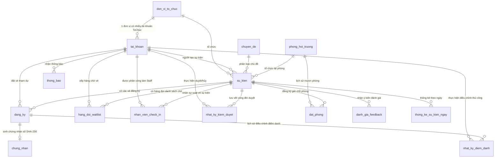

# THIẾT KẾ CƠ SỞ DỮ LIỆU CHI TIẾT (DATABASE DESIGN & ERD SPECIFICATION)
## Campus Event Hub - Enterprise Database Schema (MySQL 8.0+ / MariaDB InnoDB)
**Đồ án Môn học:** Phát triển Ứng dụng Web (IS207) - UIT  
**Phiên bản:** `2.3.0` (Master Edition: Chuẩn hóa 3NF, Generated Columns, 3 Business/AI Views)  
**Tệp nguồn:** [`database.sql`](file:///c:/Users/ADMIN/uit/IS207_PTUDW/mini_project/CampusEventHub/docs-main-project/database.sql)

---

## 1. SƠ ĐỒ THỰC THỂ QUAN HỆ (MERMAID ERD DIAGRAM)



---

## 2. NGUYÊN TẮC KHÓA DÒNG BI QUAN & TRIỆT TIÊU DEADLOCK

Nhằm ngăn chặn xung đột tương tranh khi 50+ sinh viên cùng tranh slot vé cuối cùng, hệ thống bắt buộc tuân thủ thứ tự khóa dòng bi quan duy nhất:
$$\mathbf{su\_kien} \longrightarrow \mathbf{dang\_ky} \longrightarrow \mathbf{hang\_doi\_waitlist}$$

- **Khi Đặt vé (UC-BOOK-01):** Khóa dòng `su_kien` (`SELECT ... FOR UPDATE`), kiểm tra 1 vé/sinh viên trên `dang_ky`, giảm `so_ve_con_lai`, sinh vé `DaDangKy` với chữ ký HMAC-SHA256.
- **Khi Tham gia Waitlist (UC-BOOK-02):** Khóa `su_kien`, xác nhận `so_ve_con_lai == 0`, khóa `dang_ky` kiểm tra vé, khóa `hang_doi_waitlist` lấy `MAX(so_thu_tu) + 1`.
- **Khi Hủy vé (UC-TCK-02):** Khóa `su_kien`, khóa vé trong `dang_ky` đổi sang `DaHuy`, kiểm tra Waitlist: nếu còn `WAITING` và >= 2h thì chuyển người đầu tiên sang `OFFERED` (hạn 60 phút); nếu không còn ai hoặc < 2h thì cộng trả lại `so_ve_con_lai = so_ve_con_lai + 1`.
- **Bất biến Kế toán Toàn vẹn (Capacity Invariant):**  
$$\text{Sức chứa tối đa (Capacity)} = \text{Vé hợp lệ} + \text{Slot OFFERED} + \text{so\_ve\_con\_lai}$$

---

## 3. TỪ ĐIỂN DỮ LIỆU CHI TIẾT (22 TABLES DATA DICTIONARY)

### 3.1. Bảng `don_vi_to_chuc`

> **Mô tả:** don_vi_to_chuc (Đơn vị tổ chức sự kiện (CLB, Đoàn - Hội, Khoa). Admin tạo sẵn, tài khoản ToChuc được gán vào đơn vị (UC-ADM-01).)

| Tên Cột | Kiểu Dữ Liệu | Nullable | Mặc Định | Chú Thích Nghiệp Vụ |
|---|---|---|---|---|
| `ma_don_vi_to_chuc` | `BIGINT UNSIGNED` | NO | `-` |  |
| `ten_don_vi` | `VARCHAR(200)` | NO | `-` |  |
| `ma_dinh_danh` | `VARCHAR(50)` | NO | `-` | Mã viết tắt, ví dụ CLB_WEBDEV, DOAN_KHOA_HTTT |
| `loai_don_vi` | `ENUM('CLB', 'DoanHoi', 'Khoa', 'PhongBan')` | NO | `-` |  |
| `mo_ta` | `TEXT` | YES | `-` |  |
| `logo_url` | `VARCHAR(500)` | YES | `-` |  |
| `hoat_dong` | `TINYINT(1)` | NO | `1` | 1: đang hoạt động, 0: tạm dừng |
| `thoi_gian_tao` | `DATETIME` | NO | `CURRENT_TIMESTAMP` |  |

**Chỉ mục (Indexes & Primary Keys):**
- **Primary Key:** `PRIMARY KEY (`ma_don_vi_to_chuc`)`

**Ràng buộc Toàn vẹn (Constraints & Foreign Keys):**
- `CONSTRAINT `uq_donvi_ten` UNIQUE (`ten_don_vi`)`
- `CONSTRAINT `uq_donvi_dinhdanh` UNIQUE (`ma_dinh_danh`)`

---

### 3.2. Bảng `tai_khoan`

> **Mô tả:** tai_khoan (Tài khoản người dùng và phân quyền RBAC (UC-AUTH, UC-ADM-01). Staff soát vé là quyền theo sự kiện, xem nhan_vien_check_in.)

| Tên Cột | Kiểu Dữ Liệu | Nullable | Mặc Định | Chú Thích Nghiệp Vụ |
|---|---|---|---|---|
| `ma_tai_khoan` | `BIGINT UNSIGNED` | NO | `-` |  |
| `mssv` | `VARCHAR(8)` | YES | `-` | MSSV 8 chữ số; NULL với tài khoản không phải sinh viên |
| `email` | `VARCHAR(100)` | NO | `-` |  |
| `ho_ten` | `VARCHAR(150)` | NO | `-` |  |
| `mat_khau` | `VARCHAR(255)` | NO | `-` | Bcrypt cost=12 |
| `so_dien_thoai` | `VARCHAR(20)` | YES | `-` |  |
| `khoa` | `VARCHAR(100)` | YES | `-` | Khoa/Bộ môn |
| `lop_sinh_hoat` | `VARCHAR(50)` | YES | `-` |  |
| `avatar_url` | `VARCHAR(500)` | YES | `-` |  |
| `loai_tai_khoan` | `ENUM('Admin', 'ToChuc', 'SinhVien')` | NO | `'SinhVien'` |  |
| `ma_don_vi_to_chuc` | `BIGINT UNSIGNED` | YES | `-` | Chỉ có giá trị khi loai_tai_khoan = ToChuc (UC-ADM-01 bước 6) |
| `hoat_dong` | `TINYINT(1)` | NO | `1` | 0: bị khóa (UC-ADM-01.AC.1, UC-AUTH-02.EX.2) |
| `thoi_gian_tao` | `DATETIME` | NO | `CURRENT_TIMESTAMP` |  |
| `thoi_gian_cap_nhat` | `DATETIME` | NO | `CURRENT_TIMESTAMP` |  |

**Chỉ mục (Indexes & Primary Keys):**
- **Primary Key:** `PRIMARY KEY (`ma_tai_khoan`)`
- `INDEX `idx_taikhoan_loai_hoatdong` (`loai_tai_khoan`, `hoat_dong`)`

**Ràng buộc Toàn vẹn (Constraints & Foreign Keys):**
- `CONSTRAINT `uq_taikhoan_email` UNIQUE (`email`)`
- `CONSTRAINT `uq_taikhoan_mssv` UNIQUE (`mssv`)`
- `CONSTRAINT `chk_taikhoan_mssv` CHECK (mssv IS NULL OR mssv REGEXP '^[0-9]{8}$')`
- `CONSTRAINT `chk_taikhoan_tochuc` CHECK ((loai_tai_khoan = 'ToChuc' AND ma_don_vi_to_chuc IS NOT NULL) OR (loai_tai_khoan <> 'ToChuc' AND ma_don_vi_to_chuc IS NULL))`
- `CONSTRAINT `fk_taikhoan_donvi` FOREIGN KEY (`ma_don_vi_to_chuc`) REFERENCES `don_vi_to_chuc` (`ma_don_vi_to_chuc`) ON DELETE RESTRICT ON UPDATE RESTRICT`

---

### 3.3. Bảng `dang_ky_tam_thoi`

> **Mô tả:** dang_ky_tam_thoi (Bảng đệm đăng ký tài khoản chờ xác thực OTP (UC-AUTH-01). Xóa khi kích hoạt thành công hoặc hết hạn.)

| Tên Cột | Kiểu Dữ Liệu | Nullable | Mặc Định | Chú Thích Nghiệp Vụ |
|---|---|---|---|---|
| `id` | `BIGINT UNSIGNED` | NO | `-` |  |
| `email` | `VARCHAR(100)` | NO | `-` |  |
| `mssv` | `VARCHAR(8)` | NO | `-` |  |
| `ho_ten` | `VARCHAR(150)` | NO | `-` |  |
| `lop_sinh_hoat` | `VARCHAR(50)` | NO | `-` |  |
| `khoa` | `VARCHAR(100)` | NO | `-` |  |
| `so_dien_thoai` | `VARCHAR(20)` | YES | `-` |  |
| `mat_khau` | `VARCHAR(255)` | NO | `-` | Bcrypt cost=12 |
| `ma_otp_hash` | `CHAR(64)` | NO | `-` | SHA-256 (hex) của OTP 6 số |
| `het_han_otp` | `DATETIME` | NO | `-` | Hiệu lực 10 phút |
| `so_lan_nhap_sai` | `TINYINT UNSIGNED` | NO | `0` | Nhập sai OTP quá 5 lần thì hủy bản ghi |
| `so_lan_gui_otp` | `TINYINT UNSIGNED` | NO | `1` | Đếm số lần gửi OTP trong cửa sổ giới hạn |
| `cua_so_gui_otp_tu` | `DATETIME` | NO | `CURRENT_TIMESTAMP` | Mốc bắt đầu cửa sổ 10 phút giới hạn gửi lại OTP |
| `thoi_gian_tao` | `DATETIME` | NO | `CURRENT_TIMESTAMP` |  |

**Chỉ mục (Indexes & Primary Keys):**
- **Primary Key:** `PRIMARY KEY (`id`)`
- `INDEX `idx_tamthoi_mssv` (`mssv`)`
- `INDEX `idx_tamthoi_hethan` (`het_han_otp`)`

**Ràng buộc Toàn vẹn (Constraints & Foreign Keys):**
- `CONSTRAINT `uq_tamthoi_email` UNIQUE (`email`)`
- `CONSTRAINT `chk_tamthoi_sai` CHECK (so_lan_nhap_sai <= 5)`

---

### 3.4. Bảng `otp_quen_mat_khau`

> **Mô tả:** otp_quen_mat_khau (OTP khôi phục mật khẩu (UC-AUTH-04). OTP cũ bị hủy khi sinh mã mới.)

| Tên Cột | Kiểu Dữ Liệu | Nullable | Mặc Định | Chú Thích Nghiệp Vụ |
|---|---|---|---|---|
| `id` | `BIGINT UNSIGNED` | NO | `-` |  |
| `ma_tai_khoan` | `BIGINT UNSIGNED` | NO | `-` |  |
| `ma_otp_hash` | `CHAR(64)` | NO | `-` | SHA-256 (hex) của OTP 6 số |
| `het_han` | `DATETIME` | NO | `-` | Hiệu lực 10 phút |
| `da_su_dung` | `TINYINT(1)` | NO | `0` |  |
| `so_lan_thu_sai` | `TINYINT UNSIGNED` | NO | `0` | Tối đa 5 lần |
| `thoi_gian_tao` | `DATETIME` | NO | `CURRENT_TIMESTAMP` |  |

**Chỉ mục (Indexes & Primary Keys):**
- **Primary Key:** `PRIMARY KEY (`id`)`
- `INDEX `idx_otpqmk_tk` (`ma_tai_khoan`, `da_su_dung`, `het_han`)`

**Ràng buộc Toàn vẹn (Constraints & Foreign Keys):**
- `CONSTRAINT `chk_otpqmk_sai` CHECK (so_lan_thu_sai <= 5)`
- `CONSTRAINT `fk_otpqmk_taikhoan` FOREIGN KEY (`ma_tai_khoan`) REFERENCES `tai_khoan` (`ma_tai_khoan`) ON DELETE CASCADE ON UPDATE RESTRICT`

---

### 3.5. Bảng `sessions`

> **Mô tả:** sessions (Phiên đăng nhập Laravel (SESSION_DRIVER=database). Khóa tài khoản = xóa các dòng có user_id tương ứng (UC-ADM-01.AC.1, UC-AUTH-05).)

| Tên Cột | Kiểu Dữ Liệu | Nullable | Mặc Định | Chú Thích Nghiệp Vụ |
|---|---|---|---|---|
| `id` | `VARCHAR(255)` | NO | `-` |  |
| `user_id` | `BIGINT UNSIGNED` | YES | `-` | = tai_khoan.ma_tai_khoan; không đặt FK theo chuẩn Laravel |
| `ip_address` | `VARCHAR(45)` | YES | `-` |  |
| `user_agent` | `TEXT` | YES | `-` |  |
| `payload` | `LONGTEXT` | NO | `-` |  |
| `last_activity` | `INT` | NO | `-` |  |

**Chỉ mục (Indexes & Primary Keys):**
- **Primary Key:** `PRIMARY KEY (`id`)`
- `INDEX `idx_sessions_user` (`user_id`)`
- `INDEX `idx_sessions_last` (`last_activity`)`

---

### 3.6. Bảng `chuyen_de`

> **Mô tả:** chuyen_de (Danh mục chuyên đề / thể loại sự kiện (dữ liệu khởi tạo).)

| Tên Cột | Kiểu Dữ Liệu | Nullable | Mặc Định | Chú Thích Nghiệp Vụ |
|---|---|---|---|---|
| `ma_chuyen_de` | `BIGINT UNSIGNED` | NO | `-` |  |
| `ten_chuyen_de` | `VARCHAR(100)` | NO | `-` |  |
| `mo_ta` | `VARCHAR(255)` | YES | `-` |  |
| `da_xoa` | `TINYINT(1)` | NO | `0` |  |

**Chỉ mục (Indexes & Primary Keys):**
- **Primary Key:** `PRIMARY KEY (`ma_chuyen_de`)`

**Ràng buộc Toàn vẹn (Constraints & Foreign Keys):**
- `CONSTRAINT `uq_chuyende_ten` UNIQUE (`ten_chuyen_de`)`

---

### 3.7. Bảng `phong_hoi_truong`

> **Mô tả:** phong_hoi_truong (Danh mục hội trường, phòng học (UC-ROOM-01). Xóa mềm bằng da_xoa.)

| Tên Cột | Kiểu Dữ Liệu | Nullable | Mặc Định | Chú Thích Nghiệp Vụ |
|---|---|---|---|---|
| `ma_phong` | `BIGINT UNSIGNED` | NO | `-` |  |
| `ten_phong` | `VARCHAR(100)` | NO | `-` |  |
| `co_so` | `ENUM('CoSo1', 'CoSo2')` | NO | `'CoSo1'` |  |
| `suc_chua_toi_da` | `INT UNSIGNED` | NO | `-` | Tối thiểu 10 |
| `trang_thiet_bi` | `JSON` | YES | `-` | Micro, máy chiếu, loa, bàn ghế... |
| `trang_thai` | `ENUM('KhaDung', 'BaoTri')` | NO | `'KhaDung'` |  |
| `bao_tri_tu_ngay` | `DATETIME` | YES | `-` |  |
| `bao_tri_den_ngay` | `DATETIME` | YES | `-` |  |
| `da_xoa` | `TINYINT(1)` | NO | `0` |  |

**Chỉ mục (Indexes & Primary Keys):**
- **Primary Key:** `PRIMARY KEY (`ma_phong`)`

**Ràng buộc Toàn vẹn (Constraints & Foreign Keys):**
- `CONSTRAINT `uq_phong_ten_coso` UNIQUE (`ten_phong`, `co_so`)`
- `CONSTRAINT `chk_phong_succhua` CHECK (suc_chua_toi_da >= 10)`
- `CONSTRAINT `chk_phong_baotri` CHECK ((trang_thai = 'BaoTri' AND bao_tri_tu_ngay IS NOT NULL AND bao_tri_den_ngay IS NOT NULL AND bao_tri_tu_ngay < bao_tri_den_ngay) OR (trang_thai = 'KhaDung' AND bao_tri_tu_ngay IS NULL AND bao_tri_den_ngay IS NULL))`

---

### 3.8. Bảng `su_kien`

> **Mô tả:** su_kien (Sự kiện và vòng đời State Machine 9 trạng thái (SRS mục 1.5). Hàng này là điểm khóa gốc của mọi giao dịch đặt vé.)

| Tên Cột | Kiểu Dữ Liệu | Nullable | Mặc Định | Chú Thích Nghiệp Vụ |
|---|---|---|---|---|
| `ma_su_kien` | `BIGINT UNSIGNED` | NO | `-` |  |
| `ma_don_vi_to_chuc` | `BIGINT UNSIGNED` | NO | `-` |  |
| `ma_chuyen_de` | `BIGINT UNSIGNED` | NO | `-` |  |
| `ma_phong` | `BIGINT UNSIGNED` | NO | `-` | Phòng hiện hành; chỉ đổi khi Admin duyệt dời phòng (UC-EVT-04) |
| `ten_su_kien` | `VARCHAR(255)` | NO | `-` |  |
| `anh_bia` | `VARCHAR(500)` | YES | `-` |  |
| `dien_gia` | `VARCHAR(200)` | YES | `-` |  |
| `mo_ta` | `TEXT` | NO | `-` |  |
| `lo_trinh` | `JSON` | YES | `-` | Agenda |
| `doi_tuong_tham_gia` | `VARCHAR(255)` | YES | `-` |  |
| `ngay_cong_bo` | `DATETIME` | NO | `-` | UC-SYS-01 chuyển APPROVED sang PUBLISHED khi NOW() >= giá trị này |
| `thoi_gian_bat_dau` | `DATETIME` | NO | `-` |  |
| `thoi_gian_ket_thuc` | `DATETIME` | NO | `-` |  |
| `so_luong_toi_da` | `INT UNSIGNED` | NO | `-` | Sức chứa vé phát hành |
| `so_ve_con_lai` | `INT UNSIGNED` | NO | `-` | Bất biến: 0 <= so_ve_con_lai <= so_luong_toi_da |
| `thoi_diem_het_ve` | `DATETIME` | YES | `-` | Lần đầu hết vé (UC-BOOK-01 bước 4.e, dùng cho UC-REP-02) |
| `dieu_khoan_drl` | `ENUM('KhongCo', 'Dieu3', 'Dieu4')` | NO | `'KhongCo'` |  |
| `diem_drl_du_kien` | `TINYINT UNSIGNED` | NO | `0` | +3 đến +5 điểm khi có điều khoản ĐRL |
| `gio_tinh_nguyen` | `DECIMAL(4,1)` | NO | `0.0` |  |
| `trang_thai` | `ENUM('DRAFT', 'SUBMITTED', 'APPROVED', 'REJECTED', 'PUBLISHED', 'RESCHEDULE_PENDING', 'HAPPENING', 'COMPLETED', 'CANCELLED')` | NO | `'DRAFT'` |  |
| `cong_check_in_mo` | `TINYINT(1)` | NO | `0` | Cổng vào của Kiosk đang mở (UC-OPS-01) |
| `cong_check_out_mo` | `TINYINT(1)` | NO | `0` | Cổng ra của Kiosk đang mở (UC-OPS-01) |
| `da_chot_drl` | `TINYINT(1)` | NO | `0` | 1: đã khóa chốt ĐRL (UC-DRL-01) |
| `thoi_gian_chot_drl` | `DATETIME` | YES | `-` |  |
| `thoi_gian_tao` | `DATETIME` | NO | `CURRENT_TIMESTAMP` |  |
| `thoi_gian_cap_nhat` | `DATETIME` | NO | `CURRENT_TIMESTAMP` |  |

**Chỉ mục (Indexes & Primary Keys):**
- **Primary Key:** `PRIMARY KEY (`ma_su_kien`)`
- `INDEX `idx_sukien_tt_batdau` (`trang_thai`, `thoi_gian_bat_dau`)`
- `INDEX `idx_sukien_tt_congbo` (`trang_thai`, `ngay_cong_bo`)`
- `INDEX `idx_sukien_tt_ketthuc` (`trang_thai`, `thoi_gian_ket_thuc`)`
- `INDEX `idx_sukien_donvi_tt` (`ma_don_vi_to_chuc`, `trang_thai`)`
- `FULLTEXT INDEX `ft_sukien_timkiem` (`ten_su_kien`, `mo_ta`, `dien_gia`)`

**Ràng buộc Toàn vẹn (Constraints & Foreign Keys):**
- `CONSTRAINT `chk_sukien_thoigian` CHECK (thoi_gian_bat_dau < thoi_gian_ket_thuc)`
- `CONSTRAINT `chk_sukien_soluong` CHECK (so_luong_toi_da > 0)`
- `CONSTRAINT `chk_sukien_conlai` CHECK (so_ve_con_lai <= so_luong_toi_da)`
- `CONSTRAINT `chk_sukien_congbo` CHECK (ngay_cong_bo <= thoi_gian_bat_dau)`
- `CONSTRAINT `chk_sukien_drl` CHECK (diem_drl_du_kien <= 5 AND (dieu_khoan_drl <> 'KhongCo' OR diem_drl_du_kien = 0))`
- `CONSTRAINT `chk_sukien_chot` CHECK (da_chot_drl = 0 OR thoi_gian_chot_drl IS NOT NULL)`
- `CONSTRAINT `fk_sukien_donvi` FOREIGN KEY (`ma_don_vi_to_chuc`) REFERENCES `don_vi_to_chuc` (`ma_don_vi_to_chuc`) ON DELETE RESTRICT ON UPDATE RESTRICT`
- `CONSTRAINT `fk_sukien_chuyende` FOREIGN KEY (`ma_chuyen_de`) REFERENCES `chuyen_de` (`ma_chuyen_de`) ON DELETE RESTRICT ON UPDATE RESTRICT`
- `CONSTRAINT `fk_sukien_phong` FOREIGN KEY (`ma_phong`) REFERENCES `phong_hoi_truong` (`ma_phong`) ON DELETE RESTRICT ON UPDATE RESTRICT`

---

### 3.9. Bảng `dat_phong`

> **Mô tả:** dat_phong (Lịch giữ/xác nhận phòng (UC-EVT-02/03/04, UC-ROOM-02). Mỗi sự kiện có tối đa 1 dòng PENDING và 1 dòng CONFIRMED tại một thời điểm.)

| Tên Cột | Kiểu Dữ Liệu | Nullable | Mặc Định | Chú Thích Nghiệp Vụ |
|---|---|---|---|---|
| `ma_dat_phong` | `BIGINT UNSIGNED` | NO | `-` |  |
| `ma_phong` | `BIGINT UNSIGNED` | NO | `-` |  |
| `ma_su_kien` | `BIGINT UNSIGNED` | NO | `-` |  |
| `thoi_gian_bat_dau` | `DATETIME` | NO | `-` |  |
| `thoi_gian_ket_thuc` | `DATETIME` | NO | `-` |  |
| `trang_thai` | `ENUM('PENDING', 'CONFIRMED', 'CANCELLED')` | NO | `'PENDING'` |  |
| `ghi_chu` | `VARCHAR(255)` | YES | `-` |  |
| `thoi_gian_tao` | `DATETIME` | NO | `CURRENT_TIMESTAMP` |  |
| `co_pending` | `TINYINT` | YES | `-` | Cột sinh: 1 khi PENDING, NULL nếu khác |
| `co_confirmed` | `TINYINT` | YES | `-` | Cột sinh: 1 khi CONFIRMED, NULL nếu khác |

**Chỉ mục (Indexes & Primary Keys):**
- **Primary Key:** `PRIMARY KEY (`ma_dat_phong`)`
- `INDEX `idx_datphong_xungdot` (`ma_phong`, `thoi_gian_bat_dau`, `thoi_gian_ket_thuc`, `trang_thai`)`

**Ràng buộc Toàn vẹn (Constraints & Foreign Keys):**
- `CONSTRAINT `uq_datphong_pending` UNIQUE (`ma_su_kien`, `co_pending`)`
- `CONSTRAINT `uq_datphong_confirmed` UNIQUE (`ma_su_kien`, `co_confirmed`)`
- `CONSTRAINT `chk_datphong_thoigian` CHECK (thoi_gian_bat_dau < thoi_gian_ket_thuc)`
- `CONSTRAINT `fk_datphong_phong` FOREIGN KEY (`ma_phong`) REFERENCES `phong_hoi_truong` (`ma_phong`) ON DELETE RESTRICT ON UPDATE RESTRICT`
- `CONSTRAINT `fk_datphong_sukien` FOREIGN KEY (`ma_su_kien`) REFERENCES `su_kien` (`ma_su_kien`) ON DELETE RESTRICT ON UPDATE RESTRICT`

---

### 3.10. Bảng `dang_ky`

> **Mô tả:** dang_ky (Vé tham dự và điểm danh 2 chiều (UC-BOOK, UC-TCK, UC-OPS, UC-FEED). Một sinh viên chỉ có tối đa 1 vé chưa hủy trên mỗi sự kiện.)

| Tên Cột | Kiểu Dữ Liệu | Nullable | Mặc Định | Chú Thích Nghiệp Vụ |
|---|---|---|---|---|
| `ma_dang_ky` | `BIGINT UNSIGNED` | NO | `-` |  |
| `ma_tai_khoan` | `BIGINT UNSIGNED` | NO | `-` |  |
| `ma_su_kien` | `BIGINT UNSIGNED` | NO | `-` |  |
| `ma_ve_uuid` | `CHAR(36)` | NO | `-` | UUID v4; nội dung QR = uuid + chữ ký (SRS gọi là ma_qr_code) |
| `chu_ky_hmac` | `CHAR(64)` | NO | `-` | HMAC-SHA256 hex của (uuid + UserID + EventID) |
| `trang_thai` | `ENUM('DaDangKy', 'DaCheckIn', 'DaCheckOut', 'DaHuy')` | NO | `'DaDangKy'` |  |
| `thoi_gian_dang_ky` | `DATETIME` | NO | `CURRENT_TIMESTAMP` |  |
| `thoi_gian_check_in` | `DATETIME` | YES | `-` |  |
| `thoi_gian_check_out` | `DATETIME` | YES | `-` |  |
| `thoi_gian_huy` | `DATETIME` | YES | `-` |  |
| `ly_do_huy` | `VARCHAR(255)` | YES | `-` |  |
| `da_check_in` | `TINYINT(1)` | NO | `0` |  |
| `da_check_out` | `TINYINT(1)` | NO | `0` |  |
| `tham_gia_tron_ven` | `TINYINT(1)` | NO | `0` | Rate >= 60% |
| `tham_gia_mot_phan` | `TINYINT(1)` | NO | `0` | 30% <= Rate < 60% |
| `ti_le_drl` | `DECIMAL(3,2)` | NO | `0.00` | Chỉ nhận 1.00, 0.50 hoặc 0.00 |
| `da_feedback` | `TINYINT(1)` | NO | `0` |  |
| `du_dieu_kien_drl` | `TINYINT(1)` | NO | `0` | 1 khi đã feedback VÀ ti_le_drl > 0 |
| `da_gui_nhac_nho` | `TINYINT(1)` | NO | `0` | Chống gửi trùng email nhắc hẹn (UC-NOTIF-01) |
| `ghi_chu` | `VARCHAR(255)` | YES | `-` |  |
| `ma_tk_hieu_luc` | `BIGINT UNSIGNED` | YES | `-` | Cột sinh: ma_tai_khoan nếu vé chưa hủy, NULL nếu DaHuy |

**Chỉ mục (Indexes & Primary Keys):**
- **Primary Key:** `PRIMARY KEY (`ma_dang_ky`)`
- `INDEX `idx_dangky_tk_sukien` (`ma_tai_khoan`, `ma_su_kien`)`
- `INDEX `idx_dangky_sukien_tt` (`ma_su_kien`, `trang_thai`)`

**Ràng buộc Toàn vẹn (Constraints & Foreign Keys):**
- `CONSTRAINT `uq_dangky_uuid` UNIQUE (`ma_ve_uuid`)`
- `CONSTRAINT `uq_dangky_ve_hieu_luc` UNIQUE (`ma_su_kien`, `ma_tk_hieu_luc`)`
- `CONSTRAINT `uq_dangky_id_sukien` UNIQUE (`ma_dang_ky`, `ma_su_kien`)`
- `CONSTRAINT `chk_dangky_diemdanh` CHECK ((trang_thai = 'DaDangKy' AND da_check_in = 0 AND da_check_out = 0) OR (trang_thai = 'DaCheckIn' AND da_check_in = 1 AND da_check_out = 0) OR (trang_thai = 'DaCheckOut' AND da_check_in = 1 AND da_check_out = 1) OR trang_thai = 'DaHuy')`
- `CONSTRAINT `chk_dangky_tile` CHECK (ti_le_drl IN (0.00, 0.50, 1.00))`
- `CONSTRAINT `chk_dangky_thamdu1` CHECK (NOT (tham_gia_tron_ven = 1 AND tham_gia_mot_phan = 1))`
- `CONSTRAINT `chk_dangky_thamdu2` CHECK (tham_gia_tron_ven = 0 OR (ti_le_drl = 1.00 AND da_check_out = 1))`
- `CONSTRAINT `chk_dangky_thamdu3` CHECK (tham_gia_mot_phan = 0 OR (ti_le_drl = 0.50 AND da_check_out = 1))`
- `CONSTRAINT `chk_dangky_feedback` CHECK (da_feedback = 0 OR da_check_out = 1)`
- `CONSTRAINT `chk_dangky_drl` CHECK (du_dieu_kien_drl = 0 OR (da_feedback = 1 AND ti_le_drl > 0))`
- `CONSTRAINT `fk_dangky_taikhoan` FOREIGN KEY (`ma_tai_khoan`) REFERENCES `tai_khoan` (`ma_tai_khoan`) ON DELETE RESTRICT ON UPDATE RESTRICT`
- `CONSTRAINT `fk_dangky_sukien` FOREIGN KEY (`ma_su_kien`) REFERENCES `su_kien` (`ma_su_kien`) ON DELETE RESTRICT ON UPDATE RESTRICT`

---

### 3.11. Bảng `hang_doi_waitlist`

> **Mô tả:** hang_doi_waitlist (Hàng đợi FIFO và Claim Window 60 phút (UC-BOOK-02/03, UC-SYS-01).)

| Tên Cột | Kiểu Dữ Liệu | Nullable | Mặc Định | Chú Thích Nghiệp Vụ |
|---|---|---|---|---|
| `id` | `BIGINT UNSIGNED` | NO | `-` |  |
| `ma_su_kien` | `BIGINT UNSIGNED` | NO | `-` |  |
| `ma_tai_khoan` | `BIGINT UNSIGNED` | NO | `-` |  |
| `so_thu_tu` | `INT UNSIGNED` | NO | `-` | FIFO, tăng dần trong từng sự kiện (MAX + 1 dưới khóa su_kien) |
| `trang_thai` | `ENUM('WAITING', 'OFFERED', 'ACCEPTED', 'DECLINED', 'EXPIRED', 'CLOSED_WAITLIST', 'CANCELLED')` | NO | `'WAITING'` |  |
| `thoi_gian_dang_ky` | `DATETIME` | NO | `CURRENT_TIMESTAMP` |  |
| `han_chot_xac_nhan` | `DATETIME` | YES | `-` | NOW() + 60 phút khi chuyển sang OFFERED |
| `thoi_gian_phan_hoi` | `DATETIME` | YES | `-` |  |
| `ma_tk_dang_cho` | `BIGINT UNSIGNED` | YES | `-` | Cột sinh: ma_tai_khoan nếu WAITING/OFFERED, NULL nếu khác |

**Chỉ mục (Indexes & Primary Keys):**
- **Primary Key:** `PRIMARY KEY (`id`)`
- `INDEX `idx_waitlist_fifo` (`ma_su_kien`, `trang_thai`, `so_thu_tu`)`
- `INDEX `idx_waitlist_hanchot` (`trang_thai`, `han_chot_xac_nhan`)`
- `INDEX `idx_waitlist_tk` (`ma_tai_khoan`, `trang_thai`)`

**Ràng buộc Toàn vẹn (Constraints & Foreign Keys):**
- `CONSTRAINT `uq_waitlist_thutu` UNIQUE (`ma_su_kien`, `so_thu_tu`)`
- `CONSTRAINT `uq_waitlist_dang_cho` UNIQUE (`ma_su_kien`, `ma_tk_dang_cho`)`
- `CONSTRAINT `chk_waitlist_thutu` CHECK (so_thu_tu > 0)`
- `CONSTRAINT `chk_waitlist_offered` CHECK (trang_thai <> 'OFFERED' OR han_chot_xac_nhan IS NOT NULL)`
- `CONSTRAINT `fk_waitlist_sukien` FOREIGN KEY (`ma_su_kien`) REFERENCES `su_kien` (`ma_su_kien`) ON DELETE RESTRICT ON UPDATE RESTRICT`
- `CONSTRAINT `fk_waitlist_taikhoan` FOREIGN KEY (`ma_tai_khoan`) REFERENCES `tai_khoan` (`ma_tai_khoan`) ON DELETE RESTRICT ON UPDATE RESTRICT`

---

### 3.12. Bảng `nhan_vien_check_in`

> **Mô tả:** nhan_vien_check_in (Phân công Staff soát vé theo sự kiện (UC-OPS-05). Thu hồi quyền = xóa dòng.)

| Tên Cột | Kiểu Dữ Liệu | Nullable | Mặc Định | Chú Thích Nghiệp Vụ |
|---|---|---|---|---|
| `id` | `BIGINT UNSIGNED` | NO | `-` |  |
| `ma_tai_khoan` | `BIGINT UNSIGNED` | NO | `-` |  |
| `ma_su_kien` | `BIGINT UNSIGNED` | NO | `-` |  |
| `thoi_gian_phan_cong` | `DATETIME` | NO | `CURRENT_TIMESTAMP` |  |

**Chỉ mục (Indexes & Primary Keys):**
- **Primary Key:** `PRIMARY KEY (`id`)`
- `INDEX `idx_staff_sukien` (`ma_su_kien`)`

**Ràng buộc Toàn vẹn (Constraints & Foreign Keys):**
- `CONSTRAINT `uq_staff_tk_sukien` UNIQUE (`ma_tai_khoan`, `ma_su_kien`)`
- `CONSTRAINT `fk_staff_taikhoan` FOREIGN KEY (`ma_tai_khoan`) REFERENCES `tai_khoan` (`ma_tai_khoan`) ON DELETE RESTRICT ON UPDATE RESTRICT`
- `CONSTRAINT `fk_staff_sukien` FOREIGN KEY (`ma_su_kien`) REFERENCES `su_kien` (`ma_su_kien`) ON DELETE RESTRICT ON UPDATE RESTRICT`

---

### 3.13. Bảng `danh_gia_feedback`

> **Mô tả:** danh_gia_feedback (Khảo sát đánh giá trong 48 giờ (UC-FEED-01). Dữ liệu cho BTC chỉ đọc qua v_feedback_an_danh.)

| Tên Cột | Kiểu Dữ Liệu | Nullable | Mặc Định | Chú Thích Nghiệp Vụ |
|---|---|---|---|---|
| `id` | `BIGINT UNSIGNED` | NO | `-` |  |
| `ma_dang_ky` | `BIGINT UNSIGNED` | NO | `-` |  |
| `ma_su_kien` | `BIGINT UNSIGNED` | NO | `-` | Khóa kép với ma_dang_ky đảm bảo luôn trùng sự kiện của vé |
| `diem_noi_dung` | `TINYINT UNSIGNED` | NO | `-` | 1 đến 5 sao |
| `diem_dien_gia` | `TINYINT UNSIGNED` | NO | `-` | 1 đến 5 sao |
| `diem_to_chuc` | `TINYINT UNSIGNED` | NO | `-` | 1 đến 5 sao |
| `y_kien_dong_gop` | `TEXT` | YES | `-` |  |
| `thoi_gian_gui` | `DATETIME` | NO | `CURRENT_TIMESTAMP` |  |

**Chỉ mục (Indexes & Primary Keys):**
- **Primary Key:** `PRIMARY KEY (`id`)`
- `INDEX `idx_feedback_sukien` (`ma_su_kien`)`

**Ràng buộc Toàn vẹn (Constraints & Foreign Keys):**
- `CONSTRAINT `uq_feedback_ve` UNIQUE (`ma_dang_ky`, `ma_su_kien`)`
- `CONSTRAINT `chk_feedback_noidung` CHECK (diem_noi_dung BETWEEN 1 AND 5)`
- `CONSTRAINT `chk_feedback_diengia` CHECK (diem_dien_gia BETWEEN 1 AND 5)`
- `CONSTRAINT `chk_feedback_tochuc` CHECK (diem_to_chuc BETWEEN 1 AND 5)`
- `CONSTRAINT `fk_feedback_dangky` FOREIGN KEY (`ma_dang_ky`, `ma_su_kien`) REFERENCES `dang_ky` (`ma_dang_ky`, `ma_su_kien`) ON DELETE RESTRICT ON UPDATE RESTRICT`

---

### 3.14. Bảng `chung_nhan`

> **Mô tả:** chung_nhan (Giấy chứng nhận số, bất biến (UC-CERT-01). Tra cứu công khai theo ma_hash.)

| Tên Cột | Kiểu Dữ Liệu | Nullable | Mặc Định | Chú Thích Nghiệp Vụ |
|---|---|---|---|---|
| `id` | `BIGINT UNSIGNED` | NO | `-` |  |
| `ma_dang_ky` | `BIGINT UNSIGNED` | NO | `-` |  |
| `ma_hash` | `CHAR(64)` | NO | `-` | SHA-256 hex của (TicketID + UserID + EventID + APP_KEY) |
| `ngay_cap` | `DATETIME` | NO | `CURRENT_TIMESTAMP` |  |

**Chỉ mục (Indexes & Primary Keys):**
- **Primary Key:** `PRIMARY KEY (`id`)`

**Ràng buộc Toàn vẹn (Constraints & Foreign Keys):**
- `CONSTRAINT `uq_chungnhan_dangky` UNIQUE (`ma_dang_ky`)`
- `CONSTRAINT `uq_chungnhan_hash` UNIQUE (`ma_hash`)`
- `CONSTRAINT `fk_chungnhan_dangky` FOREIGN KEY (`ma_dang_ky`) REFERENCES `dang_ky` (`ma_dang_ky`) ON DELETE RESTRICT ON UPDATE RESTRICT`

---

### 3.15. Bảng `nhat_ky_kiem_duyet`

> **Mô tả:** nhat_ky_kiem_duyet (Audit Log kiểm duyệt, dời lịch, hủy, chốt ĐRL, cấp quyền (NFR-RELI-01). Chỉ ghi thêm, không sửa, không xóa.)

| Tên Cột | Kiểu Dữ Liệu | Nullable | Mặc Định | Chú Thích Nghiệp Vụ |
|---|---|---|---|---|
| `id` | `BIGINT UNSIGNED` | NO | `-` |  |
| `ma_su_kien` | `BIGINT UNSIGNED` | YES | `-` |  |
| `ma_dang_ky` | `BIGINT UNSIGNED` | YES | `-` | Dùng cho CANCEL_TICKET |
| `ma_tai_khoan_muc_tieu` | `BIGINT UNSIGNED` | YES | `-` | Dùng cho GRANT_ORGANIZER, LOCK_ACCOUNT, UNLOCK_ACCOUNT |
| `nguoi_thuc_hien` | `BIGINT UNSIGNED` | NO | `-` |  |
| `hanh_dong` | `ENUM('SUBMIT', 'APPROVE', 'REJECT', 'REQUEST_EDIT', 'REQUEST_RESCHEDULE', 'APPROVE_RESCHEDULE', 'REJECT_RESCHEDULE', 'CANCEL_EVENT', 'CANCEL_TICKET', 'LOCK_DRL', 'UNLOCK_DRL', 'GRANT_ORGANIZER', 'LOCK_ACCOUNT', 'UNLOCK_ACCOUNT')` | NO | `-` |  |
| `trang_thai_truoc` | `VARCHAR(50)` | YES | `-` |  |
| `trang_thai_sau` | `VARCHAR(50)` | YES | `-` |  |
| `ly_do` | `TEXT` | YES | `-` | Bắt buộc với REJECT (>= 10 ký tự), REQUEST_EDIT, REQUEST_RESCHEDULE, REJECT_RESCHEDULE, CANCEL_EVENT, UNLOCK_DRL, LOCK_ACCOUNT |
| `thoi_gian_tao` | `DATETIME` | NO | `CURRENT_TIMESTAMP` |  |

**Chỉ mục (Indexes & Primary Keys):**
- **Primary Key:** `PRIMARY KEY (`id`)`
- `INDEX `idx_kiemduyet_sukien` (`ma_su_kien`, `thoi_gian_tao`)`
- `INDEX `idx_kiemduyet_nguoi` (`nguoi_thuc_hien`, `thoi_gian_tao`)`

**Ràng buộc Toàn vẹn (Constraints & Foreign Keys):**
- `CONSTRAINT `chk_kiemduyet_doituong` CHECK (ma_su_kien IS NOT NULL OR ma_dang_ky IS NOT NULL OR ma_tai_khoan_muc_tieu IS NOT NULL)`
- `CONSTRAINT `chk_kiemduyet_lydo` CHECK ((hanh_dong NOT IN ('REJECT', 'REQUEST_EDIT', 'REQUEST_RESCHEDULE', 'REJECT_RESCHEDULE', 'CANCEL_EVENT', 'UNLOCK_DRL', 'LOCK_ACCOUNT') OR ly_do IS NOT NULL) AND (hanh_dong NOT IN ('REJECT', 'REJECT_RESCHEDULE') OR CHAR_LENGTH(ly_do) >= 10))`
- `CONSTRAINT `fk_kiemduyet_sukien` FOREIGN KEY (`ma_su_kien`) REFERENCES `su_kien` (`ma_su_kien`) ON DELETE RESTRICT ON UPDATE RESTRICT`
- `CONSTRAINT `fk_kiemduyet_dangky` FOREIGN KEY (`ma_dang_ky`) REFERENCES `dang_ky` (`ma_dang_ky`) ON DELETE RESTRICT ON UPDATE RESTRICT`
- `CONSTRAINT `fk_kiemduyet_muctieu` FOREIGN KEY (`ma_tai_khoan_muc_tieu`) REFERENCES `tai_khoan` (`ma_tai_khoan`) ON DELETE RESTRICT ON UPDATE RESTRICT`
- `CONSTRAINT `fk_kiemduyet_nguoi` FOREIGN KEY (`nguoi_thuc_hien`) REFERENCES `tai_khoan` (`ma_tai_khoan`) ON DELETE RESTRICT ON UPDATE RESTRICT`

---

### 3.16. Bảng `nhat_ky_diem_danh`

> **Mô tả:** nhat_ky_diem_danh (Audit Log can thiệp điểm danh thủ công (UC-OPS-04). Dòng tồn tại = vé mang huy hiệu Thủ công.)

| Tên Cột | Kiểu Dữ Liệu | Nullable | Mặc Định | Chú Thích Nghiệp Vụ |
|---|---|---|---|---|
| `id` | `BIGINT UNSIGNED` | NO | `-` |  |
| `ma_dang_ky` | `BIGINT UNSIGNED` | NO | `-` |  |
| `nguoi_thuc_hien` | `BIGINT UNSIGNED` | NO | `-` |  |
| `trang_thai_cu` | `ENUM('DaDangKy', 'DaCheckIn', 'DaCheckOut', 'DaHuy')` | NO | `-` |  |
| `trang_thai_moi` | `ENUM('DaCheckIn', 'DaCheckOut')` | NO | `-` |  |
| `ly_do` | `TEXT` | NO | `-` | Bắt buộc, tối thiểu 10 ký tự |
| `thoi_gian_tao` | `DATETIME` | NO | `CURRENT_TIMESTAMP` |  |

**Chỉ mục (Indexes & Primary Keys):**
- **Primary Key:** `PRIMARY KEY (`id`)`
- `INDEX `idx_diemdanh_ve` (`ma_dang_ky`, `thoi_gian_tao`)`
- `INDEX `idx_diemdanh_nguoi` (`nguoi_thuc_hien`)`

**Ràng buộc Toàn vẹn (Constraints & Foreign Keys):**
- `CONSTRAINT `chk_diemdanh_lydo` CHECK (CHAR_LENGTH(ly_do) >= 10)`
- `CONSTRAINT `chk_diemdanh_khac` CHECK (trang_thai_cu <> trang_thai_moi)`
- `CONSTRAINT `fk_diemdanh_dangky` FOREIGN KEY (`ma_dang_ky`) REFERENCES `dang_ky` (`ma_dang_ky`) ON DELETE RESTRICT ON UPDATE RESTRICT`
- `CONSTRAINT `fk_diemdanh_nguoi` FOREIGN KEY (`nguoi_thuc_hien`) REFERENCES `tai_khoan` (`ma_tai_khoan`) ON DELETE RESTRICT ON UPDATE RESTRICT`

---

### 3.17. Bảng `thong_bao`

> **Mô tả:** thong_bao (Thông báo In-app (biểu tượng quả chuông) song song với email (UC-NOTIF-01, UC-BOOK-03).)

| Tên Cột | Kiểu Dữ Liệu | Nullable | Mặc Định | Chú Thích Nghiệp Vụ |
|---|---|---|---|---|
| `id` | `BIGINT UNSIGNED` | NO | `-` |  |
| `ma_tai_khoan` | `BIGINT UNSIGNED` | NO | `-` |  |
| `tieu_de` | `VARCHAR(200)` | NO | `-` |  |
| `noi_dung` | `TEXT` | NO | `-` |  |
| `loai_thong_bao` | `ENUM('HE_THONG', 'DE_XUAT_SU_KIEN', 'KET_QUA_KIEM_DUYET', 'CAP_NHAT_SU_KIEN', 'HUY_SU_KIEN', 'NHAC_HEN', 'CLAIM_SLOT', 'VE_MOI', 'WAITLIST_DONG')` | NO | `-` |  |
| `lien_ket` | `VARCHAR(255)` | YES | `-` |  |
| `da_doc` | `TINYINT(1)` | NO | `0` |  |
| `thoi_gian_gui` | `DATETIME` | NO | `CURRENT_TIMESTAMP` |  |

**Chỉ mục (Indexes & Primary Keys):**
- **Primary Key:** `PRIMARY KEY (`id`)`
- `INDEX `idx_thongbao_tk` (`ma_tai_khoan`, `da_doc`, `thoi_gian_gui`)`

**Ràng buộc Toàn vẹn (Constraints & Foreign Keys):**
- `CONSTRAINT `fk_thongbao_taikhoan` FOREIGN KEY (`ma_tai_khoan`) REFERENCES `tai_khoan` (`ma_tai_khoan`) ON DELETE CASCADE ON UPDATE RESTRICT`

---

### 3.18. Bảng `thong_ke_su_kien_ngay`

> **Mô tả:** thong_ke_su_kien_ngay (Summary Table do Scheduler cập nhật hàng đêm (UC-REP-02, NFR-PERF-03).)

| Tên Cột | Kiểu Dữ Liệu | Nullable | Mặc Định | Chú Thích Nghiệp Vụ |
|---|---|---|---|---|
| `id` | `BIGINT UNSIGNED` | NO | `-` |  |
| `ngay_thong_ke` | `DATE` | NO | `-` |  |
| `ma_su_kien` | `BIGINT UNSIGNED` | NO | `-` |  |
| `tong_ve_phat_hanh` | `INT UNSIGNED` | NO | `0` |  |
| `tong_ve_dang_ky` | `INT UNSIGNED` | NO | `0` | Vé chưa hủy |
| `tong_luot_tham_du` | `INT UNSIGNED` | NO | `0` | Số vé có thoi_gian_check_in |
| `tong_luot_check_out` | `INT UNSIGNED` | NO | `0` |  |
| `diem_hai_long_trung_binh` | `DECIMAL(3,2)` | YES | `-` | NULL khi chưa có đánh giá |

**Chỉ mục (Indexes & Primary Keys):**
- **Primary Key:** `PRIMARY KEY (`id`)`
- `INDEX `idx_thongke_sukien` (`ma_su_kien`)`

**Ràng buộc Toàn vẹn (Constraints & Foreign Keys):**
- `CONSTRAINT `uq_thongke_ngay_sukien` UNIQUE (`ngay_thong_ke`, `ma_su_kien`)`
- `CONSTRAINT `fk_thongke_sukien` FOREIGN KEY (`ma_su_kien`) REFERENCES `su_kien` (`ma_su_kien`) ON DELETE CASCADE ON UPDATE RESTRICT`

---

### 3.19. Bảng `jobs`

> **Mô tả:** jobs (Laravel Queue (QUEUE_CONNECTION=database): email hàng loạt, nhắc hẹn.)

| Tên Cột | Kiểu Dữ Liệu | Nullable | Mặc Định | Chú Thích Nghiệp Vụ |
|---|---|---|---|---|
| `id` | `BIGINT UNSIGNED` | NO | `-` |  |
| `queue` | `VARCHAR(255)` | NO | `-` |  |
| `payload` | `LONGTEXT` | NO | `-` |  |
| `attempts` | `TINYINT UNSIGNED` | NO | `-` |  |
| `reserved_at` | `INT UNSIGNED` | YES | `-` |  |
| `available_at` | `INT UNSIGNED` | NO | `-` |  |
| `created_at` | `INT UNSIGNED` | NO | `-` |  |

**Chỉ mục (Indexes & Primary Keys):**
- **Primary Key:** `PRIMARY KEY (`id`)`
- `INDEX `idx_jobs_queue` (`queue`)`

---

### 3.20. Bảng `failed_jobs`

> **Mô tả:** failed_jobs (Laravel failed jobs.)

| Tên Cột | Kiểu Dữ Liệu | Nullable | Mặc Định | Chú Thích Nghiệp Vụ |
|---|---|---|---|---|
| `id` | `BIGINT UNSIGNED` | NO | `-` |  |
| `uuid` | `VARCHAR(255)` | NO | `-` |  |
| `connection` | `TEXT` | NO | `-` |  |
| `queue` | `TEXT` | NO | `-` |  |
| `payload` | `LONGTEXT` | NO | `-` |  |
| `exception` | `LONGTEXT` | NO | `-` |  |
| `failed_at` | `TIMESTAMP` | NO | `CURRENT_TIMESTAMP` |  |

**Chỉ mục (Indexes & Primary Keys):**
- **Primary Key:** `PRIMARY KEY (`id`)`

**Ràng buộc Toàn vẹn (Constraints & Foreign Keys):**
- `CONSTRAINT `uq_failedjobs_uuid` UNIQUE (`uuid`)`

---

### 3.21. Bảng `cache`

> **Mô tả:** cache (Laravel Cache (CACHE_STORE=database), dùng cho Rate Limiting đăng nhập (NFR-SEC-01).)

| Tên Cột | Kiểu Dữ Liệu | Nullable | Mặc Định | Chú Thích Nghiệp Vụ |
|---|---|---|---|---|
| `key` | `VARCHAR(255)` | NO | `-` |  |
| `value` | `MEDIUMTEXT` | NO | `-` |  |
| `expiration` | `INT` | NO | `-` |  |

**Chỉ mục (Indexes & Primary Keys):**
- **Primary Key:** `PRIMARY KEY (`key`)`
- `INDEX `idx_cache_expiration` (`expiration`)`

---

### 3.22. Bảng `cache_locks`

> **Mô tả:** cache_locks (Laravel Cache Locks.)

| Tên Cột | Kiểu Dữ Liệu | Nullable | Mặc Định | Chú Thích Nghiệp Vụ |
|---|---|---|---|---|
| `key` | `VARCHAR(255)` | NO | `-` |  |
| `owner` | `VARCHAR(255)` | NO | `-` |  |
| `expiration` | `INT` | NO | `-` |  |

**Chỉ mục (Indexes & Primary Keys):**
- **Primary Key:** `PRIMARY KEY (`key`)`
- `INDEX `idx_cachelocks_expiration` (`expiration`)`

---

## 4. DANH SÁCH DATABASE VIEWS NGHIỆP VỤ & AI ANALYTICS

Hệ thống cung cấp 3 Database Views tối ưu hóa cho bảo mật và hiệu năng:

### 4.1. View `v_event_analytics` (Dành cho Admin BI Agent)
- **Mục đích:** Cung cấp số liệu tổng hợp vĩ mô (tỷ lệ lấp đầy, số vé đã đặt, số lượt check-in/out, số phút cháy vé, điểm feedback trung bình) cho Trợ lý Admin BI Agent (`UC-AI-03`).
- **Bảo mật:** Toàn bộ thông tin cá nhân của sinh viên bị loại bỏ hoàn toàn. Phân quyền tài khoản kết nối AI chỉ có quyền `SELECT` duy nhất trên View này.
```sql
SELECT sk.ma_su_kien, sk.ten_su_kien, dv.ten_don_vi, cd.ten_chuyen_de, ph.ten_phong, ph.co_so,
       sk.trang_thai, sk.ngay_cong_bo, sk.thoi_gian_bat_dau, sk.thoi_gian_ket_thuc,
       sk.so_luong_toi_da, sk.so_ve_con_lai, ...
FROM su_kien sk
JOIN don_vi_to_chuc dv ON dv.ma_don_vi_to_chuc = sk.ma_don_vi_to_chuc
JOIN chuyen_de cd ON cd.ma_chuyen_de = sk.ma_chuyen_de
JOIN phong_hoi_truong ph ON ph.ma_phong = sk.ma_phong
...
WHERE sk.trang_thai NOT IN ('DRAFT', 'SUBMITTED', 'REJECTED');
```

### 4.2. View `v_feedback_an_danh` (Dành cho Ban tổ chức xem phản hồi)
- **Mục đích:** Phục vụ Ban tổ chức xem đánh giá chất lượng sự kiện (`UC-FEED-01`, `UC-REP-01`).
- **Bảo mật:** Ẩn danh tuyệt đối (không chứa `ma_tai_khoan`, `mssv`, `ho_ten`), đảm bảo sinh viên tự tin góp ý trung thực.
```sql
SELECT ma_su_kien, diem_noi_dung, diem_dien_gia, diem_to_chuc, y_kien_dong_gop, thoi_gian_gui
FROM danh_gia_feedback;
```

### 4.3. View `v_danh_sach_drl` (Kết xuất Điểm Rèn Luyện chuẩn mẫu P.CTSV)
- **Mục đích:** Tự động định dạng và kết xuất danh sách sinh viên đủ điều kiện cộng ĐRL theo đúng biểu mẫu CTSV (`UC-DRL-01`).
- **Điều kiện lọc:** Chỉ lấy các bản ghi có `du_dieu_kien_drl = 1` (đã check-in, check-out đạt chuẩn >= 30% và hoàn thành khảo sát Feedback).
```sql
SELECT dk.ma_su_kien,
       ROW_NUMBER() OVER (PARTITION BY dk.ma_su_kien ORDER BY tk.mssv) AS stt,
       tk.mssv, tk.ho_ten, tk.lop_sinh_hoat, tk.khoa,
       sk.ten_su_kien, sk.dieu_khoan_drl AS dieu_drl,
       ROUND(sk.diem_drl_du_kien * dk.ti_le_drl, 2) AS diem_cong_thuc_nhan,
       dk.thoi_gian_check_in AS thoi_gian_vao,
       dk.thoi_gian_check_out AS thoi_gian_ra,
       CASE WHEN dk.tham_gia_tron_ven = 1 THEN 'Tham dự trọn vẹn (100%)'
            WHEN dk.tham_gia_mot_phan = 1 THEN 'Tham dự một phần (50%)' END AS ghi_chu_tham_du
FROM dang_ky dk
JOIN tai_khoan tk ON tk.ma_tai_khoan = dk.ma_tai_khoan
JOIN su_kien sk ON sk.ma_su_kien = dk.ma_su_kien
WHERE dk.du_dieu_kien_drl = 1;
```

## 5. BẢNG TRA CỨU ENUM & TRẠNG THÁI NGHIỆP VỤ

| Thực Thể / Bảng | Tên Cột | Các Giá Trị Hợp Lệ (Enum) | Ý Nghĩa Nghiệp Vụ |
|---|---|---|---|
| `tai_khoan` | `loai_tai_khoan` | `'Admin'`, `'ToChuc'`, `'SinhVien'` | Vai trò người dùng cốt lõi hệ thống. |
| `don_vi_to_chuc` | `loai_don_vi` | `'CLB'`, `'DoanHoi'`, `'Khoa'`, `'PhongBan'` | Phân loại đơn vị tổ chức trực thuộc trường. |
| `phong_hoi_truong` | `co_so` | `'CoSo1'`, `'CoSo2'` | Cơ sở phòng ốc (UIT Cơ sở 1 Thủ Đức, v.v.). |
| `su_kien` | `trang_thai` | `'DRAFT'`, `'SUBMITTED'`, `'APPROVED'`, `'REJECTED'`, `'PUBLISHED'`, `'RESCHEDULE_PENDING'`, `'HAPPENING'`, `'COMPLETED'`, `'CANCELLED'` | Vòng đời 9 trạng thái sự kiện. |
| `su_kien` | `dieu_khoan_drl` | `'Dieu3'`, `'Dieu4'` | Phân loại tiêu chí cộng Điểm Rèn Luyện theo quy chế CTSV. |
| `dat_phong` | `trang_thai` | `'PENDING'`, `'CONFIRMED'`, `'CANCELLED'` | Trạng thái mượn phòng hội trường. |
| `dang_ky` | `trang_thai` | `'DaDangKy'`, `'DaCheckIn'`, `'DaCheckOut'`, `'DaHuy'` | Vòng đời 4 trạng thái vé của sinh viên. |
| `hang_doi_waitlist` | `trang_thai` | `'WAITING'`, `'OFFERED'`, `'ACCEPTED'`, `'DECLINED'`, `'EXPIRED'`, `'CLOSED_WAITLIST'`, `'CANCELLED'` | Trạng thái hàng đợi danh sách chờ (Waitlist). |
| `thong_bao` | `loai_thong_bao` | `'XacNhanVe'`, `'WaitlistOffer'`, `'NhacLich'`, `'DoiLich'`, `'HuySuKien'`, `'CapChungNhan'`, `'HeThong'` | Loại thông báo gửi in-app và email. |
| `nhat_ky_kiem_duyet` | `hanh_dong` | `'SUBMIT'`, `'APPROVE'`, `'REJECT'`, `'REQUEST_RESCHEDULE'`, `'APPROVE_RESCHEDULE'`, `'REJECT_RESCHEDULE'`, `'CANCEL_EVENT'`, `'CANCEL_TICKET'`, `'GRANT_ORGANIZER'`, `'LOCK_ACCOUNT'`, `'UNLOCK_ACCOUNT'` | Nhật ký kiểm toán các thao tác nhạy cảm. |
