# THIẾT KẾ CƠ SỞ DỮ LIỆU CHI TIẾT (DATABASE DESIGN & ERD SPECIFICATION)
## Campus Event Hub - Enterprise Database Schema (MySQL 8.0+ / MariaDB InnoDB)
**Đồ án Môn học:** Phát triển Ứng dụng Web (IS207.R11) - UIT  
**Phiên bản:** `3.1.2` (SSOT Edition: Chuẩn hóa 3NF Đơn vị Khoa, Tách Phiên Kiosk TOTP, Đóng băng Slot Waitlist, Thu hồi Chứng nhận & Đồng bộ 100% SRS v3.1.2)  
**Tệp nguồn:** `database_v3.1_ssms.sql` (T-SQL / SSMS) & `database_v3.1_mysql.sql` (MySQL 8.0+ / MariaDB)

## 1. SƠ ĐỒ THỰC THỂ QUAN HỆ (MERMAID ERD DIAGRAM)

```mermaid
erDiagram
    don_vi_to_chuc ||--o{ don_vi_to_chuc : "phân cấp Khoa - CLB trực thuộc (ma_don_vi_cha)"
    don_vi_to_chuc ||--o{ tai_khoan : "quản lý cán bộ ToChuc/Admin (ma_don_vi_to_chuc)"
    don_vi_to_chuc ||--o{ tai_khoan : "quản lý sinh viên thuộc Khoa (ma_khoa - 3NF)"
    don_vi_to_chuc ||--o{ su_kien : "đơn vị chủ trì chính (Host A)"
    don_vi_to_chuc ||--o{ su_kien_dong_to_chuc : "tham gia đồng tổ chức (Co-host)"
    
    tai_khoan ||--o{ otp_quen_mat_khau : "yêu cầu khôi phục mật khẩu"
    tai_khoan ||--o{ sessions : "phiên đăng nhập (Single Active Session cho SV)"
    tai_khoan ||--o{ phien_kiosk : "kích hoạt Kiosk hội trường"
    tai_khoan ||--o{ dang_ky : "đặt vé tham dự"
    tai_khoan ||--o{ hang_doi_waitlist : "xếp hàng chờ vé FIFO"
    tai_khoan ||--o{ nhan_vien_check_in : "được phân công làm Staff"
    tai_khoan ||--o{ thong_bao : "nhận thông báo"
    tai_khoan ||--o{ nhat_ky_kiem_duyet : "thực hiện duyệt/hủy/cứu xét"
    tai_khoan ||--o{ nhat_ky_diem_danh : "thực hiện điều chỉnh thủ công"
    
    chuyen_de ||--o{ su_kien : "phân loại chủ đề"
    phong_hoi_truong ||--o{ su_kien : "tổ chức tại phòng hiện hành"
    phong_hoi_truong ||--o{ dat_phong : "lịch sử mượn phòng"
    
    su_kien ||--o{ su_kien_dong_to_chuc : "mời các đơn vị đồng tổ chức"
    su_kien ||--o{ dat_phong : "đăng ký giữ chỗ phòng (Soft Hold 48h / Confirmed)"
    su_kien ||--o{ phien_kiosk : "quản lý Kiosk Session Token & TOTP Secret 30s"
    su_kien ||--o{ dang_ky : "có các vé đăng ký"
    su_kien ||--o{ hang_doi_waitlist : "có hàng đợi danh sách chờ"
    su_kien ||--o{ nhan_vien_check_in : "nhân sự soát vé sự kiện"
    su_kien ||--o{ danh_gia_feedback : "nhận ý kiến đánh giá"
    su_kien ||--o{ nhat_ky_kiem_duyet : "lưu vết vòng đời duyệt đa cấp"
    su_kien ||--o{ thong_ke_su_kien_ngay : "thống kê theo ngày"
    
    dang_ky ||--o| chung_nhan : "sinh chứng nhận số HMAC-SHA256 & quản lý thu hồi"
    dang_ky ||--o{ nhat_ky_diem_danh : "lịch sử điều chỉnh trạng thái & tỷ lệ ĐRL"
    dang_ky ||--o| danh_gia_feedback : "gửi khảo sát sau check-out (48h + ân hạn)"
```

## 2. NGUYÊN TẮC KHÓA DÒNG BI QUAN 6 CẤP & BẤT BIẾN CỐT LÕI

Nhằm ngăn chặn xung đột tương tranh (Race Condition) khi 50+ sinh viên cùng tranh suất vé cuối cùng hoặc một sinh viên mở nhiều tab đặt 2 sự kiện trùng giờ cùng lúc, mọi giao dịch CSDL bắt buộc tuân thủ **Thứ tự Khóa Dòng Toàn cục 6 Cấp (Deadlock-Free Lock Ordering Invariant)**:
$$\mathbf{tai\_khoan} \longrightarrow \mathbf{phong\_hoi\_truong} \longrightarrow \mathbf{dat\_phong} \longrightarrow \mathbf{su\_kien} \longrightarrow \mathbf{dang\_ky} \longrightarrow \mathbf{hang\_doi\_waitlist}$$

- **Khi Đặt vé (`UC-BOOK-01`):** Khóa bản ghi `tai_khoan` của sinh viên trước tiên (để tuần tự hóa mọi giao dịch đặt vé của riêng sinh viên đó), tiếp theo khóa dòng `su_kien`, kiểm tra quy tắc 1 vé/sinh viên và kiểm tra chống trùng lịch cá nhân trên `dang_ky` (chặn tuyệt đối nếu cả 2 sự kiện đều có `khong_gioi_han_slot = 0`; cảnh báo mềm nếu 1 trong 2 sự kiện có `khong_gioi_han_slot = 1`), khấu trừ `so_ve_con_lai` và sinh vé `DaDangKy` kèm chữ ký HMAC-SHA256.
- **Khi Tham gia Waitlist (`UC-BOOK-02`):** Chỉ áp dụng cho sự kiện giới hạn slot (`khong_gioi_han_slot = 0`) trước mốc $T - 2\text{h}$. Khóa dòng `tai_khoan` $\rightarrow$ khóa dòng `su_kien`, xác nhận `so_ve_con_lai = 0`, kiểm tra sinh viên chưa có vé và chưa xếp hàng, sau đó cấp số thứ tự `COALESCE(MAX(so_thu_tu), 0) + 1` trên `hang_doi_waitlist` (được bảo vệ an toàn bởi khóa dòng `su_kien`, không dùng khóa cấp bảng).
- **Khi Hủy vé (`UC-TCK-02`) & Cấp quyền Giữ chỗ Linh hoạt (`UC-BOOK-03`):** Chỉ cho phép hủy vé trước mốc $T - 4\text{h}$. Khi có suất trống giải phóng trước mốc $T - 2\text{h}$:
  - Nếu thời gian còn lại đến $T - 2\text{h} \ge 15\text{ phút}$ và hàng đợi còn người `WAITING`: Hệ thống kiểm tra trùng lịch của người đứng đầu hàng đợi; nếu bị trùng lịch thì gán `SKIPPED_CONFLICT` và xét người kế tiếp; nếu hợp lệ thì chuyển sang `OFFERED` với hạn chót $\min(\text{NOW()} + 60\text{m}, T - 2\text{h})$.
  - Nếu thời gian còn lại đến $T - 2\text{h} < 15\text{ phút}$ và hàng đợi vẫn còn người `WAITING`: Hệ thống ngừng cấp Offer mới và **đóng băng suất trống** (`so_slot_dong_bang = so_slot_dong_bang + 1`), không cộng vào `so_ve_con_lai` để chống người ngoài chen ngang. Tại đúng mốc $T - 2\text{h}$, Tác vụ 2 (`UC-SYS-01`) hoàn trả nguyên tử cả `so_slot_dong_bang` lẫn các suất `OFFERED` hết hạn về `so_ve_con_lai` và đặt `so_slot_dong_bang = 0`.
- **Bất biến Sức chứa & Kế toán Toàn vẹn (Capacity Invariants):**
  - Ngay từ khâu tạo sự kiện (`UC-EVT-01`): $\text{so\_luong\_toi\_da} \le \text{phong\_hoi\_truong.suc\_chua\_toi\_da}$ (khi `khong_gioi_han_slot = 0`).
  - Trong suốt vòng đời vận hành vé (khi `khong_gioi_han_slot = 0`):
    $$\text{so\_luong\_toi\_da (Capacity)} = \text{Vé hợp lệ} + \text{Slot OFFERED} + \text{so\_slot\_dong\_bang} + \text{so\_ve\_con\_lai}$$

## 3. TỪ ĐIỂN DỮ LIỆU CHI TIẾT (24 TABLES DATA DICTIONARY)

### 3.1. Bảng `don_vi_to_chuc`

> **Mô tả:** Đơn vị tổ chức sự kiện (CLB, Đoàn - Hội, Khoa, Phòng ban). Hỗ trợ phân cấp đơn vị quản lý trực tiếp qua `ma_don_vi_cha` (Self-referencing FK) để định tuyến luồng phê duyệt đa cấp (Host-driven Approval Routing).

| Tên Cột | Kiểu Dữ Liệu | Nullable | Mặc Định | Chú Thích Nghiệp Vụ |
|---|---|---|---|---|
| `ma_don_vi_to_chuc` | `BIGINT UNSIGNED` | NO | `AUTO_INCREMENT` | Khóa chính tự tăng |
| `ma_don_vi_cha` | `BIGINT UNSIGNED` | YES | `NULL` | `NULL`: Cấp Trường (Khoa, CLB Trường, Đoàn-Hội Trường); `NOT NULL`: CLB trực thuộc Khoa đó |
| `ten_don_vi` | `VARCHAR(200)` | NO | `-` | Tên đầy đủ của đơn vị tổ chức |
| `ma_dinh_danh` | `VARCHAR(50)` | NO | `-` | Mã viết tắt, ví dụ `KHOA_HTTT`, `CLB_WEBDEV`, `DOAN_TRUONG` |
| `loai_don_vi` | `ENUM('CLB', 'DoanHoi', 'Khoa', 'PhongBan')` | NO | `-` | Phân loại hình thái đơn vị |
| `mo_ta` | `TEXT` | YES | `NULL` | Mô tả chức năng, nhiệm vụ đơn vị |
| `logo_url` | `VARCHAR(500)` | YES | `NULL` | Đường dẫn ảnh biểu trưng |
| `hoat_dong` | `TINYINT(1)` | NO | `1` | `1`: đang hoạt động, `0`: tạm dừng |
| `thoi_gian_tao` | `DATETIME` | NO | `CURRENT_TIMESTAMP` | Thời điểm tạo bản ghi |

**Chỉ mục (Indexes & Primary Keys):**
- **Primary Key:** `PRIMARY KEY (ma_don_vi_to_chuc)`
- `INDEX idx_donvi_cha (ma_don_vi_cha)`

**Ràng buộc Toàn vẹn (Constraints & Foreign Keys):**
- `CONSTRAINT uq_donvi_ten UNIQUE (ten_don_vi)`
- `CONSTRAINT uq_donvi_dinhdanh UNIQUE (ma_dinh_danh)`
- `CONSTRAINT fk_donvi_cha FOREIGN KEY (ma_don_vi_cha) REFERENCES don_vi_to_chuc (ma_don_vi_to_chuc) ON DELETE RESTRICT ON UPDATE RESTRICT`

### 3.2. Bảng `tai_khoan`

> **Mô tả:** Tài khoản người dùng và phân quyền RBAC (`UC-AUTH`, `UC-ADM-01`). Tài khoản đại diện Khoa hoặc CLB mang `loai_tai_khoan = 'ToChuc'` gắn với `ma_don_vi_to_chuc`. Staff soát vé là quyền theo sự kiện, xem `nhan_vien_check_in`.

| Tên Cột | Kiểu Dữ Liệu | Nullable | Mặc Định | Chú Thích Nghiệp Vụ |
|---|---|---|---|---|
| `ma_tai_khoan` | `BIGINT UNSIGNED` | NO | `AUTO_INCREMENT` | Khóa chính tự tăng |
| `mssv` | `VARCHAR(8)` | YES | `NULL` | MSSV 8 chữ số; `NULL` với tài khoản không phải sinh viên |
| `email` | `VARCHAR(100)` | NO | `-` | Địa chỉ email định danh |
| `ho_ten` | `VARCHAR(150)` | NO | `-` | Họ và tên người dùng |
| `mat_khau` | `VARCHAR(255)` | NO | `-` | Mật khẩu băm Bcrypt cost=12 |
| `so_dien_thoai` | `VARCHAR(20)` | YES | `NULL` | Số điện thoại liên hệ |
| `ma_khoa` | `BIGINT UNSIGNED` | YES | `NULL` | `[Chuẩn 3NF]` Khóa ngoại tham chiếu `don_vi_to_chuc` (`loai_don_vi = 'Khoa'`) |
| `khoa` | `VARCHAR(100)` | YES | `NULL` | Tên Khoa/Bộ môn hiển thị nhanh |
| `lop_sinh_hoat` | `VARCHAR(50)` | YES | `NULL` | Lớp sinh hoạt của sinh viên |
| `avatar_url` | `VARCHAR(500)` | YES | `NULL` | Ảnh đại diện |
| `loai_tai_khoan` | `ENUM('Admin', 'ToChuc', 'SinhVien')` | NO | `'SinhVien'` | Vai trò hệ thống cốt lõi |
| `ma_don_vi_to_chuc` | `BIGINT UNSIGNED` | YES | `NULL` | Bắt buộc khi `loai_tai_khoan = 'ToChuc'`; tùy chọn khi `loai_tai_khoan = 'Admin'` (`UC-ADM-01`) |
| `dong_y_nghi_dinh_13` | `TINYINT(1)` | NO | `1` | Đồng thuận chính sách bảo vệ dữ liệu cá nhân theo Nghị định 13/2023/NĐ-CP |
| `thoi_gian_dong_y_nd13` | `DATETIME` | YES | `CURRENT_TIMESTAMP` | Thời điểm xác nhận đồng thuận Nghị định 13 |
| `buoc_doi_mat_khau` | `TINYINT(1)` | NO | `0` | `1`: Tài khoản nội bộ mới cấp phát bắt buộc đổi mật khẩu ở lần đăng nhập đầu tiên |
| `hoat_dong` | `TINYINT(1)` | NO | `1` | `0`: bị khóa (`UC-ADM-01.AC.1`, `UC-AUTH-02.EX.2`) |
| `thoi_gian_tao` | `DATETIME` | NO | `CURRENT_TIMESTAMP` | Thời điểm tạo tài khoản |
| `thoi_gian_cap_nhat` | `DATETIME` | NO | `CURRENT_TIMESTAMP` | Thời điểm cập nhật gần nhất |

**Chỉ mục (Indexes & Primary Keys):**
- **Primary Key:** `PRIMARY KEY (ma_tai_khoan)`
- `INDEX idx_taikhoan_loai_hoatdong (loai_tai_khoan, hoat_dong)`

**Ràng buộc Toàn vẹn (Constraints & Foreign Keys):**
- `CONSTRAINT uq_taikhoan_email UNIQUE (email)`
- `CONSTRAINT uq_taikhoan_mssv UNIQUE (mssv)`
- `CONSTRAINT chk_taikhoan_mssv CHECK (mssv IS NULL OR mssv REGEXP '^[0-9]{8}$')`
- `CONSTRAINT chk_taikhoan_tochuc CHECK ((loai_tai_khoan = 'ToChuc' AND ma_don_vi_to_chuc IS NOT NULL) OR (loai_tai_khoan <> 'ToChuc' AND ma_don_vi_to_chuc IS NULL))`
- `CONSTRAINT fk_taikhoan_donvi FOREIGN KEY (ma_don_vi_to_chuc) REFERENCES don_vi_to_chuc (ma_don_vi_to_chuc) ON DELETE RESTRICT ON UPDATE RESTRICT`

### 3.3. Bảng `dang_ky_tam_thoi`

> **Mô tả:** Bảng đệm đăng ký tài khoản chờ xác thực OTP (`UC-AUTH-01`). Xóa khi kích hoạt thành công hoặc hết hạn.

| Tên Cột | Kiểu Dữ Liệu | Nullable | Mặc Định | Chú Thích Nghiệp Vụ |
|---|---|---|---|---|
| `id` | `BIGINT UNSIGNED` | NO | `AUTO_INCREMENT` | Khóa chính |
| `email` | `VARCHAR(100)` | NO | `-` | Email trường đăng ký |
| `mssv` | `VARCHAR(8)` | NO | `-` | MSSV 8 chữ số |
| `ho_ten` | `VARCHAR(150)` | NO | `-` | Họ và tên sinh viên |
| `lop_sinh_hoat` | `VARCHAR(50)` | NO | `-` | Lớp sinh hoạt |
| `khoa` | `VARCHAR(100)` | NO | `-` | Khoa quản lý |
| `so_dien_thoai` | `VARCHAR(20)` | YES | `NULL` | Số điện thoại |
| `mat_khau` | `VARCHAR(255)` | NO | `-` | Bcrypt cost=12 |
| `ma_otp_hash` | `CHAR(64)` | NO | `-` | SHA-256 (hex) của OTP 6 số |
| `het_han_otp` | `DATETIME` | NO | `-` | Hiệu lực 10 phút |
| `so_lan_nhap_sai` | `TINYINT UNSIGNED` | NO | `0` | Nhập sai OTP quá 5 lần thì hủy bản ghi |
| `so_lan_gui_otp` | `TINYINT UNSIGNED` | NO | `1` | Đếm số lần gửi OTP trong cửa sổ giới hạn |
| `cua_so_gui_otp_tu` | `DATETIME` | NO | `CURRENT_TIMESTAMP` | Mốc bắt đầu cửa sổ 10 phút giới hạn gửi lại OTP |
| `thoi_gian_tao` | `DATETIME` | NO | `CURRENT_TIMESTAMP` | Thời điểm tạo |

**Chỉ mục (Indexes & Primary Keys):**
- **Primary Key:** `PRIMARY KEY (id)`
- `INDEX idx_tamthoi_mssv (mssv)`
- `INDEX idx_tamthoi_hethan (het_han_otp)`

**Ràng buộc Toàn vẹn (Constraints & Foreign Keys):**
- `CONSTRAINT uq_tamthoi_email UNIQUE (email)`
- `CONSTRAINT chk_tamthoi_sai CHECK (so_lan_nhap_sai <= 5)`

### 3.4. Bảng `otp_quen_mat_khau`

> **Mô tả:** OTP khôi phục mật khẩu (`UC-AUTH-04`). OTP cũ bị hủy khi sinh mã mới.

| Tên Cột | Kiểu Dữ Liệu | Nullable | Mặc Định | Chú Thích Nghiệp Vụ |
|---|---|---|---|---|
| `id` | `BIGINT UNSIGNED` | NO | `AUTO_INCREMENT` | Khóa chính |
| `ma_tai_khoan` | `BIGINT UNSIGNED` | NO | `-` | Tài khoản yêu cầu đặt lại mật khẩu |
| `ma_otp_hash` | `CHAR(64)` | NO | `-` | SHA-256 (hex) của OTP 6 số |
| `het_han` | `DATETIME` | NO | `-` | Hiệu lực 10 phút |
| `da_su_dung` | `TINYINT(1)` | NO | `0` | `1`: đã sử dụng |
| `so_lan_thu_sai` | `TINYINT UNSIGNED` | NO | `0` | Tối đa 5 lần |
| `thoi_gian_tao` | `DATETIME` | NO | `CURRENT_TIMESTAMP` | Thời điểm sinh mã |

**Chỉ mục (Indexes & Primary Keys):**
- **Primary Key:** `PRIMARY KEY (id)`
- `INDEX idx_otpqmk_tk (ma_tai_khoan, da_su_dung, het_han)`

**Ràng buộc Toàn vẹn (Constraints & Foreign Keys):**
- `CONSTRAINT chk_otpqmk_sai CHECK (so_lan_thu_sai <= 5)`
- `CONSTRAINT fk_otpqmk_taikhoan FOREIGN KEY (ma_tai_khoan) REFERENCES tai_khoan (ma_tai_khoan) ON DELETE CASCADE ON UPDATE RESTRICT`

### 3.5. Bảng `sessions`

> **Mô tả:** Phiên đăng nhập Laravel (`SESSION_DRIVER=database`). Thực thi cơ chế **Phiên đăng nhập Đơn nhất (Single Active Session)** chống gian lận điểm danh tại chỗ: khi tài khoản đăng nhập trên thiết bị mới, các dòng cũ có cùng `user_id` bị thu hồi ngay lập tức (`UC-AUTH-02`, `UC-ADM-01.AC.1`, `UC-AUTH-05`).

| Tên Cột | Kiểu Dữ Liệu | Nullable | Mặc Định | Chú Thích Nghiệp Vụ |
|---|---|---|---|---|
| `id` | `VARCHAR(255)` | NO | `-` | Session ID |
| `user_id` | `BIGINT UNSIGNED` | YES | `NULL` | `= tai_khoan.ma_tai_khoan`; kiểm soát Single Active Session |
| `ip_address` | `VARCHAR(45)` | YES | `NULL` | Địa chỉ IP |
| `user_agent` | `TEXT` | YES | `NULL` | Thông tin trình duyệt/thiết bị |
| `payload` | `LONGTEXT` | NO | `-` | Dữ liệu phiên được mã hóa |
| `last_activity` | `INT` | NO | `-` | Unix timestamp hoạt động cuối |

**Chỉ mục (Indexes & Primary Keys):**
- **Primary Key:** `PRIMARY KEY (id)`
- `INDEX idx_sessions_user (user_id)`
- `INDEX idx_sessions_last (last_activity)`

### 3.6. Bảng `chuyen_de`

> **Mô tả:** Danh mục chuyên đề / thể loại sự kiện (dữ liệu khởi tạo).

| Tên Cột | Kiểu Dữ Liệu | Nullable | Mặc Định | Chú Thích Nghiệp Vụ |
|---|---|---|---|---|
| `ma_chuyen_de` | `BIGINT UNSIGNED` | NO | `AUTO_INCREMENT` | Khóa chính |
| `ten_chuyen_de` | `VARCHAR(100)` | NO | `-` | Tên chuyên đề (AI/Data, Kỹ năng mềm, Học thuật...) |
| `mo_ta` | `VARCHAR(255)` | YES | `NULL` | Mô tả chuyên đề |
| `da_xoa` | `TINYINT(1)` | NO | `0` | Xóa mềm |

**Chỉ mục & Ràng buộc:**
- **Primary Key:** `PRIMARY KEY (ma_chuyen_de)`
- `CONSTRAINT uq_chuyende_ten UNIQUE (ten_chuyen_de)`

### 3.7. Bảng `phong_hoi_truong`

> **Mô tả:** Danh mục hội trường, phòng học (`UC-ROOM-01`). Xóa mềm bằng `da_xoa`.

| Tên Cột | Kiểu Dữ Liệu | Nullable | Mặc Định | Chú Thích Nghiệp Vụ |
|---|---|---|---|---|
| `ma_phong` | `BIGINT UNSIGNED` | NO | `AUTO_INCREMENT` | Khóa chính |
| `ten_phong` | `VARCHAR(100)` | NO | `-` | Tên hội trường / phòng học |
| `co_so` | `ENUM('CoSo1', 'CoSo2')` | NO | `'CoSo1'` | Cơ sở đào tạo |
| `suc_chua_toi_da` | `INT UNSIGNED` | NO | `-` | Tối thiểu 10; giới hạn trần của `su_kien.so_luong_toi_da` |
| `trang_thiet_bi` | `JSON` | YES | `NULL` | Micro, máy chiếu, loa, bàn ghế... |
| `trang_thai` | `ENUM('KhaDung', 'BaoTri')` | NO | `'KhaDung'` | Trạng thái vận hành phòng |
| `bao_tri_tu_ngay` | `DATETIME` | YES | `NULL` | Thời điểm bắt đầu bảo trì |
| `bao_tri_den_ngay` | `DATETIME` | YES | `NULL` | Thời điểm kết thúc bảo trì |
| `da_xoa` | `TINYINT(1)` | NO | `0` | Cờ xóa mềm |

**Chỉ mục & Ràng buộc:**
- **Primary Key:** `PRIMARY KEY (ma_phong)`
- `CONSTRAINT uq_phong_ten_coso UNIQUE (ten_phong, co_so)`
- `CONSTRAINT chk_phong_succhua CHECK (suc_chua_toi_da >= 10)`
- `CONSTRAINT chk_phong_baotri CHECK ((trang_thai = 'BaoTri' AND bao_tri_tu_ngay IS NOT NULL AND bao_tri_den_ngay IS NOT NULL AND bao_tri_tu_ngay < bao_tri_den_ngay) OR (trang_thai = 'KhaDung' AND bao_tri_tu_ngay IS NULL AND bao_tri_den_ngay IS NULL))`

### 3.8. Bảng `su_kien`

> **Mô tả:** Sự kiện và vòng đời State Machine đa cấp (SRS mục 1.5). Hỗ trợ sự kiện không giới hạn slot (`khong_gioi_han_slot = 1`) và kiểm soát thời điểm kết thúc thực tế phục vụ công thức $\Delta t$. Hàng này là điểm khóa gốc của mọi giao dịch đặt vé, hủy vé và hàng chờ.

| Tên Cột | Kiểu Dữ Liệu | Nullable | Mặc Định | Chú Thích Nghiệp Vụ |
|---|---|---|---|---|
| `ma_su_kien` | `BIGINT UNSIGNED` | NO | `AUTO_INCREMENT` | Khóa chính |
| `ma_don_vi_to_chuc` | `BIGINT UNSIGNED` | NO | `-` | Đơn vị chủ trì chính (Host A / Primary Organizer) |
| `ma_chuyen_de` | `BIGINT UNSIGNED` | NO | `-` | Chuyên đề sự kiện |
| `ma_phong` | `BIGINT UNSIGNED` | NO | `-` | Phòng hội trường cố định ngay từ lúc tạo sự kiện (`so_luong_toi_da <= suc_chua_toi_da`) |
| `ten_su_kien` | `VARCHAR(255)` | NO | `-` | Tên sự kiện |
| `anh_bia` | `VARCHAR(500)` | YES | `NULL` | Đường dẫn ảnh banner |
| `dien_gia` | `VARCHAR(200)` | YES | `NULL` | Thông tin diễn giả / khách mời |
| `mo_ta` | `TEXT` | NO | `-` | Nội dung chi tiết sự kiện |
| `lo_trinh` | `JSON` | YES | `NULL` | Agenda chương trình |
| `doi_tuong_tham_gia` | `VARCHAR(255)` | YES | `NULL` | Đối tượng sinh viên mục tiêu |
| `ngay_cong_bo` | `DATETIME` | NO | `-` | `UC-SYS-01` chuyển `APPROVED` sang `PUBLISHED` khi `NOW() >= ngay_cong_bo` |
| `thoi_gian_bat_dau` | `DATETIME` | NO | `-` | Thời điểm bắt đầu kế hoạch |
| `thoi_gian_ket_thuc` | `DATETIME` | NO | `-` | Thời điểm kết thúc kế hoạch |
| `thoi_gian_ket_thuc_thuc_te` | `DATETIME` | YES | `NULL` | Ghi nhận khi BTC xác nhận mở Check-out sớm trong 25p cuối hoặc bằng `thoi_gian_ket_thuc` |
| `khong_gioi_han_slot` | `TINYINT(1)` | NO | `0` | `1`: Sự kiện không giới hạn slot (Soft Warning trùng lịch); `0`: Giới hạn slot (Hard Block trùng lịch) |
| `so_luong_toi_da` | `INT UNSIGNED` | YES | `NULL` | Sức chứa vé phát hành (`<= suc_chua_toi_da`); `NULL` khi `khong_gioi_han_slot = 1` |
| `so_ve_con_lai` | `INT UNSIGNED` | YES | `NULL` | Bất biến `0 <= so_ve_con_lai + so_slot_dong_bang <= so_luong_toi_da` khi giới hạn slot; `NULL` khi `khong_gioi_han_slot = 1` |
| `so_slot_dong_bang` | `INT UNSIGNED` | NO | `0` | Số suất trống bị đóng băng khi còn $< 15$ phút trước mốc $T-2\text{h}$ mà hàng đợi còn người `WAITING` (`UC-BOOK-03`) |
| `thoi_diem_het_ve` | `DATETIME` | YES | `NULL` | Thời điểm lần đầu hết vé (`UC-BOOK-01`, dùng cho `UC-REP-02`) |
| `dieu_khoan_drl` | `ENUM('KhongCo', 'Dieu3', 'Dieu4')` | NO | `'KhongCo'` | Điều khoản cộng Điểm Rèn Luyện |
| `diem_drl_du_kien` | `TINYINT UNSIGNED` | NO | `0` | `+3` đến `+5` điểm khi có điều khoản ĐRL |
| `gio_tinh_nguyen` | `DECIMAL(4,1)` | NO | `0.0` | Số giờ tình nguyện (nếu có) |
| `trang_thai` | `ENUM('DRAFT', 'WAITING_COHOST_CONFIRM', 'COHOST_REJECTED', 'PENDING_FACULTY', 'PENDING_ADMIN', 'APPROVED', 'REJECTED', 'PUBLISHED', 'HAPPENING', 'COMPLETED', 'CANCELLED')` | NO | `'DRAFT'` | Vòng đời sự kiện (8 trạng thái tiến trình chính + 3 trạng thái từ chối/hủy) |
| `cong_check_in_mo` | `TINYINT(1)` | NO | `0` | Cổng vào của Kiosk đang mở (`UC-OPS-01`) |
| `thoi_gian_mo_cong_check_in` | `DATETIME` | YES | `NULL` | Thời điểm mở cổng Check-in lần đầu tiên làm căn cứ quét No-show an toàn (`UC-OPS-01`, `UC-SYS-01` Tác vụ 5) |
| `cong_check_out_mo` | `TINYINT(1)` | NO | `0` | Cổng ra của Kiosk đang mở; chỉ mở được khi `NOW() >= thoi_gian_ket_thuc - 25m` (`UC-OPS-01`) |
| `da_chot_drl` | `TINYINT(1)` | NO | `0` | `1`: đã khóa chốt ĐRL (`UC-DRL-01`) |
| `thoi_gian_chot_drl` | `DATETIME` | YES | `NULL` | Thời điểm khóa chốt ĐRL |
| `thoi_gian_tao` | `DATETIME` | NO | `CURRENT_TIMESTAMP` | Thời điểm tạo |
| `thoi_gian_cap_nhat` | `DATETIME` | NO | `CURRENT_TIMESTAMP` | Thời điểm cập nhật |

**Chỉ mục (Indexes & Primary Keys):**
- **Primary Key:** `PRIMARY KEY (ma_su_kien)`
- `INDEX idx_sukien_tt_batdau (trang_thai, thoi_gian_bat_dau)`
- `INDEX idx_sukien_tt_congbo (trang_thai, ngay_cong_bo)`
- `INDEX idx_sukien_tt_ketthuc (trang_thai, thoi_gian_ket_thuc)`
- `INDEX idx_sukien_donvi_tt (ma_don_vi_to_chuc, trang_thai)`
- `FULLTEXT INDEX ft_sukien_timkiem (ten_su_kien, mo_ta, dien_gia)`

**Ràng buộc Toàn vẹn (Constraints & Foreign Keys):**
- `CONSTRAINT chk_sukien_thoigian CHECK (thoi_gian_bat_dau < thoi_gian_ket_thuc)`
- `CONSTRAINT chk_sukien_soluong CHECK (khong_gioi_han_slot = 1 OR so_luong_toi_da > 0)`
- `CONSTRAINT chk_sukien_conlai CHECK (khong_gioi_han_slot = 1 OR (so_ve_con_lai IS NOT NULL AND so_ve_con_lai <= so_luong_toi_da))`
- `CONSTRAINT chk_sukien_congbo CHECK (ngay_cong_bo <= thoi_gian_bat_dau)`
- `CONSTRAINT chk_sukien_drl CHECK (diem_drl_du_kien <= 5 AND (dieu_khoan_drl <> 'KhongCo' OR diem_drl_du_kien = 0))`
- `CONSTRAINT chk_sukien_chot CHECK (da_chot_drl = 0 OR thoi_gian_chot_drl IS NOT NULL)`
- `CONSTRAINT fk_sukien_donvi FOREIGN KEY (ma_don_vi_to_chuc) REFERENCES don_vi_to_chuc (ma_don_vi_to_chuc) ON DELETE RESTRICT ON UPDATE RESTRICT`
- `CONSTRAINT fk_sukien_chuyende FOREIGN KEY (ma_chuyen_de) REFERENCES chuyen_de (ma_chuyen_de) ON DELETE RESTRICT ON UPDATE RESTRICT`
- `CONSTRAINT fk_sukien_phong FOREIGN KEY (ma_phong) REFERENCES phong_hoi_truong (ma_phong) ON DELETE RESTRICT ON UPDATE RESTRICT`

### 3.9. Bảng `su_kien_dong_to_chuc`

> **Mô tả:** Bảng trung gian lưu danh sách các đơn vị đồng tổ chức (Co-organizers B, C, D...) được Host A mời tham gia (`UC-EVT-01`, `UC-EVT-02`). Sự kiện chỉ chuyển sang `PENDING_FACULTY` hoặc `PENDING_ADMIN` khi 100% đơn vị đồng tổ chức bấm `DONG_Y`.

| Tên Cột | Kiểu Dữ Liệu | Nullable | Mặc Định | Chú Thích Nghiệp Vụ |
|---|---|---|---|---|
| `id` | `BIGINT UNSIGNED` | NO | `AUTO_INCREMENT` | Khóa chính |
| `ma_su_kien` | `BIGINT UNSIGNED` | NO | `-` | Sự kiện được mời đồng tổ chức |
| `ma_don_vi_to_chuc` | `BIGINT UNSIGNED` | NO | `-` | Đơn vị đồng tổ chức (Co-organizer) |
| `trang_thai_xac_nhan` | `ENUM('CHO_XAC_NHAN', 'DONG_Y', 'TU_CHOI')` | NO | `'CHO_XAC_NHAN'` | Trạng thái phản hồi của đơn vị đồng tổ chức |
| `thoi_gian_phan_hoi` | `DATETIME` | YES | `NULL` | Thời điểm bấm Đồng ý hoặc Từ chối |
| `ghi_chu_tu_choi` | `TEXT` | YES | `NULL` | Lý do bắt buộc nếu bấm `TU_CHOI` ($\ge 5$ ký tự) |
| `thoi_gian_tao` | `DATETIME` | NO | `CURRENT_TIMESTAMP` | Thời điểm gửi lời mời đồng tổ chức |

**Chỉ mục (Indexes & Primary Keys):**
- **Primary Key:** `PRIMARY KEY (id)`
- `INDEX idx_dongtochuc_donvi_tt (ma_don_vi_to_chuc, trang_thai_xac_nhan)`
- `INDEX idx_dongtochuc_sukien_tt (ma_su_kien, trang_thai_xac_nhan)`

**Ràng buộc Toàn vẹn (Constraints & Foreign Keys):**
- `CONSTRAINT uq_dongtochuc_sukien_donvi UNIQUE (ma_su_kien, ma_don_vi_to_chuc)`
- `CONSTRAINT chk_dongtochuc_phanhoi CHECK ((trang_thai_xac_nhan = 'CHO_XAC_NHAN' AND thoi_gian_phan_hoi IS NULL) OR (trang_thai_xac_nhan IN ('DONG_Y', 'TU_CHOI') AND thoi_gian_phan_hoi IS NOT NULL))`
- `CONSTRAINT chk_dongtochuc_tuchoi CHECK (trang_thai_xac_nhan <> 'TU_CHOI' OR (ghi_chu_tu_choi IS NOT NULL AND CHAR_LENGTH(ghi_chu_tu_choi) >= 5))`
- `CONSTRAINT fk_dongtochuc_sukien FOREIGN KEY (ma_su_kien) REFERENCES su_kien (ma_su_kien) ON DELETE CASCADE ON UPDATE RESTRICT`
- `CONSTRAINT fk_dongtochuc_donvi FOREIGN KEY (ma_don_vi_to_chuc) REFERENCES don_vi_to_chuc (ma_don_vi_to_chuc) ON DELETE RESTRICT ON UPDATE RESTRICT`

### 3.10. Bảng `dat_phong`

> **Mô tả:** Lịch giữ/xác nhận phòng (`UC-EVT-02`, `UC-EVT-03`, `UC-ROOM-02`). Hỗ trợ giữ chỗ tạm thời (Soft Hold tối đa 48 giờ) khi sự kiện đang ở trạng thái `WAITING_COHOST_CONFIRM`.

| Tên Cột | Kiểu Dữ Liệu | Nullable | Mặc Định | Chú Thích Nghiệp Vụ |
|---|---|---|---|---|
| `ma_dat_phong` | `BIGINT UNSIGNED` | NO | `AUTO_INCREMENT` | Khóa chính |
| `ma_phong` | `BIGINT UNSIGNED` | NO | `-` | Phòng hội trường được đặt |
| `ma_su_kien` | `BIGINT UNSIGNED` | NO | `-` | Sự kiện mượn phòng |
| `thoi_gian_bat_dau` | `DATETIME` | NO | `-` | Thời điểm bắt đầu mượn phòng |
| `thoi_gian_ket_thuc` | `DATETIME` | NO | `-` | Thời điểm kết thúc mượn phòng |
| `trang_thai` | `ENUM('PENDING', 'CONFIRMED', 'CANCELLED')` | NO | `'PENDING'` | `PENDING`: giữ chỗ chờ duyệt; `CONFIRMED`: P.CTSV đã duyệt cấp phòng; `CANCELLED`: giải phóng phòng |
| `han_giu_cho_tam` | `DATETIME` | YES | `NULL` | Hạn giữ chỗ Soft Hold tối đa 48h khi chờ các đơn vị đồng tổ chức xác nhận |
| `ghi_chu` | `VARCHAR(255)` | YES | `NULL` | Ghi chú mượn phòng |
| `thoi_gian_tao` | `DATETIME` | NO | `CURRENT_TIMESTAMP` | Thời điểm tạo bản ghi |
| `co_pending` | `TINYINT` | YES | `VIRTUAL` | Cột sinh: `1` khi `PENDING`, `NULL` nếu khác |
| `co_confirmed` | `TINYINT` | YES | `VIRTUAL` | Cột sinh: `1` khi `CONFIRMED`, `NULL` nếu khác |

**Chỉ mục & Ràng buộc:**
- **Primary Key:** `PRIMARY KEY (ma_dat_phong)`
- `INDEX idx_datphong_xungdot (ma_phong, thoi_gian_bat_dau, thoi_gian_ket_thuc, trang_thai)`
- `CONSTRAINT uq_datphong_pending UNIQUE (ma_su_kien, co_pending)`
- `CONSTRAINT uq_datphong_confirmed UNIQUE (ma_su_kien, co_confirmed)`
- `CONSTRAINT chk_datphong_thoigian CHECK (thoi_gian_bat_dau < thoi_gian_ket_thuc)`
- `CONSTRAINT fk_datphong_phong FOREIGN KEY (ma_phong) REFERENCES phong_hoi_truong (ma_phong) ON DELETE RESTRICT ON UPDATE RESTRICT`
- `CONSTRAINT fk_datphong_sukien FOREIGN KEY (ma_su_kien) REFERENCES su_kien (ma_su_kien) ON DELETE RESTRICT ON UPDATE RESTRICT`

### 3.10b. Bảng `phien_kiosk` (Bảng bổ sung v3.1.1)

> **Mô tả:** Quản lý phiên trình chiếu Kiosk hội trường độc lập (**Kiosk Session Token**) và khóa bí mật sinh mã QR động 30 giây (`totp_secret` chuẩn RFC 6238) theo `UC-AUTH-02`, `UC-OPS-01` (Bước 2), `UC-OPS-03` và `NFR-SEC-01`. Đảm bảo khi thành viên Ban tổ chức đăng nhập trên thiết bị khác không làm gián đoạn màn chiếu hội trường.

| Tên Cột | Kiểu Dữ Liệu | Nullable | Mặc Định | Chú Thích Nghiệp Vụ |
|---|---|---|---|---|
| `ma_phien_kiosk` | `BIGINT UNSIGNED` | NO | `AUTO_INCREMENT` | Khóa chính tự tăng |
| `ma_su_kien` | `BIGINT UNSIGNED` | NO | `-` | Sự kiện được trình chiếu Kiosk |
| `nguoi_kich_hoat` | `BIGINT UNSIGNED` | NO | `-` | Tài khoản Ban tổ chức hoặc Admin mở màn hình Kiosk |
| `kiosk_token_hash` | `CHAR(64)` | NO | `-` | Mã băm SHA-256 của Kiosk Session Token |
| `totp_secret` | `VARCHAR(64)` | NO | `-` | Khóa bí mật RFC 6238 dùng để sinh và thẩm định Dynamic TOTP QR xoay vòng 30 giây |
| `ip_address` | `VARCHAR(45)` | YES | `NULL` | Địa chỉ IP thiết bị trình chiếu |
| `user_agent` | `VARCHAR(500)` | YES | `NULL` | Thông tin trình duyệt thiết bị Kiosk |
| `thoi_gian_bat_dau` | `DATETIME` | NO | `CURRENT_TIMESTAMP` | Thời điểm kích hoạt phiên Kiosk |
| `thoi_gian_het_han` | `DATETIME` | NO | `-` | Tự động hết hạn tại `su_kien.thoi_gian_ket_thuc + 15 phút` |
| `da_thu_hoi` | `TINYINT(1)` | NO | `0` | `1`: Đã bị Ban tổ chức thu hồi thủ công |
| `thoi_gian_thu_hoi` | `DATETIME` | YES | `NULL` | Thời điểm thu hồi phiên Kiosk |

**Chỉ mục & Ràng buộc:**
- **Primary Key:** `PRIMARY KEY (ma_phien_kiosk)`
- `CONSTRAINT uq_kiosk_token_hash UNIQUE (kiosk_token_hash)`
- `INDEX idx_kiosk_sukien_hieuluc (ma_su_kien, da_thu_hoi, thoi_gian_het_han)`
- `CONSTRAINT chk_kiosk_thoigian CHECK (thoi_gian_bat_dau < thoi_gian_het_han)`
- `CONSTRAINT chk_kiosk_thuhoi CHECK (da_thu_hoi = 0 OR thoi_gian_thu_hoi IS NOT NULL)`
- `CONSTRAINT fk_kiosk_sukien FOREIGN KEY (ma_su_kien) REFERENCES su_kien (ma_su_kien) ON DELETE CASCADE ON UPDATE RESTRICT`
- `CONSTRAINT fk_kiosk_nguoi FOREIGN KEY (nguoi_kich_hoat) REFERENCES tai_khoan (ma_tai_khoan) ON DELETE RESTRICT ON UPDATE RESTRICT`

### 3.11. Bảng `dang_ky`

> **Mô tả:** Vé tham dự, điểm danh 2 chiều, chống gian lận thiết bị (Device Binding) và theo dõi vi phạm No-show (`UC-BOOK`, `UC-TCK`, `UC-OPS`, `UC-FEED`, `UC-SYS-01`). Một sinh viên chỉ có tối đa 1 vé chưa hủy trên mỗi sự kiện.

| Tên Cột | Kiểu Dữ Liệu | Nullable | Mặc Định | Chú Thích Nghiệp Vụ |
|---|---|---|---|---|
| `ma_dang_ky` | `BIGINT UNSIGNED` | NO | `AUTO_INCREMENT` | Khóa chính |
| `ma_tai_khoan` | `BIGINT UNSIGNED` | NO | `-` | Sinh viên sở hữu vé |
| `ma_su_kien` | `BIGINT UNSIGNED` | NO | `-` | Sự kiện đăng ký |
| `ma_ve_uuid` | `CHAR(36)` | NO | `-` | UUID v4; nội dung QR = uuid + chữ ký (SRS gọi là `ma_qr_code`) |
| `chu_ky_hmac` | `CHAR(64)` | NO | `-` | HMAC-SHA256 hex của (`uuid + UserID + EventID`) |
| `trang_thai` | `ENUM('DaDangKy', 'DaCheckIn', 'DaCheckOut', 'DaHuy')` | NO | `'DaDangKy'` | Vòng đời 4 trạng thái vé |
| `thoi_gian_dang_ky` | `DATETIME` | NO | `CURRENT_TIMESTAMP` | Thời điểm đặt vé |
| `thoi_gian_check_in` | `DATETIME` | YES | `NULL` | Thời điểm quét Check-in |
| `thoi_gian_check_out` | `DATETIME` | YES | `NULL` | Thời điểm quét Check-out |
| `thoi_gian_huy` | `DATETIME` | YES | `NULL` | Chỉ cho phép sinh viên tự hủy trước mốc $T - 4\text{h}$ (`UC-TCK-02`) |
| `ly_do_huy` | `VARCHAR(255)` | YES | `NULL` | Lý do hủy vé |
| `da_check_in` | `TINYINT(1)` | NO | `0` | `1`: đã Check-in |
| `da_check_out` | `TINYINT(1)` | NO | `0` | `1`: đã Check-out |
| `ma_thiet_bi_check_in` | `VARCHAR(100)` | YES | `NULL` | Device Identifier trình duyệt khi quét Check-in (chống quét chéo tại chỗ) |
| `ma_thiet_bi_check_out` | `VARCHAR(100)` | YES | `NULL` | Device Identifier trình duyệt khi quét Check-out |
| `ma_thiet_bi_nghi_van` | `VARCHAR(100)` | YES | `NULL` | Lưu vết mã thiết bị cố tình quét hộ khi thao tác quét bị chặn tại `UC-OPS-03.EX.1` |
| `nghi_van_gian_lan` | `TINYINT(1)` | NO | `0` | `1`: Thiết bị bị phát hiện quét chéo cho nhiều tài khoản trong cùng sự kiện |
| `tham_gia_tron_ven` | `TINYINT(1)` | NO | `0` | $\text{Rate} \ge 60\%$ theo công thức $\Delta t$ chuẩn |
| `tham_gia_mot_phan` | `TINYINT(1)` | NO | `0` | $30\% \le \text{Rate} < 60\%$ theo công thức $\Delta t$ chuẩn |
| `ti_le_drl` | `DECIMAL(3,2)` | NO | `0.00` | Chỉ nhận `1.00`, `0.50` hoặc `0.00` |
| `da_feedback` | `TINYINT(1)` | NO | `0` | `1`: đã hoàn thành khảo sát trong 48h |
| `han_an_han_feedback` | `DATETIME` | YES | `NULL` | Mốc ân hạn làm khảo sát 24 giờ do Quản trị viên cấp khi cứu xét (`UC-FEED-01.AC.1`) |
| `du_dieu_kien_drl` | `TINYINT(1)` | NO | `0` | `1` khi `da_feedback = 1` VÀ `ti_le_drl > 0` |
| `vi_pham_no_show` | `TINYINT(1)` | NO | `0` | `1`: Không check-in sau khi sự kiện kết thúc (`UC-SYS-01` gắn cờ báo cáo P.CTSV) |
| `da_gui_nhac_nho` | `TINYINT(1)` | NO | `0` | Chống gửi trùng email nhắc hẹn (`UC-NOTIF-01`) |
| `ghi_chu` | `VARCHAR(255)` | YES | `NULL` | Ghi chú |
| `ma_tk_hieu_luc` | `BIGINT UNSIGNED` | YES | `VIRTUAL` | Cột sinh: `ma_tai_khoan` nếu vé chưa hủy, `NULL` nếu `DaHuy` |

**Chỉ mục & Ràng buộc:**
- **Primary Key:** `PRIMARY KEY (ma_dang_ky)`
- `INDEX idx_dangky_tk_sukien (ma_tai_khoan, ma_su_kien)`
- `INDEX idx_dangky_sukien_tt (ma_su_kien, trang_thai)`
- `INDEX idx_dangky_thietbi_in (ma_su_kien, ma_thiet_bi_check_in)`
- `INDEX idx_dangky_thietbi_out (ma_su_kien, ma_thiet_bi_check_out)`
- `CONSTRAINT uq_dangky_uuid UNIQUE (ma_ve_uuid)`
- `CONSTRAINT uq_dangky_ve_hieu_luc UNIQUE (ma_su_kien, ma_tk_hieu_luc)`
- `CONSTRAINT uq_dangky_id_sukien UNIQUE (ma_dang_ky, ma_su_kien)`
- `CONSTRAINT chk_dangky_diemdanh CHECK ((trang_thai = 'DaDangKy' AND da_check_in = 0 AND da_check_out = 0) OR (trang_thai = 'DaCheckIn' AND da_check_in = 1 AND da_check_out = 0) OR (trang_thai = 'DaCheckOut' AND da_check_in = 1 AND da_check_out = 1) OR trang_thai = 'DaHuy')`
- `CONSTRAINT chk_dangky_tile CHECK (ti_le_drl IN (0.00, 0.50, 1.00))`
- `CONSTRAINT chk_dangky_thamdu1 CHECK (NOT (tham_gia_tron_ven = 1 AND tham_gia_mot_phan = 1))`
- `CONSTRAINT chk_dangky_thamdu2 CHECK (tham_gia_tron_ven = 0 OR (ti_le_drl = 1.00 AND da_check_out = 1))`
- `CONSTRAINT chk_dangky_thamdu3 CHECK (tham_gia_mot_phan = 0 OR (ti_le_drl = 0.50 AND da_check_out = 1))`
- `CONSTRAINT chk_dangky_feedback CHECK (da_feedback = 0 OR da_check_out = 1)`
- `CONSTRAINT chk_dangky_drl CHECK (du_dieu_kien_drl = 0 OR (da_feedback = 1 AND ti_le_drl > 0))`
- `CONSTRAINT chk_dangky_noshow CHECK (vi_pham_no_show = 0 OR (trang_thai = 'DaDangKy' AND da_check_in = 0))`
- `CONSTRAINT fk_dangky_taikhoan FOREIGN KEY (ma_tai_khoan) REFERENCES tai_khoan (ma_tai_khoan) ON DELETE RESTRICT ON UPDATE RESTRICT`
- `CONSTRAINT fk_dangky_sukien FOREIGN KEY (ma_su_kien) REFERENCES su_kien (ma_su_kien) ON DELETE RESTRICT ON UPDATE RESTRICT`

### 3.12. Bảng `hang_doi_waitlist`

> **Mô tả:** Hàng đợi FIFO và Claim Window linh hoạt $\min(\text{NOW()} + 60\text{m}, T - 2\text{h})$ (`UC-BOOK-02/03`, `UC-SYS-01`).

| Tên Cột | Kiểu Dữ Liệu | Nullable | Mặc Định | Chú Thích Nghiệp Vụ |
|---|---|---|---|---|
| `id` | `BIGINT UNSIGNED` | NO | `AUTO_INCREMENT` | Khóa chính |
| `ma_su_kien` | `BIGINT UNSIGNED` | NO | `-` | Sự kiện chờ vé |
| `ma_tai_khoan` | `BIGINT UNSIGNED` | NO | `-` | Sinh viên trong hàng đợi |
| `so_thu_tu` | `INT UNSIGNED` | NO | `-` | FIFO, tăng dần trong từng sự kiện (`MAX + 1` dưới khóa `su_kien`) |
| `trang_thai` | `ENUM('WAITING', 'OFFERED', 'ACCEPTED', 'DECLINED', 'EXPIRED', 'SKIPPED_CONFLICT', 'CLOSED_WAITLIST', 'CANCELLED')` | NO | `'WAITING'` | Trạng thái hàng chờ |
| `thoi_gian_dang_ky` | `DATETIME` | NO | `CURRENT_TIMESTAMP` | Thời điểm vào hàng chờ |
| `han_chot_xac_nhan` | `DATETIME` | YES | `NULL` | Tính theo công thức $\min(\text{NOW()} + 60\text{ phút}, \text{thoi\_gian\_bat\_dau} - 2\text{ giờ})$ khi chuyển sang `OFFERED` |
| `thoi_gian_phan_hoi` | `DATETIME` | YES | `NULL` | Thời điểm xác nhận nhận vé hoặc từ chối |
| `ma_tk_dang_cho` | `BIGINT UNSIGNED` | YES | `VIRTUAL` | Cột sinh: `ma_tai_khoan` nếu `WAITING/OFFERED`, `NULL` nếu khác |

**Chỉ mục & Ràng buộc:**
- **Primary Key:** `PRIMARY KEY (id)`
- `INDEX idx_waitlist_fifo (ma_su_kien, trang_thai, so_thu_tu)`
- `INDEX idx_waitlist_hanchot (trang_thai, han_chot_xac_nhan)`
- `INDEX idx_waitlist_tk (ma_tai_khoan, trang_thai)`
- `CONSTRAINT uq_waitlist_thutu UNIQUE (ma_su_kien, so_thu_tu)`
- `CONSTRAINT uq_waitlist_dang_cho UNIQUE (ma_su_kien, ma_tk_dang_cho)`
- `CONSTRAINT chk_waitlist_thutu CHECK (so_thu_tu > 0)`
- `CONSTRAINT chk_waitlist_offered CHECK (trang_thai <> 'OFFERED' OR han_chot_xac_nhan IS NOT NULL)`
- `CONSTRAINT fk_waitlist_sukien FOREIGN KEY (ma_su_kien) REFERENCES su_kien (ma_su_kien) ON DELETE RESTRICT ON UPDATE RESTRICT`
- `CONSTRAINT fk_waitlist_taikhoan FOREIGN KEY (ma_tai_khoan) REFERENCES tai_khoan (ma_tai_khoan) ON DELETE RESTRICT ON UPDATE RESTRICT`

### 3.13. Bảng `nhan_vien_check_in`

> **Mô tả:** Phân công Staff soát vé theo sự kiện (`UC-OPS-05`). Thu hồi quyền = xóa dòng.

| Tên Cột | Kiểu Dữ Liệu | Nullable | Mặc Định | Chú Thích Nghiệp Vụ |
|---|---|---|---|---|
| `id` | `BIGINT UNSIGNED` | NO | `AUTO_INCREMENT` | Khóa chính |
| `ma_tai_khoan` | `BIGINT UNSIGNED` | NO | `-` | Tài khoản sinh viên được gán quyền Staff |
| `ma_su_kien` | `BIGINT UNSIGNED` | NO | `-` | Sự kiện được phân công |
| `thoi_gian_phan_cong` | `DATETIME` | NO | `CURRENT_TIMESTAMP` | Thời điểm phân công |

**Chỉ mục & Ràng buộc:**
- **Primary Key:** `PRIMARY KEY (id)`
- `INDEX idx_staff_sukien (ma_su_kien)`
- `CONSTRAINT uq_staff_tk_sukien UNIQUE (ma_tai_khoan, ma_su_kien)`
- `CONSTRAINT fk_staff_taikhoan FOREIGN KEY (ma_tai_khoan) REFERENCES tai_khoan (ma_tai_khoan) ON DELETE RESTRICT ON UPDATE RESTRICT`
- `CONSTRAINT fk_staff_sukien FOREIGN KEY (ma_su_kien) REFERENCES su_kien (ma_su_kien) ON DELETE RESTRICT ON UPDATE RESTRICT`

### 3.14. Bảng `danh_gia_feedback`

> **Mô tả:** Khảo sát đánh giá trong 48 giờ (`UC-FEED-01`). Dữ liệu cho BTC và Organizer AI Copilot chỉ đọc qua `v_feedback_an_danh`.

| Tên Cột | Kiểu Dữ Liệu | Nullable | Mặc Định | Chú Thích Nghiệp Vụ |
|---|---|---|---|---|
| `id` | `BIGINT UNSIGNED` | NO | `AUTO_INCREMENT` | Khóa chính |
| `ma_dang_ky` | `BIGINT UNSIGNED` | NO | `-` | Vé tham dự đã Check-out |
| `ma_su_kien` | `BIGINT UNSIGNED` | NO | `-` | Khóa kép với `ma_dang_ky` đảm bảo luôn trùng sự kiện của vé |
| `diem_noi_dung` | `TINYINT UNSIGNED` | NO | `-` | 1 đến 5 sao |
| `diem_dien_gia` | `TINYINT UNSIGNED` | NO | `-` | 1 đến 5 sao |
| `diem_to_chuc` | `TINYINT UNSIGNED` | NO | `-` | 1 đến 5 sao |
| `y_kien_dong_gop` | `TEXT` | YES | `NULL` | Nhận xét định tính bằng văn bản |
| `thoi_gian_gui` | `DATETIME` | NO | `CURRENT_TIMESTAMP` | Thời điểm gửi khảo sát |

**Chỉ mục & Ràng buộc:**
- **Primary Key:** `PRIMARY KEY (id)`
- `INDEX idx_feedback_sukien (ma_su_kien)`
- `CONSTRAINT uq_feedback_ve UNIQUE (ma_dang_ky, ma_su_kien)`
- `CONSTRAINT chk_feedback_noidung CHECK (diem_noi_dung BETWEEN 1 AND 5)`
- `CONSTRAINT chk_feedback_diengia CHECK (diem_dien_gia BETWEEN 1 AND 5)`
- `CONSTRAINT chk_feedback_tochuc CHECK (diem_to_chuc BETWEEN 1 AND 5)`
- `CONSTRAINT fk_feedback_dangky FOREIGN KEY (ma_dang_ky, ma_su_kien) REFERENCES dang_ky (ma_dang_ky, ma_su_kien) ON DELETE RESTRICT ON UPDATE RESTRICT`

### 3.15. Bảng `chung_nhan`

> **Mô tả:** Giấy chứng nhận số, bất biến (`UC-CERT-01`). Tra cứu công khai theo `ma_hash`.

| Tên Cột | Kiểu Dữ Liệu | Nullable | Mặc Định | Chú Thích Nghiệp Vụ |
|---|---|---|---|---|
| `id` | `BIGINT UNSIGNED` | NO | `AUTO_INCREMENT` | Khóa chính |
| `ma_dang_ky` | `BIGINT UNSIGNED` | NO | `-` | Vé đủ điều kiện nhận chứng nhận |
| `ma_hash` | `CHAR(64)` | NO | `-` | SHA-256 hex của (`TicketID + UserID + EventID + APP_KEY`) |
| `ngay_cap` | `DATETIME` | NO | `CURRENT_TIMESTAMP` | Thời điểm cấp chứng nhận |
| `da_thu_hoi` | `TINYINT(1)` | NO | `0` | `1`: Chứng nhận đã bị thu hồi do phát hiện gian lận (`UC-CERT-01.AC.2`) |
| `thoi_gian_thu_hoi` | `DATETIME` | YES | `NULL` | Thời điểm thu hồi chứng nhận |
| `nguoi_thu_hoi` | `BIGINT UNSIGNED` | YES | `NULL` | Quản trị viên thực hiện thu hồi chứng nhận |

**Chỉ mục & Ràng buộc:**
- **Primary Key:** `PRIMARY KEY (id)`
- `CONSTRAINT uq_chungnhan_dangky UNIQUE (ma_dang_ky)`
- `CONSTRAINT uq_chungnhan_hash UNIQUE (ma_hash)`
- `CONSTRAINT fk_chungnhan_dangky FOREIGN KEY (ma_dang_ky) REFERENCES dang_ky (ma_dang_ky) ON DELETE RESTRICT ON UPDATE RESTRICT`

### 3.16. Bảng `nhat_ky_kiem_duyet`

> **Mô tả:** Audit Log kiểm duyệt đa cấp (Khoa & P.CTSV), xác nhận đồng tổ chức, mở Check-out sớm, hủy sự kiện, hủy vé, chốt ĐRL, cấp quyền (`NFR-RELI-01`). Chỉ ghi thêm (Append-only), không sửa, không xóa.

| Tên Cột | Kiểu Dữ Liệu | Nullable | Mặc Định | Chú Thích Nghiệp Vụ |
|---|---|---|---|---|
| `id` | `BIGINT UNSIGNED` | NO | `AUTO_INCREMENT` | Khóa chính |
| `ma_su_kien` | `BIGINT UNSIGNED` | YES | `NULL` | Sự kiện liên quan |
| `ma_dang_ky` | `BIGINT UNSIGNED` | YES | `NULL` | Dùng cho `CANCEL_TICKET` |
| `ma_tai_khoan_muc_tieu` | `BIGINT UNSIGNED` | YES | `NULL` | Dùng cho `GRANT_ORGANIZER`, `LOCK_ACCOUNT`, `UNLOCK_ACCOUNT` |
| `nguoi_thuc_hien` | `BIGINT UNSIGNED` | YES | `NULL` | Tài khoản thực hiện hành động; `NULL` đại diện cho Tác vụ Nền Tự động (`UC-SYS-01` System Worker) |
| `hanh_dong` | `ENUM('SUBMIT', 'WITHDRAW_PROPOSAL', 'COHOST_ACCEPT', 'COHOST_REJECT', 'EXPIRE_COHOST_HOLD', 'APPROVE_FACULTY', 'APPROVE_FACULTY_BY_ADMIN', 'REJECT_FACULTY', 'APPROVE_ADMIN', 'REJECT_ADMIN', 'AUTO_REJECT_EXPIRED', 'REQUEST_EDIT', 'CHANGE_ROOM', 'OPEN_CHECKIN_GATE', 'EARLY_CHECKOUT_CONFIRM', 'AUTO_OPEN_CHECKOUT', 'CANCEL_EVENT', 'CANCEL_TICKET', 'GRANT_FEEDBACK_GRACE', 'REVOKE_CERTIFICATE', 'LOCK_DRL', 'UNLOCK_DRL', 'GRANT_ORGANIZER', 'LOCK_ACCOUNT', 'UNLOCK_ACCOUNT')` | NO | `-` | Mã hành động kiểm toán |
| `trang_thai_truoc` | `VARCHAR(50)` | YES | `NULL` | Trạng thái trước khi thay đổi |
| `trang_thai_sau` | `VARCHAR(50)` | YES | `NULL` | Trạng thái sau khi thay đổi |
| `ly_do` | `TEXT` | YES | `NULL` | Bắt buộc với `REJECT_FACULTY`/`REJECT_ADMIN` ($\ge 10$ ký tự), `COHOST_REJECT`, `REQUEST_EDIT`, `EARLY_CHECKOUT_CONFIRM`, `CANCEL_EVENT`, `UNLOCK_DRL`, `LOCK_ACCOUNT` |
| `thoi_gian_tao` | `DATETIME` | NO | `CURRENT_TIMESTAMP` | Thời điểm ghi log |

**Chỉ mục & Ràng buộc:**
- **Primary Key:** `PRIMARY KEY (id)`
- `INDEX idx_kiemduyet_sukien (ma_su_kien, thoi_gian_tao)`
- `INDEX idx_kiemduyet_nguoi (nguoi_thuc_hien, thoi_gian_tao)`
- `CONSTRAINT chk_kiemduyet_doituong CHECK (ma_su_kien IS NOT NULL OR ma_dang_ky IS NOT NULL OR ma_tai_khoan_muc_tieu IS NOT NULL)`
- `CONSTRAINT chk_kiemduyet_lydo CHECK ((hanh_dong NOT IN ('COHOST_REJECT', 'REJECT_FACULTY', 'REJECT_ADMIN', 'REQUEST_EDIT', 'EARLY_CHECKOUT_CONFIRM', 'CANCEL_EVENT', 'UNLOCK_DRL', 'LOCK_ACCOUNT') OR ly_do IS NOT NULL) AND (hanh_dong NOT IN ('REJECT_FACULTY', 'REJECT_ADMIN') OR CHAR_LENGTH(ly_do) >= 10))`
- `CONSTRAINT fk_kiemduyet_sukien FOREIGN KEY (ma_su_kien) REFERENCES su_kien (ma_su_kien) ON DELETE RESTRICT ON UPDATE RESTRICT`
- `CONSTRAINT fk_kiemduyet_dangky FOREIGN KEY (ma_dang_ky) REFERENCES dang_ky (ma_dang_ky) ON DELETE RESTRICT ON UPDATE RESTRICT`
- `CONSTRAINT fk_kiemduyet_muctieu FOREIGN KEY (ma_tai_khoan_muc_tieu) REFERENCES tai_khoan (ma_tai_khoan) ON DELETE RESTRICT ON UPDATE RESTRICT`
- `CONSTRAINT fk_kiemduyet_nguoi FOREIGN KEY (nguoi_thuc_hien) REFERENCES tai_khoan (ma_tai_khoan) ON DELETE RESTRICT ON UPDATE RESTRICT`

### 3.17. Bảng `nhat_ky_diem_danh`

> **Mô tả:** Audit Log can thiệp điểm danh thủ công (`UC-OPS-04`). Dòng tồn tại = vé mang huy hiệu Thủ công.

| Tên Cột | Kiểu Dữ Liệu | Nullable | Mặc Định | Chú Thích Nghiệp Vụ |
|---|---|---|---|---|
| `id` | `BIGINT UNSIGNED` | NO | `AUTO_INCREMENT` | Khóa chính |
| `ma_dang_ky` | `BIGINT UNSIGNED` | NO | `-` | Vé được điều chỉnh |
| `nguoi_thuc_hien` | `BIGINT UNSIGNED` | NO | `-` | BTC hoặc Admin thực hiện |
| `trang_thai_cu` | `ENUM('DaDangKy', 'DaCheckIn', 'DaCheckOut', 'DaHuy')` | NO | `-` | Trạng thái vé trước điều chỉnh |
| `trang_thai_moi` | `ENUM('DaCheckIn', 'DaCheckOut')` | NO | `-` | Trạng thái vé sau điều chỉnh |
| `ti_le_drl_cu` | `DECIMAL(3,2)` | NO | `0.00` | Tỷ lệ hưởng ĐRL trước khi điều chỉnh thủ công (`0.00`, `0.50`, `1.00`) |
| `ti_le_drl_moi` | `DECIMAL(3,2)` | NO | `0.00` | Tỷ lệ hưởng ĐRL sau khi điều chỉnh thủ công (`0.00`, `0.50`, `1.00`) |
| `ly_do` | `TEXT` | NO | `-` | Bắt buộc, tối thiểu 10 ký tự |
| `thoi_gian_tao` | `DATETIME` | NO | `CURRENT_TIMESTAMP` | Thời điểm can thiệp |

**Chỉ mục & Ràng buộc:**
- **Primary Key:** `PRIMARY KEY (id)`
- `INDEX idx_diemdanh_ve (ma_dang_ky, thoi_gian_tao)`
- `INDEX idx_diemdanh_nguoi (nguoi_thuc_hien)`
- `CONSTRAINT chk_diemdanh_lydo CHECK (CHAR_LENGTH(ly_do) >= 10)`
- `CONSTRAINT chk_diemdanh_khac CHECK (trang_thai_cu <> trang_thai_moi)`
- `CONSTRAINT fk_diemdanh_dangky FOREIGN KEY (ma_dang_ky) REFERENCES dang_ky (ma_dang_ky) ON DELETE RESTRICT ON UPDATE RESTRICT`
- `CONSTRAINT fk_diemdanh_nguoi FOREIGN KEY (nguoi_thuc_hien) REFERENCES tai_khoan (ma_tai_khoan) ON DELETE RESTRICT ON UPDATE RESTRICT`

### 3.18. Bảng `thong_bao`

> **Mô tả:** Thông báo In-app (biểu tượng quả chuông) song song với email (`UC-NOTIF-01`, `UC-BOOK-03`, `UC-SYS-01`).

| Tên Cột | Kiểu Dữ Liệu | Nullable | Mặc Định | Chú Thích Nghiệp Vụ |
|---|---|---|---|---|
| `id` | `BIGINT UNSIGNED` | NO | `AUTO_INCREMENT` | Khóa chính |
| `ma_tai_khoan` | `BIGINT UNSIGNED` | NO | `-` | Người nhận thông báo |
| `tieu_de` | `VARCHAR(200)` | NO | `-` | Tiêu đề thông báo |
| `noi_dung` | `TEXT` | NO | `-` | Nội dung chi tiết |
| `loai_thong_bao` | `ENUM('HE_THONG', 'MOI_DONG_TO_CHUC', 'PHAN_HOI_DONG_TO_CHUC', 'DE_XUAT_SU_KIEN', 'KET_QUA_KIEM_DUYET', 'CAP_NHAT_SU_KIEN', 'HUY_SU_KIEN', 'NHAC_HEN', 'CLAIM_SLOT', 'VE_MOI', 'WAITLIST_DONG', 'CANH_BAO_NO_SHOW')` | NO | `-` | Phân loại thông báo |
| `lien_ket` | `VARCHAR(255)` | YES | `NULL` | Đường dẫn điều hướng nhanh |
| `da_doc` | `TINYINT(1)` | NO | `0` | `1`: đã đọc |
| `thoi_gian_gui` | `DATETIME` | NO | `CURRENT_TIMESTAMP` | Thời điểm gửi |

**Chỉ mục & Ràng buộc:**
- **Primary Key:** `PRIMARY KEY (id)`
- `INDEX idx_thongbao_tk (ma_tai_khoan, da_doc, thoi_gian_gui)`
- `CONSTRAINT fk_thongbao_taikhoan FOREIGN KEY (ma_tai_khoan) REFERENCES tai_khoan (ma_tai_khoan) ON DELETE CASCADE ON UPDATE RESTRICT`

### 3.19. Bảng `thong_ke_su_kien_ngay`

> **Mô tả:** Summary Table do Scheduler cập nhật hàng đêm (`UC-REP-02`, `NFR-PERF-03`).

| Tên Cột | Kiểu Dữ Liệu | Nullable | Mặc Định | Chú Thích Nghiệp Vụ |
|---|---|---|---|---|
| `id` | `BIGINT UNSIGNED` | NO | `AUTO_INCREMENT` | Khóa chính |
| `ngay_thong_ke` | `DATE` | NO | `-` | Ngày tổng hợp số liệu |
| `ma_su_kien` | `BIGINT UNSIGNED` | NO | `-` | Sự kiện được thống kê |
| `tong_ve_phat_hanh` | `INT UNSIGNED` | YES | `NULL` | `NULL` với sự kiện `khong_gioi_han_slot = 1` |
| `tong_ve_dang_ky` | `INT UNSIGNED` | NO | `0` | Vé chưa hủy |
| `tong_luot_tham_du` | `INT UNSIGNED` | NO | `0` | Số vé có `thoi_gian_check_in` |
| `tong_luot_check_out` | `INT UNSIGNED` | NO | `0` | Số vé có `thoi_gian_check_out` |
| `tong_luot_no_show` | `INT UNSIGNED` | NO | `0` | Số vé `vi_pham_no_show = 1` |
| `diem_hai_long_trung_binh` | `DECIMAL(3,2)` | YES | `NULL` | `NULL` khi chưa có đánh giá |

**Chỉ mục & Ràng buộc:**
- **Primary Key:** `PRIMARY KEY (id)`
- `INDEX idx_thongke_sukien (ma_su_kien)`
- `CONSTRAINT uq_thongke_ngay_sukien UNIQUE (ngay_thong_ke, ma_su_kien)`
- `CONSTRAINT fk_thongke_sukien FOREIGN KEY (ma_su_kien) REFERENCES su_kien (ma_su_kien) ON DELETE CASCADE ON UPDATE RESTRICT`

### 3.20. Bảng `jobs`

> **Mô tả:** Laravel Queue (`QUEUE_CONNECTION=database`): gửi email hàng loạt, nhắc hẹn trước 24h, cảnh báo No-show.

| Tên Cột | Kiểu Dữ Liệu | Nullable | Mặc Định | Chú Thích Nghiệp Vụ |
|---|---|---|---|---|
| `id` | `BIGINT UNSIGNED` | NO | `AUTO_INCREMENT` | Khóa chính |
| `queue` | `VARCHAR(255)` | NO | `-` | Tên hàng đợi |
| `payload` | `LONGTEXT` | NO | `-` | Nội dung công việc |
| `attempts` | `TINYINT UNSIGNED` | NO | `-` | Số lần thử thực thi |
| `reserved_at` | `INT UNSIGNED` | YES | `NULL` | Thời điểm khóa xử lý |
| `available_at` | `INT UNSIGNED` | NO | `-` | Thời điểm sẵn sàng chạy |
| `created_at` | `INT UNSIGNED` | NO | `-` | Thời điểm tạo |

### 3.21. Bảng `failed_jobs`

> **Mô tả:** Lưu trữ các tiến trình hàng đợi Laravel gặp lỗi để phục vụ retry.

| Tên Cột | Kiểu Dữ Liệu | Nullable | Mặc Định | Chú Thích Nghiệp Vụ |
|---|---|---|---|---|
| `id` | `BIGINT UNSIGNED` | NO | `AUTO_INCREMENT` | Khóa chính |
| `uuid` | `VARCHAR(255)` | NO | `-` | Định danh duy nhất của Job |
| `connection` | `TEXT` | NO | `-` | Kết nối Queue |
| `queue` | `TEXT` | NO | `-` | Tên hàng đợi |
| `payload` | `LONGTEXT` | NO | `-` | Dữ liệu Job |
| `exception` | `LONGTEXT` | NO | `-` | Chi tiết lỗi Stacktrace |
| `failed_at` | `TIMESTAMP` | NO | `CURRENT_TIMESTAMP` | Thời điểm lỗi |

### 3.22. Bảng `cache`

> **Mô tả:** Laravel Cache (`CACHE_STORE=database`), dùng cho Rate Limiting đăng nhập và OTP (`NFR-SEC-01`).

| Tên Cột | Kiểu Dữ Liệu | Nullable | Mặc Định | Chú Thích Nghiệp Vụ |
|---|---|---|---|---|
| `key` | `VARCHAR(255)` | NO | `-` | Khóa chính |
| `value` | `MEDIUMTEXT` | NO | `-` | Giá trị lưu đệm |
| `expiration` | `INT` | NO | `-` | Thời điểm hết hạn |

### 3.23. Bảng `cache_locks`

> **Mô tả:** Laravel Cache Locks phục vụ khóa phân tán cấp ứng dụng.

| Tên Cột | Kiểu Dữ Liệu | Nullable | Mặc Định | Chú Thích Nghiệp Vụ |
|---|---|---|---|---|
| `key` | `VARCHAR(255)` | NO | `-` | Khóa chính |
| `owner` | `VARCHAR(255)` | NO | `-` | Chủ sở hữu khóa |
| `expiration` | `INT` | NO | `-` | Thời điểm hết hạn |

## 4. DANH SÁCH DATABASE VIEWS NGHIỆP VỤ & AI ANALYTICS

Hệ thống cung cấp 3 Database Views tối ưu hóa cho bảo mật và hiệu năng:

### 4.1. View `v_event_analytics` (Dành cho Admin BI Agent - `UC-AI-02`)
- **Mục đích:** Cung cấp số liệu tổng hợp vĩ mô (đơn vị chủ trì, đơn vị cấp trên, số đơn vị đồng tổ chức, tỷ lệ lấp đầy, số vé đã đặt, số lượt check-in/out, số lượt No-show, số phút cháy vé, điểm feedback trung bình) cho Trợ lý Admin BI Agent (`UC-AI-02`).
- **Xử lý Sự kiện Không giới hạn Slot:** Với sự kiện `khong_gioi_han_slot = 1`, cột `ti_le_lap_day_pct` trả về `NULL` (tránh lỗi chia cho 0 hoặc NULL).
- **Bảo mật:** Toàn bộ thông tin cá nhân của sinh viên bị loại bỏ hoàn toàn. Tài khoản kết nối MySQL của AI chỉ có quyền `SELECT` duy nhất trên View này.

### 4.2. View `v_feedback_an_danh` (Dành cho Ban tổ chức & Organizer AI Copilot - `UC-AI-01`)
- **Mục đích:** Phục vụ Ban tổ chức xem đánh giá chất lượng sự kiện (`UC-FEED-01`, `UC-REP-01`) và phục vụ **Organizer Content & Analytics Copilot (`UC-AI-01`)** tóm tắt phản hồi định tính của riêng sự kiện thuộc đơn vị đó.
- **Bảo mật:** Ẩn danh tuyệt đối (không chứa `ma_tai_khoan`, `mssv`, `ho_ten`), đảm bảo sinh viên tự tin góp ý trung thực.

### 4.3. View `v_danh_sach_drl` (Kết xuất Điểm Rèn Luyện chuẩn mẫu P.CTSV - `UC-DRL-01`)
- **Mục đích:** Tự động định dạng và kết xuất danh sách sinh viên đủ điều kiện cộng ĐRL theo đúng biểu mẫu P.CTSV (`UC-DRL-01`).
- **Công thức $\Delta t$ chuẩn xác:** Tính `thoi_luong_tham_du_phut` theo công thức $\min(\text{Check-out}, \text{Kết thúc thực tế}) - \max(\text{Check-in}, \text{Bắt đầu kế hoạch})$ và chỉ lấy các bản ghi có `du_dieu_kien_drl = 1`.

## 5. BẢNG TRA CỨU ENUM & TRẠNG THÁI NGHIỆP VỤ (ĐỒNG BỘ 100% VỚI SQL)

| Thực Thể / Bảng | Tên Cột | Các Giá Trị Hợp Lệ (Enum) | Ý Nghĩa Nghiệp Vụ |
|---|---|---|---|
| `tai_khoan` | `loai_tai_khoan` | `'Admin'`, `'ToChuc'`, `'SinhVien'` | Vai trò người dùng cốt lõi hệ thống. |
| `don_vi_to_chuc` | `loai_don_vi` | `'CLB'`, `'DoanHoi'`, `'Khoa'`, `'PhongBan'` | Phân loại đơn vị tổ chức trực thuộc Trường/Khoa. |
| `phong_hoi_truong` | `co_so` | `'CoSo1'`, `'CoSo2'` | Cơ sở phòng ốc (UIT Cơ sở 1, Cơ sở 2). |
| `phong_hoi_truong` | `trang_thai` | `'KhaDung'`, `'BaoTri'` | Trạng thái hoạt động của hội trường/phòng học. |
| `su_kien` | `trang_thai` | `'DRAFT'`, `'WAITING_COHOST_CONFIRM'`, `'COHOST_REJECTED'`, `'PENDING_FACULTY'`, `'PENDING_ADMIN'`, `'APPROVED'`, `'REJECTED'`, `'PUBLISHED'`, `'HAPPENING'`, `'COMPLETED'`, `'CANCELLED'` | Vòng đời sự kiện đa cấp (8 trạng thái tiến trình chính + 3 trạng thái ngoại lệ/hủy). |
| `su_kien` | `dieu_khoan_drl` | `'KhongCo'`, `'Dieu3'`, `'Dieu4'` | Phân loại tiêu chí cộng Điểm Rèn Luyện theo quy chế P.CTSV. |
| `su_kien_dong_to_chuc` | `trang_thai_xac_nhan` | `'CHO_XAC_NHAN'`, `'DONG_Y'`, `'TU_CHOI'` | Trạng thái xác nhận tham gia đồng tổ chức của các đơn vị B, C, D. |
| `dat_phong` | `trang_thai` | `'PENDING'`, `'CONFIRMED'`, `'CANCELLED'` | Trạng thái giữ chỗ mượn phòng hội trường. |
| `dang_ky` | `trang_thai` | `'DaDangKy'`, `'DaCheckIn'`, `'DaCheckOut'`, `'DaHuy'` | Vòng đời 4 trạng thái vé của sinh viên. |
| `hang_doi_waitlist` | `trang_thai` | `'WAITING'`, `'OFFERED'`, `'ACCEPTED'`, `'DECLINED'`, `'EXPIRED'`, `'SKIPPED_CONFLICT'`, `'CLOSED_WAITLIST'`, `'CANCELLED'` | Trạng thái hàng đợi danh sách chờ (Waitlist), bao gồm cả trạng thái bỏ qua do trùng lịch (`SKIPPED_CONFLICT`). |
| `thong_bao` | `loai_thong_bao` | `'HE_THONG'`, `'MOI_DONG_TO_CHUC'`, `'PHAN_HOI_DONG_TO_CHUC'`, `'DE_XUAT_SU_KIEN'`, `'KET_QUA_KIEM_DUYET'`, `'CAP_NHAT_SU_KIEN'`, `'DOI_PHONG_KHAN_CAP'`, `'HUY_SU_KIEN'`, `'NHAC_HEN'`, `'CLAIM_SLOT'`, `'VE_MOI'`, `'WAITLIST_DONG'`, `'CANH_BAO_NO_SHOW'` | Loại thông báo gửi In-app và Email (bổ sung `DOI_PHONG_KHAN_CAP` cho `UC-EVT-03.AC.4`). |
| `nhat_ky_kiem_duyet` | `hanh_dong` | `'SUBMIT'`, `'WITHDRAW_PROPOSAL'`, `'COHOST_ACCEPT'`, `'COHOST_REJECT'`, `'EXPIRE_COHOST_HOLD'`, `'APPROVE_FACULTY'`, `'APPROVE_FACULTY_BY_ADMIN'`, `'REJECT_FACULTY'`, `'APPROVE_ADMIN'`, `'REJECT_ADMIN'`, `'AUTO_REJECT_EXPIRED'`, `'REQUEST_EDIT'`, `'CHANGE_ROOM'`, `'OPEN_CHECKIN_GATE'`, `'EARLY_CHECKOUT_CONFIRM'`, `'AUTO_OPEN_CHECKOUT'`, `'CANCEL_EVENT'`, `'CANCEL_TICKET'`, `'GRANT_FEEDBACK_GRACE'`, `'REVOKE_CERTIFICATE'`, `'LOCK_DRL'`, `'UNLOCK_DRL'`, `'GRANT_ORGANIZER'`, `'LOCK_ACCOUNT'`, `'UNLOCK_ACCOUNT'` | Nhật ký kiểm toán đầy đủ 25 thao tác nhạy cảm của người dùng và tác vụ nền tự động. |
